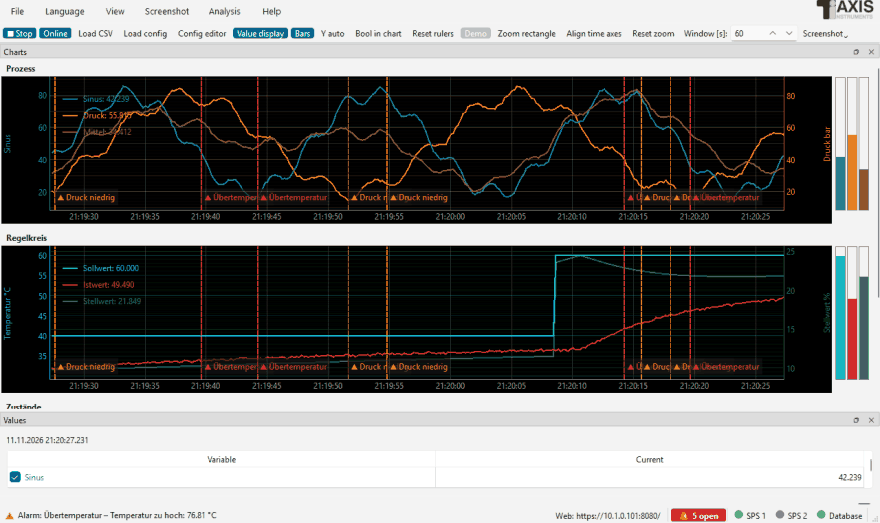
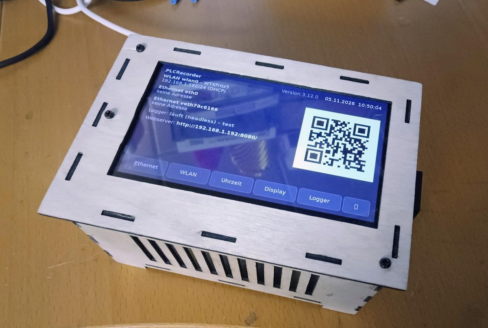

# PLC Logger

🇬🇧 [English](README.md) · 🇩🇪 Deutsch

**PLC Datenlogger** – liest zyklisch Werte aus Steuerungen vieler Hersteller, zeichnet sie als CSV und/oder in einer
Datenbank (SQLite, MariaDB, TimescaleDB, QuestDB, InfluxDB 3, VictoriaMetrics) auf und zeigt sie als y-t-Diagramme an: in der Oberfläche (PySide6, pyqtgraph), im Browser (Webserver) oder
ohne Oberfläche (Headless). Mit Trigger und Ereignisprotokoll (Marken an der Zeitachse), Aufzeichnung per Trigger
mit Vor- und Nachlauf, PID-Regler-Optimierung, XY-Diagramm und FFT, PDF-Berichten je Schicht/Tag/Woche/Monat,
Lesemodus für die Datenbank, Webserver mit HTTPS und Anmeldung, IO-Check für die Inbetriebnahme (Signalliste,
Matrix, Vertauschungen, Analog-Prüfpunkte), Sprachumschaltung (Deutsch/Englisch).



<p align="center">
  
  <br><sub>Headless auf einem Raspberry Pi 4 mit Touchscreen: Netzwerk, WLAN, Uhrzeit, Logger-Dienst und
  Webadresse auf einen Blick</sub>
</p>

Steuerungen verschiedener Hersteller lassen sich in **einer** Aufzeichnung mischen. Eingebaute Treiber:

| Treiber | Steuerungen / Protokoll | Getestet |
|---|---|---|
| `s7` | Siemens S7-300/400/1200/1500, PUT/GET (python-snap7) | ✅ echte SPS · 🧪 PLCSIM über NetToPLCsim · CI: snap7-Server |
| `tia` | Siemens S7-1200/1500 symbolisch, auch optimierte Bausteine (s7commplus) | ✅ echte S7-1516-3 PN/DP und S7-1511F-1 PN (optimierte DBs), FW 2.9 (Rückmeldungen) · 🧪 S7-PLCSIM Advanced (Windows) · CI: s7commplus-Emulator |
| `logo` | Siemens LOGO! 0BA7/0BA8 (python-snap7) | ⬜ ungetestet |
| `clx` | Allen-Bradley ControlLogix, CompactLogix, Micro800 (libplctag, pycomm3) | ✅ echte SPS (Windows, Linux, Raspberry Pi, macOS) |
| `pccc` | Allen-Bradley MicroLogix 1100/1400, SLC 500 (pycomm3) | ⬜ ungetestet |
| `modbus` | Modbus TCP | 🧪 CI: pymodbus-Server |
| `modbus_rtu` | Modbus RTU seriell, mehrere Geräte je Schnittstelle (pymodbus) | ⬜ ungetestet |
| `opcua` | OPC UA – Beckhoff, B&R, Codesys, Siemens, Omron, Kepware … (asyncua), zyklisch oder Subscription | 🧪 im Netz gegen den OPC-UA-Server des Loggers (Raspberry Pi → Kubuntu-VM; Lesen, Subscription, Wiederverbinden, Basic256Sha256 mit Anmeldung) · CI: asyncua-Server |
| `ads` | Beckhoff TwinCAT 2/3 über ADS, mit Symbolauswahl | ✅ TwinCAT 3.1.4026 auf demselben PC und entfernt über Route (Rückmeldungen) |
| `slmp` | Mitsubishi MELSEC iQ-R, iQ-F, Q, L (SLMP/MC-Protokoll) | ⬜ ungetestet |
| `fins` | Omron CJ, CS, CP, NJ/NX (FINS/TCP, FINS/UDP) | ⬜ ungetestet |
| `kvhostlink` | KEYENCE KV (Host Link) | ⬜ ungetestet |
| `toyopuc` | JTEKT TOYOPUC (Computer Link) | ⬜ ungetestet |
| `s5as511` | Siemens S5 über die PG-Schnittstelle (AS511) | ⬜ ungetestet |

✅ mit echter Steuerung getestet · 🧪 gegen Simulator bzw. Emulator getestet (automatisch bei jedem Push) ·
⬜ nach Protokolldokumentation umgesetzt, noch nicht an Hardware getestet – **Rückmeldungen sehr willkommen**
([Discussions](../../discussions)). Datenbanken: alle sieben automatisch gegen echte Server getestet (SQLite, MariaDB,
PostgreSQL/TimescaleDB, QuestDB, InfluxDB 3, VictoriaMetrics, Prometheus), dazu Grafana. Die Pakete für Windows, Linux
und macOS werden bei jedem Release automatisch gebaut und getestet; im Einsatz unter Windows, Linux (Ubuntu Studio) und auf einem
Raspberry Pi 4 (Ubuntu 24.04), die macOS-App mit einer ControlLogix auf einem Mac Neo getestet.

Weitere Treiber: eine Python-Datei im Ordner `treiber` des Datenordners genügt (Vorlage `src/plc_treiber/_vorlage.py`,
Kapitel „Treiber entwickeln“ der Anleitung).

## Ordner

| Ordner | Inhalt |
|---|---|
| `src/` | Programmdateien (`plc_*.py`) und das Treiberpaket `plc_treiber/` |
| `doc/` | Bedienungsanleitung (`bedienungsanleitung.rst`), englisches User Manual (`user_manual.rst`) und ihre Bilder (`images/`) |
| `sprachen/` | Sprachdateien |
| `tools/` | Hilfsprogramme (Version, Sprachdateien, PDF-Anleitung, Wiki, Bilder der Anleitung, Icon, INI-Umwandlung) |
| `tests/` | automatische Tests (pytest) |
| `docker/` | Testumgebung mit TimescaleDB, QuestDB, InfluxDB 3, VictoriaMetrics und Grafana |

Im Projektordner liegen außerdem Icon, Logo, `plctag.dll` und die Build-Skripte. Beim Start aus dem Quelltext
ist der Projektordner der Datenordner (Konfiguration, Aufzeichnungen, Logdatei).

Aufbau des Programms (Module, Datenfluss, Threads, Treiber-Schnittstelle): [`ARCHITEKTUR.md`](ARCHITEKTUR.md).

## Start

```console
pip install -r requirements.txt     # nur die Bibliotheken der benötigten Treiber sind nötig
python src/plc_config.py            # Konfiguration
python src/plc_logger.py            # Logger  (--demo: ohne Steuerung)
```

Ausführliche Anleitung: im [Wiki](../../wiki) (wird automatisch aus [`doc/bedienungsanleitung.rst`](doc/bedienungsanleitung.rst) erzeugt).
English: [User Manual](../../wiki/en-Home) ([`doc/user_manual.rst`](doc/user_manual.rst)).

## Bauen

* **Windows:** `build.bat` → `.exe`, Installer (Inno Setup 7 oder 6) und portables ZIP.
* **macOS:** `build_macos.sh` → App als `.dmg` für Apple Silicon bzw. Intel.
* **Linux:** `build_appimage.sh` → AppImage und Debian-Paket (`.deb`, auch für Raspberry Pi) für x86_64 bzw. arm64.
* **Anleitung als PDF:** `build.bat doc` bzw. `./build_appimage.sh doc` (nur die Anleitung, HTML und PDF deutsch/englisch),
  oder von Hand `pip install -r doc/requirements.txt`, dann `python tools/build_doc.py`
  → `dist/PLC_Datenlogger_Bedienungsanleitung_<Version>.pdf` (Sphinx mit rinohtype, kein LaTeX nötig).
* **GitHub Actions:** *Actions › Windows* bzw. *Actions › AppImages › Run workflow*, oder ein Tag `v*`
  (dann zusätzlich als GitHub-Release).

## Versionen

Aktuelle Version und Änderungen: [`CHANGELOG.md`](CHANGELOG.md). Die Nummer (`HAUPT.NEBEN.FEHLER`) steht nur in
`APP_VERSION` in `src/plc_common.py`. Neue Version: `python tools/bump_version.py neben --tag`, dann
`git push && git push origin v<Version>` – der Tag startet die Workflows, die Installer, ZIP, AppImages, .deb-Pakete und macOS-.dmg als
GitHub-Release veröffentlichen.

Die früheren Einzelprogramme (S7, TIA und CLX Datenlogger) liegen im Branch
[`einzelanwendungen`](../../tree/einzelanwendungen).

## Lizenz

Copyright (C) 2026 Michael Taxis. Der PLC Datenlogger steht unter der
[GNU Lesser General Public License v3.0 oder später](LICENSE) (`LGPL-3.0-or-later`; die LGPL v3 baut auf der
[GPL v3](COPYING) auf). Die Lizenzen der mitgelieferten Komponenten (u. a. Qt/PySide6, asyncua und psycopg unter
LGPL-3.0, libplctag unter MPL-2.0/LGPL-2.0, die übrigen unter MIT/BSD/Apache) stehen in
[`THIRD_PARTY_LICENSES.md`](THIRD_PARTY_LICENSES.md).
