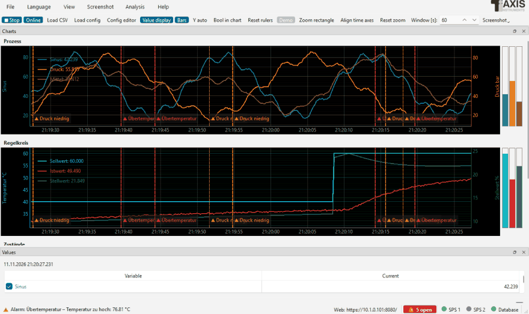
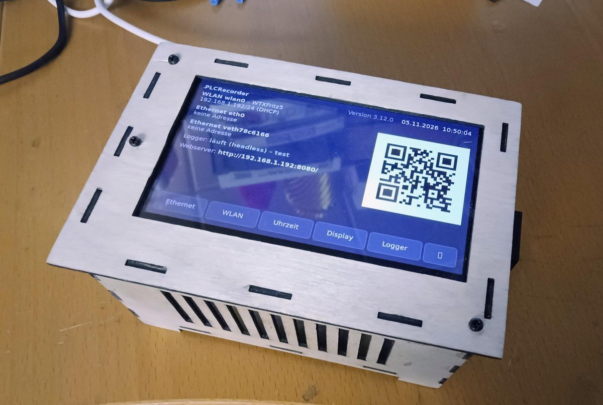
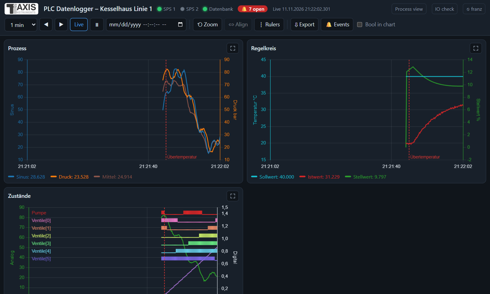
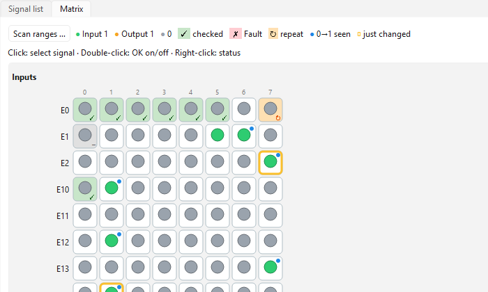
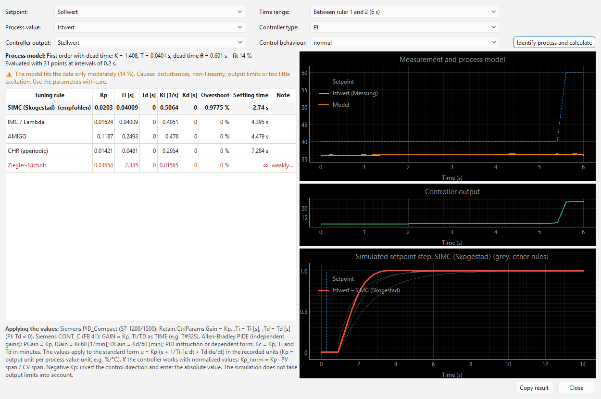
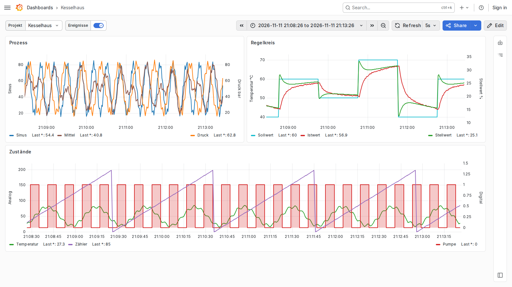

# PLC Logger

🇬🇧 English · 🇩🇪 [Deutsch](README.de.md)

[](https://github.com/franzhefekranz/PLC_Logger/releases/latest)
[](https://github.com/franzhefekranz/PLC_Logger/releases)
[](https://github.com/franzhefekranz/PLC_Logger/actions/workflows/tests.yml)
[](LICENSE)

**Free data logger for PLCs of many manufacturers – Siemens S7 / TIA, Allen-Bradley, Beckhoff, Modbus, OPC UA,
Mitsubishi, Omron and more.** Reads variables cyclically, records them to CSV and/or a database and shows them as live
trend charts – on the desktop, in the browser, or headless on a Raspberry Pi. Controllers of different manufacturers
can be mixed in **one** recording.



## Highlights

* **14 built-in drivers**, more as a single Python file (see below).
* **Recording** to CSV (millisecond timestamps, size limit with ZIP archive) and/or **SQLite, MariaDB/MySQL, PostgreSQL/TimescaleDB, QuestDB,
  InfluxDB 3, VictoriaMetrics, Prometheus** – with a ready-made **Grafana** dashboard export.
* **Live trends** with zoom, rulers, value table, bar graphs, Bool signals, several pages and charts.
* **Triggers and event log**: alarms/warnings with acknowledgement, notes, marks on the time axis,
  **notifications** by e-mail, Teams, Slack, webhook, ntfy push or Telegram.
* **Recording by trigger** with pre- and post-trigger (like an oscilloscope).
* **Analysis**: XY chart, FFT, **PID controller tuning** from recorded step responses, formulas (computed variables).
* **PDF reports** per shift, day, week or month.
* **Web server** (HTTPS, users with read/write rights): full analysis in the browser on PC, tablet and phone,
  process view, CSV/Excel export.
* **Client mode**: a second logger (or the browser) shows the recording of a headless logger – no own configuration.
* **OPC UA server**: provides the recorded values to SCADA/HMI systems.
* **IO check for commissioning**: signal list, matrix, swapped wires, analog test points, protocol – also on the phone.
* **Raspberry Pi**: headless service, touchscreen panel for network, Wi-Fi, time (from the PLC), display dimming.
* **Demo mode** without a PLC, English and German user interface.

<p align="center">
  
  <br><sub>Headless on a Raspberry Pi 4 with a 4.3" touchscreen: network, Wi-Fi, time, logger service and web address
  at a glance</sub>
</p>
<p align="center">
  
  
</p>
<p align="center">
  
  
</p>

## Supported controllers

| Driver | Controllers / protocol | Tested |
|---|---|---|
| `s7` | Siemens S7-300/400/1200/1500, PUT/GET (python-snap7) | ✅ real PLC · CI: snap7 server |
| `tia` | Siemens S7-1200/1500 **symbolic**, also optimized blocks, without PUT/GET (s7commplus) | 🧪 S7-PLCSIM Advanced · CI: s7commplus emulator |
| `logo` | Siemens LOGO! 0BA7/0BA8 (python-snap7) | ⬜ untested |
| `s5as511` | Siemens S5 via the PG interface (AS511) | ⬜ untested |
| `clx` | Allen-Bradley ControlLogix, CompactLogix, Micro800 (libplctag, pycomm3) | ✅ real PLC |
| `pccc` | Allen-Bradley MicroLogix 1100/1400, SLC 500 (pycomm3) | ⬜ untested |
| `ads` | Beckhoff TwinCAT 2/3 via ADS, with symbol browser | ⬜ untested |
| `opcua` | OPC UA – Beckhoff, B&R, Codesys, Siemens, Omron, Kepware … (asyncua), cyclic or subscription | 🧪 CI: asyncua server |
| `modbus` | Modbus TCP | 🧪 CI: pymodbus server |
| `modbus_rtu` | Modbus RTU serial, several devices per port (pymodbus) | ⬜ untested |
| `slmp` | Mitsubishi MELSEC iQ-R, iQ-F, Q, L (SLMP/MC protocol) | ⬜ untested |
| `fins` | Omron CJ, CS, CP, NJ/NX (FINS/TCP, FINS/UDP) | ⬜ untested |
| `kvhostlink` | KEYENCE KV (Host Link) | ⬜ untested |
| `toyopuc` | JTEKT TOYOPUC (Computer Link) | ⬜ untested |

✅ tested with a real controller · 🧪 tested against a simulator or emulator (automatically on every push) ·
⬜ implemented from the protocol documentation, not yet tested with hardware – **feedback very welcome**
([Discussions](../../discussions)). Databases: all seven tested automatically against real servers (SQLite, MariaDB,
PostgreSQL/TimescaleDB, QuestDB, InfluxDB 3, VictoriaMetrics, Prometheus) plus Grafana. Packages for Windows, Linux
and macOS are built and tested automatically on every release; in use on a Raspberry Pi 4 (Ubuntu 24.04).

Your controller is missing? A driver is a single Python file in the `treiber` folder of the data folder (template
`src/plc_treiber/_vorlage.py`, chapter *Developing drivers* of the manual). Pull requests welcome.

## Try it in 2 minutes

1. Download the installer or package for your system from the
   **[latest release](https://github.com/franzhefekranz/PLC_Logger/releases/latest)**:
   Windows (installer or portable ZIP), Linux (AppImage, `.deb` for x86_64 and arm64/Raspberry Pi), macOS (`.dmg`).
2. Start *PLC Datenlogger* and click **Demo** in the start window – simulated values, no PLC needed.
3. Then create your own configuration with **New configuration …**: add a controller, pick variables (symbol
   browser for TIA, ADS and OPC UA, network scan), start.

From source:

```console
pip install -r requirements.txt     # only the libraries of the drivers you need are required
python src/plc_logger.py --demo     # logger with simulated values
python src/plc_config.py            # configuration program
```

## Documentation

* **[User manual (web)](https://franzhefekranz.github.io/PLC_Logger/en/)** ·
  [Bedienungsanleitung (Web)](https://franzhefekranz.github.io/PLC_Logger/de/) – also as PDF in every release and
  via F1 in the program.
* [Wiki](../../wiki/en-Home) · [Architecture](ARCHITEKTUR.md) (German) · [Changelog](CHANGELOG.md) (German)
* Questions, ideas, show your setup: **[Discussions](../../discussions)** · Bugs: [Issues](../../issues)

## Building

* **Windows:** `build.bat` → `.exe`, installer (Inno Setup) and portable ZIP.
* **macOS:** `build_macos.sh` → app as `.dmg` for Apple Silicon or Intel.
* **Linux:** `build_appimage.sh` → AppImage and Debian package (also for Raspberry Pi) for x86_64 or arm64.
* **GitHub Actions:** a tag `v*` builds all packages and publishes them as a GitHub release.

The project language (code comments, commits) is German; the user interface and the manual are available in English
and German.

## License

Copyright (C) 2026 Michael Taxis. PLC Logger is licensed under the
[GNU Lesser General Public License v3.0 or later](LICENSE) (`LGPL-3.0-or-later`, building on the [GPL v3](COPYING)).
Licenses of the bundled components: [`THIRD_PARTY_LICENSES.md`](THIRD_PARTY_LICENSES.md).
