======================================================================
PLC Datenlogger – Bedienungsanleitung
======================================================================

.. contents:: Inhalt
   :depth: 2
   :local:

Überblick
======================================================================

Der PLC Datenlogger liest zyklisch Variablen aus einer oder **mehreren**
Steuerungen **unterschiedlicher Hersteller gleichzeitig**, speichert alle Messwerte
in einer gemeinsamen CSV-Datei (und/oder Datenbank) und zeigt sie als
y-t-Diagramm an – in der Oberfläche, im Browser (Webserver) oder gar nicht
(Headless-Betrieb, nur Aufzeichnung).

Er ersetzt die früheren Einzelprogramme *S7 Datenlogger*, *TIA Datenlogger* und
*CLX Datenlogger*. Die Kommunikation mit den Steuerungen
übernehmen **Treiber**; jede Steuerung der Konfiguration bekommt ihren eigenen
Treiber. Eingebaut sind:

.. list-table::
   :header-rows: 1
   :widths: 12 38 50

   * - Treiber
     - Steuerungen / Protokoll
     - Bibliothek, Adressierung
   * - ``s7``
     - Siemens S7-300/400/1200/1500 über S7-Kommunikation (PUT/GET)
     - python-snap7; absolute Adressen wie ``DB10.DBD4``, ``M5.0``, ``EW64``
   * - ``tia``
     - Siemens S7-1200/1500 symbolisch über S7CommPlus (wie TIA Portal/HMI),
       auch optimierte Bausteine, ohne PUT/GET
     - s7commplus; symbolische Namen wie ``Anlage_DB.Motor[2].Drehzahl``
   * - ``clx``
     - Allen-Bradley ControlLogix, CompactLogix, Micro800 über EtherNet/IP (CIP)
     - libplctag (+ pycomm3 für die Tag-Liste); Tag-Namen wie ``Program:Main.Druck``
   * - ``modbus``
     - Modbus TCP (Wago, Schneider, Beckhoff, Phoenix Contact, Umrichter,
       Energiezähler, Gateways …)
     - keine Zusatzbibliothek; ``40001``, ``30001``, ``00001``, ``10001`` bzw.
       ``HR0``, ``IR0``, ``C0``, ``DI0``
   * - ``modbus_rtu``
     - Modbus RTU über RS-485/RS-232 (mehrere Geräte an einer Schnittstelle)
     - pymodbus, pyserial; Adressen wie ``modbus``
   * - ``opcua``
     - OPC UA: Beckhoff, B&R, Codesys, Siemens, Omron, Rockwell (Gateway),
       Kepware … – Steuerungen vieler Hersteller
     - asyncua; NodeId wie ``ns=4;s=MAIN.fTemperatur``; Auswahl aus dem Server
   * - ``slmp``
     - Mitsubishi MELSEC iQ-R, iQ-F, Q, L (SLMP/MC-Protokoll, Ethernet)
     - keine Zusatzbibliothek; ``D100``, ``M10``, ``X1F``, ``ZR1000``
   * - ``kvhostlink``
     - KEYENCE KV-8000/7000/5000/3000/Nano, KV-X (Host Link, Ethernet)
     - keine Zusatzbibliothek; ``DM100``, ``R1000``, ``EM0``, ``T10``
   * - ``toyopuc``
     - JTEKT TOYOPUC PC10G/PC10, PC3J, Nano 10GX (Computer Link, Ethernet)
     - keine Zusatzbibliothek; ``D0100``, ``M0010``, ``P1-D0100`` (hex)
   * - ``s5as511``
     - Siemens S5 über die PG-Schnittstelle (AS511, seriell, 20-mA-Adapter)
     - pyserial; ``DB10.DW4``, ``EW0``, ``MW10``, ``T5``
   * - ``logo``
     - Siemens LOGO! 0BA7 und 0BA8 (LOGO! 8, 8.FS4, 8.3, 8.4)
     - python-snap7; ``VW10``, ``V2.3``, ``I1``, ``Q2``, ``M5``, ``AI1``, ``AM3``
   * - ``pccc``
     - Allen-Bradley MicroLogix 1100/1400, SLC 5/05 (EtherNet/IP, PCCC)
     - pycomm3; ``N7:0``, ``F8:2``, ``B3:0/5``, ``T4:0.ACC``
   * - ``ads``
     - Beckhoff TwinCAT 2/3 über ADS (AMS/TCP)
     - keine Zusatzbibliothek; ``MAIN.fTemperatur``, ``GVL.aWerte[3]``, ``%MW10``;
       Auswahl aus der Symboltabelle
   * - ``fins``
     - Omron CJ, CS, CP, NJ/NX über FINS/TCP oder FINS/UDP
     - keine Zusatzbibliothek; ``D100``, ``W10``, ``CIO0.05``, ``E0_100``

Weitere Treiber lassen sich **ohne Änderung des Programms** ergänzen: Eine
Python-Datei im Ordner ``treiber`` des Datenordners genügt (siehe
`Treiber entwickeln <treiber-entwickeln_>`__).

Das Programm besteht aus mehreren Dateien. Die Programmdateien (``plc_*.py`` und
das Paket ``plc_treiber/``) liegen im Ordner ``src``, die Anleitung mit ihren Bildern
im Ordner ``doc``; Sprachdateien, Icon, Logo, ``plctag.dll`` und die Build-Dateien
liegen im Projektordner darüber. Beim Start aus dem Quelltext ist der Projektordner
auch der Datenordner (Konfiguration, Aufzeichnungen, Logdatei).

.. list-table::
   :header-rows: 1
   :widths: 25 75

   * - Datei
     - Aufgabe
   * - ``plc_config.py``
     - Konfigurationsprogramm: Projekt, Steuerungen und Treiber, Diagramme,
       Y-Achsen und Variablen festlegen. Speichert in eine JSON-Datei mit beliebigem
       Namen (Standard ``plc_config.json``).
   * - ``plc_logger.py``
     - Startprogramm des Loggers: wählt anhand der Konfiguration bzw. der
       Parameter die Betriebsart (Oberfläche oder Headless).
   * - ``plc_gui.py``
     - Oberfläche des Loggers: Diagramme, Online-/Offline-Modus, Lineale,
       Status-LEDs. Wird von ``plc_logger.py`` geladen.
   * - ``plc_headless.py``
     - Betrieb ohne Oberfläche (nur Aufzeichnung, benötigt kein Qt).
   * - ``plc_recorder.py``
     - Aufzeichnungskern ohne Oberfläche: je Steuerung ein Lese-Thread (mit dem
       Leser ihres Treibers), ein Sammler-Thread für Zusammenführung, Formeln,
       Datenpuffer, CSV und Archiv.
   * - ``plc_treiber/``
     - Die Treiber: ``base.py`` (Schnittstelle), ``__init__.py`` (Verzeichnis,
       lädt eingebaute und eigene Treiber), ``ui.py`` (Einstellungsdialog der
       Verbindung), ``s7.py``/``s7_symbols.py``/``s7_browser.py``,
       ``tia.py``/``tia_io.py``/``tia_taglist.py``/``tia_browser.py``,
       ``clx.py``/``plc_io.py``/``plc_taglist.py``/``plc_browser.py``,
       ``modbus.py``, ``modbus_rtu.py``, ``opcua.py``/``opcua_browser.py``,
       ``slmp.py``, ``kvhostlink.py``, ``toyopuc.py``, ``fins.py`` (gemeinsame Grundlage
       ``word_common.py``), ``s5as511.py``, ``logo.py``, ``pccc.py``,
       ``ads.py``/``ads_browser.py``, ``ringbuffer.py`` (Ringpuffer für die zyklussynchrone Aufzeichnung) und
       ``_vorlage.py`` (Vorlage für eigene Treiber).
   * - ``plc_web.py``, ``plc_webauth.py``, ``plc_web_dialog.py``
     - Webserver (Flask) mit Chart.js-Seite zum Ansehen der Diagramme im Browser; HTTPS,
       Benutzer und Passwörter, Benutzerverwaltung im Konfigurationsprogramm.
   * - ``plc_report.py``
     - PDF-Berichte (Kennwerte, Verlauf, Ereignisse) je Schicht/Tag/Woche/Monat oder von Hand.
   * - ``plc_analysis.py``, ``plc_analysis_dialog.py``
     - XY-Diagramm und Frequenzanalyse (FFT) im Logger.
   * - ``plc_csvjoin.py``
     - Aufzeichnungen (CSV/ZIP) lesen und aneinanderhängen.
   * - ``plc_svg.py``
     - SVG-Export eines Diagramms (unabhängig von Qt).
   * - ``plc_util.py``
     - Kleine Hilfsfunktionen (Formatierung, Achsenteilung, Datenreduktion).
   * - ``plc_db.py``
     - Aufzeichnung in SQLite, MariaDB, TimescaleDB/PostgreSQL, QuestDB, InfluxDB 3,
       VictoriaMetrics oder Prometheus (eigener Schreib-Thread).
   * - ``plc_db_dialog.py``
     - Lesemodus: Zeitraum aus der Datenbank wählen und im Logger anzeigen.
   * - ``plc_cleanup.py``
     - Aufräumen alter Aufzeichnungen (CSV/Archiv) nach Zeitraum oder Speicherplatz.
   * - ``plc_netscan.py``, ``plc_netscan_dialog.py``
     - Netzwerk nach erreichbaren Steuerungen durchsuchen (Konfigurationsprogramm).
   * - ``plc_iocheck_start.py``
     - Startprogramm des IO-Checks als eigenes Programm (``PLCIOCheck.exe``).
   * - ``plc_events.py``
     - Trigger und Ereignisprotokoll (Auswertung, Datei, Quittierung).
   * - ``plc_event_viewer.py``
     - Ereignis-Viewer (Anzeigen und Quittieren); auch allein startbar.
   * - ``plc_trigger_dialog.py``
     - Trigger-Editor des Konfigurationsprogramms.
   * - ``plc_pid.py``
     - PID-Regler-Optimierung: Streckenmodell, Einstellregeln, Simulation (ohne Oberfläche).
   * - ``plc_pid_dialog.py``
     - Fenster der PID-Optimierung (Logger) und Einstellungen dazu (Konfigurationsprogramm).
   * - ``plc_i18n.py``, ``sprachen/``
     - Sprachumschaltung und Sprachdateien (``de.txt`` = Vorlage, ``en.txt`` = Englisch).
   * - ``plc_splash.py``
     - Startbild (Auswahl der Konfiguration, Lade-Anzeige).
   * - ``build_appimage.sh``, ``build_macos.sh``, ``tools/extract_tr.py``
     - Linux-AppImage und .deb-Paket bzw. macOS-App bauen; Sprachdateien nach Programmänderungen aktualisieren.
   * - ``plc_common.py``
     - Datenmodell und Konfigurationsdatei (JSON) (inkl. Übernahme der Konfigurationen der
       Einzelprogramme). Wird nicht direkt gestartet.
   * - ``build.bat``, ``installer.iss``, ``tools/make_icon.py``, ``requirements.txt``
     - Erzeugung der Windows-Installationsdatei (siehe `Installationsdatei erstellen (Windows) <installer_>`__).
   * - ``app.ico``, ``logo.png``
     - Programm-Icon (Vorgabe, wenn in der Konfiguration nichts eingetragen ist; fließt auch in
       die ``.exe``-Dateien und den Installer ein) und Herstellerlogo (Startbild, „Über …“).
   * - ``doc/``
     - Bedienungsanleitung (diese Datei) und ihre Bilder (``doc/images/``).
   * - ``plctag.dll``
     - libplctag für Windows (64 Bit), vom Treiber ``clx`` benötigt.
   * - ``plc_block_dialog.py``
     - Editor für Blöcke (Blocklesemodus), vom Konfigurationsprogramm geöffnet.
   * - ``plc_formula.py``
     - Auswertung der Formeln berechneter Variablen. Wird nicht direkt gestartet.
   * - ``plc_formula_dialog.py``
     - Editor für berechnete Variablen (vom Konfigurationsprogramm geöffnet).
   * - ``plc_branding.py``
     - Programm-Icon und Logo. Wird nicht direkt gestartet.

Funktionsumfang:

* **Steuerungen verschiedener Hersteller in einer Aufzeichnung**, z. B. eine
  S7-1500 (symbolisch), eine S7-300 (PUT/GET), eine ControlLogix und einen
  Modbus-Energiezähler – mit gemeinsamer Zeitachse, gemeinsamen Diagrammen und
  Formeln über Steuerungsgrenzen hinweg
* **Erweiterbar** um eigene Treiber (Python-Datei in einen Ordner legen, fertig)
* Je Steuerung ein eigener Lese-Thread mit eigenem Abtastintervall; eine
  langsame oder ausgefallene Steuerung bremst die anderen nicht
* **Status-LEDs** für jede Verbindung (grau, gelb, grün, rot)
* Variablenauswahl direkt aus der Steuerung (TIA: Variablenliste der CPU, CLX:
  Tag-Liste) bzw. aus exportierten DB-Quellen (S7)
* Blocklesemodus: viele Werte mit einer Anfrage lesen (Array-Ausschnitte,
  zusammenhängende Adressbereiche)
* Konfigurationen der Einzelprogramme (S7, TIA, CLX) werden übernommen; ältere
  INI-Dateien einmalig umgewandelt
* Projektname und Konfigurationsdateien mit beliebigem Namen (Öffnen-Dialog)
* **Webserver** zum Ansehen der Diagramme im Browser (Tablet, Smartphone)
* **Headless-Betrieb** (ohne Diagramme, nur Aufzeichnung)
* CSV-Protokoll mit Zeitstempel in Millisekunden, Begrenzung der Dateigröße mit
  automatischer ZIP-Archivierung (Name/Jahr/Monat/Tag), Datenbank-Aufzeichnung mit
  Lesemodus (Zeitraum aus der Datenbank wählen und anzeigen)
* Berechnete Variablen aus Formeln (z. B. Mittelwert, Differenz, Integral)
* Trigger und Ereignisprotokoll mit Quittierung und eigenen Notizen; Trigger-Marken an der
  Zeitachse der Diagramme
* **Aufzeichnung per Trigger** mit Ringspeicher: Vor- und Nachlauf einstellbar, jede Aufnahme
  in einer eigenen CSV-Datei
* PID-Regler-Optimierung aus aufgezeichneten Sprungantworten
* **XY-Diagramm** und **Frequenzanalyse (FFT)**
* **PDF-Berichte** je Schicht, Tag, Woche oder Monat (automatisch) bzw. für einen Zeitbereich
* CSV-Dateien aneinanderhängen und als neue Datei speichern
* Webserver wahlweise mit **HTTPS und Anmeldung**
* Mehrere Diagramme, je Diagramm mehrere Y-Achsen; Seiten/Tabs, Raster-Anordnung
* Legende mit Livewerten, Online-/Offline-Modus mit Linealen, Balken für Aktualwerte
* Screenshots einzelner Diagramme als PNG oder SVG
* Sprachumschaltung (Deutsch, Englisch, eigene Sprachdateien)
* Demo-Modus mit simulierten Werten (ohne SPS)

Installation und Start
======================================================================

Voraussetzungen
----------------------------------------------------------------------

* Python 3.9 oder neuer (64 Bit)
* Bibliotheken installieren (alle auf einmal):

  .. code-block:: console

     pip install -r requirements.txt

  bzw. einzeln:

  .. code-block:: console

     pip install PySide6-Essentials pyqtgraph numpy Flask    # Oberfläche, Webserver
     pip install python-snap7                                # Treiber s7 und logo
     pip install s7commplus                                  # Treiber tia
     pip install pycomm3                                     # Treiber clx (Tag-Liste), Treiber pccc
     pip install pymodbus pyserial                           # Treiber modbus_rtu
     pip install asyncua                                     # Treiber opcua
     pip install pyserial                                    # Treiber s5as511
     pip install cryptography                                # Webserver mit HTTPS

  Benötigt werden nur die Bibliotheken der Treiber, die Sie tatsächlich
  verwenden. Fehlt eine, wird der Treiber trotzdem angezeigt; der
  Einstellungsdialog der Steuerung und **Treiber › Installierte Treiber …**
  zeigen dann „✗ Bibliothek fehlt“. Die Treiber ``modbus``, ``slmp``,
  ``kvhostlink``, ``toyopuc``, ``fins`` und ``ads`` brauchen keine Bibliothek. Der Headless-Betrieb braucht kein PySide6 und kein pyqtgraph.
* **libplctag** (nur Treiber ``clx``) ist kein pip-Paket. Benötigt wird
  ``plctag.dll`` (Windows, 64 Bit); sie liegt dem Programm bei. Sonst aus
  https://github.com/libplctag/libplctag/releases das Paket
  ``libplctag_<Version>_windows_x64.zip`` laden und ``plctag.dll`` **neben die
  Programmdateien** legen, oder ihren Pfad in der Umgebungsvariablen
  ``CLX_PLCTAG_LIB`` angeben. Unter Linux wird ``libplctag.so`` verwendet.
  libplctag steht unter MPL 2.0 bzw. LGPL 2; bei Weitergabe die Lizenzhinweise
  beachten.

Programme starten
----------------------------------------------------------------------

.. code-block:: console

   python src/plc_config.py [datei.json]     # Konfiguration
   python src/plc_logger.py [datei.json]     # Logger (Oberfläche oder Headless)

Ohne Dateiangabe wird die **zuletzt benutzte** Konfigurationsdatei geöffnet
(Standard: ``plc_config.json``). Der Name der Datei ist beliebig. Weitere Parameter
des Loggers:

.. list-table::
   :header-rows: 1
   :widths: 30 70

   * - Parameter
     - Wirkung
   * - ``datei.json`` oder ``--config datei.json``
     - Konfigurationsdatei, die verwendet wird (und beim nächsten Start ohne
       Angabe wieder geöffnet wird).
   * - ``--headless``
     - Ohne Oberfläche starten, nur aufzeichnen (überstimmt die Konfiguration).
   * - ``--gui``
     - Oberfläche öffnen, auch wenn die Konfiguration *Headless* verlangt.
   * - ``--demo``
     - Simulierte Werte statt SPS-Verbindung (siehe `Demo-Modus <demo-modus_>`__).
   * - ``--iocheck``
     - Nur den `IO-Check <io-check_>`__ öffnen (Inbetriebnahme: Signalliste prüfen).

Der Logger kann das Konfigurationsprogramm auch selbst öffnen
(**Konfig-Editor** in der Werkzeugleiste), und das Konfigurationsprogramm kann den
Logger bzw. den IO-Check starten (**Datei › Logger mit dieser Konfiguration starten**,
**Datei › IO-Check mit dieser Konfiguration starten**). Der IO-Check hat außerdem ein
eigenes Startprogramm: ``python src/plc_iocheck_start.py`` (installiert:
``PLCIOCheck.exe``).

Vorbereitung der Steuerungen
----------------------------------------------------------------------

Der Logger liest nur; er schreibt nichts in die Steuerungen. Was in den
Steuerungen einzurichten ist, hängt vom Treiber ab und steht im Kapitel
`Steuerungen und Treiber <treiber_>`__ beim jeweiligen Treiber. Kurz:

* ``s7``: Bei S7-1200/1500 *PUT/GET-Kommunikation vom Partner erlauben* und nur
  **nicht optimierte** Datenbausteine lesen. TCP-Port 102.
* ``tia``: Nichts einzurichten; ggf. Passwort der Zugriffsstufe und TLS. TCP-Port 102.
* ``clx``: *External Access* der Tags *Read/Write* oder *Read Only*. TCP-Port 44818.
* ``modbus``: Modbus TCP im Gerät eingeschaltet, Register laut Gerätehandbuch.
  TCP-Port 502.
* ``modbus_rtu``: Geräteadresse, Baudrate und Parität laut Gerät; Bus
  abgeschlossen (120 Ω an beiden Enden).
* ``opcua``: OPC-UA-Server der Steuerung eingeschaltet, Variablen freigegeben;
  mit Sicherheit das Client-Zertifikat im Server als vertrauenswürdig freigeben.
  Meist TCP-Port 4840.
* ``ads``: Route auf diesen PC in TwinCAT eintragen. TCP-Port 48898.
* ``slmp``: In GX Works eine SLMP-/MC-Protokoll-Verbindung (binär) mit Port anlegen.
* ``fins``: FINS an der Ethernet-Einheit eingeschaltet. Port 9600.
* ``logo``: Server-Verbindung (S7) bzw. HMI-Zugriff in LOGO!Soft. TCP-Port 102.
* ``pccc``: Nichts einzurichten. TCP-Port 44818.
* ``kvhostlink``: Nichts einzurichten. TCP-Port 8501.
* ``toyopuc``: In PCwin einen Computer-Link-Port einrichten.
* ``s5as511``: PG-Adapter (20 mA) an der PG-Schnittstelle; STEP 5 währenddessen
  nicht verbinden.

Die Firewall des PCs muss die Verbindungen auf den genannten Ports zulassen.

.. _startbild:

Startbild
----------------------------------------------------------------------

Beim Start von Logger und Konfigurationsprogramm erscheint das **Startbild**:

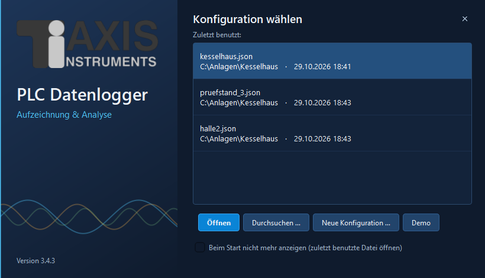

   Startbild des Konfigurationsprogramms: Konfiguration wählen oder neu anlegen.

* **Zuletzt benutzt**: die zuletzt geöffneten Konfigurationen mit Ordner und Änderungsdatum.
  Doppelklick oder **Öffnen** (Eingabetaste) startet mit der markierten Datei.
* **Durchsuchen …**: beliebige Konfigurationsdatei wählen.
* **Neue Konfiguration …**: im Logger wird nach einem Dateinamen gefragt, eine leere
  Konfiguration angelegt und zusätzlich das Konfigurationsprogramm geöffnet; im
  Konfigurationsprogramm beginnt eine neue, noch ungespeicherte Konfiguration.
* **Demo** (nur Logger): mit simulierten Werten starten.
* **Beim Start nicht mehr anzeigen**: künftig sofort mit der zuletzt benutzten Datei
  starten. Wieder einschalten: im Logger **Datei → Startbild beim Programmstart zeigen**.

Nach der Auswahl zeigt das Startbild den Ladefortschritt, bis das Hauptfenster bereit ist.
Wird beim Aufruf eine Konfigurationsdatei angegeben (z. B. ``PLCLogger.exe anlage.json``),
entfällt die Auswahl. Das Fenster lässt sich mit der Maus verschieben; **Esc** oder ✕ beendet.

Schnellstart
======================================================================

#. ``plc_config.py`` starten.
#. Im Reiter *Projekt & Steuerungen* einen Projektnamen vergeben und die
   Steuerung(en) eintragen: **Name**, **Treiber** wählen, mit **…** die
   Verbindung einstellen (IP-Adresse und die Parameter des Treibers), Intervall.
#. Mit dem Auswahlknopf des Treibers (z. B. **Aus Variablenliste wählen…**,
   **Aus Tag-Liste wählen…**, **Aus DB-Quelle wählen…**) Variablen aus der
   Steuerung übernehmen, oder mit **Variable hinzufügen** die Adresse von Hand
   eintragen.
#. Mit **Verbindung testen** prüfen, ob die Werte korrekt gelesen werden.
#. **Speichern** (bzw. **Speichern unter…** mit eigenem Dateinamen) und das
   Konfigurationsprogramm schließen.
#. ``plc_logger.py`` starten und **▶ Start** drücken.

.. tip::

   Eine vorhandene Konfiguration des S7-, TIA- oder CLX-Datenloggers öffnen Sie
   einfach mit **Datei › Öffnen…** (siehe `Übernahme von Konfigurationen der Einzelprogramme <uebernahme_>`__). Ohne SPS können Sie
   das Programm mit dem **Demo**-Modus ausprobieren (siehe `Demo-Modus <demo-modus_>`__).

Konfigurationsprogramm (``plc_config.py``)
======================================================================

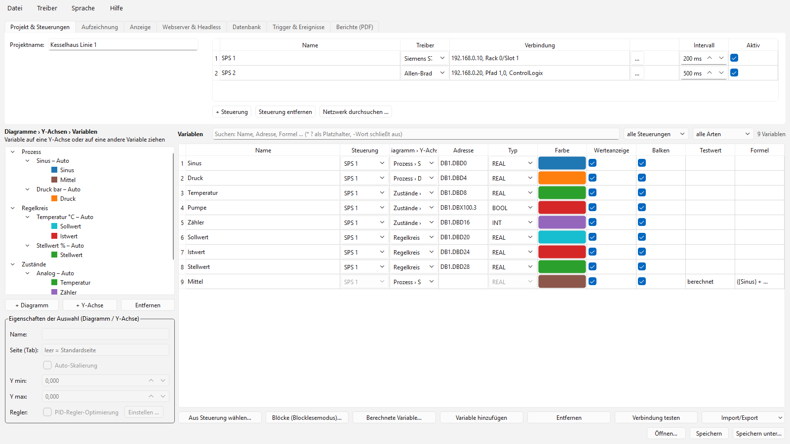

   Das Konfigurationsprogramm: Reiter oben, Zuordnungsbaum links, Variablentabelle rechts.

Projekt, Steuerungen und Einstellungen
----------------------------------------------------------------------

Der obere Fensterbereich ist in mehrere Reiter gegliedert.

**Reiter „Projekt & Steuerungen“**

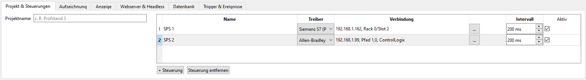

   Reiter „Projekt & Steuerungen“.

.. list-table::
   :header-rows: 1
   :widths: 30 70

   * - Feld
     - Bedeutung
   * - Projektname
     - Frei wählbarer Name des Projekts. Er erscheint in den Fenstertiteln, im
       Webserver und im Log.
   * - Steuerungen (Tabelle)
     - Eine Zeile je Steuerung mit den Spalten:

       * **Name** – eindeutig, auch für die Status-LED.
       * **Treiber** – Auswahl aus allen geladenen Treibern (``s7``, ``tia``,
         ``logo``, ``clx``, ``pccc``, ``modbus``, ``opcua``, ``ads``, ``fins`` … und eigene). Beim Wechsel des Treibers werden die
         Verbindungsparameter auf dessen Standardwerte gesetzt; die IP-Adresse
         bleibt erhalten. Die Typlisten der Variablen dieser Steuerung
         passen sich an.
       * **Verbindung** – Kurzbeschreibung der Verbindung, z. B.
         ``192.168.0.1, Rack 0/Slot 1`` oder ``192.168.0.10:502, Unit 1``.
       * **…** – öffnet den **Einstellungsdialog** der Verbindung (siehe unten).
         Doppelklick auf *Verbindung* hat dieselbe Wirkung.
       * **Intervall** – Zeit zwischen zwei Messungen dieser Steuerung, 10 bis
         60000 ms.
       * **Aktiv** – abgeschaltete Steuerungen werden nicht gelesen.

       Mit **+ Steuerung** und **Steuerung entfernen** ändern Sie die Liste; beim
       Entfernen wandern deren Variablen und Blöcke zur ersten Steuerung.

       **Netzwerk durchsuchen …** findet erreichbare Steuerungen: Im *Bereich*
       (Vorschlag: das eigene Netz, z. B. ``192.168.0.0/24``; auch ``192.168.0.10-50``
       oder einzelne Adressen, durch Komma getrennt) fragt die Suche per Rundruf nach
       EtherNet/IP-Geräten und versucht Verbindungen auf die Ports von S7 (102), Modbus
       (502), EtherNet/IP (44818), OPC UA (4840), ADS (48898), FINS (9600), SLMP (5007)
       und Keyence (8501). Mit *Gerätekennung lesen* zeigt sie bei S7-CPUs Baugruppe,
       Bestellnummer, Station und Steckplatz, bei EtherNet/IP-Geräten Produktname,
       Hersteller und Seriennummer. Jeder Treffer bekommt einen Treibervorschlag
       (S7-1200/1500: ``tia``, übrige S7: ``s7`` mit dem gefundenen Steckplatz, Logix:
       ``clx``, OPC UA mit Endpunkt, ADS mit AMS-Net-ID *IP*.1.1 …); angehakte Treffer
       übernimmt **Als Steuerung übernehmen** mit ihrer Adresse. Schon konfigurierte
       Adressen sind gekennzeichnet und nicht vorgewählt. Geräte hinter Routern werden
       nur gefunden, wenn ihr Bereich angegeben ist; eine Firewall kann Ports sperren.

       .. figure:: images/netzwerksuche.png
          :alt: Netzwerk durchsuchen
          :width: 95%
          :align: center

          Netzwerk durchsuchen: gefundene Steuerungen mit Kennung und Treibervorschlag; die schon
          konfigurierte Adresse ist nicht vorgewählt.

**Einstellungsdialog der Verbindung.** Der Dialog wird aus den Parametern des
Treibers aufgebaut (Textfelder, Zahlen, Auswahllisten, Passwortfelder).
Selten benötigte Parameter stehen im Bereich *Erweitert*. Unten zeigt der Dialog,
ob die benötigte Bibliothek installiert ist (✓ bzw. ✗ mit Fehlermeldung). Beim
**OK** prüft der Treiber die Eingaben (z. B. leere IP-Adresse). Die Parameter
der eingebauten Treiber sind im Kapitel `Steuerungen und Treiber <treiber_>`__ beschrieben.

Jede Steuerung wird im Logger von einem **eigenen Thread** gelesen. Das
Intervall gilt je Steuerung; eine langsame oder ausgefallene Steuerung bremst
die anderen nicht. Die Messwerte aller Steuerungen – gleich welchen Treibers –
werden in einer gemeinsamen CSV-Datei zusammengeführt (eine Spalte je Variable).

**Menü „Treiber“**

* **Installierte Treiber …** – Übersicht aller geladenen Treiber mit Kürzel,
  Name, benötigter Bibliothek und deren Zustand; darunter Treiber, die nicht
  geladen werden konnten (mit Fehlermeldung), und der Ordner für eigene Treiber.
* **Ordner für eigene Treiber öffnen …** – legt den Ordner ``treiber`` im
  Datenordner an (falls nötig), kopiert die Vorlage ``_vorlage.py`` hinein und
  öffnet ihn im Dateimanager (siehe `Treiber entwickeln <treiber-entwickeln_>`__).

**Reiter „Aufzeichnung“**

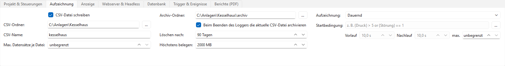

   Reiter „Aufzeichnung“.

.. list-table::
   :header-rows: 1
   :widths: 30 70

   * - Feld
     - Bedeutung
   * - CSV-Datei schreiben
     - Schaltet die CSV-Datei ein oder aus (z. B. aus, wenn nur in eine Datenbank
       aufgezeichnet werden soll; siehe `Datenbank-Aufzeichnung <datenbank_>`__).
   * - CSV-Ordner
     - Zielordner für die Protokolldateien. Ein relativer Pfad bezieht sich
       auf den Programmordner.
   * - CSV-Name
     - Name der Aufzeichnung. Er ist Präfix der Dateinamen und Name des
       Archiv-Unterordners (Standard: ``log``). Die Zeichen
       ``\ / : * ? " < > |`` sind nicht erlaubt.
   * - Max. Datensätze je Datei
     - Obergrenze für die Anzahl der Datensätze (Zeilen) je CSV-Datei.
       ``0`` = unbegrenzt. Ist die Zahl erreicht, wird die Datei gepackt und
       archiviert (siehe `Dateigröße begrenzen und archivieren <csv-archiv_>`__).
   * - Archiv-Ordner
     - Basisordner des Archivs (Standard: ``archiv``). Ein relativer Pfad
       bezieht sich auf den Programmordner.
   * - Beim Beenden archivieren
     - Ist das Häkchen gesetzt (Standard), wird beim Beenden des Loggers auch die
       aktuelle, noch nicht volle CSV-Datei gepackt und archiviert.
   * - Löschen nach, Höchstens belegen
     - Aufräumen alter Aufzeichnungen dieses Loggers (CSV-Dateien und Archiv-ZIPs):
       Dateien, deren letzte Änderung mehr als *n Tage* zurückliegt, werden gelöscht;
       belegen alle zusammen mehr als *n MB*, werden die ältesten gelöscht, bis die
       Grenze eingehalten ist. *nie*/*unbegrenzt* (0) = aus. Siehe
       `Alte Aufzeichnungen aufräumen <aufraeumen_>`__.
   * - Aufzeichnung
     - *Dauernd* (Standard) oder *Per Trigger mit Vor- und Nachlauf*: dann wird nur
       gespeichert, wenn die Startbedingung erfüllt ist (siehe
       `Aufzeichnung per Trigger (Vor- und Nachlauf) <trigger-aufzeichnung_>`__).
   * - Startbedingung
     - Bedingung wie bei Triggern, z. B. ``{Druck} > 5 or {Störung} == 1``; **…**
       öffnet den Formeleditor.
   * - Vorlauf, Nachlauf, max.
     - Sekunden vor dem Trigger (Ringspeicher), nach dem Ende der Bedingung, und die
       Höchstdauer einer Aufnahme (*unbegrenzt* = 0).

**Reiter „Anzeige“**

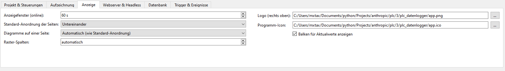

   Reiter „Anzeige“.

.. list-table::
   :header-rows: 1
   :widths: 30 70

   * - Feld
     - Bedeutung
   * - Anzeigefenster (online)
     - Breite des sichtbaren Zeitfensters im Online-Modus in Sekunden.
   * - Standard-Anordnung der Seiten
     - Anordnung beim Start: *Untereinander*, *Nebeneinander* oder *Tabs*.
   * - Diagramme auf einer Seite
     - *Automatisch* (wie die Standard-Anordnung), *Untereinander*,
       *Nebeneinander* oder *Raster (Grid)*.
   * - Raster-Spalten
     - Spaltenzahl bei *Raster*; *automatisch* wählt sie aus der Diagrammzahl.
   * - Balken für Aktualwerte anzeigen
     - Schaltet die schmalen Balken neben den Diagrammen standardmäßig ein.
   * - Balkenbreite
     - Breite eines Balkens in Pixeln (4 … 40, Vorgabe 14).
   * - Logo
     - Bilddatei, z. B. das Firmenlogo. Sie erscheint im Logger rechts oben in der
       Menüleiste (28 Pixel hoch), auf den Webseiten (Diagramme, Prozessbild,
       Anmeldung) und im Kopf der PDF-Berichte und IO-Check-Protokolle. PNG und JPG
       gehen überall, SVG nur im Logger und auf den Webseiten. Ein relativer Pfad
       bezieht sich auf den Programmordner. **Leer = kein Logo.**
   * - Kundenlogo
     - Zweites Logo (z. B. des Kunden bzw. der Anlage), erscheint an denselben Stellen
       links neben dem Logo bzw. im PDF links oben. Leer = kein Kundenlogo.
   * - Programm-Icon
     - Icon für Fenster und Taskleiste (PNG, ICO oder SVG). Ohne Angabe wird das
       mitgelieferte ``app.ico`` verwendet, sonst das Logo bzw. das Standard-Symbol.

**Reiter „Datenbank“**

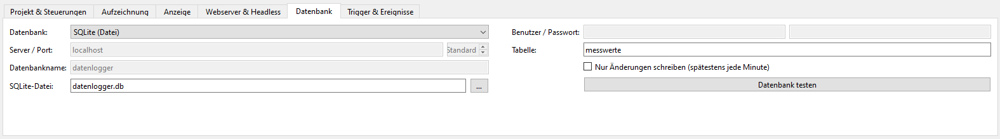

   Reiter „Datenbank“.

Auswahl und Zugangsdaten einer Datenbank, in die zusätzlich oder statt der
CSV-Datei aufgezeichnet wird (SQLite, MariaDB/MySQL, TimescaleDB/PostgreSQL, QuestDB,
InfluxDB 3, VictoriaMetrics, Prometheus), mit
dem Knopf **Datenbank testen**. Einzelheiten im Kapitel `Datenbank-Aufzeichnung <datenbank_>`__.

**Reiter „Trigger & Ereignisse“**

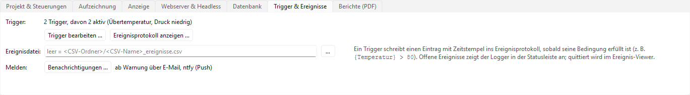

   Reiter „Trigger & Ereignisse“.

Zeigt die Zahl der angelegten Trigger. **Trigger bearbeiten …** öffnet den
Trigger-Editor, **Ereignisprotokoll anzeigen …** den Ereignis-Viewer, und unter
*Ereignisdatei* lässt sich der Speicherort des Ereignisprotokolls wählen (leer =
neben der CSV-Datei). Einzelheiten im Kapitel `Trigger und Ereignisprotokoll <ereignisse_>`__.

**Reiter „Berichte (PDF)“**

.. list-table::
   :header-rows: 1
   :widths: 30 70

   * - Feld
     - Bedeutung
   * - PDF-Bericht automatisch erstellen
     - Am Ende jedes Zeitraums schreibt der Logger einen Bericht (auch im
       Headless-Betrieb); beim Stoppen entsteht ein Teilbericht.
   * - Zeitraum
     - *Schicht*, *Tag*, *Woche* (ab Montag) oder *Monat*.
   * - Schichtbeginne
     - Uhrzeiten, durch Komma getrennt, z. B. ``06:00,14:00,22:00``.
   * - Tagesbeginn
     - Uhrzeit, zu der Tag, Woche und Monat beginnen (z. B. ``06:00`` für einen
       Produktionstag).
   * - Ordner
     - Zielordner (Standard ``berichte`` im Datenordner).

Einzelheiten im Kapitel `PDF-Berichte <pdf-berichte_>`__.

**Reiter „Webserver & Headless“**

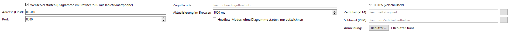

   Reiter „Webserver & Headless“.

.. list-table::
   :header-rows: 1
   :widths: 30 70

   * - Feld
     - Bedeutung
   * - Webserver starten
     - Startet mit dem Logger einen Webserver (siehe `Webserver (Diagramme im Browser) <webserver_>`__).
   * - Adresse (Host) / Port
     - ``0.0.0.0`` macht den Server im ganzen Netzwerk erreichbar, ``127.0.0.1``
       nur auf dem eigenen Rechner. Standard-Port: 8080.
   * - Zugriffscode
     - Optional. Ist ein Code gesetzt, muss er beim Aufruf mit ``?token=CODE``
       angegeben werden.
   * - Aktualisierung im Browser
     - Wie oft die Browserseite neue Daten abholt (200 bis 60000 ms).
   * - Headless-Modus
     - Der Logger startet ohne Oberfläche und zeichnet nur auf (siehe
       `Headless-Betrieb (nur Aufzeichnung) <headless_>`__).
   * - HTTPS (verschlüsselt)
     - Verschlüsselte Verbindung. Ohne eigenes Zertifikat erzeugt das Programm
       einmalig ein selbstsigniertes (Ordner ``web_tls``).
   * - Zertifikat / Schlüssel (PEM)
     - Optional eigenes Zertifikat und Schlüssel (z. B. von der Firmen-CA).
   * - Anmeldung
     - **Benutzer …** legt Benutzer mit Passwort an (gespeichert wird nur ein Hash).
       Ohne Benutzer ist keine Anmeldung nötig. Siehe `HTTPS und Anmeldung <https-anmeldung_>`__.

Aufbau: Diagramme, Y-Achsen und Variablen
----------------------------------------------------------------------

Die Anzeige ist hierarchisch aufgebaut:

.. code-block:: text

   Diagramm
   ├── Y-Achse 1 (links)
   │   ├── Variable A
   │   └── Variable B
   └── Y-Achse 2 (rechts)
       └── Variable C

* Jedes **Diagramm** erscheint im Logger als eigenes, verschiebbares Fenster.
* Jedes Diagramm hat mindestens eine **Y-Achse**. Die erste Achse liegt links,
  alle weiteren liegen rechts. Jede Achse skaliert unabhängig.
* Jede **Variable** gehört zu genau einer Y-Achse eines Diagramms.

Der Baum auf der linken Seite zeigt diese Struktur. Darunter befinden sich die
Schaltflächen:

.. list-table::
   :header-rows: 1
   :widths: 25 75

   * - Schaltfläche
     - Wirkung
   * - **+ Diagramm**
     - Legt ein neues Diagramm mit einer Y-Achse an.
   * - **+ Y-Achse**
     - Fügt dem ausgewählten Diagramm (bzw. dem Diagramm der Auswahl) eine
       weitere Y-Achse hinzu.
   * - **Entfernen**
     - Entfernt das ausgewählte Diagramm, die ausgewählte Y-Achse oder die
       ausgewählte Variable. Betroffene Variablen wandern dabei auf die erste
       Achse bzw. das erste Diagramm. Das letzte Diagramm und die letzte Achse
       eines Diagramms können nicht entfernt werden.

Eigenschaften von Diagramm und Y-Achse
----------------------------------------------------------------------

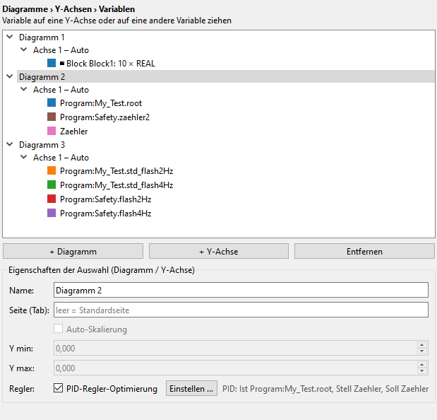

   Eigenschaften des gewählten Diagramms bzw. der gewählten Y-Achse.

Wählen Sie im Baum ein Diagramm oder eine Y-Achse aus. Im Bereich
*Eigenschaften* darunter können Sie ändern:

.. list-table::
   :header-rows: 1
   :widths: 25 75

   * - Feld
     - Bedeutung
   * - Name
     - Bezeichnung des Diagramms bzw. der Y-Achse (wird als Titel bzw.
       Achsenbeschriftung angezeigt).
   * - Seite (Tab)
     - *Nur bei Diagrammen.* Diagramme mit gleichem Seitennamen werden
       gemeinsam auf einer Seite (Tab bzw. Dock) angezeigt, z. B. ``Prozess``
       oder ``Alarme``. Leer = Standardseite (siehe `Seiten, Diagramme und Anordnung <seiten_>`__).
   * - Regler
     - *Nur bei Diagrammen.* Haken **PID-Regler-Optimierung** und **Einstellen …**:
       Soll-, Ist- und Stellwert für die Berechnung der Reglerparameter im Logger
       festlegen (siehe `PID-Regler-Optimierung <pid-optimierung_>`__).
   * - Auto-Skalierung
     - *Nur bei Y-Achsen.* Aktiv: Die Achse passt sich automatisch an die
       sichtbaren Daten an. Inaktiv: Es gelten die festen Grenzen
       *Y min* und *Y max*.
   * - Y min / Y max
     - Feste Achsengrenzen. *Y max* muss größer als *Y min* sein.

Variablen anlegen
----------------------------------------------------------------------

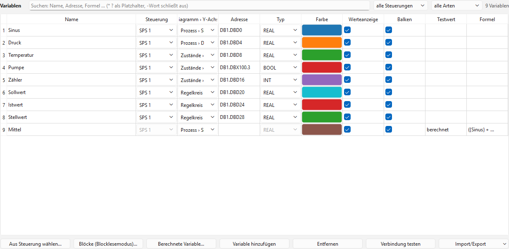

   Die Variablentabelle mit Steuerung, Adresse, Typ, Farbe und Formel.

Jede Zeile der Variablentabelle beschreibt einen Wert einer Steuerung:

.. list-table::
   :header-rows: 1
   :widths: 25 75

   * - Spalte
     - Bedeutung
   * - Name
     - Eindeutiger Name (wird auch als CSV-Spaltenüberschrift verwendet).
       Das Zeichen ``;`` ist nicht erlaubt.
   * - Steuerung
     - Steuerung, aus der die Variable gelesen wird (Auswahl aus der Tabelle der
       Steuerungen). Sie bestimmt den Treiber und damit Schreibweise der Adresse
       und mögliche Typen.
   * - Diagramm › Y-Achse
     - Zuordnung der Variablen (Auswahlliste oder Drag & Drop, siehe unten).
   * - Adresse
     - Adresse in der Schreibweise des Treibers, z. B. ``DB10.DBD4`` (``s7``),
       ``Anlage_DB.Motor[2].Drehzahl`` (``tia``), ``Program:Main.Druck``
       (``clx``) oder ``40001`` (``modbus``). Der Tooltip der Zelle zeigt
       Beispiele für den Treiber der gewählten Steuerung. Einzelheiten im Kapitel
       `Steuerungen und Treiber <treiber_>`__.
   * - Typ
     - Datentyp, Auswahl aus den Typen, die der Treiber lesen kann (z. B. ``BOOL``,
       ``INT``, ``DINT``, ``REAL``, ``LREAL`` …). Wird die Steuerung einer
       Variable geändert und kennt der neue Treiber den Typ nicht, bleibt er
       sichtbar stehen und wird beim Speichern als Fehler gemeldet.
   * - Farbe
     - Linienfarbe; Klick öffnet die Farbauswahl.
   * - Werteanzeige
     - Aktiv: Die Variable erscheint in der Werte-/Lineal-Tabelle des Loggers.
   * - Balken
     - Aktiv: Für die Variable wird ein schmaler Balken neben dem Diagramm
       angezeigt.
   * - Testwert
     - Ergebnis von **Verbindung testen**.
   * - Formel
     - Nur bei berechneten Variablen: die Formel (Doppelklick öffnet den Editor).

.. _variablen-suchen:

Variablen suchen und filtern
----------------------------------------------------------------------

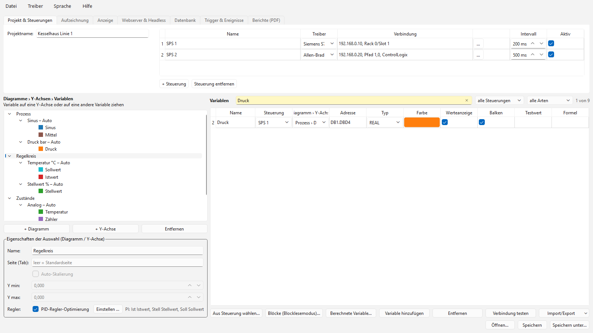

   Suchfeld und Filter über der Variablentabelle.

Über der Variablentabelle stehen ein **Suchfeld** und zwei Auswahllisten
(``Strg+F`` springt ins Suchfeld):

* **Suchtext** – durchsucht Name, Adresse, Formel, Zuordnung (Diagramm › Y-Achse),
  Typ und Steuerung; Groß-/Kleinschreibung egal. Mehrere Wörter müssen alle
  vorkommen (``temp db10``), ``*`` und ``?`` sind Platzhalter (``DB?.DBD*``), ein
  Wort mit vorangestelltem ``-`` schließt aus (``temp -soll``).
* **Steuerung** – nur Variablen einer Steuerung (berechnete Variablen bleiben sichtbar).
* **Art** – *nur gelesene*, *nur berechnete* oder *ohne Adresse* (noch unvollständige
  Zeilen).

Rechts steht, wie viele Variablen gerade zu sehen sind (*12 von 340*); das Suchfeld
ist gelb hinterlegt, solange ein Filter wirkt. Ausgeblendete Variablen bleiben in
der Konfiguration und werden mitgespeichert. **Entfernen** löscht nur markierte,
sichtbare Zeilen. Eine neu angelegte Variable, die nicht zum Filter passt, setzt
den Filter zurück.

Zuordnung per Drag & Drop
----------------------------------------------------------------------

Variablen können im Baum mit der Maus verschoben werden:

* **Auf eine Y-Achse ziehen:** Die Variable gehört danach zu dieser Achse.
* **Auf eine andere Variable ziehen:** Die Variable übernimmt die Y-Achse (und
  damit das Diagramm) der Zielvariable.
* **Auf ein Diagramm ziehen:** Die Variable wird der ersten Y-Achse dieses
  Diagramms zugeordnet.

Die Auswahlliste *Diagramm › Y-Achse* in der Tabelle und der Baum sind immer
synchron.

.. _berechnete-variablen:

Berechnete Variablen (Formeln)
----------------------------------------------------------------------

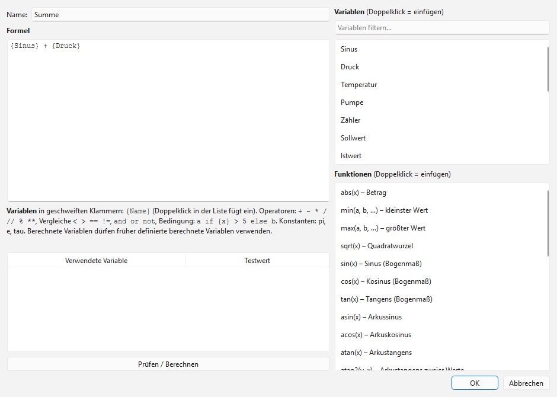

   Der Editor für berechnete Variablen.

Neben den aus der SPS gelesenen Variablen können Sie **berechnete Variablen**
anlegen, deren Werte der Logger bei jeder Messung aus anderen Variablen
berechnet. Sie erscheinen wie normale Variablen in Diagrammen, Balken,
Legende, Wertetabelle und in der CSV-Datei.

Mit **Berechnete Variable…** öffnet sich der Editor:

* **Name** der neuen Variable.
* **Formel** im Textfeld. Variablen werden in geschweiften Klammern
  angegeben, z. B. ``({Temp_Vorlauf} + {Temp_Ruecklauf}) / 2``. Ein
  Doppelklick in der Variablenliste fügt den Namen ein, ein Doppelklick in
  der Funktionsliste die Funktion.
* **Prüfen / Berechnen:** Der Editor prüft die Formel (Syntax, bekannte
  Variablen) und berechnet sie mit frei eingebbaren **Testwerten**. Das
  Ergebnis erscheint direkt darunter.

Die neue Variable wird dem ausgewählten Diagramm bzw. der ausgewählten Y-Achse
zugeordnet (änderbar wie bei jeder Variable). Ein Doppelklick auf die Spalte
*Formel* öffnet den Editor erneut.

Erlaubt sind:

.. list-table::
   :header-rows: 1
   :widths: 30 70

   * - Element
     - Beispiel / Bedeutung
   * - Rechenoperatoren
     - ``+  -  *  /  //  %  **``
   * - Vergleiche, Logik
     - ``<  >  <=  >=  ==  !=``, ``and``, ``or``, ``not``
   * - Bedingung
     - ``100 if {Druck} > 5 else 0``
   * - Konstanten
     - ``pi``, ``e``, ``tau``
   * - Mathematik
     - ``abs, min, max, sqrt, sin, cos, tan, asin, acos, atan, atan2, exp, ln,
       log10, log, floor, ceil, round, hypot, radians, degrees, sign, clamp``
   * - Zeitfunktionen
     - ``ddt(x)`` Ableitung pro Sekunde, ``integ(x)`` Integral (x · s),
       ``avg(x, n)`` gleitender Mittelwert über *n* Messwerte

Beispiele:

.. code-block:: text

   {Prozess.Temperatur} * 1.8 + 32               Umrechnung °C in °F
   {Druck_Ein} - {Druck_Aus}                     Differenzdruck
   avg({Durchfluss}, 20)                         geglätteter Durchfluss
   integ({Durchfluss}) / 3600                    Summenmenge (bei Durchfluss in 1/h)
   clamp({Fuellstand}, 0, 100)                   auf 0 bis 100 begrenzt

Hinweise:

* Ist ein Wert nicht berechenbar (Division durch 0, fehlende Messung,
  ungültiger Bereich wie ``sqrt`` einer negativen Zahl), ist das Ergebnis
  *kein Wert* (leeres CSV-Feld, Lücke in der Kurve).
* Eine berechnete Variable darf nur Variablen verwenden, die **weiter oben**
  in der Tabelle stehen (echte Variablen immer, berechnete nur wenn früher
  definiert). Das wird beim Speichern geprüft.
* Wird eine Variable umbenannt, müssen Formeln, die sie verwenden, angepasst
  werden. Der Name in der Formel muss exakt übereinstimmen.
* Aus Sicherheitsgründen wird kein beliebiger Programmcode ausgeführt, nur die
  oben aufgeführten Elemente.
* ``ddt``, ``integ`` und ``avg`` merken sich ihren Zustand während der
  Aufzeichnung und beginnen bei jedem **▶ Start** neu.
* Berechnete Variablen werden nicht aus der SPS gelesen und fehlen beim
  **Verbindung testen**.

.. _blocklesemodus:

Blocklesemodus
----------------------------------------------------------------------

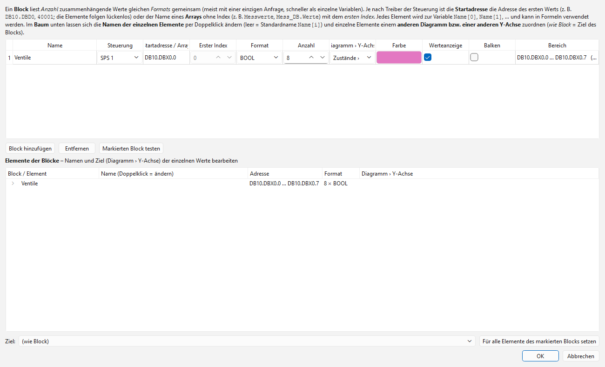

   Der Blockeditor mit Blocktabelle und Elementbaum (Namen und Ziel je Element).

Viele gleichartige Werte, die in der Steuerung hintereinander liegen, liest der
**Blocklesemodus** mit möglichst **einer Anfrage**; die Werte werden danach
einzeln zugewiesen. Was ein Block ist, hängt vom Treiber ab:

.. list-table::
   :header-rows: 1
   :widths: 15 85

   * - Treiber
     - Block
   * - ``s7``
     - **Startadresse** (z. B. ``DB10.DBD0``, ``MW100``) + Anzahl; die Elemente
       folgen lückenlos (``DB10.DBD0``, ``DB10.DBD4``, ``DB10.DBD8`` …; bei
       ``BOOL`` bitweise). Gelesen mit einer Anfrage.
   * - ``tia``
     - **Array ohne Index** (z. B. ``Mess_DB.Werte``) + **erster Index** (wie in
       TIA, z. B. 1 bei ``Array[1..100]``) + Anzahl.
   * - ``clx``
     - **Array-Tag ohne Index** (z. B. ``Messwerte``, ``Program:Main.Temp``) +
       **erster Index** + Anzahl. BOOL-Arrays sind bitweise gepackt und nicht als
       Block lesbar.
   * - ``modbus``
     - **Startadresse** (z. B. ``40001`` oder ``HR0``) + Anzahl; die Elemente
       folgen lückenlos (bei ``REAL`` je 2 Register: ``40001``, ``40003`` …).
       Der Treiber fasst ohnehin benachbarte Adressen zusammen; ein Block ist
       hier vor allem eine bequeme Art, viele Variablen anzulegen.
   * - ``modbus_rtu``
     - wie ``modbus``.
   * - ``opcua``, ``ads``
     - **Array-Knoten bzw. Array-Name** (ohne Index) + **erster Index** + Anzahl;
       gelesen in einer Anfrage.
   * - ``slmp``, ``kvhostlink``, ``toyopuc``, ``fins``, ``logo``
     - **Startgerät bzw. Startadresse** (z. B. ``D100``, ``DM100``, ``D0100``,
       ``VW100``) + Anzahl; Elemente lückenlos (bei ``REAL`` je 2 Wörter), bei
       ``BOOL`` fortlaufende Bits.
   * - ``pccc``
     - **Erstes Element** einer N-, F-, L- oder B-Datei (z. B. ``N7:0``) + Anzahl.
   * - ``s5as511``
     - **Startadresse** (z. B. ``DB10.DW0``, ``MB0``, ``E0.0``) + Anzahl; Elemente
       lückenlos.

Mit **Blöcke (Blocklesemodus)…** öffnet sich der Editor. Jede Zeile ist ein
Block mit folgenden Angaben:

.. list-table::
   :header-rows: 1
   :widths: 25 75

   * - Feld
     - Bedeutung
   * - Name
     - Name des Blocks. Jedes Element wird zur Variable ``Name[0]``,
       ``Name[1]``, …, ``Name[n-1]``. Nicht erlaubt: ``; { } [ ]``.
   * - Steuerung
     - Steuerung, aus der der Block gelesen wird (bestimmt den Treiber).
   * - Startadresse / Array
     - Siehe Tabelle oben; der Tooltip zeigt die Schreibweise des Treibers.
   * - Erster Index
     - Nur bei Treibern mit Arrays (``tia``, ``clx``, ``opcua``, ``ads``); sonst gesperrt.
   * - Format
     - Datentyp der Elemente (Auswahl des Treibers).
   * - Anzahl
     - Anzahl der Werte (1 bis 1000).
   * - Ringpuffer
     - Anzahl Datensätze eines Ringpuffers (siehe `Ringpuffer <ringpuffer_>`__); *aus* = normaler Block.
       Nur bei den Treibern ``s7``, ``tia`` und ``clx``.
   * - Diagramm › Y-Achse
     - Zuordnung aller Elemente des Blocks (einzelne Elemente lassen sich im Baum
       abweichend zuordnen, siehe unten).
   * - Farbe
     - Das erste Element erhält diese Farbe, die weiteren unterscheiden sich
       im Farbton.
   * - Werteanzeige / Balken
     - Gilt für alle Elemente des Blocks (Balken sind standardmäßig aus).
   * - Bereich
     - Berechnete Anzeige, z. B. ``DB10.DBD0 … DB10.DBD76 (80 Bytes)`` oder
       ``Messwerte[0] … Messwerte[19]``.

Beispiel (``clx``): Array-Tag ``Messwerte`` (``REAL[100]``), erster Index 10,
Anzahl 20 liest ``Messwerte[10]`` bis ``Messwerte[29]`` mit einer Anfrage und
erzeugt die Variablen ``Block[0]`` bis ``Block[19]``. Beispiel (``s7``):
Startadresse ``DB5.DBD0``, Format ``REAL``, Anzahl 20 liest die Bytes 0 bis 79
des DB 5.

Arrays lassen sich bei ``tia``, ``clx``, ``opcua``, ``ads`` und ``s7`` (aus der DB-Quelle) auch
direkt im Auswahldialog als Block übernehmen (Array markieren, **Markiertes Array als Block…**
bzw. **Array als Block …** oder Doppelklick).

**Markierten Block testen** liest den Block einmal aus der Steuerung und zeigt die
ersten Werte sowie die Lesezeit an.

Hinweise:

* Die Block-Elemente sind normale Variablen: Sie erscheinen in Diagrammen,
  Legende, Wertetabelle, Balken und CSV-Datei und können in **Formeln**
  verwendet werden, z. B. ``{Messwerte[3]} - {Messwerte[4]}``.
* **Elementnamen ändern:** Im unteren Teil des Blockeditors zeigt ein **Baum**
  alle Blöcke mit ihren Elementen. Per Doppelklick auf die Spalte *Name* erhält
  ein Element einen eigenen Namen, z. B. ``Druck Vorlauf`` statt
  ``Messwerte[1]``. Ein leerer Name stellt den Standardnamen wieder her. Die
  Namen müssen eindeutig sein und dürfen ``; { }`` nicht enthalten. In der
  Konfigurationsdatei stehen sie unter ``elementnamen`` des Blocks.
* **Elemente in verschiedenen Diagrammen:** Im Baum des Blockeditors hat jedes
  Element in der letzten Spalte *Diagramm › Y-Achse* eine Auswahlliste. *(wie
  Block)* verwendet das Ziel des Blocks, jeder andere Eintrag stellt dieses
  Element in einem anderen Diagramm bzw. an einer anderen Y-Achse dar. Mit
  **Für alle Elemente des markierten Blocks setzen** wird das gewählte Ziel für
  alle Elemente übernommen. In der Konfigurationsdatei stehen abweichende Ziele
  unter ``elementziele`` (Index: [Diagramm, Achse]).
* Im Variablenbaum der Konfiguration erscheint jeder Block als eine Zeile
  (``▦ Block …``) unter seiner Y-Achse. Mit **Entfernen** wird der markierte
  Block gelöscht.
* Der Bereich muss vollständig in der Steuerung vorhanden sein (Array groß
  genug, DB lang genug, Register vorhanden), sonst schlägt das Lesen des Blocks
  fehl; die übrigen Variablen werden weiter gelesen.
* Viele Elemente bedeuten viele Kurven: Teilen Sie große Blöcke auf mehrere
  Diagramme bzw. Y-Achsen auf oder schalten Sie *Werteanzeige* ab.

.. _ringpuffer:

Ringpuffer (zyklussynchrone Aufzeichnung)
----------------------------------------------------------------------

Normalerweise fragt der Logger die Steuerung im eingestellten Leseintervall ab. Wie lange
eine Anfrage dauert, schwankt mit dem Netzwerk und der Auslastung der Steuerung; Zyklen
dazwischen fehlen, und der Zeitstempel ist der Zeitpunkt am PC. Für eine
**zyklussynchrone, lückenlose** Aufzeichnung – z. B. alle 10 oder 50 ms – sammelt die
Steuerung die Werte selbst: Ein kleiner Baustein schreibt in jedem Zyklus bzw. Weckalarm
einen **Datensatz** (Nummer, Zeit, Werte) in einen **Ringpuffer**. Der Logger holt die
neuen Datensätze im Leseintervall ab (z. B. alle 250 ms) und macht aus jedem Datensatz
eine eigene Zeile mit dem **Zeitpunkt aus der Steuerung**. Die Abtastrate hängt so nur
von der Steuerung ab, nicht vom Netzwerk.

Möglich mit den Treibern ``s7`` (S7-300/400, S7-1200/1500 mit PUT/GET), ``tia``
(S7-1200/1500 ohne PUT/GET) und ``clx`` (ControlLogix, CompactLogix).

**1. Baustein in die Steuerung laden.** Der Knopf **SPS-Vorlagen …** im Blockeditor
öffnet den Ordner ``vorlagen`` mit fertigen Bausteinen:

.. list-table::
   :header-rows: 1
   :widths: 35 40 25

   * - Datei
     - Steuerung
     - Treiber
   * - ``Ringpuffer_S7-300_400.scl``
     - S7-300/400 (SCL-Quelle für STEP 7 V5.x)
     - ``s7``
   * - ``Ringpuffer_S7-300_400_FB.scl``
     - S7-300/400 als Funktionsbaustein mit 20 Eingängen: der Puffer liegt im Instanz-DB
       (mehrere Instanzen = mehrere Ringpuffer). Startadresse ``DBX80.0``, weil die
       Eingänge die Bytes 0 bis 79 belegen.
     - ``s7``
   * - ``Ringpuffer_S7-1200_1500.scl``
     - S7-1200/1500 (SCL-Quelle für TIA Portal: *Externe Quellen*)
     - ``tia`` oder ``s7``
   * - ``Ringpuffer_S7-1200_1500_FB.scl``
     - S7-1200/1500 als Funktionsbaustein mit 20 Eingängen, **nicht optimiert**: der Puffer
       liegt im Instanz-DB ``Cycl_Rec_DB`` (mehrere Instanzen = mehrere Ringpuffer).
       Startadresse ``DBX80.0``.
     - ``tia`` oder ``s7``
   * - ``Ringpuffer_ControlLogix.st``
     - ControlLogix/CompactLogix (Structured Text, Datentypen beschrieben)
     - ``clx``

Die Vorlagen schreiben 10 Werte vom Typ REAL in einen Puffer mit 100 Datensätzen; beide
Zahlen lassen sich anpassen (Hinweise am Anfang jeder Datei). Aufgerufen wird der
Baustein dort, wo die Werte gleichmäßig anfallen: im Weckalarm (S7-300/400: OB35,
S7-1200/1500: *Cyclic interrupt* OB30, Logix: periodische Task) mit z. B. 10 ms oder 50 ms.

**2. Ringpuffer im Blockeditor anlegen.** Ein Block wird zum Ringpuffer, sobald in der
Spalte **Ringpuffer** die Anzahl der Datensätze steht (*aus* = normaler Block):

.. list-table::
   :header-rows: 1
   :widths: 25 75

   * - Feld
     - Ringpuffer
   * - Startadresse
     - ``s7``, ``tia``: Adresse des Zählers am Anfang des Puffers in einem **nicht
       optimierten** Datenbaustein, z. B. ``DB100.DBX0.0``. ``clx``: Tag des Puffers,
       z. B. ``Puffer`` oder ``Program:Main.Puffer``.
   * - Format
     - Datentyp der Werte: ``INT``, ``DINT``, ``REAL`` (``s7``/``tia`` zusätzlich
       ``WORD``, ``UINT``, ``DWORD``, ``UDINT``, ``LREAL``; ``clx`` zusätzlich ``UINT``,
       ``UDINT``, ``LREAL``). Binärsignale als ``INT`` 0/1 ablegen.
   * - Anzahl
     - Werte je Datensatz (wie in der Steuerung).
   * - Ringpuffer
     - Datensätze im Puffer (wie in der Steuerung).

Die Elemente heißen wie bei Blöcken ``Name[0]``, ``Name[1]`` … und lassen sich im Baum
umbenennen und anderen Diagrammen zuordnen. **Markierten Block testen** holt den Puffer
einmal ab und zeigt Zählerstand, Anzahl der Datensätze, ihren mittleren Abstand und die
jüngsten Werte.

**3. Leseintervall und Puffergröße.** Das **Intervall** der Steuerung (Tabelle der
Steuerungen) ist hier das Leseintervall: Es bestimmt nur, wie oft abgeholt wird. Der Puffer muss die Datensätze von
mindestens drei Leseintervallen fassen: *Datensätze ≥ 3 × Leseintervall ÷ Zykluszeit*.
Beispiel: 10-ms-Weckalarm und 250 ms Leseintervall → mindestens 75 Datensätze (die
Vorlagen haben 100); 50 ms und 500 ms → mindestens 30.

**Aufbau des Puffers** (S7: nicht optimierter DB, Startadresse gerade; Logix: UDT mit
genau diesen Namen):

.. code-block:: text

   Zaehler          DINT     Anzahl der bisher geschriebenen Datensätze (1, 2, 3 …)
   Daten[0..N-1]             N Datensätze; Datensatz Nummer n steht in Daten[n MOD N]
     Seq            DINT     Nummer des Datensatzes (= Zaehler beim Schreiben)
     Zeit           DINT     Zeit in ms (siehe unten)
     Werte[0..M-1]           M Werte im gewählten Format

Die Steuerung schreibt in dieser Reihenfolge: Werte, Zeit, Seq, zuletzt den Zähler. Der
Logger liest den Zähler, dann die neuen Datensätze und noch einmal den Zähler; ein
Datensatz zählt nur, wenn *Seq* die erwartete Nummer hat und er während des Lesens nicht
überschrieben werden konnte.

**Zeit:** S7-300/400 ``TIME_TCK`` (ms seit dem Neustart der CPU), S7-1200/1500 und Logix
ms seit Mitternacht aus der Uhr der Steuerung. Der Logger rechnet Überläufe (Mitternacht,
2³¹) heraus und hängt die Zeit an die PC-Uhr: Der jüngste Datensatz der ersten Abholung
erhält die aktuelle Zeit, alle anderen ihren Abstand dazu laut Steuerung. Die Abstände der
Zeilen sind damit genau die der Steuerung; die absolute Zeit ist so genau wie die PC-Uhr
(eine abweichende Uhr der Steuerung wird langsam nachgeführt).

Hinweise:

* Verlorene Datensätze (Puffer zu klein, Verbindung lange unterbrochen) meldet die
  Statuszeile: „Ringpuffer …: n Datensätze verloren“. Nach einer kurzen Unterbrechung
  werden die Datensätze aus dem Puffer nachgeholt, solange er sie noch enthält.
* Ein Neustart der Steuerung setzt den Zähler zurück; der Logger erkennt das und beginnt
  von vorn.
* Weil die Datensätze erst beim Abholen eintreffen, zeigen Diagramme und Wertetabelle
  mit Ringpuffern alle Werte um etwa zwei Leseintervalle verzögert (die Zeilen werden
  nach ihrer Zeit sortiert). CSV-Datei und Datenbank enthalten jeden Datensatz mit seiner
  Zeit.
* Normale Variablen derselben oder anderer Steuerungen werden wie gewohnt gelesen; in
  den Zeilen eines Ringpuffers behalten sie ihren letzten Wert.
* Formeln, Trigger, Berichte und die Aufzeichnung per Trigger sehen jeden Datensatz – ein
  Trigger löst also auch auf einen Impuls von nur einem Zyklus aus.
* Im Demo-Modus liefern Ringpuffer-Elemente simulierte Werte wie normale Variablen.

Variablen aus der Steuerung wählen
----------------------------------------------------------------------

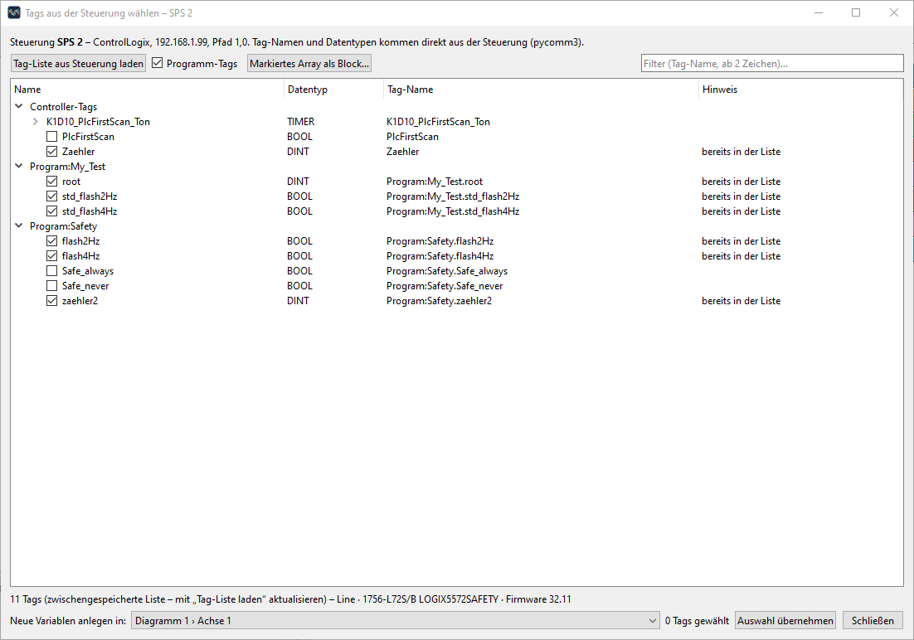

   Beispiel: Tag-Liste einer ControlLogix (Treiber ``clx``), bereits angelegte Tags sind angehakt.

Der Knopf über der Variablentabelle heißt je nach Treiber der gewählten
Steuerung unterschiedlich und öffnet dessen Auswahldialog (bei mehreren
Steuerungen wird zuerst gefragt, welche):

.. list-table::
   :header-rows: 1
   :widths: 15 25 60

   * - Treiber
     - Knopf
     - Herkunft der Variablen
   * - ``tia``
     - Aus Variablenliste wählen…
     - Variablenliste direkt aus der CPU (alle Datenbausteine, Merker, Ein- und
       Ausgänge mit Struktur und Typ, auch optimierte Bausteine).
   * - ``clx``
     - Aus Tag-Liste wählen…
     - Tag-Liste direkt aus der Steuerung (pycomm3): Controller- und
       Programm-Tags, UDTs, Arrays.
   * - ``s7``
     - Aus DB-Quelle wählen…
     - Exportierte DB-Quellen aus TIA Portal/STEP 7 (die SPS liefert über
       PUT/GET keine Namen); Abgleich der DB-Größen mit der SPS, Arrays als Block.
   * - ``opcua``
     - Aus OPC-UA-Server wählen…
     - Adressraum des Servers (Ordner, Variablen mit Datentyp, Arrays als Block).
   * - ``ads``
     - Aus TwinCAT wählen…
     - Symboltabelle der TwinCAT-Steuerung (Baum nach Namensteilen, Typ, Kommentar,
       Arrays als Block).
   * - übrige Treiber
     - –
     - Modbus, MELSEC, Omron, KEYENCE, TOYOPUC, LOGO!, MicroLogix und S5 liefern keine Namen; Adressen laut
       Programm bzw. Gerätehandbuch von Hand eintragen.

Allgemeines Vorgehen:

#. **Laden.** Beim ersten Öffnen wird die Liste aus der Steuerung geladen (``tia``,
   ``clx``) bzw. werden die DB-Quellen importiert (``s7``, **DB-Quelle
   importieren…**). Geladene Listen werden je Steuerung im Ordner ``taglisten``
   des Datenordners zwischengespeichert und beim nächsten Öffnen sofort angezeigt,
   auch ohne Verbindung. Die Pfade der S7-DB-Quellen werden in der Konfiguration
   gespeichert.
#. **Suchen.** Strukturen und Arrays lassen sich aufklappen; das **Filter**-Feld
   sucht nach Namen.
#. **Auswählen.** Lesbare Werte anhaken. Bereits angelegte Variablen sind
   angehakt und ausgegraut. Nicht aufzeichenbare Typen (z. B. ``STRING``) sind
   grau dargestellt.
#. **Arrays als Block** (``tia``, ``clx``, ``opcua``, ``ads``, ``s7``): Array markieren, **Markiertes
   Array als Block…** (``s7``: **Array als Block …**) oder Doppelklick, ersten Index und Anzahl
   festlegen. Bei ``s7`` gilt das für eindimensionale Arrays aus Zahlen oder BOOL; die
   Startadresse wird aus der DB-Quelle berechnet.
#. **Übernehmen.** Unter *Neue Variablen anlegen in* das Diagramm bzw. die Y-Achse
   wählen und **Auswahl übernehmen** drücken. Adresse und Typ kommen aus der
   Steuerung bzw. Quelle.
#. **Prüfen.** Mit **Verbindung testen** die gelesenen Werte kontrollieren.

Einzelheiten zu den Dialogen stehen beim jeweiligen Treiber im Kapitel
`Steuerungen und Treiber <treiber_>`__.

Verbindung testen
----------------------------------------------------------------------

**Verbindung testen** verbindet sich nacheinander mit jeder Steuerung
(über ihren Treiber), liest deren Variablen einmal und trägt das Ergebnis in die
Spalte *Testwert* ein. Fehler einzelner Variablen werden dort im Klartext
angezeigt (z. B. Adresse nicht vorhanden, falscher Typ, Zugriff verweigert,
Modbus-Ausnahme „ungültige Adresse“); kann eine Steuerung nicht erreicht werden,
meldet das ein Hinweisfenster mit Name und Verbindung.

Beim Speichern prüft der Treiber jeder Steuerung die Adressen formal (Schreibweise,
passender Typ, z. B. ``BOOL`` bei Coils). Ob es eine Adresse in der Steuerung
tatsächlich gibt, zeigt erst der Verbindungstest.

Speichern und Laden
----------------------------------------------------------------------

Das Menü **Datei** des Konfigurationsprogramms enthält:

* **Neu** – leere Konfiguration mit einer Steuerung; der Dateiname wird beim
  ersten Speichern abgefragt.
* **Öffnen…** (``Strg+O``) – lädt eine Konfigurationsdatei (JSON) mit **beliebigem
  Namen**, auch Konfigurationen des S7-, TIA- und CLX-Datenloggers (siehe
  `Übernahme von Konfigurationen der Einzelprogramme <uebernahme_>`__).
* **Speichern** (``Strg+S``) und **Speichern unter…** (``Strg+Umschalt+S``) –
  schreiben in die aktuelle bzw. eine neue Datei (die Endung ist immer ``.json``). Vor dem Speichern wird geprüft, dass Steuerungs- und
  Variablennamen eindeutig und nicht leer sind, die Verbindungsparameter und
  Adressen für den jeweiligen Treiber gültig sind, die Formeln stimmen und bei
  festen Y-Achsen *Y max* größer als *Y min* ist.
* **INI-Datei umwandeln …** – ältere INI-Konfigurationen einmalig in JSON umwandeln
  (siehe `Ältere INI-Dateien umwandeln <ini-umwandeln_>`__).
* **Logger mit dieser Konfiguration starten** (``Strg+R``) – speichert und
  startet den Logger mit dieser Datei.
* **IO-Check mit dieser Konfiguration starten** – speichert und startet den
  `IO-Check <io-check_>`__ mit den Steuerungen dieser Datei (eigenes Programm).

Der Titel des Fensters zeigt Projektname und Dateiname. Die zuletzt benutzte
Datei wird gemerkt (Datei ``plc_last.txt``); Logger und Konfigurationsprogramm
öffnen sie beim nächsten Start ohne Parameter wieder.

.. note::

   Der Logger liest die Konfiguration bei jedem **Start**. Änderungen wirken
   daher erst nach erneutem Drücken von **▶ Start**.

Variablen importieren und exportieren
----------------------------------------------------------------------

Der Knopf **Import/Export** unter der Variablentabelle tauscht die Variablenliste
mit einer **Excel-** (``.xlsx``) oder **CSV-Datei** aus – praktisch, um lange
Listen in Excel zu bearbeiten oder aus einer Adressliste der Steuerung zu
übernehmen. Eingelesen werden zusätzlich **ODS-Dateien** (LibreOffice/OpenOffice
Calc, ``.ods``).

* **Variablen exportieren (CSV/Excel) …** schreibt alle Variablen der Tabelle
  (ohne Block-Elemente, siehe `Blocklesemodus <blocklesemodus_>`__) mit den Spalten
  ``Name``, ``Steuerung``, ``Diagramm``, ``Y-Achse``, ``Adresse``, ``Typ``,
  ``Farbe``, ``Werteanzeige``, ``Balken`` und ``Formel``.
* **Variablen importieren (CSV/Excel/ODS) …** liest eine solche Datei. Die erste
  Zeile enthält die Spaltennamen; Pflicht ist nur ``Name``, Reihenfolge und
  Groß-/Kleinschreibung sind egal. CSV-Dateien dürfen Semikolon, Komma oder
  Tabulator als Trennzeichen haben.

Beim Import gilt:

* Sind schon Variablen vorhanden, fragt das Programm, ob sie **ersetzt** oder die
  neuen **angehängt** werden sollen. Beim Anhängen werden Variablen mit bereits
  vorhandenem Namen übersprungen.
* ``Steuerung`` ist der Name einer Steuerung aus der Steuerungstabelle; leer oder
  unbekannt = erste Steuerung (unbekannte Namen werden gemeldet).
* ``Diagramm`` und ``Y-Achse`` sind Namen; fehlende Diagramme und Achsen werden
  angelegt, leer = erstes Diagramm bzw. erste Achse.
* ``Typ`` leer = Standardtyp des Treibers; ``Farbe`` als ``#rrggbb``, leer =
  Farbe aus der Palette.
* ``Werteanzeige`` und ``Balken``: ``ja``/``nein`` (auch ``1``/``0``, ``x``);
  leer = ja.
* Ist ``Formel`` gefüllt, entsteht eine berechnete Variable (``Adresse`` und
  ``Typ`` werden dann ignoriert).

Adressen und Formeln werden wie bei der Eingabe von Hand erst beim
**Speichern** geprüft.

Aufbau der Konfigurationsdatei (JSON)
----------------------------------------------------------------------

Die Konfiguration wird als **JSON-Datei** gespeichert (UTF-8, eingerückt) und kann bei Bedarf auch von Hand
bearbeitet werden – mit jedem Texteditor, besser mit einem, der JSON prüft (z. B. Notepad++,
Visual Studio Code). Beispiel:

.. code-block:: json

   {
     "format": "PLC Datenlogger Konfiguration",
     "version": 1,
     "einstellungen": {
       "projekt": "Prüfstand 3",
       "csv_ordner": "logs",
       "csv_name": "log",
       "max_records": 100000,
       "archiv_ordner": "archiv",
       "fenster_s": 60,
       "anordnung": "untereinander",
       "balken": true,
       "archiv_beenden": true,
       "seite_anordnung": "raster",
       "raster_spalten": 2,
       "web_aktiv": true,
       "web_host": "0.0.0.0",
       "web_port": 8080,
       "web_intervall_ms": 1000,
       "headless": false,
       "treiberdaten": {
         "s7": {
           "symbolquellen": "C:/Projekt/Mess_DB.db"
         }
       }
     },
     "steuerungen": [
       {
         "name": "Presse",
         "treiber": "tia",
         "intervall_ms": 100,
         "aktiv": true,
         "ip": "192.168.0.1",
         "port": 102,
         "tls": "auto",
         "passwort": "",
         "rolle": "hmi",
         "tags_je_anfrage": 50
       },
       {
         "name": "Altanlage",
         "treiber": "s7",
         "intervall_ms": 500,
         "aktiv": true,
         "ip": "192.168.0.20",
         "rack": 0,
         "slot": 2
       },
       {
         "name": "Kessel",
         "treiber": "clx",
         "intervall_ms": 200,
         "aktiv": true,
         "ip": "192.168.1.10",
         "pfad": "1,0",
         "cpu": "controllogix",
         "timeout_ms": 2000
       },
       {
         "name": "Zaehler",
         "treiber": "modbus",
         "intervall_ms": 1000,
         "aktiv": true,
         "ip": "192.168.0.50",
         "port": 502,
         "unit": 1,
         "wortfolge": "CDAB",
         "max_register": 120,
         "luecke": 8,
         "timeout_ms": 2000
       }
     ],
     "diagramme": [
       {
         "name": "Prozess",
         "seite": "Prozess",
         "achsen": [
           {
             "name": "Temperatur",
             "auto": true,
             "y_min": 0.0,
             "y_max": 100.0
           },
           {
             "name": "Leistung",
             "auto": false,
             "y_min": 0.0,
             "y_max": 50.0
           }
         ]
       }
     ],
     "variablen": [
       {
         "name": "Kraft",
         "adresse": "Presse_DB.Kraft",
         "typ": "REAL",
         "farbe": "#d62728",
         "wert_anzeigen": true,
         "diagramm": 1,
         "achse": 1,
         "balken": true,
         "formel": "",
         "steuerung": 1
       },
       {
         "name": "Temp_Alt",
         "adresse": "DB10.DBD4",
         "typ": "REAL",
         "steuerung": 2
       },
       {
         "name": "Temperatur_Kessel",
         "adresse": "Program:Kessel.Temperatur",
         "typ": "REAL",
         "steuerung": 3
       },
       {
         "name": "Wirkleistung",
         "adresse": "30013",
         "typ": "REAL",
         "steuerung": 4
       }
     ],
     "bloecke": [
       {
         "name": "Messwerte",
         "adresse": "Messwerte",
         "start": 0,
         "typ": "REAL",
         "anzahl": 20,
         "diagramm": 1,
         "achse": 1,
         "farbe": "#1f77b4",
         "wert_anzeigen": true,
         "balken": false,
         "steuerung": 3,
         "elementziele": {
           "3": [
             1,
             2
           ]
         }
       }
     ]
   }

Aufbau:

.. list-table::
   :header-rows: 1
   :widths: 22 78

   * - Schlüssel
     - Inhalt
   * - ``format``, ``version``
     - Kennung der Datei und Version des Aufbaus (derzeit 1).
   * - ``einstellungen``
     - Projekt, Aufzeichnung (CSV, Archiv, Datenbank), Anzeige, Webserver, Headless.
   * - ``steuerungen``
     - Liste der Steuerungen (Reihenfolge = Nummer, auf die ``steuerung`` verweist).
   * - ``diagramme``
     - Liste der Diagramme, je Diagramm die Liste ``achsen`` (Y-Achsen) und ggf. die
       PID-Einstellungen (``pid_…``).
   * - ``variablen``
     - Normale und berechnete Variablen (``formel`` nicht leer).
   * - ``bloecke``
     - Blöcke des Blocklesemodus; ``elementnamen`` = eigene Namen einzelner Elemente
       (``{"1": "Druck Vorlauf"}``), ``elementziele`` = abweichendes Diagramm und Achse
       einzelner Elemente (``{"3": [2, 1]}``).
   * - ``trigger``
     - Trigger des Ereignisprotokolls.

Zahlen und Wahrheitswerte stehen mit ihrem Typ in der Datei (``200``, ``1.5``,
``true``/``false``). Fehlende Schlüssel erhalten beim Laden ihren Standardwert,
unbekannte werden ignoriert. Ist die Datei kein gültiges JSON (z. B. ein vergessenes
Komma), meldet das Programm die Zeile der Fehlerstelle.

Erläuterungen:

* ``treiber`` ist das Kürzel des Treibers; die übrigen Schlüssel eines
  Eintrags in ``steuerungen`` (außer ``name``, ``intervall_ms``, ``aktiv``) sind dessen
  Verbindungsparameter (siehe `Steuerungen und Treiber <treiber_>`__). Unbekannte Schlüssel werden
  ignoriert, fehlende erhalten den Standardwert des Treibers.
* ``adresse`` ist die Adresse in der Schreibweise des Treibers der Steuerung.
  Bei Blöcken ist ``adresse`` die Startadresse bzw. der Array-Name und ``start``
  der erste Index (nur ``tia``/``clx``).
* ``treiberdaten`` enthält treibereigene Angaben als Objekt (z. B. die Pfade der
  S7-DB-Quellen).
* ``diagramm``, ``achse`` und ``steuerung`` sind Nummern ab 1.
* ``seite_anordnung`` ist leer (automatisch), ``untereinander``,
  ``nebeneinander`` oder ``raster``; ``raster_spalten: 0`` wählt die Spaltenzahl
  automatisch.
* Die Variablen eines Blocks (``Messwerte[0]`` …) werden beim Laden erzeugt und
  stehen nicht unter ``variablen`` in der Datei.
* Das TIA-Passwort steht im **Klartext** in der Datei.

.. _ini-umwandeln:

Ältere INI-Dateien umwandeln
----------------------------------------------------------------------

Frühere Versionen speicherten die Konfiguration als INI-Datei. Diese werden **nicht
mehr direkt geöffnet**, sondern einmalig in eine JSON-Datei umgewandelt; die INI-Datei
selbst bleibt dabei unverändert:

* **Konfigurationsprogramm › Datei › INI-Datei umwandeln …** – eine oder mehrere
  INI-Dateien wählen; neben jeder entsteht eine gleichnamige ``.json``-Datei. Bei einer
  einzelnen Datei wird das Ergebnis gleich geöffnet.
* Wird im Konfigurationsprogramm (Öffnen, Startbild) eine INI-Datei gewählt, bietet
  es die Umwandlung direkt an.
* Für viele Dateien auf einmal (Python-Quellen):

  .. code-block:: console

     python tools/ini2json.py anlage1.ini anlage2.ini        # -> anlage1.json, anlage2.json
     python tools/ini2json.py alt.ini -o neu.json -f        # anderer Name, überschreiben

Der Logger meldet beim Start mit einer INI-Datei, dass sie umgewandelt werden muss. War
zuletzt eine INI-Datei geöffnet und gibt es daneben bereits die umgewandelte
``.json``-Datei, wird diese automatisch verwendet. Alle Inhalte – auch Trigger,
PID-Einstellungen und Blöcke – werden übernommen.

.. _treiber:

Steuerungen und Treiber
======================================================================

Jede Steuerung der Konfiguration hat genau einen Treiber. Er legt fest, welche
Verbindungsparameter es gibt, wie Variablen adressiert werden, welche Datentypen
lesbar sind, wie Blöcke aussehen und ob es einen Auswahldialog gibt. In einer
Konfiguration lassen sich beliebige Treiber mischen.

**Wie gut ist welcher Treiber geprüft?** Bei jedem Hochladen laufen automatische Tests; wo es
eine fremde, verbreitete Gegenstelle gibt, prüfen sie den Treiber gegen deren Simulator.
Mit echten Steuerungen erprobt sind bisher nur ``s7`` und ``clx``:

.. list-table::
   :header-rows: 1
   :widths: 20 80

   * - Treiber
     - Geprüft
   * - ``s7``
     - **Mit Steuerung** (S7-300/400, auch Ringpuffer); automatisch gegen den S7-Server von
       python-snap7 (Einzelwerte, Bits, Blöcke, Ringpuffer).
   * - ``clx``
     - **Mit Steuerung** (normales Lesen und Blöcke); der Ringpuffer nur gegen eine
       nachgebildete libplctag.
   * - ``tia``
     - Automatisch: Ringpuffer gegen den S7CommPlus-Emulator von s7commplus. Das
       symbolische Lesen ist noch nicht mit einer Steuerung erprobt.
   * - ``modbus``
     - Automatisch gegen den Modbus-TCP-Server von pymodbus (alle vier Tabellen, Bits,
       REAL/DINT, Wortfolge).
   * - ``opcua``
     - Automatisch gegen einen OPC-UA-Server von asyncua (Zahlen, BOOL, Array als Block).
   * - ``logo``, ``pccc``, ``modbus_rtu``, ``ads``, ``slmp``, ``fins``, ``kvhostlink``,
       ``toyopuc``, ``s5as511``
     - Noch weder mit Steuerung noch mit Simulator erprobt. Erfahrungen und Fehlermeldungen
       (z. B. über GitHub) sind willkommen.

Treiber ``s7`` – Siemens S7 (PUT/GET, snap7)
----------------------------------------------------------------------

Für S7-300/400 und S7-1200/1500 über die klassische S7-Kommunikation mit
**absoluten Adressen**. Bibliothek: ``python-snap7``.

.. list-table:: Verbindungsparameter
   :header-rows: 1
   :widths: 20 80

   * - Parameter
     - Bedeutung
   * - IP-Adresse
     - Adresse der CPU bzw. des CP.
   * - Rack
     - Baugruppenträger, fast immer ``0``.
   * - Slot
     - Steckplatz der CPU: S7-300 ``2``, S7-1200/1500 ``1`` (bzw. ``0``),
       S7-400 laut Hardwarekonfiguration.

**Vorbereitung:** Bei S7-1200/1500 in TIA Portal in den CPU-Eigenschaften
*„PUT/GET-Kommunikation vom Partner erlauben“* aktivieren. Gelesen werden nur
Datenbausteine **ohne** „Optimierten Bausteinzugriff“ (für optimierte Bausteine
den Treiber ``tia`` verwenden). TCP-Port 102.

**Adressen** (deutsche oder englische Schreibweise; der Typ kommt aus der Spalte
*Typ*, die Größenangabe X/B/W/D in der Adresse ist nur Schreibhilfe):

.. list-table::
   :header-rows: 1
   :widths: 40 60

   * - Adresse
     - Bedeutung
   * - ``DB10.DBX4.2``, ``DB10.DBB4``, ``DB10.DBW4``, ``DB10.DBD4``
     - Datenbaustein 10, Byte 4 (Bit 2)
   * - ``DB10.4``, ``DB10.4.2``
     - Kurzform: DB-Nummer, Byte[, Bit]
   * - ``M5.0``, ``MB5``, ``MW10``, ``MD20``
     - Merker
   * - ``E0.1``, ``EB0``, ``EW64`` bzw. ``I0.1``, ``IB0``, ``IW64``
     - Eingänge (Prozessabbild)
   * - ``A1.0``, ``AB1``, ``AW2`` bzw. ``Q1.0``, ``QB1``, ``QW2``
     - Ausgänge (Prozessabbild)

Beim Speichern wird die Adresse einheitlich passend zum Typ geschrieben (z. B.
``DB10.4`` mit Typ ``REAL`` → ``DB10.DBD4``).

**Typen:** ``BOOL``, ``BYTE``, ``USINT``, ``SINT``, ``CHAR``, ``WORD``, ``UINT``,
``INT``, ``DWORD``, ``UDINT``, ``DINT``, ``REAL``, ``TIME`` (ms), ``LWORD``,
``ULINT``, ``LINT``, ``LREAL``.

**Blöcke:** Startadresse + Anzahl, Elemente lückenlos; ein Block wird mit
**einer** Anfrage gelesen. Einzelvariablen werden einzeln gelesen – bei vielen
Variablen in einem DB ist ein Block deutlich schneller.

**Auswahldialog „Aus DB-Quelle wählen…“:** Die SPS liefert über
S7-Kommunikation **keine Namen und Strukturen**. Der Baum der Datenbausteine
(DB › Struktur › Variable) wird deshalb aus **DB-Quellen** aufgebaut:

#. In TIA Portal den DB (und benötigte UDTs) markieren, Rechtsklick *Quelle aus
   Bausteinen generieren*; in STEP 7 den DB als Quelle (``.db``/``.awl``)
   speichern.
#. Im Dialog **DB-Quelle importieren…** wählen (mehrere Dateien möglich). Fehlt die
   DB-Nummer in der Quelle (TIA), wird sie abgefragt.
#. Optional **Mit SPS abgleichen**: vergleicht die berechnete Größe jedes DB mit
   der Größe in der SPS (✓ bzw. ⚠ – Abweichung deutet auf einen optimierten
   Baustein oder eine veraltete Quelle hin).
#. Variablen anhaken (Häkchen an Struktur/Array/DB wählt alles darin) und
   übernehmen. Der Name der Variable ist der Symbolpfad.

Die Pfade der Quellen werden in der Konfiguration gespeichert (``treiberdaten``)
und beim nächsten Öffnen wieder gelesen.

Treiber ``tia`` – Siemens S7-1200/1500 symbolisch (S7CommPlus)
----------------------------------------------------------------------

Symbolischer Zugriff wie TIA Portal und Siemens-HMIs – auch auf **optimierte**
Datenbausteine, **ohne** PUT/GET. Bibliothek: ``s7commplus``.

.. list-table:: Verbindungsparameter
   :header-rows: 1
   :widths: 25 75

   * - Parameter
     - Bedeutung
   * - IP-Adresse
     - Adresse der CPU.
   * - Port
     - ISO-on-TCP-Port, Standard ``102``.
   * - TLS
     - *Automatisch* (TLS, wenn die CPU es anbietet), *Aus*, *An (TLS erzwingen)*.
       Neuere Firmware (S7-1500 ab V3.1, S7-1200 ab V4.7, Projekte ab TIA V19)
       kommuniziert nur verschlüsselt.
   * - Passwort
     - Passwort der Zugriffsstufe, falls die CPU lesenden Zugriff schützt
       (steht im Klartext in der Konfigurationsdatei).
   * - Rolle (Erweitert)
     - *HMI* (Standard), *Engineering*, *PG*.
   * - Variablen je Anfrage (Erweitert)
     - Höchstzahl Variablen je Leseanfrage (Standard 50); größere Mengen werden
       aufgeteilt.

**Vorbereitung:** In der Regel keine. Variablen müssen „Erreichbar aus
HMI/OPC UA/Web API“ sein (Standard). Jede CPU erlaubt nur eine begrenzte Zahl
von HMI-Verbindungen; der Logger belegt eine je Steuerung. TCP-Port 102.

**Adressen:** symbolische Namen wie in TIA Portal:

.. code-block:: text

   Mess_DB.Temp                     Variable in einem Datenbaustein
   Anlage_DB.Motor[2].Drehzahl      Strukturglied in einem Array
   MArea.Start_Merker               Merker (PLC-Variable)
   IArea.Taster_1                   Eingang
   QArea.Lampe                      Ausgang

**Typen:** ``BOOL``, ``BYTE``, ``WORD``, ``DWORD``, ``LWORD``, ``SINT``, ``INT``,
``DINT``, ``LINT``, ``USINT``, ``UINT``, ``UDINT``, ``ULINT``, ``REAL``,
``LREAL``, ``TIME``, ``LTIME``, ``S5TIME``, ``CHAR``, ``WCHAR``.

**Blöcke:** Array ohne Index + erster Index (wie in TIA, z. B. ``1`` bei
``Array[1..100]``) + Anzahl.

**Auswahldialog „Aus Variablenliste wählen…“:** lädt die Variablenliste direkt
aus der CPU (Datenbausteine, Merker, Ein-/Ausgänge mit Struktur und Typ) und
speichert sie im Ordner ``taglisten`` zwischen.

.. warning::

   ``s7commplus`` ist eine **inoffizielle** Implementierung, nicht von Siemens.
   Neue Konfigurationen zuerst an einer nicht sicherheitsrelevanten Anlage testen.

Treiber ``logo`` – Siemens LOGO! (0BA7/0BA8)
----------------------------------------------------------------------

Für LOGO! 7 (0BA7) und LOGO! 8 (0BA8, 8.FS4, 8.3, 8.4) über S7-Kommunikation;
Bibliothek ``python-snap7`` (wie beim Treiber ``s7``).

**In der LOGO! einrichten:** In LOGO!Soft Comfort unter *Extras › Ethernet-Verbindungen*
(LOGO! 8: *Online-Einstellungen › Zugriffskontrolle*) den Zugriff für HMI bzw. eine
**Server-Verbindung (S7)** anlegen. Die TSAP-Werte dieser Verbindung müssen zu den
Parametern hier passen: *Lokaler TSAP* der LOGO! = **TSAP der LOGO!**, *Entfernter TSAP*
= **TSAP des Loggers**. LOGO! 8 mit freigegebenem HMI-Zugriff: ``02.00`` und ``01.00``
(Vorgabe).

.. list-table:: Verbindungsparameter
   :header-rows: 1
   :widths: 30 70

   * - Parameter
     - Bedeutung
   * - IP-Adresse
     - Adresse der LOGO!.
   * - Gerät
     - *LOGO! 8* oder *LOGO! 7* – bestimmt, wo I, Q, M, AI, AQ, AM im
       Variablenspeicher (VM) liegen.
   * - TSAP der LOGO! / TSAP des Loggers
     - Als ``hh.hh`` (z. B. ``02.00``, ``20.00``) oder Zahl (``0x0200``).

**Adressen:** Variablenspeicher direkt (``V10`` bzw. ``VB10`` = Byte, ``VW12`` = Wort,
``VD20`` = Doppelwort, ``V10.3`` = Bit) oder die LOGO!-Operanden ``I1`` … ``I24``,
``Q1`` … ``Q20``, ``M1`` … ``M64``, ``NI``, ``NQ`` (BOOL) und ``AI1`` … ``AI8``, ``AQ``,
``AM1`` … ``AM64``, ``NAI``, ``NAQ`` (INT). Werte im VM sind wie bei S7 „Big Endian“.
Benachbarte Adressen werden zu einer Anfrage zusammengefasst; Blöcke: Startadresse im VM
(z. B. ``VW100``), die Elemente folgen lückenlos.

Treiber ``clx`` – Allen-Bradley Logix (EtherNet/IP)
----------------------------------------------------------------------

Für ControlLogix, CompactLogix und Micro800. Gelesen wird mit **libplctag**
(``plctag.dll`` / ``libplctag.so``); alle Tags einer Steuerung werden je Zyklus
gleichzeitig angestoßen und zu gemeinsamen CIP-Anfragen zusammengefasst. Die
Tag-Liste liefert **pycomm3**.

.. list-table:: Verbindungsparameter
   :header-rows: 1
   :widths: 25 75

   * - Parameter
     - Bedeutung
   * - IP-Adresse
     - Adresse des Ethernet-Moduls (z. B. 1756-EN2T) bzw. der CPU mit eingebautem
       Ethernet.
   * - CIP-Pfad
     - Weg zur CPU, ``Port,Adresse``; Backplane = Port 1. ControlLogix mit CPU in
       Steckplatz 0: ``1,0`` (Steckplatz 3: ``1,3``), CompactLogix: ``1,0``,
       Micro800: leer.
   * - Steuerungstyp
     - ControlLogix, CompactLogix oder Micro800.
   * - Zeitlimit (Erweitert)
     - Wartezeit je Lesezyklus (Standard 2000 ms).

**Vorbereitung:** *External Access* der Tags *Read/Write* oder *Read Only*.
TCP-Port 44818.

**Adressen:** Tag-Namen wie in Studio 5000 bzw. Connected Components Workbench:
``Temp_Kessel`` (Controller-Tag), ``Program:Main.Druck`` (Programm-Tag),
``Anlage.Motor[2].Drehzahl``, ``Status.3`` (Bit 3 eines Integers, Typ ``BOOL``).

**Typen:** ``BOOL``, ``SINT``, ``INT``, ``DINT``, ``LINT``, ``USINT``, ``UINT``,
``UDINT``, ``ULINT``, ``REAL``, ``LREAL`` (Bit-Strings ``DWORD``/``WORD`` als
``UDINT``/``UINT`` lesen).

**Blöcke:** Array-Tag ohne Index + erster Index + Anzahl; libplctag teilt große
Bereiche selbst auf. BOOL-Arrays nicht als Block.

**Auswahldialog „Aus Tag-Liste wählen…“:** Controller-Tags und (Häkchen
*Programm-Tags*) die Tags aller Programme, mit UDTs, Arrays (höchstens 500
Elemente einzeln) und Filter; Zwischenspeicher im Ordner ``taglisten``.

Treiber ``pccc`` – Allen-Bradley MicroLogix / SLC 500 (PCCC)
----------------------------------------------------------------------

Für die älteren Allen-Bradley-Steuerungen mit Dateiadressen (RSLogix 500):
MicroLogix 1100/1400, SLC 5/05 sowie SLC 5/03/04 über ein Ethernet-Brückenmodul.
Bibliothek ``pycomm3`` (SLCDriver, EtherNet/IP mit PCCC-Befehlen). ControlLogix,
CompactLogix und Micro800 laufen über den Treiber ``clx``.

.. list-table:: Verbindungsparameter
   :header-rows: 1
   :widths: 30 70

   * - Parameter
     - Bedeutung
   * - IP-Adresse
     - Adresse der Steuerung bzw. des Ethernet-Moduls.
   * - CIP-Pfad (Erweitert)
     - Nur hinter einem Brückenmodul, z. B. ``bp/1``; sonst leer.

**Adressen** in RSLogix-500-Schreibweise: ``N7:0`` (INT), ``F8:2`` (REAL), ``L9:0``
(DINT, MicroLogix 1100/1400), ``B3:2`` (Wort) bzw. ``B3:0/5`` und ``N7:10/3`` (Bits,
Typ BOOL), ``T4:0.ACC``/``T4:0.PRE``/``C5:1.ACC`` (Ist-/Vorgabewerte),
``T4:0.DN`` (Statusbit), ``I:0/1``, ``O:0/2``, ``S:1/5``. Nahe beieinander liegende
Elemente derselben N-, F-, L- oder B-Datei werden mit **einer** Anfrage gelesen;
Blöcke: erstes Element, z. B. ``N7:0``.

Treiber ``modbus`` – Modbus TCP
----------------------------------------------------------------------

Für alle Geräte mit Modbus TCP (auch Modbus-RTU-Geräte hinter einem
TCP-Gateway). Ohne Zusatzbibliothek. Benachbarte Adressen werden automatisch zu
möglichst wenigen Anfragen zusammengefasst (Funktionen 1 bis 4).

.. list-table:: Verbindungsparameter
   :header-rows: 1
   :widths: 30 70

   * - Parameter
     - Bedeutung
   * - IP-Adresse, Port
     - Adresse des Geräts bzw. Gateways, Port Standard ``502``.
   * - Geräteadresse (Unit-ID)
     - Slave-/Unit-ID (Standard 1); bei Gateways die Adresse am seriellen Bus.
   * - Byte-/Wortfolge
     - Reihenfolge bei Werten über mehrere Register (``DINT``, ``REAL`` …) laut
       Gerätehandbuch: ``ABCD`` Big Endian (Standard), ``CDAB`` Wörter getauscht
       (häufig, z. B. bei vielen Energiezählern), ``BADC`` Bytes getauscht,
       ``DCBA`` Little Endian.
   * - Register je Anfrage (Erweitert)
     - Höchstzahl Register einer Anfrage (1 bis 125, Standard 120).
   * - Lücke zusammenfassen bis (Erweitert)
     - Adressen mit kleinerem Abstand werden in einer Anfrage mitgelesen
       (Standard 8 Register; 0 = nur lückenlose).
   * - Zeitlimit (Erweitert)
     - Wartezeit auf eine Antwort (Standard 2000 ms).

**Adressen** – Modicon-Schreibweise (ab 1 gezählt) oder Tabelle + Offset (ab 0):

.. list-table::
   :header-rows: 1
   :widths: 35 30 35

   * - Modicon
     - ab 0
     - Bereich, Funktion
   * - ``40001`` … (6-stellig ``400001``)
     - ``HR0`` …
     - Holding-Register, FC 3
   * - ``30001`` … (``300001``)
     - ``IR0`` …
     - Input-Register, FC 4
   * - ``00001`` … bzw. ``1`` …
     - ``C0`` …
     - Coils, FC 1 (Typ ``BOOL``)
   * - ``10001`` … (``100001``)
     - ``DI0`` …
     - Discrete Inputs, FC 2 (Typ ``BOOL``)
   * - ``40001.3``
     - ``HR0.3``
     - Bit 3 eines Registers (Typ ``BOOL``, Bit 0–15)

``40001`` und ``HR0`` bezeichnen dasselbe Register. Steht im Gerätehandbuch
„Register 100“ ohne Zusatz, ist meist ``HR100`` (= ``40101``) gemeint – im
Zweifel mit **Verbindung testen** beide prüfen. ``%MW0`` (Schneider) wird als
``HR0`` verstanden.

**Typen:** ``BOOL``, ``INT``, ``UINT``, ``WORD`` (1 Register), ``DINT``,
``UDINT``, ``DWORD``, ``REAL`` (2 Register), ``LINT``, ``ULINT``, ``LWORD``,
``LREAL`` (4 Register).

**Blöcke:** Startadresse + Anzahl, Elemente lückenlos (bei ``REAL`` im Abstand
von 2 Registern).

**Fehler:** Antwortet das Gerät mit einer Modbus-Ausnahme (z. B. *ungültige
Adresse*), bleibt nur die betroffene Anfrage ohne Wert; die Meldung erscheint
in der Statuszeile bzw. als Testwert.

Treiber ``modbus_rtu`` – Modbus RTU (seriell)
----------------------------------------------------------------------

Für Geräte mit Modbus RTU an RS-485 oder RS-232 (Frequenzumrichter, Energiezähler,
Temperaturregler, Kompaktsteuerungen …), angeschlossen über eine eingebaute
Schnittstelle oder einen USB-Adapter. Bibliothek: ``pymodbus`` (3.x oder 4.x) und
``pyserial``.

Adressen, Datentypen, Byte-/Wortfolge, Blöcke und das Zusammenfassen benachbarter
Adressen sind **dieselben wie beim Treiber** ``modbus`` (``40001``/``HR0``,
``30001``/``IR0``, ``00001``/``C0``, ``10001``/``DI0``, ``40001.3``).

.. list-table:: Verbindungsparameter
   :header-rows: 1
   :widths: 30 70

   * - Parameter
     - Bedeutung
   * - Schnittstelle
     - Windows ``COM3`` …, Linux ``/dev/ttyUSB0``, ``/dev/ttyAMA0`` …
   * - Geräteadresse
     - Modbus-Slave-Adresse 1–247.
   * - Baudrate, Parität, Stoppbits
     - Laut Gerät; üblich 19200 Baud, gerade Parität, 1 Stoppbit (bzw. 9600 8N2).
   * - Byte-/Wortfolge
     - Wie beim Treiber ``modbus``.
   * - Datenbits, Register je Anfrage, Lücke, Zeitlimit, Wiederholungen (Erweitert)
     - Register je Anfrage Standard 60 (kleinere Werte entlasten langsame
       Geräte), Zeitlimit 1000 ms, 1 Wiederholung.

**Mehrere Geräte an einem Bus:** Je Gerät eine Steuerung mit **gleicher
Schnittstelle** und eigener Geräteadresse anlegen. Die Steuerungen teilen sich die
Schnittstelle automatisch; die Telegramme gehen nacheinander auf den Bus.
Baudrate, Parität, Stoppbits und Datenbits müssen dabei gleich sein (sonst meldet
die zweite Steuerung einen Fehler). Die Abtastintervalle aller Geräte zusammen
müssen zur Busgeschwindigkeit passen – bei 9600 Baud dauert eine Anfrage mit
10 Registern etwa 30 ms.

Antwortet ein Gerät nicht, wird nur dessen Steuerung als gestört gemeldet (LED
rot), die übrigen Geräte am Bus werden weiter gelesen.

Treiber ``opcua`` – OPC UA
----------------------------------------------------------------------

Für alle Steuerungen und Server mit OPC UA – z. B. Beckhoff TwinCAT, B&R,
Codesys-Steuerungen (Wago, Festo, Schneider, Eaton …), Siemens S7-1500 und WinCC,
Omron NX/NJ, Rockwell über FactoryTalk Linx Gateway, Mitsubishi iQ-R mit
OPC-UA-Modul, Kepware/KEPServerEX. Bibliothek: ``asyncua``.

.. list-table:: Verbindungsparameter
   :header-rows: 1
   :widths: 30 70

   * - Parameter
     - Bedeutung
   * - Endpunkt
     - z. B. ``opc.tcp://192.168.0.10:4840`` (Codesys, TwinCAT, S7-1500: Port
       4840; Kepware: 49320). Ein Pfad nach dem Port gehört dazu, falls der Server
       ihn verlangt.
   * - Betriebsart
     - *Zyklisch lesen (Read)* (Standard) oder *Subscription* – der Server meldet nur
       Änderungen (siehe unten).
   * - Meldeintervall, Abtastrate (Erweitert, nur Subscription)
     - Wie oft der Server gesammelte Änderungen schickt bzw. die Werte prüft;
       ``0`` = Intervall der Steuerung.
   * - Sicherheit
     - *Keine*, oder *Basic256Sha256*, *Aes128Sha256RsaOaep*, *Aes256Sha256RsaPss*
       jeweils mit *Signieren* bzw. *Signieren und verschlüsseln* – was der Server
       anbietet.
   * - Benutzer, Passwort
     - Leer = anonym. Das Passwort steht im Klartext in der Konfigurationsdatei.
   * - Client-Zertifikat, privater Schlüssel (Erweitert)
     - Nur mit Sicherheit. Leer = der Treiber erzeugt beim ersten Verbinden ein
       selbstsigniertes Zertifikat (Ordner ``opcua`` im Datenordner, gültig ein Jahr).
   * - Zeitlimit, Knoten je Anfrage (Erweitert)
     - Standard 4 s und 500 Knoten je Read-Anfrage (manche Server erlauben weniger,
       dann z. B. 100 einstellen).

**Zertifikat freigeben:** Mit Sicherheit muss der Server das Client-Zertifikat
meist erst als vertrauenswürdig akzeptieren (TwinCAT, Codesys, S7-1500: im
Zertifikatsspeicher des Servers „Vertrauen“ wählen). Der erste Verbindungsversuch
wird dann abgelehnt, nach der Freigabe klappt es.

**Adressen:** die NodeId des Knotens, wie sie Server und Engineering-Werkzeug
anzeigen:

.. code-block:: text

   ns=4;s=|var|CODESYS Control.Application.GVL.Temperatur     Codesys
   ns=4;s=MAIN.fTemperatur                                     TwinCAT
   ns=3;s="DB_Prozess"."Temperatur"                            S7-1500
   ns=2;s=Kanal1.Geraet1.Temperatur                            Kepware
   ns=2;i=1001                                                 numerische Kennung

Der Server liefert jeden Wert mit seinem eigenen OPC-UA-Datentyp; die Spalte *Typ*
dient nur der Anzeige. Zeitstempel (DateTime) werden als Unix-Zeit aufgezeichnet,
Texte sind nicht aufzeichenbar.

**Blöcke:** Array-Knoten (NodeId ohne Index) + erster Index + Anzahl. Der
Ausschnitt wird mit einem Indexbereich in **einer** Anfrage gelesen. Ein Array
als einzelne Variable meldet „Array – bitte als Block lesen“.

**Auswahldialog „Aus OPC-UA-Server wählen…“:** verbindet sich mit dem Server und
zeigt den Adressraum ab *Objects*; Ordner werden beim Aufklappen nachgeladen.
Lesbare Variablen (Zahlen, BOOL) anhaken, Arrays per Doppelklick bzw. **Markiertes
Array als Block …** übernehmen. Das Filterfeld durchsucht die bereits geladenen
Knoten. Name der neuen Variable ist der Pfad aus den Anzeigenamen.

Alle Knoten einer Steuerung werden je Zyklus mit möglichst wenigen Read-Anfragen
gelesen. Ein ungültiger Knoten (z. B. *BadNodeIdUnknown*) betrifft nur seine
eigene Variable.

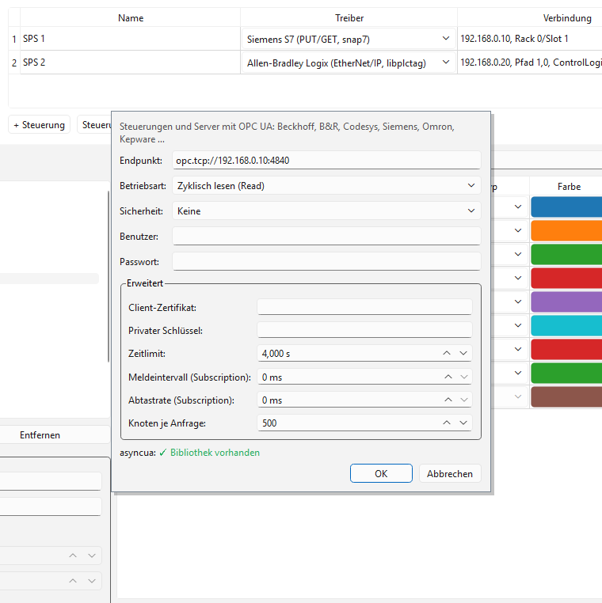

   Verbindungseinstellungen des Treibers opcua mit Betriebsart Subscription.

**Subscription:** Statt in jedem Zyklus alle Knoten zu lesen, richtet der Treiber
beim Verbinden ein Abonnement ein; der Server meldet nur noch geänderte Werte. Der
Logger zeichnet weiterhin im Intervall der Steuerung auf (mit dem zuletzt gemeldeten
Wert). Das spart bei vielen, selten wechselnden Werten Netzlast und Serverleistung.
Die Anfangswerte werden einmal gelesen; die Verbindung prüft der Treiber alle paar
Sekunden mit einer kleinen Leseanfrage und verbindet bei Bedarf neu. Arrays (Blöcke)
werden mit Indexbereich abonniert.

Treiber ``ads`` – Beckhoff TwinCAT (ADS)
----------------------------------------------------------------------

Für TwinCAT 2 und 3 über das Beckhoff-Protokoll ADS (AMS/TCP, Port 48898) – ohne
Zusatzbibliothek und ohne TwinCAT auf dem Logger-Rechner. (Alternativ funktioniert
TwinCAT auch über den Treiber ``opcua``, wenn der TF6100-Server lizenziert ist.)

**Route anlegen:** Die Steuerung beantwortet ADS-Anfragen nur von Rechnern, für die
eine **Route** eingetragen ist: im TwinCAT-System-Manager bzw. XAE unter
*SYSTEM › Routes* (oder im TwinCAT-Symbol der Steuerung) eine statische Route mit der
**AMS-Net-ID dieses Rechners** (Parameter *Eigene AMS-Net-ID*, Standard: IP-Adresse + ``.1.1``)
und seiner IP-Adresse anlegen. Ohne Route meldet der Treiber
„ADS-Fehler 0x7: Zielrechner nicht gefunden“.

.. list-table:: Verbindungsparameter
   :header-rows: 1
   :widths: 30 70

   * - Parameter
     - Bedeutung
   * - IP-Adresse
     - Adresse der Steuerung.
   * - AMS-Net-ID der Steuerung
     - z. B. ``5.12.34.56.1.1`` (TwinCAT zeigt sie im Router an); leer = IP + ``.1.1``.
   * - AMS-Port
     - ``851`` = erste SPS-Laufzeit von TwinCAT 3 (``852`` … weitere), ``801`` = TwinCAT 2.
   * - Eigene AMS-Net-ID, eigener AMS-Port (Erweitert)
     - Muss zur Route passen; leer = eigene IP-Adresse + ``.1.1``.
   * - Variablen je Anfrage (Erweitert)
     - Höchstzahl Teile einer Summenanfrage (TwinCAT: 500).

**Adressen:** symbolisch wie im SPS-Projekt – ``MAIN.fTemperatur``,
``GVL.aWerte[3]``, ``MAIN.stMotor.nDrehzahl``, TwinCAT 2 global ``.gWert`` – oder
Merker/E/A ``%MW10``, ``%MD4``, ``%MX2.3``, ``%IW0``, ``%QX0.1`` bzw. Indexgruppe:Offset
(``0x4020:16``). Symbolnamen werden beim Verbinden einmal aufgelöst; danach werden alle
Variablen mit Summenanfragen gelesen (bis zu 500 je Anfrage). Nach einem Download in die
Steuerung verbindet der Treiber neu und löst die Namen erneut auf.

**Blöcke:** Array-Name ohne Index (``MAIN.aWerte``) + erster Index + Anzahl – der
Ausschnitt wird am Stück gelesen.

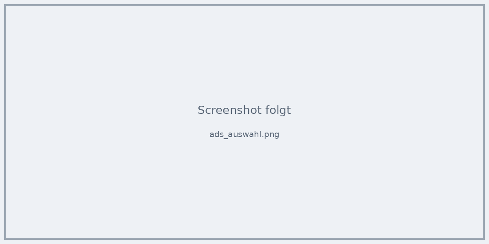

   Verbindungseinstellungen des Treibers ads (AMS-Net-ID, Ports, Erweitert).

**Auswahldialog „Aus TwinCAT wählen…“:** liest die Symboltabelle der Steuerung und zeigt
sie als Baum (``MAIN`` › ``Pumpe`` › ``fDruck``) mit Typ und Kommentar; Filterfeld,
Variablen anhaken, Arrays aus Zahlen per Doppelklick als Block übernehmen.

Treiber ``slmp`` – Mitsubishi MELSEC (SLMP / MC-Protokoll)
----------------------------------------------------------------------

Für MELSEC iQ-R, iQ-F (FX5), Q (QnU, QnUDE …) und L mit eingebautem Ethernet oder
Ethernet-Modul. Protokoll SLMP (MC-Protokoll) mit 3E-Rahmen, binär, über TCP oder
UDP. Keine Zusatzbibliothek.

**Vorbereitung (GX Works):** In den Ethernet-Einstellungen eine Verbindung
„SLMP“ (iQ-R/iQ-F) bzw. „MC-Protokoll“ (Q/L), **binär**, TCP oder UDP, mit Port
anlegen und auf die Steuerung übertragen. Der Logger liest nur.

.. list-table:: Verbindungsparameter
   :header-rows: 1
   :widths: 30 70

   * - Parameter
     - Bedeutung
   * - IP-Adresse, Port, Protokoll
     - Wie in GX Works eingestellt (z. B. Port 5007, TCP).
   * - Serie
     - *Q/L/iQ-F* (Standardformat) oder *iQ-R* (erweitertes Format mit 4-Byte-
       Gerätenummern). Eine iQ-R versteht beide.
   * - Netzwerk-Nr., Station, Ziel-Modul (Erweitert)
     - Für die eigene Station ``0``, ``255``, ``03FF``. Bei Multi-CPU-Systemen
       Ziel-Modul ``03E0`` … ``03E3`` für CPU 1 … 4.
   * - Wörter je Anfrage, Lücke, Zeitlimit (Erweitert)
     - Standard 960 Wörter (Höchstwert des Protokolls), 16 Wörter, 2000 ms.

**Adressen** in MELSEC-Schreibweise. ``X``, ``Y``, ``B``, ``W``, ``SB``, ``SW``,
``DX``, ``DY`` sind **hexadezimal**, alle übrigen dezimal:

.. list-table::
   :header-rows: 1
   :widths: 40 60

   * - Adresse
     - Bedeutung
   * - ``D100``, ``W1A``, ``R200``, ``ZR1000``, ``SD10``, ``Z0``
     - Wortgeräte (Datenregister, Link-Register, Dateiregister …)
   * - ``TN5``, ``CN3``, ``SN0``
     - Istwerte von Timern, Zählern, remanenten Timern
   * - ``M10``, ``X1F``, ``Y20``, ``B3``, ``L5``, ``F0``, ``SM400``, ``TS5``, ``CS3``
     - Bitgeräte (Typ ``BOOL``)
   * - ``D100.3``
     - Bit 3 eines Wortes (Bit ``0`` … ``F``)
   * - ``M16`` mit Typ ``UINT``
     - 16 Bits eines Bitgeräts als Wort (nur ab einem Vielfachen von 16)

**Typen:** ``BOOL``, ``INT``, ``UINT``, ``WORD``, ``DINT``, ``UDINT``, ``DWORD``,
``REAL``, ``LINT``, ``ULINT``, ``LWORD``, ``LREAL``. Werte über mehrere Wörter
belegen aufeinanderfolgende Register, niederwertiges Wort zuerst (wie in GX Works).

**Blöcke:** Startgerät + Anzahl (z. B. ``D100``, ``REAL``, 10 → ``D100``,
``D102`` … ``D118``). Unabhängig davon fasst der Treiber benachbarte Adressen zu
möglichst wenigen Anfragen zusammen; Bitgeräte werden wortweise (16 Bits je Wort)
gelesen.

Fehlerantworten der Steuerung erscheinen mit Code, z. B. *SLMP-Fehler 0xC056:
Adresse außerhalb des Bereichs*; betroffen ist nur die jeweilige Anfrage.

Treiber ``fins`` – Omron (FINS)
----------------------------------------------------------------------

Für Omron CJ1/CJ2, CS1, CP1L/CP1H (Ethernet), CP2E und NJ/NX (mit FINS-Freigabe)
über FINS/TCP oder FINS/UDP, Port 9600 – ohne Zusatzbibliothek.

.. list-table:: Verbindungsparameter
   :header-rows: 1
   :widths: 30 70

   * - Parameter
     - Bedeutung
   * - IP-Adresse, Port
     - Adresse der Steuerung bzw. der Ethernet-Einheit; Port 9600.
   * - Protokoll
     - *FINS/TCP* (empfohlen; die Steuerung vergibt die Knotennummern) oder *FINS/UDP*.
   * - Ziel-/Quellknoten, Ziel-/Quellnetz (Erweitert)
     - FINS-Adressen. ``0`` = automatisch: bei TCP von der Steuerung, bei UDP das letzte
       Byte der IP-Adresse (Steuerung bzw. eigener Rechner). Bei UDP muss die
       Knotentabelle der Steuerung zur Adresse dieses Rechners passen.
   * - Wörter je Anfrage (Erweitert)
     - Höchstens 999 (ältere CPUs über UDP ggf. weniger).

**Adressen** in Omron-Schreibweise (dezimal): ``D100``/``DM100``, ``W10``, ``H20``,
``A300``, ``CIO100`` (oder nur ``100``), erweiterter Datenspeicher ``E0_100`` (Bank 0 …
24), Timer-/Zähler-Istwerte ``T5``, ``C3``; Bits mit Punkt und Bitnummer 00 … 15:
``D100.05``, ``CIO0.01``, ``W3.15`` (Typ BOOL). DINT/REAL/LREAL belegen 2 bzw. 4
Wörter, niederwertiges Wort zuerst (wie CX-Programmer). Benachbarte Adressen ergeben
eine Anfrage; Blöcke: Startadresse, Elemente lückenlos.

Treiber ``kvhostlink`` – KEYENCE KV (Host Link)
----------------------------------------------------------------------

Für KEYENCE KV-8000, KV-7000, KV-5000/5500, KV-3000, KV Nano und KV-X mit
Ethernet (eingebaut oder KV-EP21V/KV-LE21V). Protokoll: Host Link (ASCII) über
TCP, Port **8501**. In KV STUDIO ist nichts einzurichten. Keine Zusatzbibliothek.

.. list-table:: Verbindungsparameter
   :header-rows: 1
   :widths: 30 70

   * - Parameter
     - Bedeutung
   * - IP-Adresse, Port
     - Adresse der KV; Port Standard 8501.
   * - Wörter je Anfrage, Lücke, Zeitlimit (Erweitert)
     - Standard 500 Wörter, 16 Wörter, 2000 ms.

**Adressen** in KEYENCE-Schreibweise:

.. list-table::
   :header-rows: 1
   :widths: 40 60

   * - Adresse
     - Bedeutung
   * - ``DM100``, ``EM0``, ``FM0``, ``ZF10``, ``W1A`` (hex), ``TM0``, ``CM10``, ``VM0``, ``Z1``
     - Wortgeräte
   * - ``R1000``, ``MR500``, ``LR0``, ``CR3``
     - Relais (Typ ``BOOL``); die letzten beiden Ziffern sind die Bitnummer 00–15
       (``R1000`` = Kanal 10, Bit 0; auf ``R1015`` folgt ``R1100``)
   * - ``B1F``, ``VB0``
     - Link-Relais (hexadezimal, Typ ``BOOL``)
   * - ``T10``, ``C5``
     - Istwert von Timer bzw. Zähler (32 Bit, Typ ``DINT``/``UDINT``)
   * - ``DM100.3``
     - Bit 3 eines Wortes

**Typen** wie beim Treiber ``slmp``; Werte über mehrere Wörter: niederwertiges
Wort zuerst (wie in KV STUDIO). Benachbarte Wortadressen werden mit einem
``RDS``-Befehl gelesen, benachbarte Relais ebenso.

Fehlerantworten (``E0`` Gerätenummer ungültig, ``E1`` Befehl ungültig …)
betreffen nur die jeweilige Anfrage.

Treiber ``toyopuc`` – JTEKT TOYOPUC (Computer Link)
----------------------------------------------------------------------

Für JTEKT TOYOPUC PC10G/PC10, PC3J/PC3JG, Nano 10GX und TOYOPUC-Plus mit
Ethernet. Protokoll: Computer Link (binär) über TCP oder UDP. Keine
Zusatzbibliothek.

**Vorbereitung (PCwin):** Am Ethernet-Modul bzw. der eingebauten Schnittstelle
einen Port für *Computer Link* (TCP passiv bzw. UDP) einrichten.

.. list-table:: Verbindungsparameter
   :header-rows: 1
   :widths: 30 70

   * - Parameter
     - Bedeutung
   * - IP-Adresse, Port, Protokoll
     - Wie in PCwin eingestellt.
   * - Wörter je Anfrage, Lücke, Zeitlimit (Erweitert)
     - Standard 512 Wörter, 16 Wörter, 2000 ms.

**Adressen** wie in PCwin, Nummern **hexadezimal**:

.. list-table::
   :header-rows: 1
   :widths: 40 60

   * - Adresse
     - Bedeutung
   * - ``D0100``, ``R0010``, ``S0020``, ``N0005``, ``B0000``
     - Register (Daten-, Link-, Sonder-, Istwert-, Dateiregister)
   * - ``M0010``, ``X0007``, ``Y0020``, ``K0001``, ``L0100``, ``V0000``, ``T0005``, ``C0003``, ``P0000``
     - Relais und Kontakte (Typ ``BOOL``)
   * - ``M010W``
     - 16 Relais als Wort (``M0100`` … ``M010F``)
   * - ``D0100.F``
     - Bit F eines Registers
   * - ``U00100``, ``EN0010``, ``H0000``, ``ES0000``, ``EB00000``
     - Erweiterte Register
   * - ``EM0010``, ``EX0007``, ``EY0007``, ``EK0000``, ``EV0000``, ``EL0000``, ``GX0000``, ``GM0000`` …
     - Erweiterte Relais
   * - ``P1-D0100``, ``P2-M1000``, ``P3-R0000``
     - Programmbereiche 1–3 (PC3J im 3-Programm-Modus, PC10); auch die oberen
       Nummernbereiche (z. B. ``D3000`` … bzw. ``M1000`` …) werden so adressiert.

**Typen** wie beim Treiber ``slmp``; Werte über mehrere Wörter: niederwertiges
Wort zuerst. Die Wortadressen der Bereiche entsprechen dem Computer-Link-Handbuch
von JTEKT (Grundbereich mit Befehl 1C, erweiterter Bereich und Programmbereiche
mit Befehl 94).

Treiber ``s5as511`` – Siemens S5 (PG-Schnittstelle AS511)
----------------------------------------------------------------------

Für SIMATIC S5-90U, 95U, 100U, 115U, 135U, 155U über die **PG-Schnittstelle**
(20-mA-Linienstrom). Benötigt wird ein Pegelwandler 20 mA ⇄ RS-232 oder USB
(PG-Adapterkabel, z. B. 6ES5 734-1BD20, oder ein USB-PG-Adapter). Protokoll:
AS511 mit 9600 Baud, 8 Datenbits, gerade Parität, 1 Stoppbit. Bibliothek:
``pyserial``.

.. list-table:: Verbindungsparameter
   :header-rows: 1
   :widths: 30 70

   * - Parameter
     - Bedeutung
   * - Schnittstelle
     - Schnittstelle des Adapters, z. B. ``COM1`` oder ``/dev/ttyUSB0``.
   * - Baudrate
     - 9600 (Standard der PG-Schnittstelle).
   * - Parität, Bytes je Anfrage, Lücke, Zeitlimit (Erweitert)
     - Gerade Parität; 64 Bytes; 8 Bytes; 500 ms.

**Adressen** in S5-Schreibweise (deutsch oder englisch):

.. list-table::
   :header-rows: 1
   :widths: 40 60

   * - Adresse
     - Bedeutung
   * - ``DB10.DW4``
     - Datenwort 4 des DB 10 (Typ ``WORD``, ``INT`` oder ``S5TIME``)
   * - ``DB10.DL4``, ``DB10.DR4``
     - linkes bzw. rechtes Byte von Datenwort 4 (Typ ``BYTE``)
   * - ``DB10.DD4``
     - Doppelwort aus DW4 und DW5 (Typ ``DWORD``, ``DINT`` oder ``REAL``)
   * - ``DB10.D4.3``
     - Bit 3 von Datenwort 4 (Bit 0 … 15; Typ ``BOOL``)
   * - ``EB0``, ``EW0``, ``ED0``, ``E0.1`` (``I…``)
     - Eingänge (Prozessabbild)
   * - ``AB1``, ``AW2``, ``AD4``, ``A1.0`` (``Q…``)
     - Ausgänge (Prozessabbild)
   * - ``MB10``, ``MW10``, ``MD10``, ``M5.0`` (``F…``)
     - Merker
   * - ``T5``, ``Z3`` (``C3``)
     - Timer- bzw. Zählerwort

**Typen:** ``BOOL``, ``BYTE``, ``WORD``, ``INT``, ``DWORD``, ``DINT``,
``REAL`` (S5-Gleitpunktzahl „KG“: Exponent und Mantisse im Zweierkomplement) und
``S5TIME`` (Timerwort mit Zeitbasis → Millisekunden). Die Daten liegen im S5 im
Motorola-Format (höherwertiges Byte zuerst).

**Ablauf:** Beim Verbinden liest der Treiber die Systemdaten der CPU (Lage von
Prozessabbild, Merkern, Timern und Zählern im Speicher), beim ersten Zugriff auf
einen Datenbaustein dessen Adresse und Länge, und liest dann die Speicherbereiche
mit möglichst wenigen Aufträgen. Ändert sich ein Datenbaustein (neu geladen, Länge
geändert), mit **■ Stop** / **▶ Start** neu verbinden.

**Hinweise:**

* Die PG-Schnittstelle ist langsam (9600 Baud, Quittungsverkehr): Ein Auftrag
  dauert etwa 50–100 ms. Für viele Werte ein Intervall von 1 s oder mehr wählen
  und Werte möglichst zusammenhängend anlegen.
* Solange der Logger liest, ist die PG-Schnittstelle belegt – zum Programmieren
  mit STEP 5 den Logger stoppen.
* Fehlt ein Datenbaustein, meldet die Variable „DB… nicht vorhanden“; Adressen
  hinter dem Ende des DB „Adresse außerhalb von DB…“.

.. _uebernahme:

Übernahme von Konfigurationen der Einzelprogramme
======================================================================

Konfigurationsdateien des **S7 Datenloggers**, **TIA Datenloggers** und
**CLX Datenloggers** werden übernommen – als JSON-Datei direkt mit **Datei › Öffnen…**,
als ältere INI-Datei nach der einmaligen Umwandlung (**Datei › INI-Datei umwandeln …**,
siehe `Ältere INI-Dateien umwandeln <ini-umwandeln_>`__). Dabei gilt:

* Der Treiber jeder Steuerung wird aus ihren Einträgen erkannt: ``rack``/``slot`` →
  ``s7``, ``pfad``/``cpu`` → ``clx``, ``tls``/``rolle``/``port`` → ``tia``.
* S7-Variablen (``bereich``, ``db``, ``byte``, ``bit``) werden in Adressen
  umgerechnet, z. B. ``DB10.DBD4`` oder ``M5.0``; S7-Blöcke erhalten ihre
  Startadresse. Tag-Namen von TIA und CLX werden unverändert übernommen.
* Die Pfade der S7-DB-Quellen (``symbolquellen``) wandern nach ``treiberdaten``.
* Diagramme, Achsen, Formeln, Blöcke, Trigger, PID-Einstellungen, Datenbank,
  Webserver und Anzeige werden unverändert übernommen.

Gespeichert wird im Format des PLC Datenloggers (Schlüssel ``treiber`` und
``adresse``). Die Einzelprogramme können diese Datei danach **nicht** mehr lesen –
speichern Sie deshalb mit **Speichern unter…** unter neuem Namen, wenn die Datei
auch im Einzelprogramm weiter benutzt werden soll.

Konfigurationen mehrerer Einzelprogramme lassen sich zusammenführen, indem die
Steuerungen und Variablen im Konfigurationsprogramm neu angelegt oder die
Einträge der Listen ``steuerungen`` und ``variablen`` in der JSON-Datei von Hand
kopiert werden (``steuerung`` der Variablen anpassen).

Logger (``plc_logger.py``)
======================================================================

Bedienelemente
----------------------------------------------------------------------

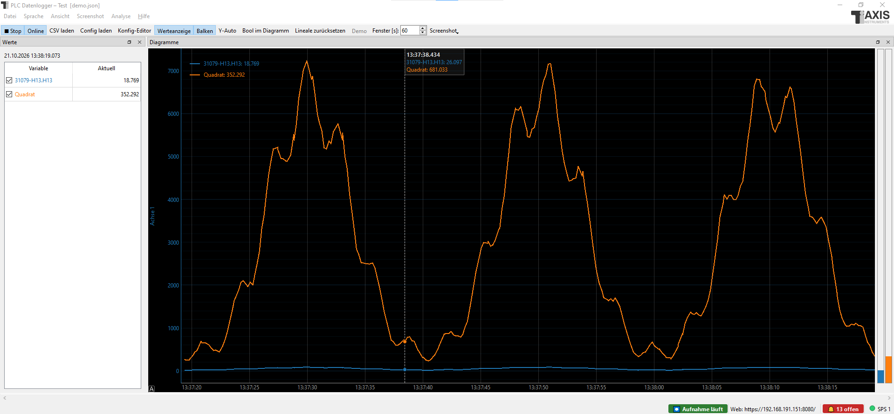

   Das Hauptfenster des Loggers mit Werkzeugleiste, Diagrammen, Wertetabelle und Statusleiste.

Werkzeugleiste (oben):

.. list-table::
   :header-rows: 1
   :widths: 25 75

   * - Element
     - Funktion
   * - **▶ Start / ■ Stop**
     - Startet bzw. beendet Aufzeichnung und CSV-Logging.
   * - **Online / Offline**
     - Schaltet zwischen fortlaufender Anzeige und Rückblick um.
   * - **CSV laden**
     - Öffnet eine gespeicherte CSV-Datei zur Ansicht (Offline-Modus).
   * - **Konfiguration**
     - Startet das Konfigurationsprogramm.
   * - **Werteanzeige**
     - Blendet die Wertetabelle (rechts) ein oder aus.
   * - **Balken**
     - Blendet die schmalen Balken neben den Diagrammen ein oder aus.
   * - **Y-Auto**
     - Aktiv: alle Y-Achsen werden automatisch skaliert und überschreiben feste
       Bereiche. Inaktiv: Es gelten die Einstellungen der Konfiguration.
   * - **Bool im Diagramm**
     - Zeichnet BOOL-Variablen zusätzlich als gefüllte Treppenlinie im Diagramm
       (abhängig von der Y-Achse). Standard: aus, BOOLs erscheinen nur als
       Streifen in der Legende.
   * - **Lineale zurücksetzen**
     - Setzt die beiden Lineale (Offline) auf ein Drittel und zwei Drittel des
       sichtbaren Zeitbereichs.
   * - **Demo**
     - Simulierte Werte statt SPS (siehe `Demo-Modus <demo-modus_>`__).
   * - **Screenshot**
     - Öffnet eine Liste der Diagramme; das gewählte Diagramm wird als PNG
       oder SVG gespeichert (siehe `Screenshots von Diagrammen <screenshots_>`__).
   * - **Fenster [s]**
     - Breite des sichtbaren Zeitfensters in Sekunden (1 bis 604800).

Am unteren Fensterrand befindet sich die **Zeit-Scrollleiste** (nur im
Offline-Modus aktiv). Die Statuszeile zeigt Verbindungsmeldungen und den
Pfad der gespeicherten CSV-Datei.

Das Menü **Ansicht** enthält die Anordnung der Diagramme, eine Liste zum
Ein- und Ausblenden einzelner Diagramme sowie die Schalter für Werteanzeige
und Balken.

Aufzeichnung starten und beenden
----------------------------------------------------------------------

#. **▶ Start** drücken. Der Logger lädt die Konfiguration neu, baut die
   Diagramme auf und verbindet sich mit den Steuerungen.
#. Jede Steuerung wird in ihrem eigenen Intervall gelesen. Die Messwerte werden
   zu Zeilen zusammengeführt und in die CSV-Datei geschrieben.
#. **■ Stop** beendet die Aufzeichnung und schließt die Datei. Beim Beenden des
   Programms wird automatisch gestoppt und – bei gesetzter Option – die
   aktuelle CSV-Datei archiviert (siehe `Dateigröße begrenzen und archivieren <csv-archiv_>`__).

Bei Verbindungsverlust versucht der Logger selbstständig, die Verbindung
wiederherzustellen, und meldet dies in der Statuszeile. Während der Pause
entstehen Lücken in den Daten – nur bei den Variablen der betroffenen
Steuerung, die übrigen laufen weiter.

Das Lesen, die Berechnung der Formeln und das Schreiben der CSV-Datei laufen in
eigenen Threads, getrennt von der Oberfläche. Die Anzeige holt sich nur etwa
zehnmal pro Sekunde einen Ausschnitt der Daten und zeichnet unsichtbare Kurven
nicht neu; dadurch bleibt die Bedienung auch bei vielen Variablen flüssig.

Menü **Datei** des Loggers: **Config laden …** (``Strg+O``, Dateidialog für eine
beliebig benannte Konfigurationsdatei), **Konfiguration neu laden** (``F5``),
**Konfig-Editor**, **CSV laden**, **Webserver-Adresse …** und **Beenden**.
Der Fenstertitel zeigt den Projektnamen und die Konfigurationsdatei.

.. _status-led:

Status-LEDs der Verbindungen
----------------------------------------------------------------------

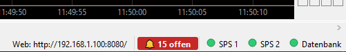

   Status-LEDs in der Statusleiste: grün, gelb, rot, grau.

In der Statusleiste zeigt für jede Steuerung eine **LED** mit ihrem Namen den
Verbindungszustand:

.. list-table::
   :header-rows: 1
   :widths: 20 80

   * - Farbe
     - Bedeutung
   * - grau
     - Steuerung nicht aktiv (abgeschaltet oder Aufzeichnung gestoppt).
   * - gelb
     - Verbindung wird aufgebaut.
   * - grün
     - Verbindung steht, es wird gelesen.
   * - rot
     - Verbindungs- oder Lesefehler; der Logger versucht es erneut.

Der Tooltip der LED zeigt die Statusmeldung (bei Fehlern den Fehlertext) und die
Zykluszeit der letzten Leseanfrage.
Im Webserver erscheinen dieselben LEDs.

Online-Modus
----------------------------------------------------------------------

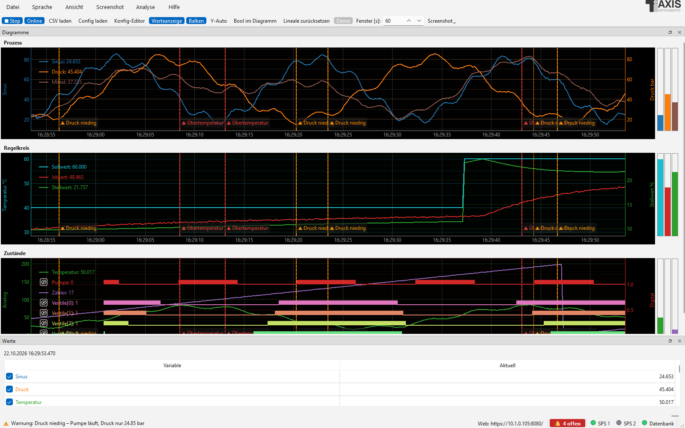

   Online-Modus: fortlaufende Anzeige der letzten Sekunden.

Im Online-Modus läuft die Zeitachse mit den neuesten Daten mit. Es werden
immer die letzten *N* Sekunden angezeigt (Einstellung **Fenster [s]**). Die
Wertetabelle zeigt in der Spalte *Aktuell* den jeweils letzten Messwert.
Die Aufzeichnung läuft unabhängig von der Anzeige weiter.

**Werte am Mauszeiger:** Steht die Maus über einem Diagramm, erscheint eine
gestrichelte senkrechte Linie am nächstgelegenen Messpunkt. Ein Kästchen daneben
zeigt dessen Uhrzeit und die Werte aller eingeblendeten Variablen dieses Diagramms
(auch der BOOL-Variablen); Punkte markieren die Werte auf den Kurven. Bleibt die
Maus stehen, laufen Linie und Werte mit den neuen Messungen mit. Verlässt die Maus
das Diagramm, verschwindet die Anzeige. Abschalten: **Ansicht › Werte am
Mauszeiger (online)** (die Einstellung bleibt gespeichert). Im Offline-Modus
übernehmen die Lineale diese Aufgabe.

**Zoomen mit der Maus (nur Zeitachse):** Auch online lässt sich die Zeitachse mit dem
**Mausrad** (bzw. Ziehen mit der rechten Maustaste) zoomen; die Y-Achsen bleiben
unverändert. Die neue Breite wird als **Fenster [s]** übernommen, das rechte Ende
folgt weiter den neuesten Werten.

Offline-Modus
----------------------------------------------------------------------

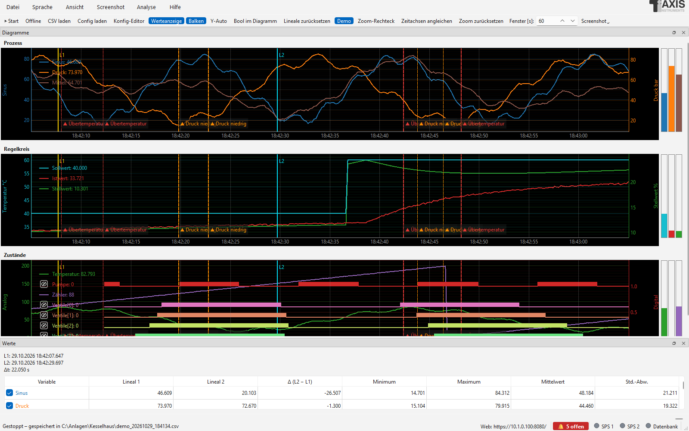

   Offline-Modus: Rückblick mit Scrollleiste.

Im Offline-Modus wird die Anzeige eingefroren, und Sie können in der Zeit
zurückblättern:

* **Zeit-Scrollleiste** unten: durch die aufgezeichneten Daten blättern.
* **Maus:** Im Diagramm mit gedrückter Maustaste ziehen, um die Zeitachse zu
  verschieben, und mit dem Mausrad zoomen. Scrollleiste und
  *Fenster [s]* folgen automatisch.
* **Fenster [s]:** Breite des sichtbaren Zeitbereichs.

.. note::

   Beim Wechsel in den Offline-Modus wird eine Momentaufnahme aller bis dahin
   gemessenen Daten erstellt. Läuft die Aufzeichnung weiter, erscheinen neuere
   Daten erst, wenn Sie erneut von *Online* auf *Offline* umschalten.

Der Speicher im Programm ist auf etwa 300 000 Messpunkte begrenzt; ältere
Punkte werden dann aus der Anzeige entfernt. Die CSV-Datei enthält immer alle
Daten.

Lineale (Offline)
----------------------------------------------------------------------

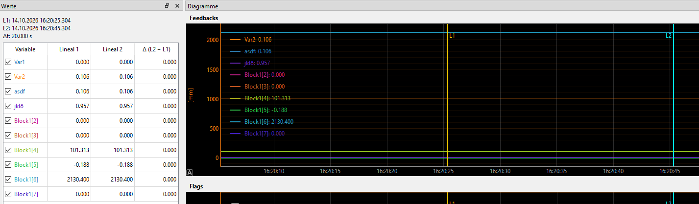

   Zwei Lineale mit Zeit- und Differenzanzeige.

Im Offline-Modus erscheinen in allen Diagrammen zwei senkrechte Lineale:
**L1** (gelb) und **L2** (cyan). Beide lassen sich mit der Maus verschieben
und sind über alle Diagramme hinweg synchron.

Die Wertetabelle zeigt dann:

.. list-table::
   :header-rows: 1
   :widths: 25 75

   * - Spalte
     - Inhalt
   * - Lineal 1
     - Wert jeder Variable am Zeitpunkt von L1.
   * - Lineal 2
     - Wert jeder Variable am Zeitpunkt von L2.
   * - Δ (L2 − L1)
     - Differenz der beiden Werte.

Über der Tabelle werden die Zeitpunkte von L1 und L2 sowie die Zeitdifferenz
**Δt** in Sekunden angezeigt. Verwendet wird jeweils der zeitlich nächste
Messwert (ohne Interpolation).

.. _trigger-marken:

Trigger-Marken an der Zeitachse
----------------------------------------------------------------------

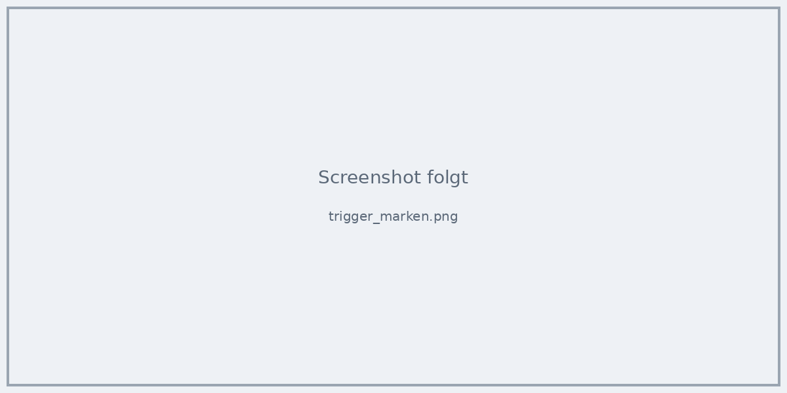

   Trigger-Marken: Alarm (rot), Warnung (orange), Aufnahme per Trigger (grün), Notiz (grau).

Ereignisse aus dem Ereignisprotokoll erscheinen in allen Diagrammen als **senkrechte
gestrichelte Linie** mit einem Kurztext unten an der Zeitachse (▲ Name des Triggers):
rot = *Alarm*, orange = *Warnung*, blau = *Info*, grün = Beginn einer
`Aufzeichnung per Trigger <trigger-aufzeichnung_>`__, grau = Notiz. Der Tooltip zeigt
Zeit, Text sowie Gehen- und Quittierzeit. Die Marken gibt es online und offline,
auch beim Anzeigen einer geladenen CSV-Datei oder eines Datenbank-Zeitraums (aus dem
Ereignisprotokoll der Konfiguration). Bei sehr vielen Ereignissen im sichtbaren
Bereich werden höchstens 150 gezeigt. Abschalten: **Ansicht › Trigger-Marken an der
Zeitachse**.

.. _seiten:

Seiten, Diagramme und Anordnung
----------------------------------------------------------------------

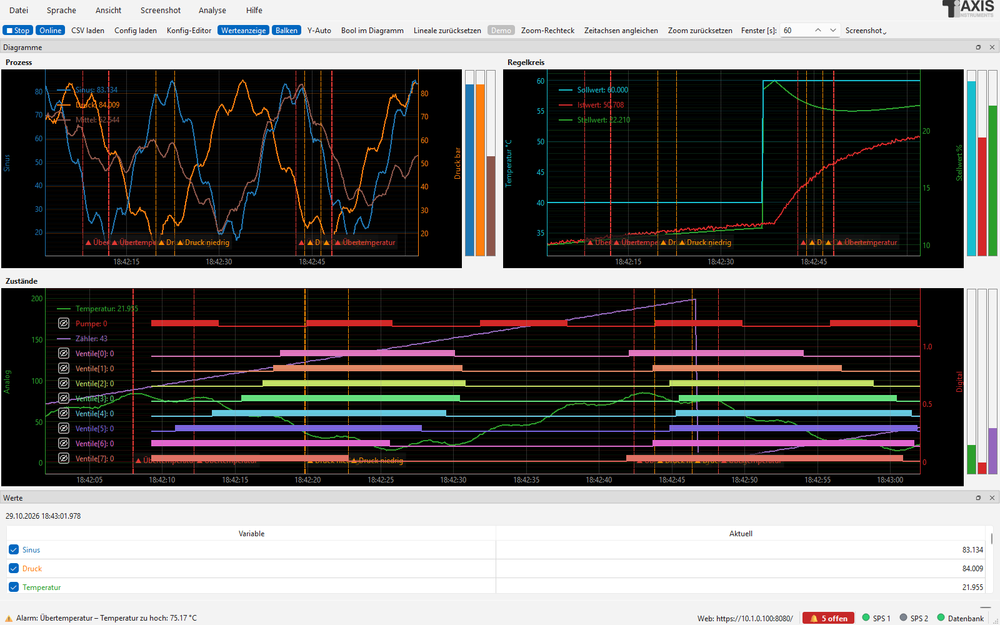

   Diagramme einer Seite als Raster (Grid) angeordnet.

Die Diagramme liegen auf **Seiten**. Eine Seite ist ein Dock-Fenster bzw. ein
Tab und kann **mehrere Diagramme** enthalten:

* Ohne Seitenangaben in der Konfiguration liegen alle Diagramme auf einer
  gemeinsamen Seite *Diagramme*. Im Modus *Tabs* erhält dann jedes Diagramm
  einen eigenen Tab.
* Mit dem Feld **Seite (Tab)** in der Konfiguration bestimmen Sie selbst, welche
  Diagramme zusammen auf einer Seite liegen (gleicher Seitenname = gleiche
  Seite). So können Sie z. B. die Tabs *Prozess* und *Alarme* mit je mehreren
  Diagrammen bilden.

**Mindesthöhe und Scrollleiste:** Jedes Diagramm hat eine Mindesthöhe. Passen
nicht alle Diagramme einer Seite ins Fenster, erscheint an der Seite eine
Scrollleiste. Im Modus *Nebeneinander* gilt entsprechend eine Mindestbreite mit
waagerechter Scrollleiste.

**Anordnung der Seiten** (Menü **Ansicht › Anordnung**):

.. list-table::
   :header-rows: 1
   :widths: 25 75

   * - Modus
     - Wirkung
   * - Untereinander
     - Seiten liegen übereinander; die Diagramme einer Seite stehen
       untereinander.
   * - Nebeneinander
     - Seiten liegen nebeneinander; die Diagramme einer Seite stehen ebenfalls
       nebeneinander.
   * - Tabs
     - Jede Seite ist ein Tab; die Diagramme einer Seite stehen untereinander.

**Anordnung der Diagramme auf einer Seite** (Menü **Ansicht › Diagramme auf der
Seite**): *Automatisch* richtet sich nach der Anordnung der Seiten; *Untereinander*
und *Nebeneinander* erzwingen eine Spalte bzw. eine Zeile; **Raster (Grid)** legt
die Diagramme in Zeilen und Spalten. Die Spaltenzahl stellt **Ansicht › Raster-Spalten**
ein (*Automatisch* wählt etwa die Wurzel der Diagrammzahl, bei sechs Diagrammen
also drei Spalten). Ein letztes einzelnes Diagramm füllt die Restzeile. Die
Voreinstellung steht in der Konfiguration (Reiter *Anzeige*).

Per **Drag & Drop** lässt sich die Anordnung weiter anpassen:

* **Seiten:** An der Titelleiste einer Seite anfassen und an den Rand einer
  anderen Seite ziehen (daneben bzw. darüber) oder auf deren Mitte ziehen (als
  Tab). Ein Doppelklick auf die Titelleiste löst die Seite als frei schwebendes
  Fenster.
* **Diagramme innerhalb einer Seite:** Die Titelzeile eines Diagramms (fett,
  über dem Diagramm) fassen und auf die Titelzeile eines anderen Diagramms
  derselben Seite ziehen. Das Diagramm wird an dieser Position eingefügt.

Seiten lassen sich über **Ansicht › Seiten / Diagramme** aus- und wieder
einblenden. Die per Drag & Drop angepasste Anordnung der Seiten bleibt bei
erneutem Start innerhalb derselben Programmsitzung erhalten, solange die
Seitennamen und der Modus gleich bleiben. Nach einem Programmneustart gilt
wieder die Standard-Anordnung.

Alle Diagramme teilen sich dieselbe Zeitachse.

Legende mit Livewerten
----------------------------------------------------------------------

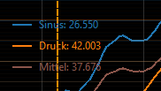

   Legende mit Livewerten; eine Kurve ist hervorgehoben, eine ausgeblendet.

Die Legende in jedem Diagramm zeigt hinter dem Namen jeder Variable den
**aktuellen Wert** in der Farbe der Variable, z. B. ``Temperatur: 51.234``.
Online ist das der letzte Messwert, offline der Wert am Lineal 1.

**Kurve hervorheben:** Ein **Linksklick** auf den Namen (oder das Muster) einer
Kurve in der Legende hebt sie hervor: Die Kurve wird dicker gezeichnet und liegt
im Vordergrund, der Name erscheint **fett**, alle übrigen Kurven des Diagramms
werden abgeblendet. Ein erneuter Klick auf denselben Namen hebt die Hervorhebung
wieder auf; ein Klick auf einen anderen Namen verschiebt sie.

**Kurve aus- und einblenden:** Rechtsklick auf den Namen einer Kurve in der
Legende öffnet ein Menü mit *Kurve ausblenden* bzw. *Kurve einblenden* sowie
*Alle Kurven dieses Diagramms einblenden*. Ausgeblendete Kurven erscheinen in
der Legende grau mit dem Zusatz *(aus)*. Das Häkchen in der Wertetabelle bleibt
damit synchron. Die Auswahl bleibt beim Wechseln der Anordnung erhalten.

.. _screenshots:

Screenshots von Diagrammen
----------------------------------------------------------------------

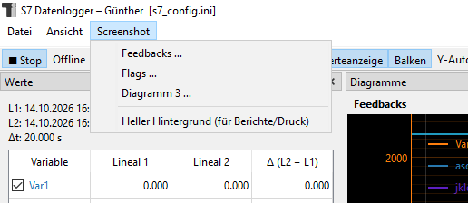

   Menü „Screenshot“ mit Auswahl des Diagramms und heller Hintergrund.

Einzelne Diagramme lassen sich als Bild speichern:

#. In der Werkzeugleiste auf **Screenshot** klicken (oder im Menü
   **Screenshot**) und das gewünschte Diagramm auswählen.
#. Im Speichern-Dialog Dateinamen und Format wählen: **PNG** (Pixelbild) oder
   **SVG** (Vektorgrafik). Das Format ergibt sich aus der Dateiendung bzw.
   dem gewählten Dateityp.

Der Screenshot enthält das Diagramm genau so, wie es angezeigt wird: Kurven,
alle Y-Achsen, Legende, Balken und im Offline-Modus auch die Lineale.
PNG-Dateien werden mit doppelter Auflösung erzeugt. Die **SVG-Datei** wird aus den
Messdaten selbst gezeichnet (Achsen mit Teilung, Raster, Zeitachse, Kurven, BOOL-Verläufe,
Lineale mit Beschriftung und Legende mit Werten) und lässt sich verlustfrei
skalieren und z. B. in Inkscape oder Office-Programmen weiter bearbeiten. Liegt das Diagramm in einem verdeckten Tab, wird es dafür
automatisch in den Vordergrund geholt.

Für Berichte und Ausdrucke lässt sich im Menü **Screenshot** die Option
**Heller Hintergrund (für Berichte/Druck)** einschalten. Der Screenshot wird
dann mit weißem Hintergrund und dunkler Schrift gespeichert; Lineale werden
dafür in dunkleren Farben gezeichnet. Die Bildschirmanzeige selbst bleibt
unverändert. Die Einstellung gilt für die laufende Programmsitzung.

Wertetabelle (Werteanzeige)
----------------------------------------------------------------------

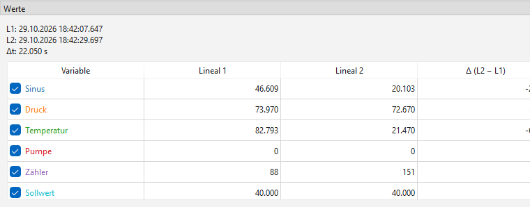

   Wertetabelle mit Aktualwerten (online) bzw. Linealwerten (offline).

Die Tabelle am rechten Rand listet alle Variablen, bei denen in der
Konfiguration *Werteanzeige* aktiviert ist.

* Der Name wird in der Variablenfarbe dargestellt. Ein Mauszeiger über dem
  Namen zeigt die Adresse (bei berechneten Variablen die Formel).
* Mit dem **Häkchen** vor dem Namen blenden Sie die Kurve der Variable im
  Diagramm aus oder ein (alternativ per Rechtsklick in der Legende).
* Die Spalten wechseln je nach Modus (*Aktuell* online, *Lineal 1 / Lineal 2 /
  Δ* offline).
* Offline zeigt die Tabelle zusätzlich die **Kennwerte zwischen den Linealen**:
  *Minimum*, *Maximum*, *Mittelwert* und *Std.-Abw.* (Standardabweichung der
  Stichprobe, wie ``STABW`` in Excel). Berücksichtigt werden alle Messpunkte vom
  Messpunkt an Lineal 1 bis zum Messpunkt an Lineal 2 (einschließlich); fehlende
  Werte werden übergangen. Bei BOOL-Variablen ist der Mittelwert der Anteil der
  Zeit, in der das Signal an war (0,25 = 25 %). Die Werte folgen jedem
  Verschieben der Lineale.

Y-Achsen und Skalierung
----------------------------------------------------------------------

* Jede Y-Achse ist in der Farbe ihrer ersten Variable beschriftet.
* Achsen mit **Auto-Skalierung** passen sich an die im Zeitfenster sichtbaren
  Daten an. Achsen mit festen Grenzen behalten ihren Bereich.
* Der Schalter **Y-Auto** in der Werkzeugleiste überschreibt vorübergehend alle
  festen Bereiche. Wird er wieder ausgeschaltet, gelten die Einstellungen der
  Konfiguration.

Balken für Aktualwerte
----------------------------------------------------------------------

Neben jedem Diagramm zeigt je Variable ein schmaler Balken den aktuellen
Wert (Breite einstellbar: Konfiguration › Anzeige › *Balkenbreite*). Die Skalierung
entspricht der Y-Achse der Variable. Im Offline-Modus
zeigen die Balken die Werte am Lineal 1. Fahren Sie mit der Maus über die
Balken, um Namen und Werte als Tooltip zu sehen.

BOOL-Variablen
----------------------------------------------------------------------

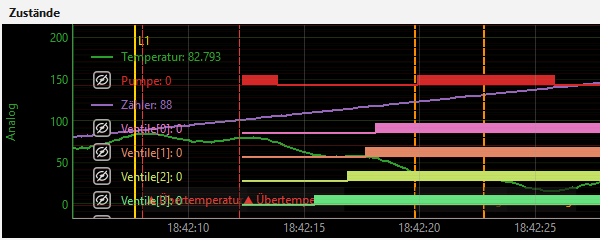

   BOOL-Signale: Linie bei 0, nach oben gehender Streifen bei 1, neben den Legendenzeilen.

Boolesche Variablen werden unabhängig von den Y-Achsen dargestellt:

* **In der Legende** stehen Name und Wert wie bei den analogen Kurven untereinander.
  Neben jedem BOOL-Eintrag, in der Höhe seiner Legendenzeile, läuft über die
  **Breite des Diagramms** wie bei einem digitalen Signal eine **Linie** auf der
  Grundlinie (Wert 0) bzw. ein **nach oben gehender Streifen** (Wert 1) in der
  Variablenfarbe. Wie eine Kurve deckt sie den dargestellten Zeitbereich ab
  (online die letzten *N* Sekunden, offline den sichtbaren Ausschnitt). So lassen
  sich mehrere BOOL-Variablen auf einen Blick vergleichen, ohne das Diagramm zu
  verdecken.
* **Als Kurve** werden BOOLs standardmäßig nicht gezeichnet (sie hängen sonst
  an einer Y-Achse). Mit **Bool im Diagramm** in der Werkzeugleiste erscheinen
  sie zusätzlich als transparent gefüllte Treppenlinie.
* **In der Wertetabelle** ist die Zelle bei Wert 1 in der Variablenfarbe
  **gefüllt**, bei Wert 0 leer.

Ausgeblendete BOOLs (Rechtsklick in der Legende) und hervorgehobene BOOLs
(Linksklick) werden abgeblendet bzw. mit dickerem Streifen gezeichnet. Der SVG-Export und der
Webserver (dort steht der Name in der Zeile des Streifens) zeigen die BOOL-Signale ebenso.

.. _demo-modus:

Demo-Modus
======================================================================

Der Demo-Modus erzeugt simulierte Werte, ohne dass eine SPS verbunden sein
muss:

#. In der Werkzeugleiste **Demo** aktivieren.
#. **▶ Start** drücken.

Die Variablen aus Ihrer Konfiguration werden dabei mit Testsignalen versorgt
(REAL: Sinus mit Rauschen, BOOL: Rechteck, Ganzzahlen: Sägezahn). Ist noch
nichts konfiguriert, legt der Demo-Modus zwei Beispiel-Diagramme mit mehreren
Y-Achsen und einem BOOL-Signal an. Der Schalter ist während der Aufzeichnung
gesperrt und wird nicht gespeichert. Die Demo-Daten werden als
``demo_JJJJMMTT_HHMMSS.csv`` abgelegt.

.. _webserver:

Webserver (Diagramme im Browser)
======================================================================

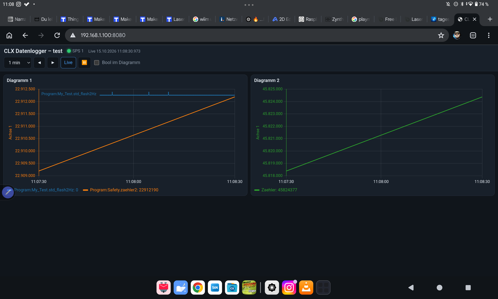

   Die Diagramme im Browser eines Tablets.

Mit der Option **Webserver starten** (Reiter *Webserver & Headless*) stellt der
Logger die Diagramme als Webseite bereit. Sie lässt sich mit jedem Browser im
Netzwerk öffnen, z. B. mit einem Tablet oder Smartphone – auch im Headless-Betrieb.

* **Adresse:** ``http://<IP-Adresse des Rechners>:<Port>/`` (Standard-Port 8080).
  Die Adresse zeigt im Logger **Datei › Webserver-Adresse …** – zusammen mit einem
  **QR-Code**: mit der Kamera des Smartphones scannen statt abtippen (mit Zugriffscode,
  sofern keine Anmeldung eingerichtet ist). Beim Start steht die Adresse außerdem im Log.
  Gegebenenfalls muss die Firewall den Port freigeben.
* **Zugriffscode:** Ist im Reiter ein Code eingetragen, wird die Seite mit
  ``http://…:8080/?token=CODE`` aufgerufen. Ohne Code und ohne Anmeldung kann jeder
  im Netzwerk zusehen; die Seite ist nur lesend, es gibt keine Steuerfunktion.
* **HTTPS und Anmeldung:** siehe unten.
* **Prozessbild:** Kacheln mit Werten, Zeigern und Lampen unter ``/prozess``, siehe
  `Prozessbild`_.
* **Logos:** Kundenlogo und Logo der Konfiguration (Reiter *Anzeige*) stehen in der
  Kopfzeile der Seiten (Diagramme, Prozessbild, Anmeldung); leere Felder = kein Logo.
* **Sprache:** Die Seiten (Diagramme, Anmeldung, Prozessbild, IO-Check) erscheinen in der
  Sprache, die im Programm eingestellt ist (Menü *Sprache*), z. B. Englisch.
* **Darstellung:** Die Seite zeigt je Seite (Tab) die Diagramme mit Chart.js, mit
  mehreren Y-Achsen, BOOL-Signalen als Treppenlinie und Status-LEDs der
  Steuerungen. Die Anzeige passt sich der Bildschirmgröße an.
* **Bedienung:** *Live* zeigt das letzte Zeitfenster; mit **◀ ▶** blättert man in
  der Zeit zurück (Verlauf), **Pause** hält die Anzeige an. Antippen eines
  Legendeneintrags hebt eine Kurve hervor, langes Drücken oder Doppelklick blendet
  sie aus.
* **Vollbild:** Der Knopf rechts über einem Diagramm (oder ein Doppelklick ins
  Diagramm) vergrößert es auf das ganze Fenster; die Kopfzeile mit Zeitfenster,
  **◀ ▶**, *Live* und *Pause* bleibt sichtbar und bedienbar. Wo der Browser es
  erlaubt, wird zusätzlich auf echtes Vollbild (ohne Adressleiste) umgeschaltet.
  Zurück zur normalen Darstellung: derselbe Knopf, Doppelklick, ``Esc`` oder die
  Zurück-Taste bzw. -Geste des Browsers. Im Vollbild werden mehr Punkte geladen
  (passend zur Breite).
* **Chart.js:** Die Bibliothek wird aus ``web_static/chart.umd.js`` ausgeliefert
  (die Installationsdatei enthält sie). Fehlt die Datei, lädt der Browser sie ersatzweise
  aus dem Internet (jsdelivr); im geschlossenen Netzwerk daher die Datei
  ``chart.umd.js`` (Chart.js 4) manuell in den Ordner ``web_static`` legen.

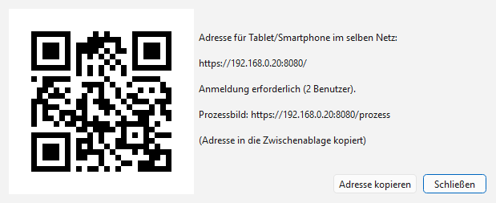

   Datei › Webserver-Adresse …: Adresse mit QR-Code zum Scannen.

Der Server überträgt nur die sichtbaren Daten, auf die Bildschirmbreite reduziert
(Minimum und Maximum je Abschnitt bleiben erhalten), und komprimiert sie.

.. _https-anmeldung:

HTTPS und Anmeldung
----------------------------------------------------------------------

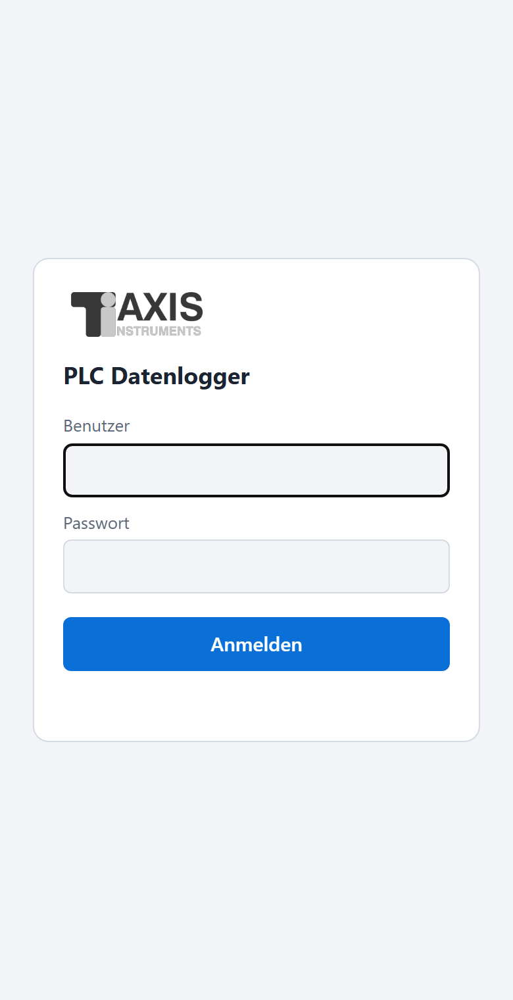

   Anmeldeseite des Webservers (Smartphone).

**HTTPS** (Reiter *Webserver & Headless*, *HTTPS (verschlüsselt)*): Die Seite ist dann
unter ``https://<IP>:<Port>/`` erreichbar. Ohne eigenes Zertifikat erzeugt der Logger
beim ersten Start ein **selbstsigniertes** (RSA 2048, zehn Jahre gültig, für
Rechnername, IP-Adresse und ``localhost``; Ordner ``web_tls`` im Datenordner). Der
Browser warnt beim ersten Aufruf, weil er den Aussteller nicht kennt: Fingerabdruck
vergleichen und die Ausnahme bestätigen. Den **SHA-256-Fingerabdruck** zeigt
**Datei › Webserver-Adresse …** (im Headless-Betrieb steht er in der Logdatei). Mit
einem Zertifikat der Firmen-CA (PEM-Dateien für Zertifikat und Schlüssel eintragen)
entfällt die Warnung. Benötigt das Paket ``cryptography`` (in der Installation enthalten).

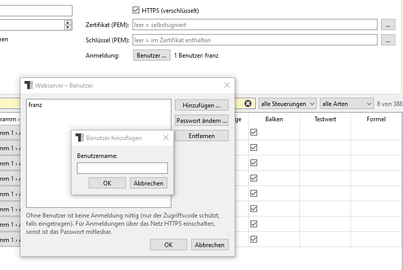

   Benutzer des Webservers anlegen (Konfigurationsprogramm, Reiter Webserver & headless).

**Anmeldung:** Mit **Benutzer …** Benutzer anlegen (Name und Passwort, mindestens
8 Zeichen); gespeichert wird nur ein Hash des Passworts (PBKDF2-SHA256), nicht das
Passwort selbst. Ist mindestens ein Benutzer eingetragen, zeigt der Browser zuerst eine
Anmeldeseite; die Anmeldung gilt 12 Stunden bzw. bis **⎋ Abmelden** (rechts oben auf der
Seite). Nach fünf Fehlversuchen ist die Adresse eine Minute gesperrt. Ein zusätzlich
eingetragener Zugriffscode erlaubt weiterhin den Zugriff ohne Anmeldung
(``?token=CODE``, z. B. für ein fest installiertes Anzeigegerät).

.. note::

   Ohne HTTPS werden Passwörter und Messwerte unverschlüsselt übertragen. Anmeldung
   deshalb zusammen mit HTTPS verwenden. Für Zugriffe aus dem Internet gehört der
   Server zusätzlich hinter ein VPN oder einen Reverse-Proxy.

.. _prozessbild:

Prozessbild
----------------------------------------------------------------------

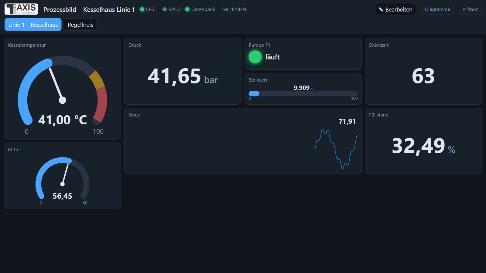

   Prozessbild: Text, Zeigerinstrumente, Zahlenwerte (Druck über der Warngrenze),
   Zustandslampe, Balken und Kurzverlauf.

Neben den Diagrammen bietet der Webserver ein **Prozessbild** – eine Übersicht mit
großen, gut ablesbaren Kacheln, z. B. für einen Monitor in der Leitwarte oder ein Tablet
an der Maschine. Aufruf: ``http://<IP>:<Port>/prozess``, der Link **Prozessbild** oben
auf der Diagrammseite oder im Logger **Datei › Prozessbild im Browser** (öffnet den
Standardbrowser dieses Rechners).

Kachelarten:

* **Zahlenwert** – großer Wert mit Einheit.
* **Zeigerinstrument** – Bogen von Minimum bis Maximum, Warn- und Alarmbereiche farbig.
* **Balken** – waagerecht oder (bei einer hohen, schmalen Kachel) senkrecht, z. B. Füllstand.
* **Zustand (Lampe)** – für BOOL-Signale: Lampe mit Texten und Farben für EIN und AUS
  (wahlweise umgekehrt).
* **Kurzverlauf** – Linie der letzten Sekunden bis Stunden (*Zeitraum*) mit aktuellem Wert.
* **Text / Überschrift** – z. B. Anlagenteil oder Hinweis.

Für Zahlenwert, Zeiger, Balken und Verlauf lassen sich **obere und untere Warn- und
Alarmgrenzen** eintragen: Wird eine überschritten, färbt sich die Kachel gelb bzw. rot.
Ohne Messwert (Verbindung gestört) erscheint **—**. Mehrere **Seiten** stehen als Reiter
oben. Auf dem Smartphone stehen die Kacheln untereinander (zwei je Zeile oder eine
ganze Zeile).

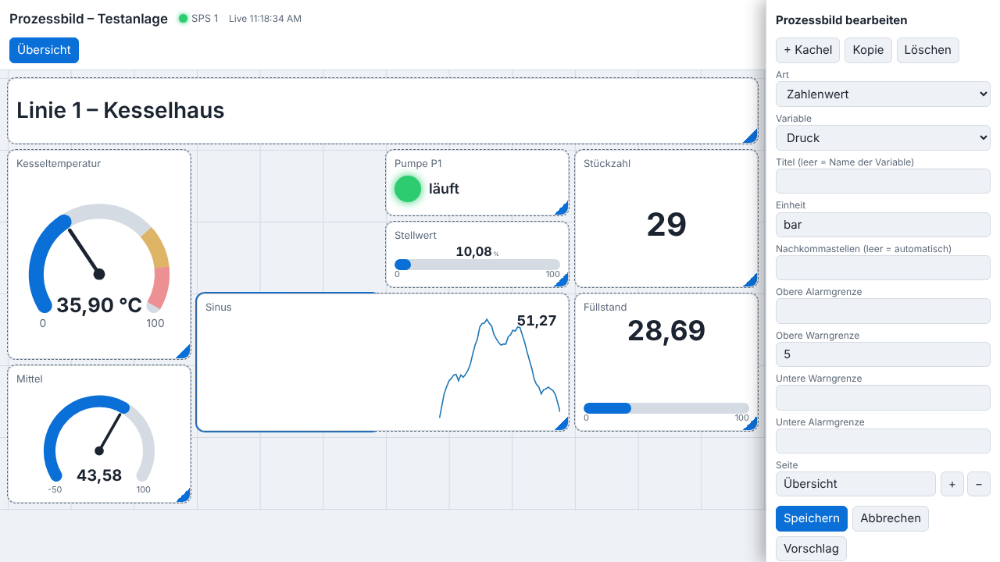

   Bearbeiten: Kachel gewählt (blau), rechts ihre Eigenschaften.

**Bearbeiten:** Knopf **✎ Bearbeiten** (am PC bzw. Tablet). Kacheln mit der Maus ziehen
verschiebt sie auf dem Raster (12 Spalten), die Ecke unten rechts ändert die Größe;
Pfeiltasten verschieben die gewählte Kachel, mit ``Umschalt`` ändern sie die Größe,
``Entf`` löscht. Rechts stehen die Eigenschaften der gewählten Kachel (Art, Variable,
Titel, Einheit, Nachkommastellen, Minimum/Maximum, Grenzen, Farben, Texte). **+ Kachel**,
**Kopie**, **Löschen**, Seiten mit **+**/**−** anlegen bzw. löschen und umbenennen;
**Vorschlag** füllt die Seite mit je einer Kachel pro Variable. **Speichern** übernimmt das
Layout, **Abbrechen** verwirft die Änderungen.

* Gespeichert wird in der Datei ``<Konfiguration>.prozessbild.json`` neben der
  Konfigurationsdatei (z. B. ``anlage.prozessbild.json``); das Konfigurationsprogramm
  ändert sie nicht. Die Kacheln verweisen auf den **Namen** der Variable – wird eine
  Variable umbenannt, zeigt die Kachel „Variable fehlt“ und muss neu zugeordnet werden.
* Ohne gespeichertes Layout zeigt die Seite einen Vorschlag (BOOL als Lampe, sonst
  Zahlenwert).
* **Wer darf bearbeiten:** Sind Benutzer eingerichtet (`HTTPS und Anmeldung`_), nur
  angemeldete Benutzer – wer die Seite nur mit Zugriffscode aufruft, kann sie ansehen,
  aber nicht ändern (gut für ein fest installiertes Anzeigegerät). Ohne Anmeldung darf
  jeder mit Zugang zur Seite bearbeiten.

.. _opcua-server:

OPC-UA-Server
======================================================================

Der Logger kann seine Werte selbst als **OPC-UA-Server** bereitstellen – für ein
Leitsystem, MES, SCADA, Node-RED oder einen weiteren Logger. Damit lassen sich z. B.
Werte aus einer S5 oder einer Modbus-Steuerung, die selbst kein OPC UA kann, und die
berechneten Variablen in einem OPC-UA-Netz weiterverwenden. Der Server ist **nur lesend**.

**Einschalten:** Konfigurationsprogramm, Reiter *Webserver & Headless*, **OPC UA …**:

* **OPC-UA-Server starten** – der Server läuft, solange die Aufzeichnung läuft (auch im
  Headless-Betrieb); beim Start steht der Endpunkt in der Statuszeile bzw. im Log.
* **Adresse (Host)** und **Port** (Standard 4840). Endpunkt:
  ``opc.tcp://<Rechner>:4840/plc-datenlogger/``. Die Firewall muss den Port freigeben.
* **Aktualisierung** – so oft werden geänderte Werte in den Server übernommen (Standard
  500 ms; schneller als die Abtastzeit der Steuerungen bringt nichts).
* **Sicherheit** – eine oder mehrere Stufen: *Keine*, *Basic256Sha256* (Signieren bzw.
  Signieren und verschlüsseln), *Aes128Sha256RsaOaep*, *Aes256Sha256RsaPss*. Für die
  verschlüsselten Endpunkte erzeugt der Logger beim ersten Start ein selbstsigniertes
  Zertifikat (Ordner ``opcua`` im Datenordner, ``server_cert.der``); im Client muss es ggf.
  als vertrauenswürdig angenommen werden. Eigenes Zertifikat: Dateien eintragen.
* **Zugriff** – *Anonym* und/oder *Anmeldung mit den Benutzern des Webservers*
  (dieselben Namen und Passwörter wie unter `HTTPS und Anmeldung`_). Für eine Anmeldung
  sollte ein verschlüsselter Endpunkt eingeschaltet sein, sonst geht das Passwort im
  Klartext über das Netz.

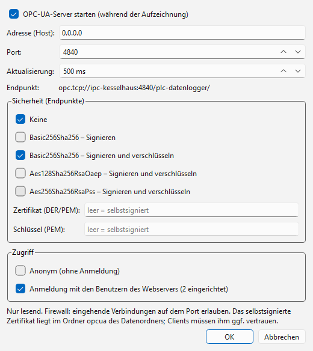

   Dialog OPC-UA-Server: Endpunkt, Sicherheitsstufen und Zugriff.

**Adressraum** (Namensraum ``urn:plc-datenlogger``):

.. code-block:: text

   Objects
   └─ PLC Datenlogger
      ├─ SPS 1                 je Steuerung ein Ordner mit ihren Variablen
      │  ├─ Temperatur         ns=2;s=Temperatur   (Double; BOOL-Variablen: Boolean)
      │  └─ …
      ├─ Berechnet             berechnete Variablen (Formeln)
      ├─ Ereignisse            je Trigger: Boolean, True solange das Ereignis ansteht
      └─ Status
         ├─ SPS 1              Boolean: Verbindung in Ordnung
         ├─ SPS 1_Text         Zustandstext der Verbindung
         ├─ Zeitstempel        Zeit der letzten Messzeile
         └─ Aufzeichnung       True, solange die Aufzeichnung läuft

Die NodeId einer Variable ist ihr Name (``ns=<Index>;s=<Name>``; den Index liefert der
Client über den Namensraum ``urn:plc-datenlogger``, meist 2). Der **Quellzeitstempel**
ist die Zeit der Messung. Hat eine Variable keinen Wert (Steuerung nicht erreichbar),
trägt sie den Status **BadNoCommunication**. Clients können die Werte lesen oder
abonnieren (Subscription); gemeldet wird nur, was sich geändert hat.

.. _headless:

Headless-Betrieb (nur Aufzeichnung)
======================================================================

Ohne Oberfläche zeichnet der Logger nur auf: Lesen aus den Steuerungen, Formeln,
CSV-Datei, Archivierung und – falls aktiviert – Webserver. Das spart Ressourcen und
eignet sich für Dauerbetrieb, z. B. als Autostart-Programm auf einem Industrie-PC.

* **Einschalten:** Option *Headless-Modus* im Reiter *Webserver & Headless* der
  Konfiguration, oder Startparameter ``--headless``. Mit ``--gui`` lässt sich trotz
  eingestelltem Headless-Modus die Oberfläche öffnen.
* **Meldungen** (Verbindung, Fehler, Archivierung) stehen in der Logdatei
  ``plc_logger.log`` im Programm- bzw. Datenordner (rotierend, mehrere Dateien).
* **Beenden:** Mit ``Strg+C`` im Konsolenfenster bzw. durch das Signal SIGTERM
  (Dienst beenden, Windows: Fenster schließen) wird sauber beendet: Die
  CSV-Datei wird geschlossen und – bei gesetzter Option – archiviert.
* Die installierte Version enthält im Startmenü die Verknüpfung
  *PLC Datenlogger (Headless, nur Aufzeichnung)*.

.. _datenbank:

Datenbank-Aufzeichnung
======================================================================

Die Messwerte lassen sich **zusätzlich oder statt** der CSV-Datei in eine Datenbank
schreiben – etwa zur Auswertung mit SQL oder zur Anzeige in Grafana. Die Einstellungen
stehen im Konfigurationsprogramm im Reiter **Datenbank**; die CSV-Datei schaltet der
Haken **CSV-Datei schreiben** im Reiter *Aufzeichnung* ein oder aus.

.. list-table::
   :header-rows: 1
   :widths: 25 75

   * - Feld
     - Bedeutung
   * - Datenbank
     - *Keine*, *SQLite (Datei)*, *MariaDB / MySQL*, *TimescaleDB / PostgreSQL*,
       *QuestDB*, *InfluxDB 3 Core*, *VictoriaMetrics* oder *Prometheus (Remote Write)*.
   * - Server / Port
     - Rechnername oder IP-Adresse des Datenbankservers; Port *Standard* = 3306
       (MariaDB), 5432 (PostgreSQL/TimescaleDB), 9000 (QuestDB), 8181 (InfluxDB 3)
       8428 (VictoriaMetrics) bzw. 9090 (Prometheus). Bei QuestDB, InfluxDB,
       VictoriaMetrics und Prometheus darf
       hier auch eine vollständige URL stehen, z. B. ``https://server:8181``
       (verschlüsselt; der Port im Feld gilt dann nicht).
   * - Datenbankname
     - Name der Datenbank auf dem Server. MariaDB/PostgreSQL: sie muss bereits
       existieren, die Tabelle legt das Programm selbst an. InfluxDB 3: wird bei
       Bedarf angelegt. Bei QuestDB, VictoriaMetrics und Prometheus ohne Bedeutung
       (eine Datenbank je Server).
   * - Benutzer / Passwort
     - Zugangsdaten. Der Benutzer braucht die Rechte CREATE (beim ersten Start) und
       INSERT. Das Passwort steht im Klartext in der Konfigurationsdatei. QuestDB,
       InfluxDB, VictoriaMetrics und Prometheus: Benutzer und Passwort werden per
       HTTP-Basic-Anmeldung gesendet; **ohne Benutzer gilt das Passwort als Token**
       (InfluxDB 3: Token ``apiv3_…``, QuestDB Enterprise, VictoriaMetrics hinter
       *vmauth*, Prometheus hinter einem Proxy); beides leer = ohne Anmeldung.
   * - SQLite-Datei
     - Dateiname der SQLite-Datenbank; ein relativer Pfad gilt im Datenordner des
       Programms.
   * - Tabelle
     - Name der Tabelle (Standard ``messwerte``; Buchstaben, Ziffern, ``_``).
       VictoriaMetrics und Prometheus: die Metrik heißt *Tabelle* + ``_wert``, also
       ``messwerte_wert``.
   * - Nur Änderungen schreiben
     - Ein Wert wird nur geschrieben, wenn er sich geändert hat, spätestens aber
       jede Minute. Spart bei langsam veränderlichen Werten viel Platz.
   * - Löschen nach, Höchstens belegen
     - Alte Werte automatisch löschen (siehe `Alte Aufzeichnungen aufräumen
       <aufraeumen_>`__): nach *n Tagen* (SQLite, MariaDB, PostgreSQL/TimescaleDB,
       QuestDB) bzw. wenn die Werte mehr als *n MB* belegen (nur SQLite).
   * - Datenbank testen
     - Verbindet sich, legt die Tabelle an und meldet das Ergebnis.

**Tabellenaufbau** (eine Zeile je Wert, „schmales“ Format):

.. list-table::
   :header-rows: 1
   :widths: 20 30 50

   * - Spalte
     - Typ
     - Inhalt
   * - ``zeit``
     - SQLite: Text, MariaDB: ``DATETIME(3)``, PostgreSQL: ``TIMESTAMPTZ``,
       QuestDB: ``TIMESTAMP`` (Zeitachse der Tabelle)
     - Zeitpunkt der Messung in **UTC** mit Millisekunden
   * - ``projekt``
     - Text (QuestDB: ``SYMBOL``)
     - Projektname aus der Konfiguration (mehrere Logger können eine Tabelle teilen)
   * - ``variable``
     - Text (QuestDB: ``SYMBOL``)
     - Name der Variable
   * - ``wert``
     - Gleitkommazahl
     - Messwert (BOOL als 0/1)

Ungültige Werte (z. B. während eines Verbindungsausfalls) werden nicht geschrieben.
Ein Index über ``variable, zeit`` beschleunigt Abfragen einzelner Variablen. Bei
**TimescaleDB** wird die Tabelle automatisch zur *Hypertable* (zeitlich partitioniert);
ist die Erweiterung nicht installiert, entsteht eine normale PostgreSQL-Tabelle und die
Statuszeile meldet das.

**QuestDB** wird über die HTTP-Schnittstelle angesprochen (Standardport 9000, derselbe
Port wie die Web-Konsole): die Werte gehen im *InfluxDB Line Protocol* an ``/write``,
Abfragen im Lesemodus an ``/exp``. Die Tabelle wird nach Tagen partitioniert angelegt;
ab QuestDB 7.3 mit Deduplizierung über ``zeit, projekt, variable`` – ein nach einer
Störung erneut gesendeter Stapel ergibt so keine doppelten Zeilen (ältere Versionen:
ohne Deduplizierung, die Statuszeile meldet das). Ein leerer Projektname wird als
``NULL`` gespeichert.

**InfluxDB 3** (Core oder Enterprise) wird ebenfalls über HTTP angesprochen
(Standardport 8181): Werte im Line Protocol an ``/api/v3/write_lp``, Abfragen mit SQL
an ``/api/v3/query_sql``. Datenbank und Tabelle legt das Programm an (Tags ``projekt``
und ``variable``, Feld ``wert``); die Zeitspalte heißt in InfluxDB ``time`` statt
``zeit``. Gleiche Variable und gleicher Zeitpunkt überschreiben sich, doppelte Zeilen
entstehen also nicht. Ist die Anmeldung eingeschaltet (Standard bei InfluxDB 3), den
Token (``influxdb3 create token --admin``) ins Feld *Passwort* eintragen und *Benutzer*
leer lassen.

**VictoriaMetrics** speichert keine Tabellen, sondern Zeitreihen: Jede Variable wird
eine Serie der Metrik ``messwerte_wert`` mit den Labels ``projekt`` und ``variable``.
Geschrieben wird im Line Protocol an ``/write``, gelesen über die
Prometheus-Schnittstelle (Lesemodus: Rohdaten über ``/api/v1/export``, Mittelwerte über
``/api/v1/query_range``). VictoriaMetrics speichert Zeitstempel mit Millisekunden und
behält Daten standardmäßig nur einen Monat (Startparameter ``-retentionPeriod``).

**Prometheus** speichert wie VictoriaMetrics Zeitreihen (Metrik ``messwerte_wert``,
Labels ``projekt`` und ``variable``). Geschrieben wird per **Remote Write**
(``/api/v1/write``, Protobuf mit Snappy-Kompression, ohne Zusatzbibliothek); Prometheus
muss dafür mit ``--web.enable-remote-write-receiver`` gestartet sein, sonst meldet die
Statuszeile „Remote Write ist nicht eingeschaltet“. Gelesen wird über die
HTTP-Schnittstelle (Lesemodus: Rohdaten stundenweise über ``/api/v1/query``, Mittelwerte
über ``/api/v1/query_range``; erster und letzter Zeitpunkt in der Übersicht sind auf etwa
1/2000 des Aufbewahrungszeitraums genau). Prometheus nimmt Werte je Serie nur in
zeitlicher Reihenfolge und höchstens etwa eine Stunde alt an. Ältere Werte (z. B. nach
einem langen Ausfall nachgetragen) lehnt es ab; der Logger verwirft solche Stapel, meldet
sie („… Werte abgelehnt“) und zählt sie im Tooltip der Datenbank-LED. Abhilfe: in der
Prometheus-Konfiguration ``storage: tsdb: out_of_order_time_window: 1d``. Die
Aufbewahrungsdauer stellt der Startparameter ``--storage.tsdb.retention.time`` ein
(Standard 15 Tage).

Beispielabfragen:

.. code-block:: sql

   -- Verlauf einer Variable der letzten Stunde (PostgreSQL/TimescaleDB)
   SELECT zeit, wert FROM messwerte
    WHERE variable = 'Temperatur' AND zeit > now() - interval '1 hour' ORDER BY zeit;

   -- Minutenmittel (TimescaleDB)
   SELECT time_bucket('1 minute', zeit) AS minute, avg(wert)
     FROM messwerte WHERE variable = 'Temperatur' GROUP BY minute ORDER BY minute;

   -- Letzte Werte aller Variablen (MariaDB / SQLite)
   SELECT variable, MAX(zeit) FROM messwerte GROUP BY variable;

   -- Minutenmittel (QuestDB)
   SELECT zeit, avg(wert) FROM messwerte WHERE variable = 'Temperatur' SAMPLE BY 1m;

   -- Letzter Wert je Variable (QuestDB)
   SELECT * FROM messwerte LATEST ON zeit PARTITION BY variable;

   -- Minutenmittel (InfluxDB 3)
   SELECT date_bin(INTERVAL '1 minute', time) AS minute, avg(wert) FROM messwerte
    WHERE variable = 'Temperatur' AND time > now() - INTERVAL '1 hour' GROUP BY 1 ORDER BY 1;

Für VictoriaMetrics und Prometheus (PromQL, z. B. in Grafana):

.. code-block:: text

   messwerte_wert{variable="Temperatur"}                          # Verlauf
   avg_over_time(messwerte_wert{variable="Temperatur"}[1m])       # Minutenmittel
   last_over_time(messwerte_wert{projekt="Anlage 1"}[1h])         # letzter Wert je Variable

**Betrieb:**

* Geschrieben wird in einem eigenen Thread etwa einmal pro Sekunde in Stapeln; die
  Anzeige und das Lesen aus der Steuerung werden dadurch nicht gebremst.
* In der Statusleiste (und im Webserver) zeigt eine eigene **LED „Datenbank“** den
  Zustand; der Tooltip nennt die Zahl der geschriebenen Werte.
* Ist die Datenbank nicht erreichbar, bleiben die Werte im Speicher (bis etwa
  2 Millionen Werte) und werden nach dem erneuten Verbinden nachgetragen. Beim
  Beenden noch nicht geschriebene Werte meldet die Statuszeile.
* **Treiber:** SQLite ist in Python enthalten. MariaDB braucht ``PyMySQL``,
  TimescaleDB/PostgreSQL ``psycopg`` (``pip install PyMySQL "psycopg[binary]"``); in
  der Installationsdatei sind beide enthalten. QuestDB, InfluxDB 3, VictoriaMetrics
  und Prometheus brauchen keine Bibliothek.
* Für Grafana: Datenquelle *MySQL* bzw. *PostgreSQL* anlegen (QuestDB: Plugin
  *QuestDB* oder *PostgreSQL* auf Port 8812; InfluxDB 3: *InfluxDB* mit Abfragesprache
  *SQL*; VictoriaMetrics und Prometheus: *Prometheus*); die Zeitspalte ist ``zeit`` (InfluxDB:
  ``time``, UTC).
* **Testumgebung:** Im Ordner ``docker`` startet ``docker compose up -d`` TimescaleDB,
  QuestDB, InfluxDB 3 Core, VictoriaMetrics, Prometheus und Grafana mit fertig eingerichteten
  Datenquellen (Zugangsdaten in ``docker/.env``). SQLite-Dateien lassen sich mit dem SQLite-Plugin von Grafana lesen.

.. _db-lesen:

Lesemodus: Aufzeichnungen aus der Datenbank anzeigen
----------------------------------------------------------------------

Im Logger lädt **Datei › Aus Datenbank laden …** (``Strg+D``) einen frei wählbaren
Zeitraum aus der Datenbank und zeigt ihn im **Offline-Modus** an – mit Linealen,
Wertetabelle, Screenshots und PID-Optimierung wie bei einer geladenen CSV-Datei.
Gelesen wird aus der Datenbank der geladenen Konfiguration; die Datenbank wird nur
gelesen, eine laufende Aufzeichnung (auch eines anderen Loggers) kann dabei
weiterschreiben.

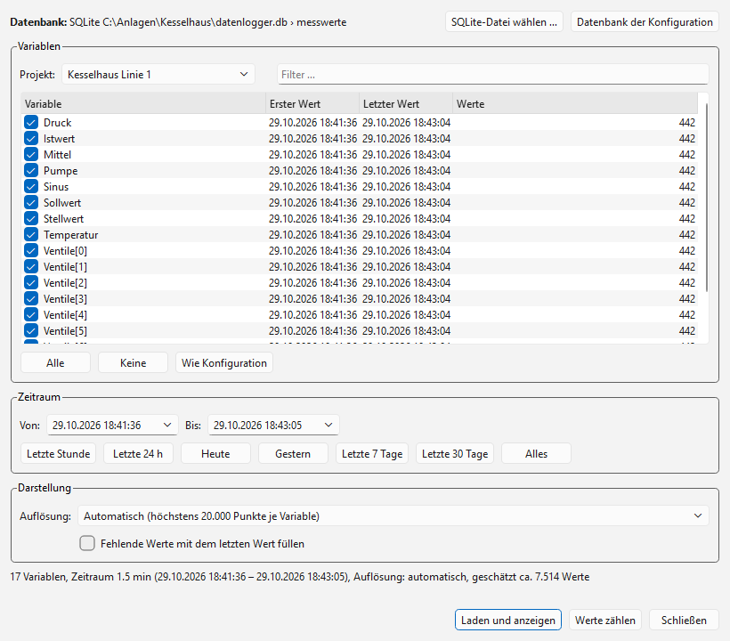

   Dialog „Aus Datenbank laden“: Variablen, Zeitraum und Auflösung wählen.

.. list-table::
   :header-rows: 1
   :widths: 25 75

   * - Bereich
     - Bedeutung
   * - Datenbank
     - Zeigt die Quelle. **SQLite-Datei wählen …** liest stattdessen eine beliebige
       SQLite-Datei (z. B. eine Kopie von einem anderen Rechner);
       **Datenbank der Konfiguration** kehrt zurück.
   * - Projekt
     - Projektname, unter dem die Werte gespeichert wurden (Vorgabe: Projekt der
       Konfiguration). *(alle Projekte)* fasst gleichnamige Variablen aller
       Projekte zusammen.
   * - Variablen
     - Alle Variablen in der Datenbank mit erstem und letztem Zeitpunkt und Anzahl
       der Werte. Angehakt sind zunächst die Variablen der aktuellen Konfiguration.
       **Alle**, **Keine**, **Wie Konfiguration** und das Filterfeld helfen bei
       vielen Variablen.
   * - Zeitraum
     - **Von** / **Bis** (Ortszeit) mit Kalender, oder per Knopf: *Letzte Stunde*,
       *Letzte 24 h*, *Letzte 7 Tage*, *Letzte 30 Tage* (jeweils bis zum letzten
       gespeicherten Wert der gewählten Variablen), *Heute*, *Gestern*, *Alles*.
   * - Auflösung
     - *Automatisch*: Rohdaten, solange es höchstens 20 000 Punkte je Variable sind,
       sonst Mittelwerte in einem passenden Raster (1 s, 2 s, 5 s … 1 Tag).
       *Rohdaten*: jeder gespeicherte Wert. *Mittelwert je 1 s … je Tag*: feste
       Raster. Die Mittelwerte berechnet die Datenbank selbst – auch Monate an Daten
       lassen sich so schnell überblicken.
   * - Fehlende Werte mit dem letzten Wert füllen
     - Für Aufzeichnungen mit **Nur Änderungen schreiben** (dort voreingestellt):
       Ein fehlender Wert bedeutet „unverändert“, die Kurve läuft durchgehend.
       Ohne Haken erscheinen Lücken.
   * - Werte zählen
     - Ermittelt die genaue Zahl der Werte im Zeitraum (darüber steht eine
       Schätzung aus der Variablenliste).

**Laden und anzeigen** liest die Werte im Hintergrund; der Fortschritt steht unten im
Fenster, **Abbrechen** beendet das Lesen. Danach wechselt der Logger in den
Offline-Modus. Farben, Diagramme und Achsen kommen aus der Konfiguration;
Variablen, die dort fehlen, erscheinen im ersten Diagramm. Die Statuszeile nennt
Quelle, Zeitraum und Auflösung. Eine laufende Aufzeichnung wird beim Laden beendet
(wie beim Laden einer CSV-Datei); mit **▶ Start** beginnt eine neue.

Hinweise:

* Zeitstempel stehen in der Datenbank in UTC; angezeigt wird in Ortszeit.
* Beim Mittelwert liegt der Zeitstempel in der Mitte des Rasters (z. B. 10:00:30
  für 10:00:00 bis 10:00:59). Minimum und Maximum innerhalb eines Rasters sind
  nicht zu sehen – für kurze Spitzen Rohdaten oder ein feineres Raster wählen.
* Zum Schutz des Speichers liest der Logger höchstens 20 Millionen Werte auf einmal;
  darüber erscheint ein Hinweis, einen kürzeren Zeitraum oder Mittelwerte zu wählen.
* Bei MariaDB und PostgreSQL braucht der Benutzer nur das Recht SELECT.

.. _ereignisse:

Trigger und Ereignisprotokoll
======================================================================

Ein **Trigger** überwacht eine Bedingung über die Variablen, z. B.
``{Temperatur} > 80``. Sobald sie erfüllt ist, schreibt der Logger einen Eintrag
mit Zeitstempel in das **Ereignisprotokoll** (eine Textdatei). Die Zahl der noch
nicht quittierten Ereignisse steht in der Statusleiste des Loggers; quittiert wird
im **Ereignis-Viewer**.

Trigger anlegen
----------------------------------------------------------------------

Konfigurationsprogramm, Reiter **Trigger & Ereignisse** → **Trigger bearbeiten …**.

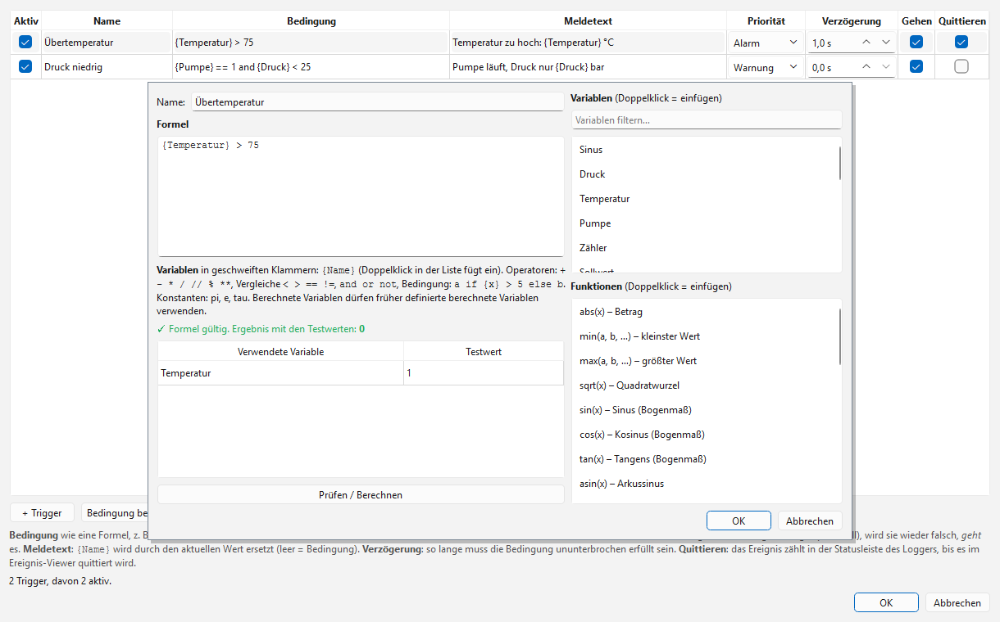

   Der Trigger-Editor: eine Zeile je Trigger, fehlerhafte Zeilen sind rot markiert.

.. list-table::
   :header-rows: 1
   :widths: 22 78

   * - Spalte
     - Bedeutung
   * - Aktiv
     - Nur aktive Trigger werden ausgewertet. Ausgeschaltete Trigger dürfen auch
       fehlerhaft sein (z. B. nach dem Umbenennen einer Variable).
   * - Name
     - Name des Triggers (eindeutig, ohne ``;``); steht im Ereignisprotokoll.
   * - Bedingung
     - Ausdruck wie bei den `berechneten Variablen <berechnete-variablen_>`__.
       Ergebnis ungleich 0 = erfüllt. Beispiele: ``{Temperatur} > 80``,
       ``{Druck} < 2 and {Pumpe} == 1``, ``abs(ddt({Füllstand})) > 5``,
       ``{Störung} == 1``. Variablen ohne Wert (keine Verbindung) gelten als
       *nicht erfüllt*. **Bedingung bearbeiten …** (oder Doppelklick) öffnet den
       Formeleditor mit Variablenliste und Testwerten.
   * - Meldetext
     - Text des Eintrags. ``{Name}`` wird durch den Wert der Variable zum Zeitpunkt
       des Ereignisses ersetzt, z. B. ``Temperatur zu hoch: {Temperatur} °C``.
       Leer = die Bedingung selbst.
   * - Priorität
     - *Info*, *Warnung* oder *Alarm* (Farbe im Viewer, Filter).
   * - Verzögerung
     - So viele Sekunden muss die Bedingung **ununterbrochen** erfüllt sein, bevor das
       Ereignis kommt (unterdrückt kurze Spitzen). 0 = sofort.
   * - Gehen
     - Auch das Ende des Ereignisses (Bedingung wieder falsch) eintragen.
   * - Quittieren
     - Das Ereignis muss quittiert werden und zählt bis dahin in der Statusleiste.
       Ohne Haken wird es nur protokolliert.

Ein Trigger löst **einmal je Flanke** aus: Erst wenn die Bedingung wieder falsch und
dann erneut wahr wird, entsteht ein neues Ereignis. Die Trigger werden mit jedem
Messzyklus geprüft – also auch im Headless-Betrieb – und gelten ab dem nächsten Start
der Aufzeichnung. Im Demo-Modus ohne eigene Trigger gibt es zwei Beispiel-Trigger
(*Übertemperatur*, *Druck niedrig*).

Ereignisdatei
----------------------------------------------------------------------

Feld **Ereignisdatei** im selben Reiter; leer = ``<CSV-Ordner>/<CSV-Name>_ereignisse.csv``.
Die Datei wird nur fortgeschrieben (nie geändert oder archiviert) und lässt sich mit
Excel öffnen (Semikolon, UTF-8):

.. code-block:: text

   ID;Zeit;Art;Trigger;Priorität;Text;Benutzer
   17;2026-10-15 16:20:01.250;KOMMT;Übertemperatur;Alarm;Temperatur zu hoch: 81.37 °C;
   17;2026-10-15 16:22:40.100;GEHT;Übertemperatur;Alarm;;
   17;2026-10-15 16:25:12.000;QUITTIERT;Übertemperatur;Alarm;;mmuster

*Art* ist ``KOMMT``, ``GEHT`` oder ``QUITTIERT``; Zeilen mit derselben *ID* gehören
zum selben Ereignis. Bei ``QUITTIERT`` steht in *Benutzer* der Windows-Benutzername.
``-`` in der Spalte *Benutzer* einer ``KOMMT``-Zeile bedeutet „keine Quittierung nötig“.

Anzeige in der Statusleiste
----------------------------------------------------------------------

.. figure:: images/ereignis_statusleiste.png
   :alt: Ereigniszähler in der Statusleiste
   :align: center

   Rot hinterlegt: drei Ereignisse sind noch nicht quittiert.

Rechts in der Statusleiste zeigt der Knopf **🔔** die Zahl der offenen (nicht
quittierten) Ereignisse; bei offenen Ereignissen ist er rot. Ein Klick darauf – oder
**Datei → Ereignisprotokoll …** (Strg+E) – öffnet den Viewer. Jedes neue Ereignis
erscheint außerdem als Meldung in der Statusleiste (``⚠ Alarm: …``). Der Zähler gilt
auch ohne laufende Aufzeichnung, z. B. wenn ein Headless-Logger auf demselben Rechner
in die Datei schreibt. Im Webserver steht oben „🔔 n offen“ (Tooltip: die offenen
Ereignisse); quittiert wird nur im Viewer.

Ereignis-Viewer und Quittieren
----------------------------------------------------------------------

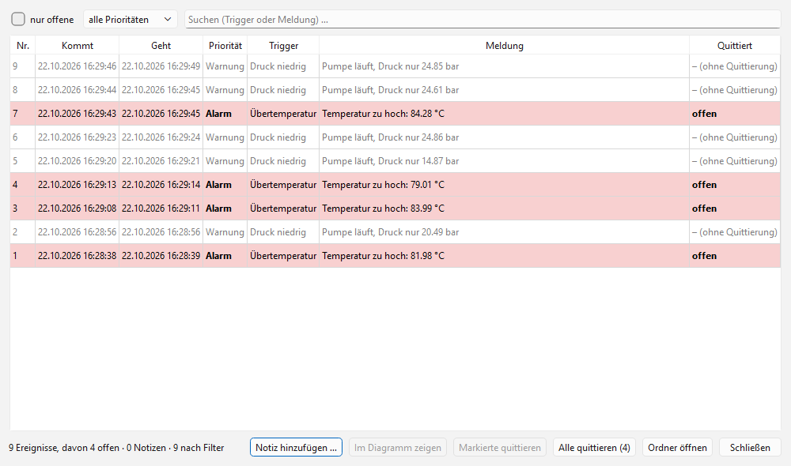

   Der Ereignis-Viewer: offene Ereignisse farbig nach Priorität, erledigte grau.

* Die Tabelle zeigt die neuesten Ereignisse oben: Nummer, Kommt, Geht, Priorität,
  Trigger, Meldung und Quittierung (Zeit und Benutzer bzw. **offen**).
* Filter: **nur offene**, Priorität, Suchfeld (Trigger oder Meldung).
* **Markierte quittieren** (oder Doppelklick auf eine Zeile) quittiert die
  ausgewählten Ereignisse, **Alle quittieren** alle offenen.
* Die Anzeige aktualisiert sich selbst, sobald neue Ereignisse kommen (F5 = sofort).
* **Im Diagramm zeigen** (Knopf oder Rechtsklick auf eine Zeile, nur im Logger): Der Logger
  wechselt in den Offline-Modus und zeigt den Zeitraum um das Ereignis, **Lineal 1** auf
  dem Beginn (Kommt), **Lineal 2** auf dem Ende (Geht). Liegen die Werte nicht mehr im
  Speicher, lädt er sie aus der Datenbank der Konfiguration (falls eine eingestellt ist;
  10 Minuten vor und nach dem Ereignis), sonst die passende CSV-Datei aus dem CSV-Ordner
  bzw. dem Archiv.
* **Ordner öffnen** zeigt die Ereignisdatei im Explorer.

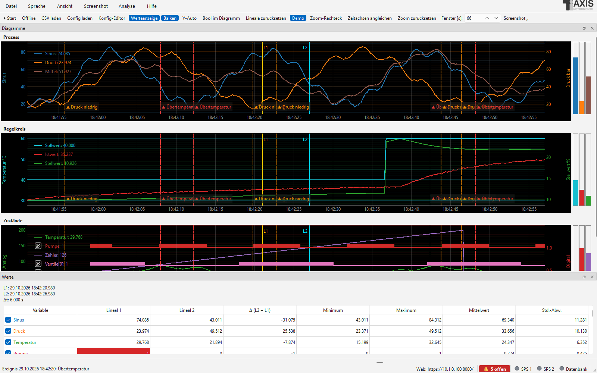

   Nach „Im Diagramm zeigen“: Zeitraum um das Ereignis, Lineal 1 auf Kommt, Lineal 2 auf Geht.

Der Viewer lässt sich auch **allein** starten – etwa neben einem Headless-Logger oder an
einem anderen Rechner mit Zugriff auf die Datei (Netzlaufwerk):

.. code-block:: text

   PLCLogger.exe --ereignisse                        (Ereignisprotokoll der zuletzt benutzten Konfiguration)
   PLCLogger.exe --ereignisse anlage.json             (Ereignisprotokoll dieser Konfiguration)
   PLCLogger.exe --ereignisse D:\logs\log_ereignisse.csv

Die installierte Version hat dafür im Startmenü die Verknüpfung *PLC Ereignisprotokoll*.
Im Konfigurationsprogramm öffnet **Ereignisprotokoll anzeigen …** denselben Viewer.

.. _benachrichtigungen:

Benachrichtigungen
----------------------------------------------------------------------

Kommt ein Ereignis, kann der Logger es sofort weitermelden – per **E-Mail**, in einen
**Microsoft-Teams**- oder **Slack**-Kanal, an einen beliebigen **Webhook** (JSON), als
**Push-Nachricht aufs Handy** mit der App *ntfy* oder über **Telegram**. Einstellen im
Konfigurationsprogramm, Reiter *Trigger & Ereignisse*, **Benachrichtigungen …**; daneben
steht, ob und wohin gemeldet wird.

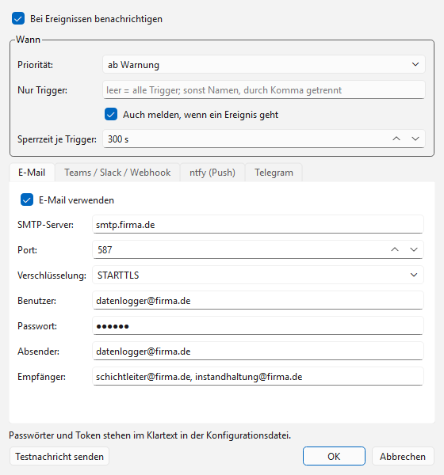

   Benachrichtigungen: oben wann gemeldet wird, darunter je Kanal ein Reiter.

**Wann gemeldet wird:**

* **Bei Ereignissen benachrichtigen** – Hauptschalter.
* **Priorität** – ab *Info*, *Warnung* (Standard) oder nur *Alarm*.
* **Nur Trigger** – leer = alle; sonst die Namen, durch Komma getrennt.
* **Auch melden, wenn ein Ereignis geht** – zusätzlich eine Nachricht, wenn die Bedingung
  nicht mehr erfüllt ist (nur, wenn das Kommen gemeldet wurde).
* **Sperrzeit je Trigger** (Standard 300 s) – kommt derselbe Trigger innerhalb dieser Zeit
  erneut, wird nicht noch einmal gemeldet; die nächste Nachricht nennt die Zahl der
  unterdrückten. Verhindert Meldungsfluten bei einem flatternden Signal.

Die Nachricht enthält Priorität, Trigger, Meldungstext, Zeit, Projekt und Rechnername.

**Kanäle** (je ein Reiter, einzeln einschaltbar):

* **E-Mail:** SMTP-Server, Port (587 mit STARTTLS, 465 mit SSL/TLS, 25 unverschlüsselt),
  Benutzer und Passwort (leer = ohne Anmeldung), Absender und Empfänger (mehrere durch
  Komma getrennt).
* **Teams / Slack / Webhook:** *Microsoft Teams (Workflows)* – im Teams-Kanal unter
  *Workflows* die Vorlage „Bei Empfang einer Webhookanforderung in einem Kanal posten“
  anlegen und deren Adresse eintragen; die Nachricht erscheint als Karte, Alarme rot.
  *Slack* – Adresse eines *Incoming Webhook*. *Allgemein (JSON)* – sendet Titel, Text,
  Trigger, Priorität, Art (KOMMT/GEHT), Zeit, Projekt und Rechner als JSON per POST, z. B.
  an Node-RED, Home Assistant oder ein eigenes System.
* **ntfy (Push):** App *ntfy* auf dem Handy installieren und ein Thema abonnieren; hier die
  Adresse mit Thema eintragen, z. B. ``https://ntfy.sh/anlage-4711-xyz``. Alarme kommen mit
  höchster Dringlichkeit. Bei ``ntfy.sh`` kann jeder mitlesen, der den Namen des Themas
  kennt – einen schwer zu erratenden Namen wählen oder einen eigenen ntfy-Server
  betreiben (dann ggf. Zugriffstoken eintragen).
* **Telegram:** Bei *@BotFather* einen Bot anlegen (liefert das Bot-Token), dem Bot eine
  Nachricht schreiben und die Chat-ID eintragen (z. B. über *@userinfobot*).

**Testnachricht senden** schickt über alle eingeschalteten Kanäle eine Probe und zeigt je
Kanal ✓ oder den Fehler. Gesendet wird im Hintergrund, die Aufzeichnung wartet nicht
darauf; Fehler (Server nicht erreichbar, Anmeldung falsch) stehen in der Statuszeile bzw.
der Logdatei. Benachrichtigungen funktionieren auch im Headless-Betrieb – der Rechner
braucht dafür Zugang zum Mailserver bzw. zum Internet.

.. note::

   Passwörter und Token stehen im Klartext in der Konfigurationsdatei. Die Datei deshalb
   nur Berechtigten zugänglich machen und für E-Mail ein eigenes Konto verwenden.

.. _notizen:

Notizen (eigene Einträge)
----------------------------------------------------------------------

Neben den Triggern lassen sich **Notizen von Hand** ins Ereignisprotokoll schreiben,
z. B. „Ventil V12 getauscht“ oder „Sollwert auf 65 °C geändert“ – so steht später in
derselben Datei, warum sich ein Verlauf geändert hat.

* Im Logger: **Datei → Notiz ins Ereignisprotokoll …** (Strg+M). Im Offline-Modus ist
  die Zeit von **Lineal 1** vorgegeben – so lässt sich eine Stelle im Verlauf nachträglich
  kommentieren.
* Im Ereignis-Viewer: **Notiz hinzufügen …**.

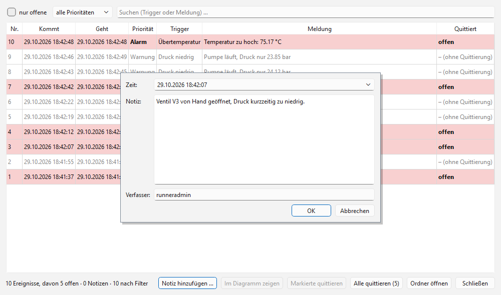

   Zeit, Text und Verfasser einer Notiz.

Zeit (Standard: jetzt), Text (auch mehrzeilig) und Verfasser (Standard: Windows- bzw.
Linux-Benutzername) sind frei wählbar. Notizen stehen als Art ``NOTIZ`` in der Datei,
erscheinen im Viewer grün hinterlegt mit 📝 und müssen nicht quittiert werden. Der Filter
**nur Notizen** zeigt nur sie.

.. code-block:: text

   18;2026-10-16 09:12:00.000;NOTIZ;Notiz;Notiz;Ventil V12 getauscht;mmuster

.. _trigger-aufzeichnung:

Aufzeichnung per Trigger (Vor- und Nachlauf)
======================================================================

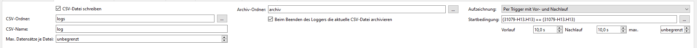

   Reiter Aufzeichnung: Aufzeichnung per Trigger mit Startbedingung, Vor- und Nachlauf.

Statt dauernd aufzuzeichnen, kann der Logger nur dann in CSV-Datei und Datenbank
schreiben, wenn etwas passiert – mit den Werten **vor** dem Ereignis (Vorlauf) und
**danach** (Nachlauf). Typische Anwendungen: Störungsanalyse, Prüfzyklen, Chargen.

**Einstellen** (Konfigurationsprogramm, Reiter *Aufzeichnung*):

* **Aufzeichnung:** *Per Trigger mit Vor- und Nachlauf*.
* **Startbedingung:** eine Bedingung wie bei Triggern, z. B. ``{Druck} > 5``,
  ``{Störung} == 1`` oder ``abs(ddt({Kraft})) > 100``; **…** öffnet den Formeleditor
  mit Variablenliste und Prüfung. Verwendbar sind alle Variablen einschließlich der
  berechneten.
* **Vorlauf:** so viele Sekunden vor dem Trigger werden mitgespeichert. Dafür hält der
  Logger die letzten Messwerte in einem **Ringspeicher**.
* **Nachlauf:** so lange wird nach dem Ende der Bedingung weiter gespeichert. Wird die
  Bedingung in dieser Zeit erneut wahr, verlängert sich die Aufnahme.
* **max.:** Höchstdauer einer Aufnahme (*unbegrenzt* = 0). Danach endet die Aufnahme
  auch bei weiter erfüllter Bedingung; die nächste beginnt erst, wenn die Bedingung
  einmal falsch war.

**Ablauf:** Nach dem Start zeigt die Statusleiste *⏸ wartet auf Trigger*. Wird die
Bedingung wahr, beginnt eine Aufnahme (*⏺ Aufnahme läuft*): eine **neue CSV-Datei**
(``<CSV-Name>_<Datum>_<Uhrzeit>.csv``) mit dem Vorlauf und allen folgenden Werten bis
zum Ende des Nachlaufs. Jede Aufnahme bekommt ihre eigene Datei; sie bleibt im CSV-Ordner.
Mit Datenbank werden dieselben Zeilen in die Datenbank geschrieben. Beginn und Ende
stehen als Ereignis *Aufnahme* (Priorität *Info*, ohne Quittierpflicht) im
Ereignisprotokoll und erscheinen als grüne `Trigger-Marke <trigger-marken_>`__ im Diagramm.

Die **Anzeige** im Logger (und im Webserver) läuft immer weiter, auch zwischen den
Aufnahmen. Ist die Startbedingung fehlerhaft (z. B. unbekannte Variable), meldet der
Logger das und zeichnet sicherheitshalber dauernd auf.

.. tip::

   Mehrere Aufnahmen lassen sich mit **Datei › CSV-Dateien aneinanderhängen und speichern …**
   wieder zu einer Datei zusammenfügen (siehe `Mehrere CSV-Dateien aneinanderhängen <csv-verbinden_>`__).

.. _pid-optimierung:

PID-Regler-Optimierung
======================================================================

Zeigt ein Diagramm einen Regelkreis – **Sollwert**, **Istwert** und **Stellwert** –,
berechnet der Logger aus den aufgezeichneten Daten passende Reglerparameter
(Kp, Ti, Td). Dazu bestimmt er zuerst ein Modell der Regelstrecke und wendet darauf
bewährte Einstellregeln an.

Einschalten (Konfigurationsprogramm)
----------------------------------------------------------------------

Im Zuordnungsbaum das Diagramm auswählen und unter *Eigenschaften der Auswahl* den
Haken **PID-Regler-Optimierung** setzen. Im Fenster **Einstellen …** werden festgelegt:

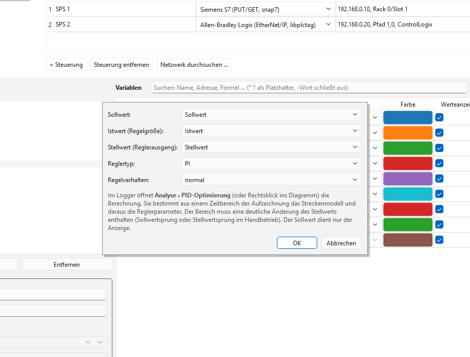

   Soll-, Ist- und Stellwert des Diagramms zuordnen.

.. list-table::
   :header-rows: 1
   :widths: 25 75

   * - Feld
     - Bedeutung
   * - Sollwert
     - Variable mit dem Sollwert (optional, nur zur Anzeige).
   * - Istwert
     - Regelgröße (Messwert), z. B. Temperatur.
   * - Stellwert
     - Reglerausgang, z. B. Ventilstellung oder Heizleistung in %.
   * - Reglertyp
     - *PI* (meist ausreichend, unempfindlich gegen Messrauschen) oder *PID*.
   * - Regelverhalten
     - *schnell* (aggressiv, kleine Reserve), *normal* oder *robust* (langsam, sicher
       auch bei schwankender Strecke).

Die Zuordnung wird anhand üblicher Namen (Soll/SP, Ist/PV, Stell/CV/Out …) vorgeschlagen.

Daten aufzeichnen
----------------------------------------------------------------------

Die Berechnung braucht einen Zeitbereich, in dem sich der **Stellwert deutlich
ändert** und der Istwert darauf reagiert:

* **Stellwertsprung im Handbetrieb** (am besten): Regler auf Hand, Prozess zur Ruhe
  kommen lassen, Stellwert um 5 … 20 % springen lassen und warten, bis der Istwert
  wieder ruhig ist.
* **Sollwertsprung im Automatikbetrieb**: geht ebenso, solange der Regler nicht zu
  träge ist und der Stellwert nicht dauerhaft an der Grenze (0 / 100 %) steht.

Der Bereich sollte mit ruhigem Prozess beginnen und keine großen Störungen enthalten.

Berechnen (Logger)
----------------------------------------------------------------------

Menü **Analyse → PID-Optimierung: <Diagramm> …** oder Rechtsklick in das Diagramm →
**PID-Regler optimieren …**.

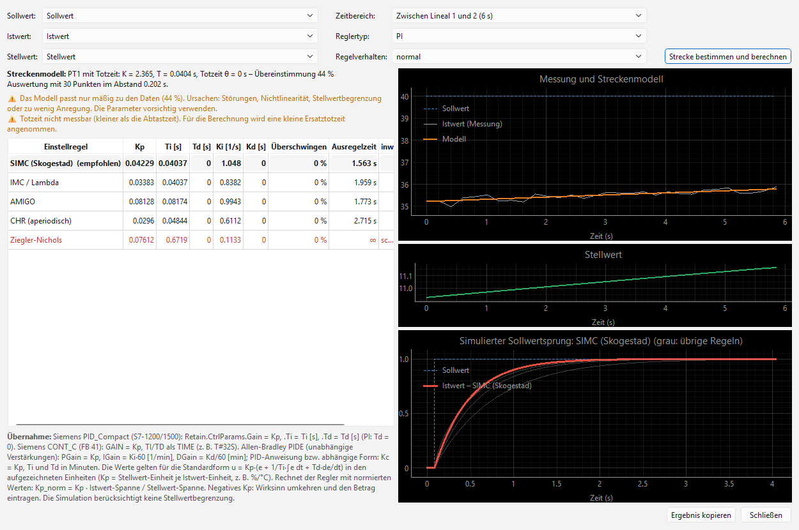

   Links Modell und Parameter, rechts Messung/Modell, Stellwert und simulierter Sollwertsprung.

1. **Zeitbereich** wählen: *Zwischen Lineal 1 und 2* (Offline-Modus, Lineale vorher um
   den Sprung legen), *Sichtbarer Bereich* oder *Alle Daten*.
2. **Strecke bestimmen und berechnen** klicken. Oben steht das Streckenmodell:

   * *PT1 mit Totzeit* – Verstärkung K, Zeitkonstante T, Totzeit θ (Temperatur, Druck,
     Durchfluss, Drehzahl …);
   * *I-Strecke mit Totzeit* – Integrierbeiwert Ki (z. B. Füllstand).

   Die **Übereinstimmung** gibt an, wie gut das Modell die Messung trifft (100 % =
   perfekt). Unter etwa 50 % sind die Parameter unsicher; Hinweise darunter nennen
   mögliche Ursachen. Im Diagramm rechts liegt die Modellkurve (orange) über dem
   gemessenen Istwert (grau).
3. Die **Tabelle** zeigt die Parameter nach mehreren Einstellregeln; die erste
   (fett) ist die empfohlene:

   .. list-table::
      :header-rows: 1
      :widths: 28 72

      * - Regel
        - Eigenschaften
      * - SIMC (Skogestad)
        - Empfehlung: gute Führung und Störunterdrückung, geringes Überschwingen.
      * - IMC / Lambda
        - Ruhig, praktisch ohne Überschwingen; schont Stellglieder.
      * - AMIGO
        - Robust (Åström/Hägglund), gute Störunterdrückung.
      * - CHR (aperiodisch)
        - Chien-Hrones-Reswick, Führungsverhalten ohne Überschwingen.
      * - Ziegler-Nichols
        - Klassisch, schnell, aber schwach gedämpft – nur zum Vergleich.

   Spalten: **Kp** (Verstärkung), **Ti** und **Td** in Sekunden (Standardform
   ``u = Kp·(e + 1/Ti·∫e dt + Td·de/dt)``), dazu die Parallelform **Ki** = Kp/Ti und
   **Kd** = Kp·Td sowie **Überschwingen** und **Ausregelzeit** (2-%-Band) aus der
   Simulation.
4. Unten rechts ist der **simulierte Sollwertsprung** mit der markierten Regel zu sehen
   (rot; grau die übrigen). Reglertyp und Regelverhalten lassen sich im Fenster
   umschalten – die Tabelle wird sofort neu berechnet.
5. **Ergebnis kopieren** legt Modell und alle Parameter als Text in die Zwischenablage.

Hinweise
----------------------------------------------------------------------

* Kp gilt in den aufgezeichneten Einheiten (Stellwert-Einheit je Istwert-Einheit, z. B.
  %/°C). Rechnet der Regler in der Steuerung mit normierten Werten, umrechnen:
  ``Kp_norm = Kp · Istwert-Spanne / Stellwert-Spanne``.
* Ein **negatives Kp** bedeutet: Der Istwert sinkt bei steigendem Stellwert (z. B.
  Kühlung). In der Steuerung den Wirksinn umkehren und den Betrag eintragen.
* Die Simulation berücksichtigt keine Stellwertbegrenzung. Neue Parameter vorsichtig
  einführen und den Regelkreis beobachten.
* Im **Demo-Modus** enthält die Beispielkonfiguration das Diagramm *Regelkreis* mit
  einem simulierten, absichtlich träge eingestellten Regler (Sollwert wechselt jede
  Minute) – nach einigen Minuten Aufzeichnung lässt sich die Optimierung ausprobieren.
* **Übernahme in die Steuerung:** *PIDE* mit unabhängigen Verstärkungen: ``PGain`` = Kp, ``IGain`` = Ki·60 [1/min], ``DGain`` = Kd/60 [min]. *PIDE* abhängige Form bzw. *PID*-Anweisung: ``Kc`` = Kp, Ti und Td in **Minuten** (Werte aus der Tabelle durch 60 teilen). *PIDE* rechnet in % der Bereiche ``PVEUMax/Min`` und ``CVEUMax/Min`` – Kp entsprechend umrechnen.

.. _analyse:

Analyse: XY-Diagramm und Frequenzanalyse
======================================================================

Beide Auswertungen stehen im Logger im Menü **Analyse** und arbeiten mit den
angezeigten Daten – während der Aufzeichnung, offline oder mit einer geladenen
CSV-Datei bzw. einem Datenbank-Zeitraum. Der **Zeitbereich** ist wählbar: *Zwischen
Lineal 1 und 2* (offline), *Sichtbarer Bereich* oder *Alle Daten*. Die Fenster bleiben
neben dem Hauptfenster offen; **Aktualisieren** holt die Daten neu. **Bild speichern …**
legt das Diagramm als PNG ab, **Werte speichern (CSV) …** die dargestellten Werte.

XY-Diagramm
----------------------------------------------------------------------

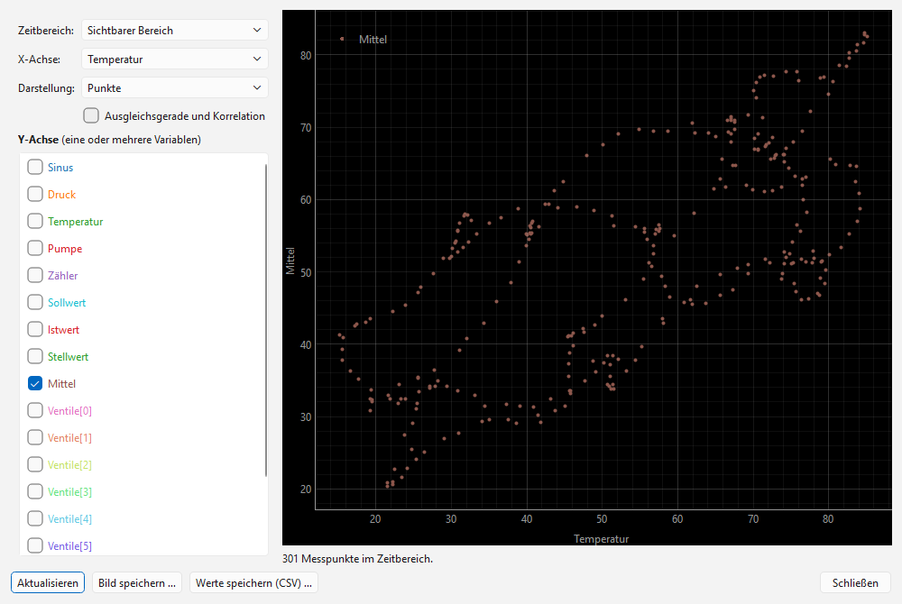

   XY-Diagramm mit Regressionsgerade.

Eine oder mehrere Variablen (Y) über einer anderen Variable (X) – z. B. Druck über
Hub, Kraft über Weg oder eine Kennlinie. **X-Achse** wählen, **Y-Achse** in der Liste
anhaken (Farben wie in der Konfiguration). Darstellung als *Punkte*, *Linie (zeitliche
Reihenfolge)* oder beides. **Ausgleichsgerade und Korrelation** zeichnet je Y-Variable
die Regressionsgerade und nennt den Korrelationskoeffizienten *r* sowie die
Geradengleichung.

Frequenzanalyse (FFT)
----------------------------------------------------------------------

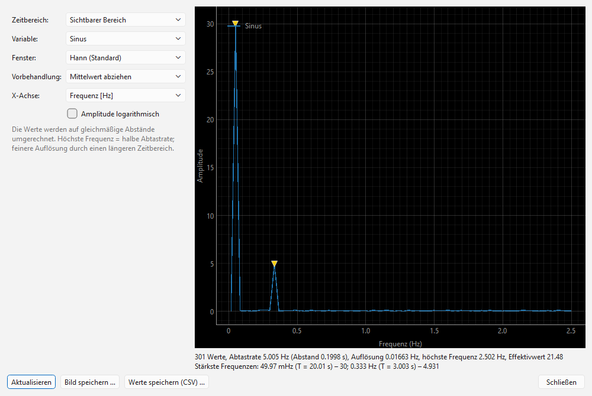

   Amplitudenspektrum mit den stärksten Frequenzen.

Das **Amplitudenspektrum** einer Variable, z. B. um Schwingungen, Pendeln eines
Regelkreises oder periodische Störungen zu finden. Die Messwerte werden zuerst auf
gleichmäßige Abstände (üblicher Messabstand) umgerechnet; fehlende Werte werden
überbrückt.

* **Fenster:** *Hann* (Standard), *Hamming*, *Blackman*, *Flat-Top* (genaue Amplituden)
  oder *Rechteck* (ohne Fenster).
* **Vorbehandlung:** Mittelwert oder linearen Trend abziehen (sonst überdeckt der
  Gleichanteil die kleinen Frequenzen).
* **X-Achse:** Frequenz in Hz oder Periodendauer in s (logarithmisch); Amplitude
  wahlweise logarithmisch.

Unter dem Diagramm stehen Abtastrate, Auflösung (= 1 / Dauer des Zeitbereichs), höchste
darstellbare Frequenz (halbe Abtastrate) und die **stärksten Frequenzen** mit
Periodendauer und Amplitude (gelbe Dreiecke im Diagramm). Ein Sinus der Amplitude *A*
erscheint etwa mit der Höhe *A*.

.. tip::

   Für feine Frequenzauflösung einen langen Zeitbereich wählen; für hohe Frequenzen ein
   kurzes Intervall der Steuerung (bei 100 ms sind höchstens 5 Hz sichtbar).

.. _pdf-berichte:

PDF-Berichte
======================================================================

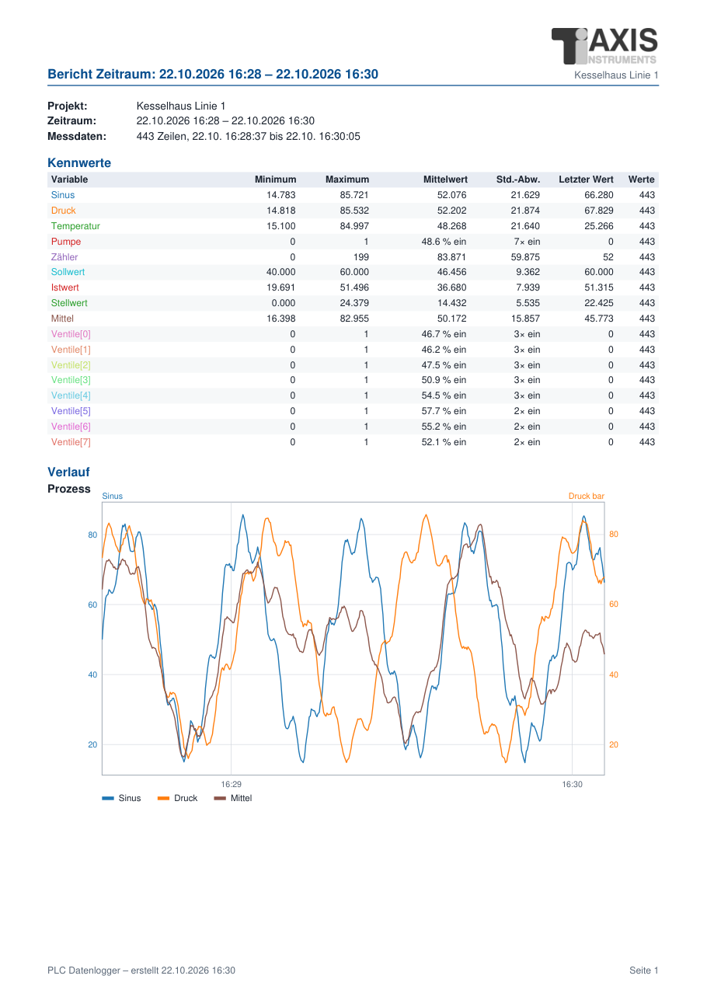

   Erste Seite eines PDF-Berichts.

Ein Bericht fasst einen Zeitraum auf wenigen Seiten zusammen:

* **Kopf:** Projekt, Zeitraum, Datenbasis (Anzahl der Messzeilen, erste und letzte Messung);
  darüber Kundenlogo und Logo aus der Konfiguration (Reiter *Anzeige*), sofern eingetragen.
* **Kennwerte** je Variable: Minimum, Maximum, Mittelwert, Standardabweichung, letzter
  Wert und Anzahl gültiger Werte; bei BOOL-Variablen der Anteil der Zeit mit Wert 1
  (Einschaltdauer) und die Zahl der Einschaltvorgänge.
* **Verlauf** jedes Diagramms der Konfiguration mit seinen Y-Achsen; BOOL-Variablen als
  Spuren unter dem Diagramm (Höhe = Anteil der Zeit mit Wert 1). Spitzen bleiben erhalten
  (Minimum und Maximum je Zeitabschnitt).
* **Ereignisse und Notizen** des Zeitraums aus dem Ereignisprotokoll.

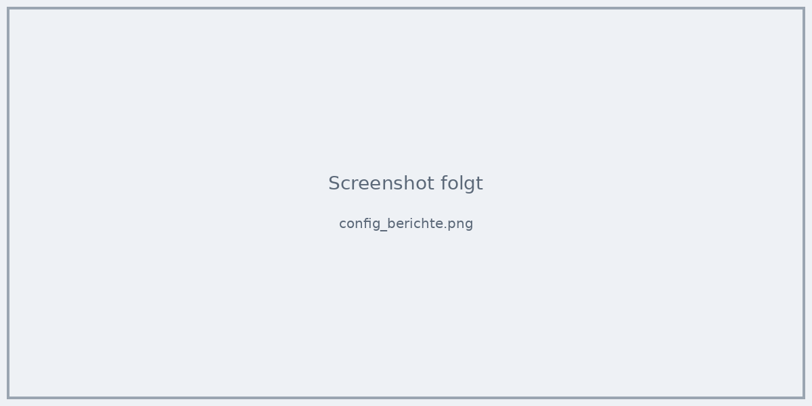

   Reiter Berichte (PDF) im Konfigurationsprogramm.

**Automatisch** (Konfigurationsprogramm, Reiter *Berichte (PDF)*): Am Ende jeder
**Schicht**, jedes **Tages**, jeder **Woche** oder jedes **Monats** schreibt der Logger den
Bericht in den Ordner ``berichte`` (Name ``<CSV-Name>_bericht_<Zeitraum>_<Beginn>.pdf``) –
auch im Headless-Betrieb. Dafür sammelt er während der Aufzeichnung die Kennwerte und eine
verdichtete Fassung des Verlaufs, unabhängig davon, wie viele Messwerte er im Speicher hält.
Beim Stoppen bzw. Beenden entsteht ein **Teilbericht** (Zusatz ``_teil``, Titel
„unvollständig“) für den angefangenen Zeitraum. Schichten beginnen zu den eingestellten
Uhrzeiten; Tag, Woche (Montag) und Monat zum *Tagesbeginn*.

**Von Hand:** **Analyse › PDF-Bericht erstellen …** – Zeitbereich wählen (zwischen den
Linealen, sichtbar, alles), Dateinamen bestätigen; der Bericht öffnet sich anschließend
im PDF-Betrachter.

Die PDF-Dateien entstehen ohne Zusatzprogramm (Standardschrift Helvetica, Vektorgrafik).

.. _io-check:

IO-Check (Inbetriebnahme)
======================================================================

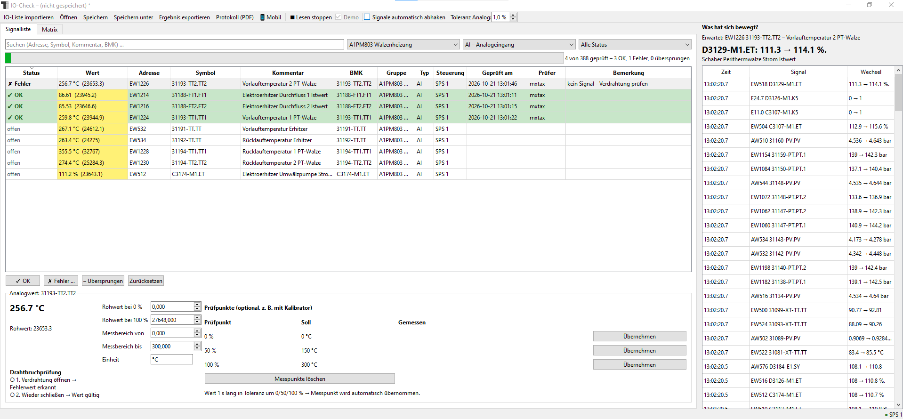

   Das IO-Check-Fenster: Signalliste mit Live-Werten und Status, rechts „Was hat sich bewegt?“.

Der IO-Check hilft bei der Inbetriebnahme, alle Ein- und Ausgänge einer Anlage zu
prüfen: Jedes Signal der IO-Liste wird live angezeigt und abgehakt; was sich gerade
bewegt hat, steht oben, vertauschte Signale fallen sofort auf. Der IO-Check liest
selbst aus den Steuerungen der Konfiguration – eine Aufzeichnung muss nicht laufen.

Öffnen:

* als eigenes Programm ``PLCIOCheck.exe`` (Startmenü *PLC IO-Check*, optional auch auf
  dem Desktop). Das Startbild zeigt die zuletzt benutzten Prüfstände
  (``*.iocheck.json``) und Konfigurationen; eine Konfiguration beginnt einen neuen
  Prüfstand mit deren Steuerungen, **Demo** startet mit simulierten Werten;
* im Konfigurationsprogramm **Datei › IO-Check mit dieser Konfiguration starten**;
* im Logger **Analyse › IO-Check …**;
* Linux/AppImage bzw. aus dem Quelltext: ``--iocheck`` (``plc_logger.py --iocheck``),
  optional mit einer Konfiguration oder einem Prüfstand.

**▶ Lesen starten** (F5) verbindet sich mit den Steuerungen; mit **Demo** werden die
Signale simuliert (zum Ausprobieren ohne Steuerung).

.. note::

   Der IO-Check liest nur. Ausgänge werden wie bisher über das Engineering-Werkzeug
   (Beobachtungs-/Forcetabelle) bzw. das Programm geschaltet und im IO-Check abgehakt.

IO-Liste importieren
----------------------------------------------------------------------

**IO-Liste importieren …** übernimmt eine CSV-, Excel- oder ODS-Tabelle (LibreOffice), z. B. aus EPLAN, die
Variablentabelle des TIA Portals (Export nach Excel) oder eine eigene Liste. Die Spalten
werden an ihrer Überschrift erkannt (Groß-/Kleinschreibung egal):

.. list-table::
   :header-rows: 1
   :widths: 25 75

   * - Feld
     - Erkannte Überschriften (Auswahl)
   * - Adresse (Pflicht)
     - Adresse, Address, Logische Adresse / Logical Address, Operand, Tag-Name, NodeId
   * - Symbol
     - Symbol, Name, Variable, Signal
   * - Kommentar
     - Kommentar, Comment, Beschreibung, Funktion, Bezeichnung
   * - BMK
     - BMK, Betriebsmittelkennzeichen, Kennzeichen, AKZ
   * - Gruppe
     - Gruppe, Schrank, Baugruppe, Ort, Station, Modul
   * - Typ
     - Typ, Art, Signalart (DI/DO/AI/AO, DE/DA/AE/AA, Eingang/Ausgang …)
   * - Datentyp
     - Datentyp, Data Type (Bool, Int, Word, Real …)
   * - Steuerung
     - Steuerung, SPS, PLC – Name der Steuerung in der Konfiguration; leer = erste
   * - Messbereich
     - Messbereich (z. B. ``0 … 10 bar``, ``4-20 mA``) oder getrennt *Messbereich
       von/bis*, *Einheit*; Rohwerte mit *Rohwert min/max* (Vorgabe 0 … 27648)

Fehlen Typ und Datentyp, werden sie aus der Adresse abgeleitet: ``E0.0``/``%I0.0`` =
Digitaleingang, ``A4.0``/``%Q4.0`` = Digitalausgang, ``EW256``/``%IW256``/``PEW256`` =
Analogeingang, ``AW``/``%QW`` = Analogausgang. Für den Treiber ``s7`` werden ``%``
und ``P`` entfernt, für ``ads`` die TwinCAT-Schreibweise (``%IX0.1``) und für ``tia``
der Symbolname (``IArea.<Name>``) verwendet. Zeilen ohne Adresse (Zwischenüberschriften)
und doppelte Adressen entfallen. Beim zweiten Import lässt sich die Liste ersetzen oder
ergänzen. Die Meldung nach dem Import nennt die erkannten Spalten.

**Eigene Spaltenüberschriften:** Unter **Spalten …** steht je Feld, unter welchen
Überschriften es in der Liste gesucht wird (mehrere durch Komma getrennt; Groß- und
Kleinschreibung, Leer- und Sonderzeichen zählen nicht). Heißt die Spalte in den eigenen
Listen z. B. „E/A“ oder „Klartext“, trägt man das hier einmal ein. **Ein leeres Feld
schaltet die Spalte ab:** sie wird nicht eingelesen und in der Signalliste nicht
angezeigt (z. B. BMK oder Steuerung, wenn es sie nicht gibt). Die Adresse ist Pflicht.
**Vorgabe** stellt die eingebauten Namen wieder her. Die Einstellung gilt für alle
Prüfstände dieses Benutzers.

Signalliste und Prüfstatus
----------------------------------------------------------------------

Die Tabelle zeigt je Signal Status, Live-Wert (Digital: LED und 0/1; Analog: Wert in
technischer Einheit und Rohwert), Adresse, Symbol, Kommentar, BMK, Gruppe, Typ,
Prüfzeit, Prüfer und Bemerkung. Ein Wechsel leuchtet kurz gelb auf. Über der Tabelle:
Suchfeld, Filter nach Gruppe, Typ und Status sowie der Fortschritt („312 von 480
geprüft – 305 OK, 4 Fehler, 3 übersprungen“).

* **✓ OK** (Strg+1), **✗ Fehler …** (Strg+2, fragt nach einer Bemerkung),
  **– Übersprungen** (Strg+3), **Zurücksetzen** (Strg+0) – für die markierten Zeilen.
  Zeit und Prüfer (Windows- bzw. Linux-Benutzer) werden eingetragen.
* Die **Bemerkung** lässt sich per Doppelklick direkt in der Tabelle bearbeiten.
* **Signale automatisch abhaken** (optional, aus): Ein Signal mit Status *offen* wird
  OK, sobald ein Digitalsignal 0→1→0 gewechselt hat (Sensor betätigt und losgelassen)
  bzw. ein Analogeingang die Drahtbruchprüfung bestanden hat (siehe unten). Abgehakt werden nur Signale, die in der IO-Liste bzw. einem Scan-Bereich
  stehen; welche Signale zu prüfen sind, bestimmt also die Liste.

Was hat sich bewegt? (Vertauschungen)
----------------------------------------------------------------------

Rechts stehen die letzten Wechsel, der neueste groß oben (Zeit, Signal, z. B. ``0 → 1``
bzw. ``4.98 → 7.51 bar``). So findet man ein Signal, ohne die Adresse zu kennen: im Feld
auslösen und ablesen, welches kam. Doppelklick auf einen Eintrag wählt das Signal.

Das in der Liste oder Matrix **gewählte Signal** gilt als *erwartet*. Wechselt
stattdessen ein anderer Digitaleingang (und das erwartete nicht), erscheint eine rote
Warnung „Vertauschung? Erwartet B12, gekommen B13“ mit Signalton; der Eintrag wird rot
markiert.

Der Knopf **Was hat sich bewegt?** in der Werkzeugleiste blendet die Seitenleiste aus
und wieder ein (mehr Platz für die Signalliste; die Wahl wird gemerkt). Die Warnung bei
einer Vertauschung erscheint dann in der Statuszeile.

Analogwerte prüfen
----------------------------------------------------------------------

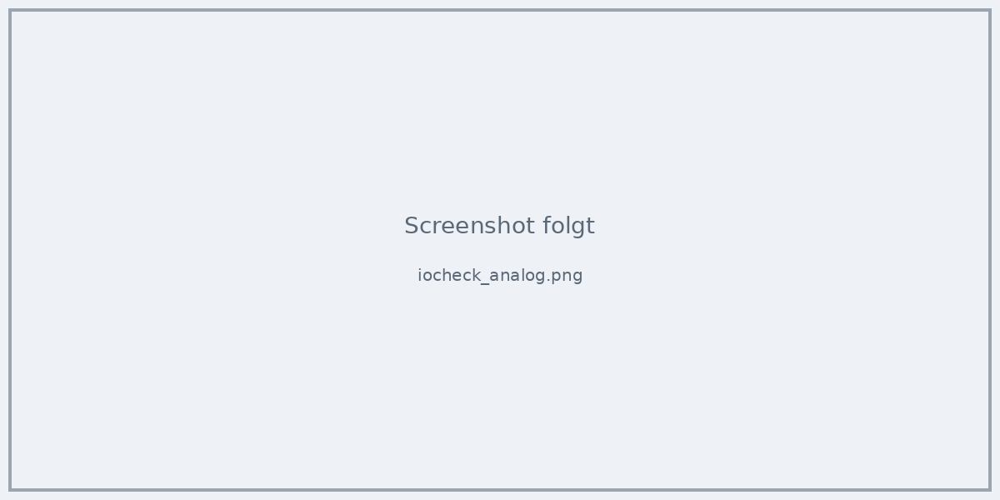

   Analogwert mit Drahtbruchprüfung und optionalen Prüfpunkten.

Ist ein Analogsignal gewählt, zeigt das Feld **Analogwert** den skalierten Wert, den
Rohwert und Fehlerwerte. Messbereich (Rohwert bei 0 und 100 %, technischer Bereich,
Einheit) lässt sich dort anpassen.

* **Drahtbruchprüfung** (Analogeingänge, üblicher Weg): Verdrahtung des Signals öffnen
  (Klemme lösen) – die Baugruppe meldet einen Fehlerwert, Schritt 1 wird abgehakt – und
  wieder schließen – der Wert ist wieder gültig, Schritt 2 wird abgehakt. Danach das
  Signal mit **✓ OK** bestätigen bzw. bei *Signale automatisch abhaken* automatisch.
  Wird dabei ein anderer Analogeingang unterbrochen als der gewählte, erscheint die
  Vertauschungswarnung. Als Unterbrechung gilt ein Fehlerwert (Siemens: über 32511,
  z. B. 32767; unter −4864 bei 4 … 20 mA, z. B. bei 0 mA; −32768) bzw. bei anderen
  Rohwertbereichen ein Wert mehr als 17,6 % außerhalb. Bei 0 … 10 V und 0 … 20 mA ist eine
  Unterbrechung nicht vom Wert 0 zu unterscheiden – dann von Hand abhaken oder die
  Prüfpunkte verwenden.
* **Prüfpunkte 0/50/100 %** (optional, z. B. mit Kalibrator): Liegt der Wert 1 s lang innerhalb der **Toleranz** (in der
  Werkzeugleiste, Vorgabe 1 % des Messbereichs) um einen Prüfpunkt, wird er übernommen –
  z. B. 4, 12 und 20 mA mit einem Kalibrator einspeisen. **Übernehmen** übernimmt den
  aktuellen Wert von Hand. Sind alle drei Punkte in Toleranz, wird das Signal OK.
* **Fehlerwerte** (Siemens-Rohwerte): 32767 = Überlauf bzw. Drahtbruch, −32768 =
  Unterlauf, 27649 … 32511 = Übersteuerungsbereich, unter −4864 = Unterlauf (bei
  4 … 20 mA Drahtbruch). Bei anderen Rohwertbereichen: Wert außerhalb des Messbereichs.

.. _io-matrix:

Matrix und Bereiche scannen
----------------------------------------------------------------------

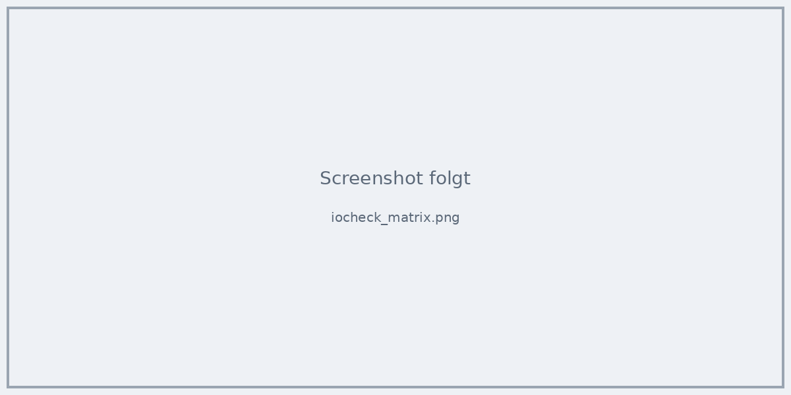

   Matrix: Ein-/Ausgänge als LEDs, geprüfte grün mit Haken.

Der Reiter **Matrix** zeigt alle Binärsignale als **LEDs**: Siemens-Bitadressen nach Byte
(Zeile) und Bit (Spalte 0 … 7), getrennt nach Eingängen, Ausgängen und Merkern; andere
Adressen der Reihe nach.

* LED grün = Eingang 1, orange = Ausgang 1, grau = 0, rot = nicht lesbar.
* Hintergrund grün mit ✓ = geprüft, rot mit ✗ = Fehler, grau mit – = übersprungen.
  Ein blauer Punkt bedeutet: 0→1 gesehen, aber noch nicht wieder 1→0. Ein gelber
  Rahmen markiert einen eben erfolgten Wechsel, ein blauer Rahmen das gewählte Signal.
* Klick wählt das Signal (auch in der Liste), Doppelklick schaltet OK ein/aus,
  Rechtsklick öffnet die Statusauswahl; der Tooltip zeigt Symbol, Kommentar, BMK und
  Status.

   Bereiche ohne IO-Liste scannen.

**Bereiche scannen …** liest zusammenhängende Bits auch ohne IO-Liste, z. B. Startadresse
``E0.0`` und 256 Bits (= E0.0 … E31.7) oder ``A0.0`` und 64 Bits – praktisch, wenn
es noch keine Liste gibt. Adressen in der Schreibweise des Treibers der gewählten
Steuerung; Signale, die in der IO-Liste stehen, behalten deren Symbol und Status. Für
``s7`` werden benachbarte Adressen mit einer Anfrage je Bereich gelesen.

Speichern und Ergebnis
----------------------------------------------------------------------

**Speichern** legt den Prüfstand als ``*.iocheck.json`` ab (Signale, Status,
Bemerkungen, Messpunkte, Scan-Bereiche, Optionen). Nach dem ersten Speichern wird jede
Änderung sofort gesichert – man kann jederzeit aufhören und am nächsten Tag mit
**Öffnen …** weitermachen. **Ergebnis exportieren …** schreibt die Liste mit Status,
Prüfzeit, Prüfer, Bemerkung und Messpunkten als Excel- oder CSV-Datei.

.. _io-mobil:

Auf Smartphone oder Tablet prüfen
----------------------------------------------------------------------

   IO-Check auf dem Smartphone: Signal gewählt, unten die Statusknöpfe.

Der Monteur an der Maschine sieht live, was ankommt, und hakt direkt dort ab; mehrere
Geräte können gleichzeitig prüfen. **📱 Mobil …** in der Werkzeugleiste zeigt die Adresse
(z. B. ``https://192.168.0.20:8080/io``) mit einem **QR-Code** zum Scannen und kopiert sie in
die Zwischenablage. Läuft im
Logger bereits der Webserver, wird dieser verwendet (Link *IO-Check* oben auf der
Diagrammseite); sonst startet der IO-Check einen eigenen mit den Einstellungen der
Konfiguration (Reiter *Webserver & headless*: Port, HTTPS, Benutzer, Zugriffscode; ist der
Port belegt, der nächste freie).

* Reiter **Liste** (Suche, Filter nach Gruppe und Status), **Matrix** (LEDs wie am PC) und
  **Bewegt** (letzte Wechsel). Ein Antippen wählt ein Signal; unten erscheinen Wert,
  **✓ OK**, **✗ Fehler** (mit Bemerkung), **Übersprungen**, **Zurück**, das Bemerkungsfeld
  und bei Analogeingängen die Drahtbruchprüfung und die Prüfpunkte (automatische Übernahme wie am PC, solange das
  Signal auf dem Gerät gewählt ist).

.. figure:: images/iocheck_mobil_matrix.png
   :alt: Matrix und Vertauschungswarnung auf dem Smartphone
   :width: 45%
   :align: center

   Matrix und Vertauschungswarnung auf dem Smartphone.

* Das gewählte Signal gilt auf diesem Gerät als *erwartet*: Wechselt ein anderer
  Digitaleingang, erscheint die Warnung „Vertauschung?“ und das Gerät vibriert.
* **Prüfer** ist der **Anmeldename** im Webserver (Benutzer im Konfigurationsprogramm
  anlegen, siehe `HTTPS und Anmeldung <https-anmeldung_>`__); er steht in Liste, Ergebnis
  und Protokoll. Ohne Anmeldung wird „Web (Zugriffscode)“ bzw. „Web (IP-Adresse)“
  eingetragen – dann kann jeder im Netz den Status ändern, daher Benutzer anlegen.
* **PDF** oben rechts öffnet das Abnahmeprotokoll auf dem Gerät.
* Die Änderungen übernimmt das IO-Check-Fenster am PC und speichert sie; es muss dafür
  geöffnet bleiben.

.. _io-protokoll:

Abnahmeprotokoll (PDF)
----------------------------------------------------------------------

   Erste Seite eines Abnahmeprotokolls.

**Protokoll (PDF) …** erzeugt das Abnahmeprotokoll und öffnet es:

* Kopf: Projekt, Prüfstand, Steuerungen, Prüfzeitraum und Ergebnis (geprüft in %, OK,
  Fehler, übersprungen, offen); darüber Kundenlogo und Logo der Konfiguration.
* **Zusammenfassung** je Signalart und je Gruppe, **Prüfer** mit Anzahl der geprüften
  Signale (PC-Benutzer bzw. Anmeldename im Webserver).
* **Fehler und offene Signale** – die Restpunkte.
* **Alle Signale** je Gruppe mit Adresse, Symbol, Kommentar, BMK, Typ, Status, Prüfzeit,
  Prüfer und Bemerkung bzw. Messpunkten der Analogwerte.
* **Bestätigung:** Unterschriftsfelder für Prüfer und Abnahme (Auftraggeber).

Aus Scan-Bereichen erscheinen nur bearbeitete Signale. Das Protokoll entsteht ohne
Zusatzprogramm (wie die PDF-Berichte); Zeichen außerhalb des westeuropäischen
Zeichensatzes erscheinen als „?“.

.. _sprache:

Sprache umschalten und übersetzen
======================================================================

Die Oberfläche ist auf Deutsch geschrieben und lässt sich über **Sprachdateien** in
andere Sprachen übersetzen. Mitgeliefert werden **Deutsch** und **Englisch**.

Umschalten
----------------------------------------------------------------------

   Menü Sprache.

Menü **Sprache** (im Logger und im Konfigurationsprogramm): Sprache wählen und die Frage
nach dem Neustart bestätigen. Die Wahl gilt für beide Programme und den Ereignis-Viewer
und wird in der Datei ``plc_einstellungen.json`` im Datenordner gespeichert. Auch die
Standardtexte von Qt (Ja/Nein/Abbrechen, Dateidialoge) folgen der gewählten Sprache, und
**Hilfe › Bedienungsanleitung** (F1) öffnet die Anleitung in der gewählten Sprache (für alle
Sprachen außer Deutsch die englische Fassung *User Manual*).

Nicht übersetzt werden Daten: Namen von Variablen, Diagrammen und Triggern, die Spalten
der CSV-Dateien und des Ereignisprotokolls (``KOMMT``, ``GEHT`` …), die Webseite des
Webservers sowie die Logdatei des Headless-Betriebs (teilweise).

Eigene Übersetzung erstellen
----------------------------------------------------------------------

1. Menü **Sprache → Ordner mit Sprachdateien öffnen …**. Der Ordner ``sprachen`` im
   Datenordner öffnet sich; die Vorlage ``de.txt`` wird dabei hineinkopiert.
2. ``de.txt`` kopieren und nach dem **Sprachkürzel** benennen, z. B. ``fr.txt``
   (Französisch), ``it.txt``, ``es.txt``, ``nl.txt``, ``pl.txt``, ``cs.txt``.
3. Die Datei mit einem Texteditor öffnen (UTF-8), oben hinter ``# Sprache:`` den Namen
   eintragen (z. B. ``Français``) und hinter jedem ``>`` die Übersetzung schreiben:

   .. code-block:: text

      # Sprache: Français

      @ Konfiguration laden
      > Charger la configuration

      @ {0} offene Ereignisse quittieren?
      > Acquitter {0} événements ouverts ?

4. Speichern – die Sprache erscheint sofort im Menü **Sprache** (nach Neustart aktiv).

Regeln:

* ``@`` = deutscher Originaltext (nicht ändern), ``>`` = Übersetzung. Leer gelassene
  Übersetzungen zeigen den deutschen Text – man kann also schrittweise übersetzen.
* ``\n`` steht für einen Zeilenumbruch.
* **Platzhalter** wie ``{0}``, ``{1}`` oder ``{2:.1f}`` müssen erhalten bleiben (die
  Reihenfolge im Satz ist frei). Fehlt einer, wird für diesen Text das Original verwendet.
* ``&`` vor einem Buchstaben markiert das Tastenkürzel im Menü (Alt + Buchstabe); ``&&``
  ergibt ein einzelnes ``&``.
* HTML-Auszeichnungen wie ``<b>…</b>`` oder ``<code>…</code>`` unverändert lassen.
* Die englische Datei ``en.txt`` kann als Beispiel dienen.

Gesucht wird zuerst im Ordner ``sprachen`` des Datenordners (eigene Dateien, bleiben bei
Updates erhalten), dann im Programmordner (mitgelieferte Dateien). Eine eigene ``en.txt``
im Datenordner ersetzt also die mitgelieferte.

Für Entwickler: Texte im Programm stehen als ``tr("…")`` bzw. ``tr("… {0} …").format(wert)``
(Modul ``plc_i18n.py``). Nach Programmänderungen bringt
``python tools/extract_tr.py plc .`` alle Sprachdateien auf den neuesten Stand (neue
Texte mit leerer Übersetzung, vorhandene Übersetzungen bleiben).

CSV-Dateien
======================================================================

Dateiname und Ort
----------------------------------------------------------------------

Für jede Aufzeichnung wird eine neue Datei im CSV-Ordner angelegt:
``<CSV-Name>_JJJJMMTT_HHMMSS.csv``, z. B. ``log_20261012_080000.csv``
(im Demo-Modus ``demo_...``).

.. _csv-archiv:

Dateigröße begrenzen und archivieren
----------------------------------------------------------------------

In der Konfiguration lässt sich die Anzahl der Datensätze je CSV-Datei
begrenzen (*Max. Datensätze je Datei*, ``0`` = unbegrenzt). Wird die Zahl
erreicht, geschieht automatisch Folgendes:

#. Die Datei wird geschlossen und als ZIP gepackt.
#. Das ZIP wird in der folgenden Verzeichnisstruktur abgelegt:

   .. code-block:: text

      <Archiv-Ordner>/<CSV-Name>/<Jahr>/<Monat>/<Tag>/<Dateiname>.zip

   Beispiel: ``archiv/log/2026/10/12/log_20261012_080000.zip``
#. Die ursprüngliche CSV-Datei wird erst gelöscht, nachdem das Archiv
   erfolgreich geprüft wurde.
#. Die Aufzeichnung läuft ohne Unterbrechung in einer neuen CSV-Datei weiter.

Hinweise:

* Für **Jahr, Monat und Tag** gilt das Datum des *ersten Datensatzes* der
  Datei. Der Ordnername ``<CSV-Name>`` ist der in der Konfiguration
  eingestellte Name (im Demo-Modus ``demo``).
* Das Packen läuft im Hintergrund und bremst die Aufzeichnung nicht. Das
  Ergebnis erscheint in der Statuszeile. Schlägt die Archivierung fehl,
  bleibt die CSV-Datei im CSV-Ordner erhalten.
* Wird die Aufzeichnung mit **■ Stop** beendet, bleibt die aktuelle Datei
  ungepackt im CSV-Ordner liegen. Nur volle Dateien werden archiviert.
* Archivierte Dateien lassen sich mit **CSV laden** direkt als ZIP öffnen.
* Die Anzeige im Logger arbeitet unabhängig von den Dateien weiter; beim
  Laden einer Datei wird nur deren Inhalt angezeigt.

Faustformel für die Dateigröße: Datensätze je Datei = Dauer ÷ Abtastintervall.
Bei 200 ms Intervall entstehen 5 Datensätze pro Sekunde, also 432 000 pro Tag;
ein Limit von 100 000 Datensätzen entspricht dann rund 5,5 Stunden je Datei.

.. _aufraeumen:

Alte Aufzeichnungen aufräumen
----------------------------------------------------------------------

Damit Platte bzw. Datenbank nicht volllaufen, löscht der Logger alte Aufzeichnungen auf
Wunsch selbst – nach **Zeitraum** (*Löschen nach … Tagen*) und/oder nach
**Speicherplatz** (*Höchstens belegen … MB*). Beide Grenzen sind voreingestellt aus
(*nie* bzw. *unbegrenzt*).

* **CSV und Archiv** (Reiter *Aufzeichnung*): betroffen sind nur die Dateien dieses
  Loggers – ``<CSV-Name>_*.csv`` im CSV-Ordner und die ZIP-Dateien unter
  ``<Archiv-Ordner>/<CSV-Name>/``. Maßgeblich ist die letzte Änderung einer Datei
  (= Ende der Aufzeichnung darin). Die gerade beschriebene CSV-Datei wird nie
  gelöscht; leer gewordene Archivordner werden entfernt.
* **Datenbank** (Reiter *Datenbank*): Werte älter als *n Tage* werden gelöscht – bei
  SQLite und MariaDB zeilenweise (in Portionen), bei TimescaleDB ganze Zeitabschnitte
  (``drop_chunks``), bei QuestDB ganze Tagespartitionen. Die Speicherplatz-Grenze gibt
  es nur für SQLite: Belegen die Werte mehr als *n MB*, wird jeweils der älteste Tag
  gelöscht. Die Datei wird dabei nicht kleiner, der frei gewordene Platz wird für neue
  Werte genutzt (verkleinern: ``VACUUM`` mit einem SQLite-Werkzeug). InfluxDB 3,
  VictoriaMetrics und Prometheus verwalten die Aufbewahrungsdauer selbst (Einstellung
  am Server).

Geprüft wird beim Start der Aufzeichnung und danach stündlich, auch im Headless-Betrieb.
Was gelöscht wurde, steht in der Statuszeile bzw. im Log („[Aufräumen] …“).

.. warning::

   Gelöschte Aufzeichnungen lassen sich nicht wiederherstellen. Grenzen so wählen, dass
   die Daten so lange erhalten bleiben, wie sie gebraucht werden (z. B.
   Aufbewahrungspflichten).

Format
----------------------------------------------------------------------

* Trennzeichen: Semikolon (``;``), Dezimaltrennzeichen: Punkt
* Zeichensatz: UTF-8
* Erste Zeile: Spaltenüberschriften

.. list-table::
   :header-rows: 1
   :widths: 20 80

   * - Spalte
     - Inhalt
   * - ``Zeit``
     - Zeitstempel mit Millisekunden, z. B. ``2026-10-11 10:59:30.927``
   * - ``Epoch``
     - Unix-Zeit in Sekunden mit drei Nachkommastellen (Millisekunden),
       z. B. ``1791716370.927``
   * - Variablen
     - Eine Spalte je Variable, benannt nach dem Variablennamen. Ein leeres
       Feld bedeutet: kein gültiger Wert.

Beispiel:

.. code-block:: text

   Zeit;Epoch;Temperatur;Pumpe
   2026-10-11 10:59:30.927;1791716370.927;51.234;1
   2026-10-11 10:59:31.127;1791716371.127;51.301;1

.. note::

   Wird die Datei in Excel geöffnet, zeigt Excel Millisekunden nur an, wenn die
   Spalte entsprechend formatiert ist (benutzerdefiniertes Zahlenformat
   ``TT.MM.JJJJ hh:mm:ss,000``). Die Werte in der Datei selbst enthalten die
   Millisekunden immer.

CSV-Datei laden
----------------------------------------------------------------------

**CSV laden** öffnet eine oder mehrere CSV- oder ZIP-Dateien (bei ZIP-Archiven die
erste CSV im Archiv) und zeigt sie im Offline-Modus an; mehrere Dateien werden dabei
nach der Zeit aneinandergehängt (siehe unten). Eine laufende
Aufzeichnung wird dabei beendet. Zur Darstellung wird die Spalte ``Epoch``
verwendet. Variablen, deren Name in der aktuellen Konfiguration vorhanden ist,
übernehmen Farbe und Zuordnung zu Diagramm und Y-Achse; unbekannte Variablen
erscheinen auf der ersten Y-Achse des ersten Diagramms.

.. _csv-verbinden:

Mehrere CSV-Dateien aneinanderhängen
----------------------------------------------------------------------

**Datei › CSV-Dateien aneinanderhängen und speichern …** wählt mehrere Aufzeichnungen
(CSV oder archivierte ZIP-Dateien, auch aus verschiedenen Archiv-Ordnern) und fügt sie
zu einer zusammen; das Ergebnis wird als **neue CSV-Datei** gespeichert (Vorschlag:
``<CSV-Name>_<Beginn>-<Ende>.csv``) und offline angezeigt. Die gewählten Dateien bleiben
unverändert.

* Die Reihenfolge der Auswahl spielt keine Rolle: alle Zeilen werden nach der Zeit sortiert.
* Spalten werden über den Variablennamen zugeordnet. Fehlt eine Variable in einer Datei
  (z. B. später hinzugefügt), bleibt sie dort leer.
* Doppelte Zeitpunkte (überlappende Dateien) werden nur einmal übernommen.
* An Lücken zwischen den Dateien (z. B. zwischen zwei Aufnahmen per Trigger) wird eine
  leere Zeile eingefügt, damit die Kurven dort unterbrochen sind.

Wer die Dateien nur ansehen will, wählt sie einfach zusammen in **CSV laden** – dann ohne
Speichern.

Werte exportieren (CSV/Excel)
----------------------------------------------------------------------

   Dialog „Werte exportieren“.

**Datei › Werte exportieren (CSV/Excel) …** (``Strg+Umschalt+E``) speichert
Messwerte als CSV- oder Excel-Datei (``.xlsx``). Grundlage ist die gesamte
Aufzeichnung im Speicher bzw. die geladene CSV-Datei oder der Datenbank-Zeitraum.

* **Zeitbereich:** *Zwischen Lineal 1 und Lineal 2* (nur offline; dieselben
  Messpunkte wie die Kennwerte der Wertetabelle), *Sichtbarer Ausschnitt* oder
  *Alle Daten*.
* **Nur eingeblendete Variablen:** ausgeblendete Kurven werden weggelassen.
* **Downsampling:** verdichtet die Werte auf ein festes Zeitraster (z. B. 1 s
  oder 60 s), etwa um lange Aufzeichnungen für Excel oder einen Bericht zu
  verkleinern. Verfahren je Intervall: *Mittelwert*, *Minimum*, *Maximum*,
  *Erster Wert* oder *Letzter Wert*. Der Zeitstempel einer Zeile ist der Beginn
  ihres Intervalls; Intervalle ohne Messpunkt entfallen. BOOL-Variablen bleiben
  0/1 (beim Mittelwert gilt 1, wenn das Signal im Intervall an war). Der Dialog
  zeigt, wie viele Zeilen höchstens entstehen.

Das Format folgt der Dateiendung bzw. dem gewählten Dateityp:

* **CSV:** gleicher Aufbau wie die Aufzeichnung (``Zeit;Epoch;Variablen …``,
  Semikolon, Dezimalpunkt) – die Datei lässt sich mit **CSV laden** wieder öffnen.
* **Excel:** Spalte A Datum und Uhrzeit (mit Millisekunden), Spalte B ``Epoch``,
  danach je Variable eine Spalte; fehlende Werte bleiben leer. Ein Tabellenblatt
  fasst höchstens 1 048 575 Zeilen – bei mehr Messpunkten Downsampling verwenden
  oder als CSV speichern.

.. _treiber-entwickeln:

Treiber entwickeln
======================================================================

Ein Treiber ist **eine Python-Datei**. Sie wird beim Programmstart automatisch
geladen; das Programm selbst muss weder geändert noch neu gebaut werden – auch die
installierte ``.exe`` bzw. das AppImage lädt eigene Treiber.

Wo Treiber gesucht werden
----------------------------------------------------------------------

.. list-table::
   :header-rows: 1
   :widths: 40 60

   * - Ort
     - Hinweis
   * - Ordner ``treiber`` im **Datenordner**
     - Empfohlen. Windows installiert: ``%APPDATA%\PLCDatenlogger\treiber``,
       Linux: ``~/PLCDatenlogger/treiber``, portabel bzw. Python-Quellen: Ordner
       ``treiber`` neben den Programmdateien. Bleibt bei Updates erhalten.
       Öffnen mit **Treiber › Ordner für eigene Treiber öffnen …**.
   * - Ordner in der Umgebungsvariablen ``PLC_TREIBER``
     - Mehrere Ordner mit ``;`` (Windows) bzw. ``:`` (Linux) trennen – z. B. für
       einen gemeinsamen Netzwerkordner.
   * - Paket ``plc_treiber`` (nur Python-Quellen)
     - Datei direkt neben ``s7.py`` usw.; Dateiname **ohne** Unterstrich
       (Namen mit ``_`` gelten dort als Hilfsmodule, z. B. ``s7_browser.py``).

Dateien, deren Name mit ``_`` beginnt (z. B. ``_vorlage.py``), werden **nicht**
geladen. Hilfsmodule eines Treibers können neben ihm im selben Ordner liegen
(der Ordner wird in den Suchpfad aufgenommen). Kann ein Treiber nicht geladen
werden (Syntaxfehler, fehlende Bibliothek beim Import, doppeltes Kürzel), laufen
alle anderen weiter; die Fehlermeldung steht unter **Treiber › Installierte
Treiber …**.

In fünf Schritten zum eigenen Treiber
----------------------------------------------------------------------

#. **Treiber › Ordner für eigene Treiber öffnen …** – der Ordner enthält danach
   die Vorlage ``_vorlage.py``.
#. Die Vorlage kopieren, z. B. nach ``meine_sps.py`` (ohne ``_`` am Anfang).
   Unverändert ist sie bereits ein funktionierender Treiber „Simulation“, der
   Sinus-, Rampen-, Rechteck- und Zufallswerte liefert (Adressen ``sinus:20``,
   ``rampe:10``, ``rechteck:4``, ``zufall:50``).
#. Kürzel ``id`` (eindeutig, steht in der Konfigurationsdatei), ``name``,
   ``params`` und ``types`` anpassen.
#. In der Reader-Klasse ``connect()``, ``read()`` und ``close()`` mit dem
   Protokoll der Steuerung füllen.
#. Konfigurationsprogramm neu starten – der Treiber erscheint in der Auswahl
   *Treiber* der Steuerungstabelle.

Minimaler Treiber
----------------------------------------------------------------------

.. code-block:: python

   from plc_treiber.base import NAN, Driver, Param, Reader

   class MeinReader(Reader):
       def connect(self):
           # Verbindung aufbauen; Fehler als Ausnahme melden (z. B. ConnectionError)
           self.sock = verbinde(self.plc.params["ip"], self.plc.params["port"])
           return len(self.vars)                 # Anzahl lesbarer Variablen

       def read(self):
           # EIN Messzyklus: Werte in der Reihenfolge von self.vars, float, NaN = kein Wert
           out = []
           for v in self.vars:
               try:
                   out.append(float(lies(self.sock, v.address, v.dtype)))
                   self.errors.pop(v.address, None)
               except KeyError as e:             # nur diese Variable fehlt
                   self.errors[v.address] = str(e)
                   out.append(NAN)
           return out

       def close(self):
           self.sock.close()

   class MeinTreiber(Driver):
       id = "mein"
       name = "Meine Steuerung"
       description = "Kurzbeschreibung für den Einstellungsdialog"
       params = [
           Param("ip", "IP-Adresse", "text", "192.168.0.10"),
           Param("port", "Port", "int", 5000, minimum=1, maximum=65535),
       ]
       types = ["BOOL", "INT", "DINT", "REAL"]
       address_hint = "z. B. R100"

       def create_reader(self, plc, variables):
           return MeinReader(self, plc, variables)

   DRIVER = MeinTreiber()

Schnittstelle
----------------------------------------------------------------------

Alle Einzelheiten stehen in ``src/plc_treiber/base.py``. Die wichtigsten Teile:

.. list-table:: Klasse ``Driver`` – Attribute
   :header-rows: 1
   :widths: 30 70

   * - Attribut
     - Bedeutung
   * - ``id``
     - Eindeutiges Kürzel (Kleinbuchstaben), steht als ``"treiber": "…"`` in der
       Konfigurationsdatei. Nach der Einführung nicht mehr ändern.
   * - ``name``, ``description``
     - Anzeigename (Auswahlliste) und Beschreibung (Einstellungsdialog).
   * - ``params``
     - Liste von ``Param`` – daraus entsteht der Einstellungsdialog; die Werte
       stehen in der Konfigurationsdatei und im Leser in ``self.plc.params``.
   * - ``types``, ``block_types``, ``default_type``
     - Lesbare Datentypen (Auswahl aus ``BOOL, BYTE, WORD, DWORD, LWORD, SINT, INT,
       DINT, LINT, USINT, UINT, UDINT, ULINT, REAL, LREAL, TIME, LTIME, S5TIME,
       CHAR, WCHAR``), Formate für Blöcke (``None`` = wie ``types``), Vorgabe.
   * - ``address_label``, ``address_hint``, ``block_hint``
     - Bezeichnung und Tooltip-Texte für Adressen und Blöcke.
   * - ``block_uses_index``
     - ``True``: Block = Array-Name + erster Index (Elemente ``Name[i]``);
       ``False``: Block = Startadresse (Elementadresse über
       ``block_element_address``).
   * - ``browse_label``
     - Text des Auswahlknopfs; leer = kein Auswahldialog.
   * - ``library``
     - Name der benötigten Bibliothek (für Anzeigen).

.. list-table:: Klasse ``Driver`` – Methoden (alle optional außer ``create_reader``)
   :header-rows: 1
   :widths: 35 65

   * - Methode
     - Aufgabe
   * - ``create_reader(plc, variables)``
     - Liefert den ``Reader`` für eine Steuerung.
   * - ``summary(plc)``
     - Kurztext der Verbindung für Tabelle, LEDs und Meldungen.
   * - ``check_params(params)``
     - Fehlertext für ungültige Parameter oder ``""``.
   * - ``check_address(address, dtype)``
     - Formale Prüfung einer Adresse beim Speichern; Fehlertext oder ``""``.
   * - ``normalize_address(address, dtype)``
     - Einheitliche Schreibweise (z. B. Großbuchstaben).
   * - ``block_element_address(block, i)``
     - Adresse des i-ten Block-Elements (``block.address``, ``block.start``,
       ``block.dtype``).
   * - ``check_block(block)``, ``type_size(dtype)``
     - Prüfung eines Blocks; Größe eines Typs in Bytes (für die Anzeige).
   * - ``check_library()``
     - Prüft die Bibliothek (``import …``); Ausnahme mit Hinweis, wenn sie fehlt.
       Bibliotheken möglichst erst hier bzw. in ``connect()`` importieren, damit
       der Treiber auch ohne sie geladen wird.
   * - ``read_once(plc, variables)``
     - Verbindungstest; Standard: ``connect`` + ``read`` + ``close``.
   * - ``browse(parent, ctx)``
     - Auswahldialog (Qt). ``ctx``: ``BrowseContext`` mit ``plc``, ``existing``
       (vorhandene Adressen), ``target_labels``, ``default_target`` und ``store``
       (treibereigene, in der Konfiguration gespeicherte Werte). Rückgabe:
       ``BrowseResult`` mit ``variables`` = ``[(Name, Adresse, Typ)]``,
       ``blocks`` = ``[(Name, Adresse, erster Index, Anzahl, Typ)]``,
       ``target_index`` und geändertem ``store`` – oder ``None`` bei Abbruch.

.. list-table:: Klasse ``Reader``
   :header-rows: 1
   :widths: 30 70

   * - Teil
     - Bedeutung
   * - ``self.plc``, ``self.vars``, ``self.driver``
     - Steuerung (``plc.params``, ``plc.name``), zu lesende Variablen (je
       ``address``, ``dtype``, ``name``, ``block``, ``block_idx``), Treiber.
   * - ``connect()``
     - Verbindung aufbauen und prüfen; Rückgabe: Anzahl lesbarer Variablen.
   * - ``read()``
     - Ein Messzyklus; Liste von ``float`` in der Reihenfolge von ``self.vars``,
       ``NAN`` für nicht lesbare Werte. Möglichst wenige Anfragen (Variablen mit
       gleichem ``block`` gemeinsam lesen).
   * - ``close()``
     - Verbindung schließen (darf mehrfach aufgerufen werden).
   * - ``self.errors``
     - ``{Adresse: Fehlertext}`` einzelner nicht lesbarer Variablen; erscheint in
       Statuszeile und Testwert. Die übrigen Variablen werden weiter gelesen.

Regeln:

* **Verbindungsfehler** (Steuerung nicht erreichbar, Socket geschlossen) als
  Ausnahme aus ``connect()``/``read()`` melden. Der Lese-Thread zeigt die LED
  rot, schließt den Leser und verbindet nach kurzer Wartezeit neu.
* **Fehler einzelner Variablen** dagegen in ``self.errors`` eintragen und ``NAN``
  liefern – keine Ausnahme.
* Jeder Leser läuft in **seinem eigenen Thread**; er muss nicht thread-sicher
  sein, darf aber keine globalen Objekte unsynchronisiert mit anderen Lesern
  teilen.
* ``read()`` sollte deutlich kürzer dauern als das Intervall der Steuerung.
* Texte für die Oberfläche können mit ``from plc_i18n import tr`` übersetzbar
  gemacht werden (``tools/extract_tr.py`` nimmt Treiber im Paket mit auf).

Für fertige Beispiele lohnt ein Blick in ``src/plc_treiber/modbus.py`` (eigenes
Protokoll über Sockets, Zusammenfassen von Anfragen, eigene Adressschreibweise)
und ``src/plc_treiber/s7.py`` (Bibliothek, Blöcke, Auswahldialog).

Testen ohne Oberfläche
----------------------------------------------------------------------

.. code-block:: python

   import sys; sys.path.insert(0, r"C:\Pfad\zum\plc_datenlogger")
   from plc_common import Plc, Variable
   from plc_treiber import get_driver, load_errors

   print(load_errors())                                  # Ladefehler?
   d = get_driver("mein")
   plc = Plc(name="Test", driver="mein", params=d.default_params())
   werte, fehler = d.read_once(plc, [Variable("A", address="R100", dtype="INT")])
   print(werte, fehler)

Treiber in die ``.exe`` aufnehmen
----------------------------------------------------------------------

Eigene Treiber im Ordner ``treiber`` brauchen keinen Neubau. Soll ein Treiber
fest eingebaut werden, die Datei in ``plc_treiber/`` legen, ihr Kürzel in
``BUILTIN`` in ``src/plc_treiber/__init__.py`` eintragen (optional, legt nur die
Reihenfolge fest) und benötigte Bibliotheken in ``requirements.txt`` sowie –
falls PyInstaller sie nicht findet – als ``--collect-all`` in ``build.bat`` bzw.
``build_appimage.sh`` ergänzen. ``build.bat`` nimmt alle Module von
``plc_treiber`` automatisch auf (``--collect-submodules plc_treiber``).

.. _installer:

Installationsdatei erstellen (Windows)
======================================================================

Aus den Python-Dateien lassen sich drei eigenständige Programme
(``PLCLogger.exe``, ``PLCKonfiguration.exe`` und ``PLCIOCheck.exe``) und eine Setup-Datei erzeugen.
Dazu dienen:

.. list-table::
   :header-rows: 1
   :widths: 30 70

   * - Datei
     - Aufgabe
   * - ``build.bat``
     - Baut mit **PyInstaller** beide Programme in *einen* gemeinsamen Ordner
       (``dist\PLCDatenlogger``) und anschließend mit **Inno Setup** den Installer.
   * - ``installer.iss``
     - Inno-Setup-Skript (Programmordner, Startmenü, optionale Desktop-Symbole,
       Deinstallation, Anleitung).
   * - ``tools/make_icon.py``
     - Erzeugt fehlende Symboldateien (``app.ico`` aus dem Standard-Symbol,
       ``app.png`` für das AppImage aus ``app.ico``); vorhandene bleiben unverändert.
   * - ``requirements.txt``
     - Benötigte Python-Pakete (inkl. PyInstaller und docutils für den Build).

**Voraussetzungen:** Python 3.9 oder neuer (64 Bit), Internetzugang beim ersten
Lauf (pip) und für den Installer **Inno Setup 7 oder 6**
(``https://jrsoftware.org/isinfo.php``).

**Ablauf:**

#. Die Ordnerstruktur des Projekts bleibt erhalten (Programmdateien in ``src``,
   Anleitung in ``doc``, Build-Dateien im Projektordner; siehe Überblick).
#. Im Projektordner ``build.bat`` starten (Doppelklick oder Eingabeaufforderung).

   .. code-block:: console

      build.bat              alles: Umgebung, Programme, Installer
      build.bat exe          nur die Programme (dist\PLCDatenlogger)
      build.bat installer    nur den Installer (benötigt vorhandenes dist\)

#. Ergebnis: ``dist\PLCDatenlogger`` (lauffähig ohne Installation) und
   ``installer\PLCDatenlogger_Setup_<Version>.exe``.

Das Skript legt eine virtuelle Umgebung ``.venv`` an, installiert die Pakete,
erzeugt bei Bedarf das Icon und baut beide Programme. Dabei entstehen auch die deutsche
(``bedienungsanleitung.html``) und die englische Anleitung (``user_manual.html``). Die Versionsnummer wird
oben in ``build.bat`` bei ``VERSION`` eingestellt. Icon und Logo sind die Dateien
``app.ico`` und ``logo.png`` im Projektordner; zum Austauschen einfach ersetzen
(Icon am besten mit 256×256 Pixeln, für ein scharfes Symbol in Explorer und Taskleiste).

**Speicherort der Daten:** Die installierten Programme schreiben Konfiguration
(``plc_config.json``), CSV-Dateien und Archiv **nicht** in den Programmordner
(dieser ist meist schreibgeschützt), sondern nach
``%APPDATA%\\PLCDatenlogger``. Die Daten bleiben beim Deinstallieren und bei
Updates erhalten. Soll alles neben den Programmen liegen (portabler Betrieb auf
einem USB-Stick), legen Sie eine leere Datei ``portable.txt`` neben die
``.exe``-Dateien.

**Hinweise:**

* Die ``.exe``-Dateien enthalten Python und alle Bibliotheken (die
  ``plctag.dll`` sowie die Bibliotheken aller eingebauten Treiber – python-snap7, s7commplus, pycomm3, cryptography – werden mitgenommen; fehlt ``plctag.dll`` neben
  ``build.bat``, lädt das Skript sie einmalig aus dem GitHub-Release von libplctag); auf dem
  Zielrechner muss nichts installiert werden.
* Der Logger startet die Konfiguration über **Konfig-Editor** in der
  Werkzeugleiste (``PLCKonfiguration.exe`` im selben Ordner); ``PLCIOCheck.exe`` ist der
  IO-Check als eigenes Programm (Startmenü *PLC IO-Check*).
* Schlägt der Build fehl, steht die Ursache in den Meldungen des Fensters
  (häufig: kein Internet für pip, Python nicht im PATH, Virenscanner sperrt
  ``dist``). Mit ``build.bat exe`` bzw. ``build.bat installer`` lassen sich die
  Schritte getrennt wiederholen.

Portable Version (ohne Installation)
----------------------------------------------------------------------

Statt des Installers lässt sich ein ZIP-Paket erzeugen, das nur entpackt wird –
z. B. auf einen USB-Stick oder in einen beliebigen Ordner:

.. code-block:: console

   build.bat portable

Ergebnis: ``dist\PLCDatenlogger_portable_<Version>.zip`` (``build.bat`` ohne Parameter
erzeugt das ZIP zusätzlich zum Installer). Benutzung:

#. ZIP entpacken (Rechtsklick › *Alle extrahieren*).
#. ``PLCKonfiguration.exe`` bzw. ``PLCLogger.exe`` im entpackten Ordner starten.
   Eine Installation oder Administratorrechte sind nicht nötig.

Im Paket liegt die Datei ``portable.txt``. Sie schaltet den portablen Betrieb ein:
Konfiguration, CSV-Dateien, Archiv und Logdatei liegen dann **im entpackten Ordner**
statt unter ``%APPDATA%``. Der Ordner muss deshalb beschreibbar sein (also nicht
unter ``C:\Program Files`` entpacken). Zum Entfernen genügt es, den Ordner zu
löschen. Für ein Update die neuen Programmdateien über den alten Ordner entpacken;
Konfiguration und Aufzeichnungen bleiben erhalten.

.. note::

   Beim ersten Start einer heruntergeladenen ``.exe`` kann Windows SmartScreen
   warnen (*Weitere Informationen › Trotzdem ausführen*), da die Programme nicht
   signiert sind. Unter *Eigenschaften › Zulassen* der ZIP-Datei lässt sich das
   vor dem Entpacken für alle Dateien aufheben.

Bauen auf GitHub (ohne eigenen Windows-PC)
----------------------------------------------------------------------

Liegt das Projekt in einem GitHub-Repository, baut der Workflow
``.github/workflows/windows.yml`` das **portable ZIP** und den **Installer** auf einem
Windows-Rechner von GitHub:

* **Von Hand:** *Actions › Windows › Run workflow*. Die Dateien liegen danach in der
  Zusammenfassung des Laufs unter *Artifacts* (``windows-portable`` und
  ``windows-setup``).
* **Mit einem Tag** ``v*`` (z. B. ``v3.0.0``): zusätzlich als Dateien eines
  GitHub-Release, zusammen mit den AppImages. Der Text des Release kommt aus
  ``CHANGELOG.md``.

Gebaut wird mit ``build.bat`` wie auf dem eigenen PC. Bilder der Anleitung (Ordner
``doc/images``) werden mitgenommen, wenn sie im Repository liegen.

**Versionsnummer:** Sie steht an genau einer Stelle, ``APP_VERSION`` in
``src/plc_common.py``; ``build.bat``, ``build_appimage.sh``, Installer, PDF-Anleitung und
der Dialog *Über …* lesen sie von dort. Die Nummer folgt dem Schema
``HAUPT.NEBEN.FEHLER`` (inkompatible Änderung / neue Funktionen / Fehlerbehebung); was
sich geändert hat, steht in ``CHANGELOG.md``. Neue Version und Release:

.. code-block:: console

   python tools/bump_version.py neben --tag    # z. B. 3.0.0 -> 3.1.0: Nummer, CHANGELOG, Commit, Tag
   git push && git push origin v3.1.0          # Tag hochladen: GitHub baut Installer, ZIP und AppImages

Passt der Tag nicht zu ``APP_VERSION``, bricht der Workflow ab.

**Automatische Tests:** Der Workflow ``.github/workflows/tests.yml`` läuft bei jedem Push
unter Linux und Windows: Programmlogik, Webserver, Benachrichtigungen, OPC-UA-Server,
Sprachdateien und Anleitung sowie die Oberfläche mit echtem PySide6 (ohne Bildschirm).
Fehler erscheinen als Hinweise am Lauf. Lokal:

.. code-block:: console

   pip install pytest
   python -m pytest tests

**Anleitung als PDF:** Diese Anleitung lässt sich mit Sphinx als PDF erzeugen – ohne
LaTeX, über rinohtype:

.. code-block:: console

   pip install -r doc/requirements.txt
   python tools/build_doc.py              # -> dist\PLC_Datenlogger_Bedienungsanleitung_<Version>.pdf
   python tools/build_doc.py --lang en    # -> dist\PLC_Datenlogger_User_Manual_<Version>.pdf (englisch)
   python tools/build_doc.py --html       # zusätzlich HTML-Vorschau in build\doc\html_de

Die Einstellungen stehen in ``doc/conf.py``, das Layout in ``doc/pdf.rtt`` (Vorlage)
und ``doc/pdf.rts`` (Schriften, Seitenumbrüche). Die deutsche Anleitung ist
``doc/bedienungsanleitung.rst``, die englische ``doc/user_manual.rst`` (gleiche Gliederung;
Änderungen bitte in beiden vornehmen). Die Versionsnummer kommt aus
``APP_VERSION`` in ``src/plc_common.py``. ``build.bat`` erzeugt beide PDFs automatisch
und legt sie zusätzlich zu den HTML-Fassungen in den Installer (Startmenü-Einträge
*Bedienungsanleitung (PDF)* und *User Manual (English, PDF)*) und in das portable ZIP
(Ordner ``Doku``). Gelingt ein PDF nicht, meldet ``build.bat`` einen Hinweis und baut ohne
es weiter.

**Wiki:** Der Workflow ``.github/workflows/wiki.yml`` erzeugt bei jeder Änderung dieser
Anleitung (oder der Bilder) das GitHub-Wiki neu: eine Seite je Kapitel, mit
Seitenleiste und Bildern, dazu die englischen Seiten mit dem Präfix ``en-`` (Werkzeug
``tools/make_wiki.py``, benötigt pandoc). Einmalig
vorher im Repository das Wiki einschalten und die erste Seite anlegen. Die
Wiki-Seiten nicht von Hand bearbeiten – sie werden beim nächsten Lauf überschrieben.

.. _appimage:

Linux: AppImage und Debian-Paket (x86_64 und arm64)
======================================================================

Für Linux gibt es das Programm als **AppImage**: eine einzelne Datei, die ohne Installation
läuft. Sie enthält Logger, Konfigurationsprogramm, IO-Check und Ereignis-Viewer. Alternativ
gibt es dasselbe Programm als **Debian-Paket** (``.deb``) für Debian, Ubuntu, Linux Mint und
Raspberry Pi OS, siehe `Debian-Paket <debpaket_>`_.

Benutzen
----------------------------------------------------------------------

.. code-block:: console

   chmod +x PLCDatenlogger-3.0.0-x86_64.AppImage        # einmalig: ausführbar machen
   ./PLCDatenlogger-3.0.0-x86_64.AppImage               # Logger (mit Startbild)
   ./PLCDatenlogger-3.0.0-x86_64.AppImage --konfig      # Konfigurationsprogramm
   ./PLCDatenlogger-3.0.0-x86_64.AppImage --ereignisse  # Ereignis-Viewer
   ./PLCDatenlogger-3.0.0-x86_64.AppImage --headless anlage.json   # nur Aufzeichnung (z. B. als Dienst)

Auf Raspberry Pi (64-Bit-System) und anderen arm64-Rechnern entsprechend die Datei
``…-aarch64.AppImage``. Die Daten (Konfiguration, CSV, Archiv, Ereignisse, Sprachdateien)
liegen in ``~/PLCDatenlogger``; liegt neben dem AppImage eine Datei ``portable.txt``, bleiben sie
im Ordner des AppImage. Manche Systeme brauchen für AppImages das Paket ``libfuse2``
(Ubuntu 22.04: ``sudo apt install libfuse2``, Ubuntu 24.04: ``libfuse2t64``); ohne FUSE
startet es auch mit ``--appimage-extract-and-run``.

**Wayland:** Auf Arbeitsoberflächen mit Wayland (z. B. Ubuntu, Fedora, KDE Plasma) starten
alle Programme über **XWayland**. Unter reinem Wayland stürzte Qt beim Ziehen eines
Diagramm- oder Wertefensters (Dock) ab; über XWayland lassen sich die Fenster zudem frei
verschieben und abtrennen. Ein eigenes ``QT_QPA_PLATFORM`` gilt weiter; mit
``PLC_WAYLAND=1`` läuft das Programm unter Wayland, dann lassen sich die Docks nicht ziehen
(Anordnung über das Menü *Ansicht*). Fehlt XWayland, gilt dasselbe automatisch.

Die Bibliothek **libplctag** (``libplctag.so``) wird beim Bauen aus dem Quelltext übersetzt und ist im AppImage enthalten.

.. _debpaket:

Debian-Paket (.deb)
----------------------------------------------------------------------

Das Paket installiert das Programm fest ins System, mit Einträgen im Startmenü
(*PLC Datenlogger*, *PLC Konfiguration*, *PLC IO-Check*) und Befehlen für das Terminal. Die
benötigten Systembibliotheken (Qt-Grafik) installiert ``apt`` gleich mit:

.. code-block:: console

   sudo apt install ./plc-datenlogger_3.2.1_amd64.deb   # PC (x86_64)
   sudo apt install ./plc-datenlogger_3.2.1_arm64.deb   # Raspberry Pi 4/5 (64-Bit-System), arm64
   plc-datenlogger                     # Logger (mit Startbild)
   plc-konfiguration                   # Konfigurationsprogramm
   plc-iocheck                         # IO-Check
   plc-ereignisse                      # Ereignis-Viewer
   plc-datenlogger --headless anlage.json   # nur Aufzeichnung (z. B. als Dienst)
   sudo apt remove plc-datenlogger     # entfernen (die Daten in ~/PLCDatenlogger bleiben)

Das Programm liegt unter ``/usr/lib/PLCDatenlogger``, die Anleitung unter
``/usr/share/doc/PLCDatenlogger``. Die Daten liegen wie beim AppImage in ``~/PLCDatenlogger``
(je Benutzer). Ein Update installiert man genauso mit der neueren ``.deb``-Datei.

Welche Systeme passen? Wie beim AppImage braucht das Programm mindestens die glibc des
Build-Systems; ``apt`` prüft das und lehnt das Paket auf zu alten Systemen ab:

* **amd64** (aus dem GitHub-Release): Ubuntu 22.04 und neuer, Debian 12 und neuer, Linux Mint 21
  und neuer.
* **arm64** (aus dem GitHub-Release): Raspberry Pi OS ab Trixie (Debian 13), Ubuntu 24.04 und
  neuer. Für Raspberry Pi OS Bookworm das Paket selbst bauen: ``./build_appimage.sh --docker
  arm64`` (siehe unten) baut in einem Debian-12-Container. Ein 32-Bit-Raspberry-Pi-OS wird nicht
  unterstützt.

Bauen
----------------------------------------------------------------------

``build_appimage.sh`` im Programmordner baut das AppImage für die Architektur des Rechners,
auf dem es läuft:

.. code-block:: console

   sudo apt install python3-venv cmake build-essential file libxkbcommon-x11-0 libxcb-cursor0 \
        libxcb-icccm4 libxcb-keysyms1 libxcb-shape0 libegl1 libfontconfig1 libdbus-1-3
   ./build_appimage.sh
   # Ergebnis: dist/PLCDatenlogger-3.0.0-x86_64.AppImage (bzw. -aarch64)
   #      und dist/plc-datenlogger_3.0.0_amd64.deb (bzw. _arm64)

* **x86_64** auf einem x86_64-Rechner bauen, **arm64** auf einem arm64-Rechner (Raspberry
  Pi 4/5 mit 64-Bit-System, Ubuntu arm64 …). PyInstaller kann nicht für eine andere
  Architektur übersetzen.
* Ohne arm64-Rechner: ``./build_appimage.sh --docker arm64`` baut in einem Docker-Container
  per QEMU-Emulation (langsam, aber auf jedem x86_64-PC mit Docker möglich).
* Das AppImage läuft auf Systemen mit **gleicher oder neuerer** glibc als das Build-System.
  Für möglichst viele Zielsysteme auf einem älteren System bauen (z. B. Ubuntu 22.04).
* Gibt es für PySide6 auf einem älteren arm64-System kein passendes Paket, die Qt-Pakete des
  Systems verwenden: ``sudo apt install python3-pyside6.qtwidgets python3-pyside6.qtsvg`` und
  ``VENV_SYSTEM=1 ./build_appimage.sh``.
* Das ``.deb``-Paket entsteht im selben Lauf aus denselben Programmdateien (benötigt
  ``dpkg-deb``, auf Debian/Ubuntu immer vorhanden); ``SKIP_DEB=1`` schaltet es ab.
* **GitHub Actions**: Der Workflow ``.github/workflows/appimage.yml`` baut die AppImages und
  ``.deb``-Pakete für x86_64 und arm64 automatisch, wenn das Projekt in einem GitHub-Repository liegt (Actions › AppImages ›
  Run workflow, oder bei einem Tag ``v*``).

.. _macos:

macOS (Apple Silicon und Intel)
======================================================================

Für macOS gibt es das Programm als **App** in einer ``.dmg``-Datei:
``PLCDatenlogger-<Version>-macos-arm64.dmg`` für Macs mit Apple Silicon (M1, M2 …) und
``…-macos-x86_64.dmg`` für Intel-Macs; beide ab macOS 12. Die App enthält Logger,
Konfigurationsprogramm, IO-Check und Ereignis-Viewer, dazu die Anleitung und die
SPS-Vorlagen.

.. note::

   Die macOS-Fassung ist eine **Vorschau**: Sie wird automatisch gebaut und getestet, wurde aber
   noch nicht auf einem Mac bedient. Rückmeldungen (z. B. über GitHub) sind willkommen.

**Installieren:** DMG öffnen und **PLC Datenlogger** auf **Programme** ziehen. Die App ist
nicht bei Apple signiert und notarisiert; macOS blockiert sie deshalb beim ersten Start.
Einmal im Finder mit **Rechtsklick › Öffnen** starten und bestätigen (neuere macOS-Versionen:
*Systemeinstellungen › Datenschutz & Sicherheit › Dennoch öffnen*) oder im Terminal:

.. code-block:: console

   xattr -dr com.apple.quarantine "/Applications/PLC Datenlogger.app"

**Benutzen:** Die App startet den Logger mit Startbild. Das Konfigurationsprogramm öffnet
sich aus dem Logger (Konfig-Editor); Parameter wie unter Linux:

.. code-block:: console

   "/Applications/PLC Datenlogger.app/Contents/MacOS/PLC Datenlogger" --konfig
   "/Applications/PLC Datenlogger.app/Contents/MacOS/PLC Datenlogger" --headless anlage.json

Die Daten liegen in ``~/PLCDatenlogger``. Die Menüleiste steht wie bei Mac-Programmen oben
am Bildschirm; Tastenkürzel mit ``Strg`` gelten auf dem Mac mit ``⌘``. libplctag (Treiber
``clx``) ist enthalten.

**Bauen:** ``build_macos.sh`` baut auf einem Mac die App für dessen Architektur (benötigt
Python 3.10+, die Xcode Command Line Tools und für libplctag ``cmake``, z. B. ``brew install
cmake``); Ergebnis ``dist/PLC Datenlogger.app`` und die ``.dmg``. Der Workflow
``.github/workflows/macos.yml`` baut beide Fassungen auf GitHub (Actions › macOS › Run
workflow, oder bei einem Tag ``v*``) und hängt die ``.dmg`` ans Release. Mit einem
Apple-Entwicklerkonto signiert das Skript mit ``MACOS_SIGN_ID="Developer ID Application: …"``;
die Notarisierung folgt dann mit ``xcrun notarytool``.

Hilfe und Kontexthilfe (F1)
======================================================================

Logger und Konfigurationsprogramm haben ein Menü **Hilfe**:

* **Bedienungsanleitung** öffnet diese Anleitung (PDF bzw. HTML) mit dem
  Standardprogramm des Systems. Ist die Oberfläche nicht auf Deutsch eingestellt, öffnet
  sich die englische Fassung (*User Manual*).
* **Über PLC Datenlogger …** zeigt Version, Copyright, Links auf taxis-instruments.de und
  den Quelltext auf GitHub, die Lizenz, die Lizenzen der Drittkomponenten und die
  Versionen der verwendeten Bibliotheken.

**F1** öffnet die Anleitung im Browser direkt an der Stelle, die zum aktuellen
Fenster passt – auch in Dialogen. Maßgeblich ist das Feld mit dem Eingabefokus:

* Konfigurationsprogramm: je Reiter der passende Abschnitt; in der
  Steuerungstabelle der Abschnitt des Treibers der markierten Zeile; im
  Zuordnungsbaum, in der Variablentabelle und bei den Eigenschaften von Diagramm
  und Y-Achse deren Abschnitt.
* Dialoge: Verbindungseinstellungen (Abschnitt des Treibers), Variablen aus der
  Steuerung wählen, Blöcke, berechnete Variablen, Trigger, PID-Regler,
  Datenbank-Lesemodus, Ereignisprotokoll, Notizen, Benutzer des Webservers,
  XY-Diagramm, Frequenzanalyse, IO-Check.
* Logger: Bedienelemente, Diagramme, Wertetabelle; Startbild: Abschnitt
  „Startbild“.

Für die Kontexthilfe wird die HTML-Fassung ``bedienungsanleitung.html`` (englisch:
``user_manual.html``) benötigt (Installer und portable Version: Unterordner ``Doku``). Fehlt sie, öffnet F1 die
Anleitung am Anfang.

Fehlersuche
======================================================================

.. list-table::
   :header-rows: 1
   :widths: 35 65

   * - Problem
     - Mögliche Ursache und Abhilfe
   * - „Verbindung fehlgeschlagen“ / LED rot
     - Verbindungsparameter (**…** in der Steuerungstabelle) und Netzwerk der
       betroffenen Steuerung prüfen, Firewall (``s7``/``tia``/``logo`` TCP 102,
       ``clx``/``pccc`` TCP 44818, ``modbus`` TCP 502, ``fins`` UDP/TCP 9600,
       ``ads`` TCP 48898). Die übrigen Steuerungen laufen unabhängig
       weiter.
   * - „Bibliothek fehlt“ im Einstellungsdialog bzw. unter *Installierte Treiber*
     - Bibliothek des Treibers installieren: ``pip install python-snap7``
       (``s7``, ``logo``), ``pip install s7commplus`` (``tia``), ``pip install pycomm3``
       (``pccc``; ``clx`` zusätzlich ``plctag.dll``). ``fins`` und ``ads`` brauchen
       keine Bibliothek.
   * - Treiber fehlt in der Auswahl / „(Treiber fehlt)“
     - Eigener Treiber nicht geladen: **Treiber › Installierte Treiber …** zeigt
       die Fehlermeldung. Dateiname darf nicht mit ``_`` beginnen; Datei liegt
       im richtigen Ordner? Steuerungen mit fehlendem Treiber bleiben in der
       Konfiguration erhalten, werden aber nicht gelesen.
   * - ``s7``: „Address out of range“ / Werte falsch
     - DB zu kurz oder **optimierter** Baustein (Offsets stimmen nicht) – Baustein
       ohne „Optimierten Bausteinzugriff“ anlegen oder Treiber ``tia`` verwenden.
       Bei S7-1200/1500 PUT/GET erlauben.
   * - ``tia``: Verbindung abgelehnt
     - TLS-Einstellung (*An* bzw. *Aus* probieren), Passwort der Zugriffsstufe,
       Zahl freier HMI-Verbindungen der CPU.
   * - ``logo``: keine Verbindung
     - In LOGO!Soft Comfort eine Verbindung als **Server** mit passendem TSAP
       einrichten (Vorgabe TSAP der LOGO! ``02.00``, des Loggers ``01.00``) und das
       Programm in die LOGO! laden. Es sind nur wenige Verbindungen gleichzeitig möglich.
   * - ``clx``: „libplctag wurde nicht gefunden“
     - ``plctag.dll`` (64 Bit) neben die Programmdateien legen bzw. Pfad in
       ``CLX_PLCTAG_LIB`` angeben. 32-Bit-Python kann die 64-Bit-DLL nicht laden.
   * - ``clx``: „PLCTAG_ERR_NOT_FOUND“ bzw. „…BAD_PARAM“
     - Den Tag gibt es nicht (Schreibweise, Präfix ``Program:Name.``) oder
       *External Access* ist *None*. Nur dieser Tag bleibt ohne Wert.
   * - ``pccc``: Datei nicht gefunden / kein Wert
     - Datendatei gibt es in der Steuerung nicht oder sie ist zu kurz (z. B. ``N7:120``
       bei nur 100 Elementen). Datentabelle des Projekts prüfen.
   * - ``modbus``: „ungültige Adresse“ (Ausnahme 2)
     - Register im Gerät nicht vorhanden. Zählweise prüfen (``40001`` = ``HR0``;
       „Register 100“ im Handbuch ist oft ``HR100``). Einzelne Lücken in einem
       zusammengefassten Bereich: *Lücke zusammenfassen bis* auf ``0`` stellen.
   * - ``modbus_rtu``: „Gerät … antwortet nicht“
     - Geräteadresse, Baudrate, Parität, Stoppbits prüfen; A/B-Leitung vertauscht?
       Busabschluss vorhanden? Zeitlimit erhöhen.
   * - ``opcua``: „BadSecurityChecksFailed“, „BadCertificate…“ oder Abweisung
     - Client-Zertifikat im Server als vertrauenswürdig freigeben; Sicherheit so
       wählen, wie der Server sie anbietet.
   * - ``opcua``: „BadNodeIdUnknown“
     - NodeId falsch geschrieben (Namensraum ``ns=``, Anführungszeichen bei S7-1500)
       – am besten aus dem Auswahldialog übernehmen.
   * - ``ads``: keine Verbindung / Zeitüberschreitung
     - In der TwinCAT-Steuerung muss eine **Route** für den Logger-PC (AMS-Net-ID und
       IP-Adresse) eingetragen sein; AMS-Net-ID und Port (TwinCAT 3: 851, TwinCAT 2:
       801) des Ziels prüfen.
   * - ``fins``: „FINS-Fehler …“ bzw. keine Antwort
     - Knotennummern (Netz/Knoten/Einheit) und UDP/TCP prüfen; bei UDP darf die eigene
       Knotennummer nicht von einem anderen Gerät belegt sein.
   * - ``slmp``: „SLMP-Fehler 0xC059“ bzw. keine Verbindung
     - Verbindung in GX Works als **binär** einrichten; Serie (Q/L bzw. iQ-R),
       Port und TCP/UDP prüfen.
   * - ``kvhostlink``: „KV-Fehler E0“
     - Gerätenummer außerhalb des Bereichs der CPU.
   * - ``toyopuc``: „TOYOPUC-Fehler 0x40/0x42“
     - Adresse außerhalb des Bereichs; obere Nummernbereiche mit ``P1-…`` adressieren.
   * - ``s5as511``: „Keine Antwort von der S5“
     - Adapter, Schnittstelle, Parität (gerade) und Verkabelung prüfen; STEP 5
       darf nicht gleichzeitig verbunden sein.
   * - ``modbus``: Werte unsinnig groß/klein
     - Byte-/Wortfolge falsch (meist ``CDAB`` statt ``ABCD``) oder falscher Typ
       (``REAL`` statt ``DINT``). Mit **Verbindung testen** die Einstellungen
       durchprobieren.
   * - Auswahldialog lässt sich nicht laden
     - Bibliothek des Treibers fehlt (siehe oben), Verbindung prüfen. ``clx``: bei
       sehr großen Projekten *Programm-Tags* abschalten. ``s7``: DB-Quellen
       müssen am gespeicherten Pfad liegen.
   * - LED „Datenbank“ rot
     - Server, Port, Datenbankname und Zugangsdaten mit **Datenbank testen** prüfen.
       Die Datenbank muss existieren (``CREATE DATABASE datenlogger;``), der Benutzer
       braucht CREATE- und INSERT-Rechte. „Treiber fehlt“: ``pip install PyMySQL`` bzw.
       ``pip install "psycopg[binary]"``. Die Werte werden bis zur Verbindung gepuffert.
   * - Webseite nicht erreichbar
     - Webserver in der Konfiguration eingeschaltet? Port von der Firewall frei?
       Host ``0.0.0.0`` (nicht ``127.0.0.1``) für Zugriffe von anderen Geräten.
       Mit Zugriffscode: ``/?token=CODE`` anhängen. Bei eingeschaltetem HTTPS
       ``https://`` verwenden.
   * - Browser warnt vor dem Zertifikat
     - Beim selbst signierten Zertifikat normal: Fingerabdruck vergleichen
       (**Datei › Webserver-Adresse …**) und die Ausnahme bestätigen, oder ein
       Zertifikat der Firmen-CA verwenden.
   * - Logger startet ohne Fenster
     - In der Konfiguration ist *Headless-Modus* aktiv. Mit ``--gui`` starten oder
       die Option abschalten.
   * - Werte sind offensichtlich falsch
     - Der eingestellte Typ passt nicht zur Variable (z. B. ``INT`` statt
       ``REAL``). Mit **Verbindung testen** gegenprüfen oder die Variable aus dem
       Auswahldialog übernehmen (Typ kommt dann aus der Steuerung).
   * - „Keine Variablen“ beim Start
     - Zuerst im Konfigurationsprogramm Variablen anlegen und speichern, oder
       den Demo-Modus verwenden.
   * - Es wird keine CSV-Datei geschrieben
     - Bei *Aufzeichnung: Per Trigger mit Vor- und Nachlauf* entstehen Dateien nur, während die
       Startbedingung erfüllt ist (Statusleiste *⏸ wartet auf Trigger*).
   * - Änderungen der Konfiguration wirken nicht
     - Der Logger lädt die Konfiguration beim Start. **■ Stop** und erneut
       **▶ Start** drücken.
   * - Diagramm ist leer
     - Aufzeichnung läuft nicht, oder die Variable ist über das Häkchen in der
       Wertetabelle ausgeblendet. Im Menü *Ansicht › Seiten / Diagramme* prüfen, ob das
       Diagramm eingeblendet ist.
   * - Kurve einer Y-Achse ist nicht sichtbar
     - Feste Achsengrenzen liegen außerhalb der Werte. **Y-Auto** aktivieren
       oder die Grenzen in der Konfiguration anpassen.
   * - „⚠ Archivierung … fehlgeschlagen“
     - Archiv-Ordner nicht beschreibbar oder Datenträger voll. Die CSV-Datei
       bleibt im CSV-Ordner erhalten.
   * - Block lässt sich nicht lesen
     - Der Bereich (Start + Anzahl) ist in der Steuerung nicht vollständig
       vorhanden, oder das Format passt nicht. Größe, Index und Format prüfen.
   * - Berechnete Variable zeigt keine Werte
     - Formel prüfen (Editor: **Prüfen / Berechnen**). Nicht berechenbare Werte
       ergeben Lücken. Beim Start meldet der Logger Formelfehler.
   * - Logo oder Icon erscheint nicht
     - Pfad in der Konfiguration prüfen (relative Pfade gelten vom
       Programmordner). Ersatzweise PNG statt SVG verwenden (im PDF gehen nur PNG und
       JPG). Ein leeres Logo-Feld bedeutet „kein Logo“.
   * - Installierte Version findet die Konfiguration nicht
     - Die Daten liegen unter ``%APPDATA%\\PLCDatenlogger`` (nicht im Programmordner).
       Mit ``portable.txt`` neben der ``.exe`` wird der Programmordner verwendet.
   * - Einzelprogramm kann die Datei nicht mehr lesen
     - Nach dem Speichern im PLC Datenlogger hat die Datei das neue Format (siehe
       `Übernahme von Konfigurationen der Einzelprogramme <uebernahme_>`__). Alte Datei vorher mit **Speichern unter…** sichern.
   * - Keine Millisekunden in Excel
     - Zellformat anpassen (siehe Hinweis im Abschnitt *CSV-Dateien*).

Bekannte Einschränkungen
======================================================================

* Ein Block gehört zu genau einer Steuerung; Formeln können aber Variablen
  verschiedener Steuerungen (auch verschiedener Treiber) verknüpfen – es zählt
  der jeweils letzte Wert. Die Messzeitpunkte der Steuerungen sind nicht synchron.
* Nur lesender Zugriff; der Logger schreibt nichts in die Steuerungen.
* ``opcua``: Strukturen und Texte sind nicht aufzeichenbar.
* ``s5as511``: langsam (9600 Baud); nur lesend; Datenbaustein-Adressen werden beim
  Verbinden ermittelt.
* ``slmp``, ``kvhostlink``, ``toyopuc``, ``s5as511``, ``fins``, ``ads`` und ``logo`` wurden
  gegen Protokoll-Simulatoren getestet, ``pccc`` nur mit einer nachgebildeten Bibliothek;
  vor dem Produktiveinsatz an der realen Steuerung mit **Verbindung testen** prüfen.
* ``ads``: nur Datentypen mit fester Größe (Zahlen, BOOL), keine Referenzen/Zeiger und
  Eigenschaften; eine Route in der Steuerung ist nötig.
* ``s7``: nur nicht optimierte Bausteine; Namen nur über DB-Quellen.
* ``tia``: inoffizielle Bibliothek; Funktion hängt von Firmware und
  Schutzeinstellungen der CPU ab.
* Aufgezeichnet werden Zahlen und ``BOOL``; Strings und ganze Strukturen nicht
  (deren Glieder aber schon).
* Ein Block hat höchstens 1000 Elemente und genau ein Format. Ist ein Teil des
  Bereichs nicht lesbar, schlägt der gesamte Block fehl.
* Eigene Treiber laufen mit den Rechten des Programms; nur Treiber aus
  vertrauenswürdiger Quelle in den Treiber-Ordner legen.
* Der Webserver ist nur lesend; ohne HTTPS unverschlüsselt.
* PDF-Berichte verwenden die Standardschrift Helvetica: Zeichen außerhalb des westeuropäischen
  Zeichensatzes (Windows-1252) erscheinen als „?“.
* Automatische Berichte und die Aufzeichnung per Trigger beziehen sich auf eine laufende
  Aufzeichnung; nach einem Neustart beginnt der Berichtszeitraum mit den neuen Daten
  (Teilbericht beim Stoppen).
* Berechnete Variablen kennen nur Werte der aktuellen Messung (außer ``ddt``,
  ``integ`` und ``avg``); beim Laden einer CSV-Datei werden sie aus der Datei
  übernommen.
* Diagramme lassen sich per Drag & Drop nur innerhalb ihrer Seite umordnen.
* Die minimale Abtastzeit hängt von der Kommunikation mit der Steuerung ab; bei
  vielen Variablen kann das eingestellte Intervall nicht eingehalten werden.
* Der Demo-Schalter und die Fensteranordnung werden nicht in der Konfigurationsdatei
  gespeichert.

Lizenz
======================================================================

PLC Datenlogger · Copyright (C) 2026 Michael Taxis

Das Programm ist freie Software und steht unter der **GNU Lesser General Public
License, Version 3 oder (nach Ihrer Wahl) jeder späteren Version**
(``LGPL-3.0-or-later``). Es wird in der Hoffnung verbreitet, dass es nützlich ist,
aber **ohne jede Gewähr**.

* ``LICENSE`` – Text der GNU LGPL v3, ``COPYING`` – Text der GNU GPL v3, auf der
  die LGPL v3 aufbaut.
* ``THIRD_PARTY_LICENSES.md`` – Lizenzen der mitgelieferten Komponenten: u. a.
  Qt/PySide6, asyncua und psycopg (LGPL-3.0), libplctag (MPL-2.0 oder LGPL-2.0),
  die übrigen unter MIT, BSD oder Apache-2.0.
* Die Dateien liegen im Programmordner (portable Version: ebenfalls im
  Programmordner, AppImage: ``usr/share/doc``). Im Programm zeigt **Hilfe › Über
  PLC Datenlogger …** Version, Lizenz und die verwendeten Bibliotheken an.
* Die Bibliotheken liegen als eigene Dateien im Programmordner (``_internal``) und
  können durch eigene, kompatible Fassungen ersetzt werden.
