======================================================================
PLC Datenlogger – User Manual
======================================================================

.. contents:: Contents
   :depth: 2
   :local:

Overview
======================================================================

The PLC Datenlogger (PLC data logger) cyclically reads variables from one or
**several** controllers **of different manufacturers at the same time**, stores all
measurements in a common CSV file (and/or a database) and displays them as a
y-t chart – in the user interface, in the browser (web server) or not at all
(headless operation, recording only).

It replaces the former single programs *S7 Datenlogger*, *TIA Datenlogger* and
*CLX Datenlogger*. Communication with the controllers is handled by **drivers**;
each controller in the configuration gets its own driver. Built in are:

.. list-table::
   :header-rows: 1
   :widths: 12 38 50

   * - Driver
     - Controllers / protocol
     - Library, addressing
   * - ``s7``
     - Siemens S7-300/400/1200/1500 via S7 communication (PUT/GET)
     - python-snap7; absolute addresses such as ``DB10.DBD4``, ``M5.0``, ``EW64``
   * - ``tia``
     - Siemens S7-1200/1500 symbolically via S7CommPlus (like TIA Portal/HMI),
       including optimized blocks, without PUT/GET
     - s7commplus; symbolic names such as ``Anlage_DB.Motor[2].Drehzahl``
   * - ``clx``
     - Allen-Bradley ControlLogix, CompactLogix, Micro800 via EtherNet/IP (CIP)
     - libplctag (+ pycomm3 for the tag list); tag names such as ``Program:Main.Druck``
   * - ``modbus``
     - Modbus TCP (Wago, Schneider, Beckhoff, Phoenix Contact, drives, energy
       meters, gateways …)
     - no additional library; ``40001``, ``30001``, ``00001``, ``10001`` or
       ``HR0``, ``IR0``, ``C0``, ``DI0``
   * - ``modbus_rtu``
     - Modbus RTU via RS-485/RS-232 (several devices on one port)
     - pymodbus, pyserial; addresses as for ``modbus``
   * - ``opcua``
     - OPC UA: Beckhoff, B&R, Codesys, Siemens, Omron, Rockwell (gateway),
       Kepware … – controllers of many manufacturers
     - asyncua; NodeId such as ``ns=4;s=MAIN.fTemperatur``; selection from the server
   * - ``slmp``
     - Mitsubishi MELSEC iQ-R, iQ-F, Q, L (SLMP/MC protocol, Ethernet)
     - no additional library; ``D100``, ``M10``, ``X1F``, ``ZR1000``
   * - ``kvhostlink``
     - KEYENCE KV-8000/7000/5000/3000/Nano, KV-X (Host Link, Ethernet)
     - no additional library; ``DM100``, ``R1000``, ``EM0``, ``T10``
   * - ``toyopuc``
     - JTEKT TOYOPUC PC10G/PC10, PC3J, Nano 10GX (Computer Link, Ethernet)
     - no additional library; ``D0100``, ``M0010``, ``P1-D0100`` (hex)
   * - ``s5as511``
     - Siemens S5 via the PG interface (AS511, serial, 20 mA adapter)
     - pyserial; ``DB10.DW4``, ``EW0``, ``MW10``, ``T5``
   * - ``logo``
     - Siemens LOGO! 0BA7 and 0BA8 (LOGO! 8, 8.FS4, 8.3, 8.4)
     - python-snap7; ``VW10``, ``V2.3``, ``I1``, ``Q2``, ``M5``, ``AI1``, ``AM3``
   * - ``pccc``
     - Allen-Bradley MicroLogix 1100/1400, SLC 5/05 (EtherNet/IP, PCCC)
     - pycomm3; ``N7:0``, ``F8:2``, ``B3:0/5``, ``T4:0.ACC``
   * - ``ads``
     - Beckhoff TwinCAT 2/3 via ADS (AMS/TCP)
     - no additional library; ``MAIN.fTemperatur``, ``GVL.aWerte[3]``, ``%MW10``;
       selection from the symbol table
   * - ``fins``
     - Omron CJ, CS, CP, NJ/NX via FINS/TCP or FINS/UDP
     - no additional library; ``D100``, ``W10``, ``CIO0.05``, ``E0_100``

Further drivers can be added **without changing the program**: a Python file in the
``treiber`` folder of the data folder is enough (see
`Developing drivers <treiber-entwickeln_>`__).

The program consists of several files. The program files (``plc_*.py`` and the
package ``plc_treiber/``) are in the ``src`` folder, the manual with its images in
the ``doc`` folder; language files, icon, logo, ``plctag.dll`` and the build files
are in the project folder above. When started from source, the project folder is
also the data folder (configuration, recordings, log file).

.. list-table::
   :header-rows: 1
   :widths: 25 75

   * - File
     - Purpose
   * - ``plc_config.py``
     - Configuration program: define project, controllers and drivers, charts,
       Y axes and variables. Saves to a JSON file with any name (default
       ``plc_config.json``).
   * - ``plc_logger.py``
     - Start program of the logger: chooses the operating mode (user interface or
       headless) from the configuration or the command-line parameters.
   * - ``plc_gui.py``
     - User interface of the logger: charts, online/offline mode, rulers,
       status LEDs. Loaded by ``plc_logger.py``.
   * - ``plc_headless.py``
     - Operation without user interface (recording only, no Qt needed).
   * - ``plc_recorder.py``
     - Recording core without user interface: one read thread per controller (with
       the reader of its driver), one collector thread for merging, formulas,
       data buffer, CSV and archive.
   * - ``plc_treiber/``
     - The drivers: ``base.py`` (interface), ``__init__.py`` (directory, loads
       built-in and own drivers), ``ui.py`` (connection settings dialog),
       ``s7.py``/``s7_symbols.py``/``s7_browser.py``,
       ``tia.py``/``tia_io.py``/``tia_taglist.py``/``tia_browser.py``,
       ``clx.py``/``plc_io.py``/``plc_taglist.py``/``plc_browser.py``,
       ``modbus.py``, ``modbus_rtu.py``, ``opcua.py``/``opcua_browser.py``,
       ``slmp.py``, ``kvhostlink.py``, ``toyopuc.py``, ``fins.py`` (common basis
       ``word_common.py``), ``s5as511.py``, ``logo.py``, ``pccc.py``,
       ``ads.py``/``ads_browser.py``, ``ringbuffer.py`` (ring buffers for cycle-synchronous recording) and
       ``_vorlage.py`` (template for own drivers).
   * - ``plc_web.py``, ``plc_webauth.py``, ``plc_web_dialog.py``
     - Web server (Flask) with a Chart.js page for viewing the charts in the browser;
       HTTPS, users and passwords, user management in the configuration program.
   * - ``plc_report.py``
     - PDF reports (statistics, trend, events) per shift/day/week/month or manually.
   * - ``plc_analysis.py``, ``plc_analysis_dialog.py``
     - XY chart and frequency analysis (FFT) in the logger.
   * - ``plc_csvjoin.py``
     - Reading and joining recordings (CSV/ZIP).
   * - ``plc_svg.py``
     - SVG export of a chart (independent of Qt).
   * - ``plc_util.py``
     - Small helper functions (formatting, axis ticks, data reduction).
   * - ``plc_db.py``
     - Recording to SQLite, MariaDB, TimescaleDB/PostgreSQL, QuestDB, InfluxDB 3,
       VictoriaMetrics or Prometheus (own writer thread).
   * - ``plc_db_dialog.py``
     - Read mode: choose a time range from the database and show it in the logger.
   * - ``plc_cleanup.py``
     - Clean-up of old recordings (CSV/archive) by period or storage space.
   * - ``plc_netscan.py``, ``plc_netscan_dialog.py``
     - Scanning the network for reachable controllers (configuration program).
   * - ``plc_iocheck_start.py``
     - Start program of the IO check as a program of its own (``PLCIOCheck.exe``).
   * - ``plc_events.py``
     - Triggers and event log (evaluation, file, acknowledgement).
   * - ``plc_event_viewer.py``
     - Event viewer (display and acknowledge); can also be started on its own.
   * - ``plc_trigger_dialog.py``
     - Trigger editor of the configuration program.
   * - ``plc_pid.py``
     - PID controller tuning: process model, tuning rules, simulation (without user interface).
   * - ``plc_pid_dialog.py``
     - PID tuning window (logger) and its settings (configuration program).
   * - ``plc_i18n.py``, ``sprachen/``
     - Language switching and language files (``de.txt`` = template, ``en.txt`` = English).
   * - ``plc_splash.py``
     - Start screen (choice of configuration, loading indicator).
   * - ``build_appimage.sh``, ``build_macos.sh``, ``tools/extract_tr.py``
     - Build the Linux AppImage and .deb package or the macOS app; update the language files after program changes.
   * - ``plc_common.py``
     - Data model and configuration file (JSON) (including import of the configurations
       of the single programs). Not started directly.
   * - ``build.bat``, ``installer.iss``, ``tools/make_icon.py``, ``requirements.txt``
     - Building the Windows installer (see `Building the installer (Windows) <installer_>`__).
   * - ``app.ico``, ``logo.png``
     - Program icon (default if nothing is entered in the configuration; also used for the
       ``.exe`` files and the installer) and manufacturer logo (start screen, “About …”).
   * - ``doc/``
     - User manual (German ``bedienungsanleitung.rst``, English ``user_manual.rst``) and
       its images (``doc/images/``).
   * - ``plctag.dll``
     - libplctag for Windows (64 bit), required by the ``clx`` driver.
   * - ``plc_block_dialog.py``
     - Editor for blocks (block read mode), opened by the configuration program.
   * - ``plc_formula.py``
     - Evaluation of the formulas of calculated variables. Not started directly.
   * - ``plc_formula_dialog.py``
     - Editor for calculated variables (opened by the configuration program).
   * - ``plc_branding.py``
     - Program icon and logo. Not started directly.

Features:

* **Controllers of different manufacturers in one recording**, e.g. an S7-1500
  (symbolic), an S7-300 (PUT/GET), a ControlLogix and a Modbus energy meter – with a
  common time axis, common charts and formulas across controllers
* **Extensible** with own drivers (put a Python file into a folder, done)
* One read thread per controller with its own sampling interval; a slow or failed
  controller does not slow down the others
* **Status LEDs** for every connection (grey, yellow, green, red)
* Selection of variables directly from the controller (TIA: variable list of the CPU,
  CLX: tag list) or from exported DB sources (S7)
* Block read mode: read many values with one request (array sections, contiguous
  address ranges)
* Configurations of the single programs (S7, TIA, CLX) are imported; older INI files
  are converted once
* Project name and configuration files with any name (open dialog)
* **Web server** for viewing the charts in the browser (tablet, smartphone)
* **Headless operation** (without charts, recording only)
* CSV log with millisecond timestamps, file size limit with automatic ZIP archiving
  (name/year/month/day), database recording with read mode (choose a time range from
  the database and display it)
* Calculated variables from formulas (e.g. mean, difference, integral)
* Triggers and event log with acknowledgement and own notes; trigger marks on the
  time axis of the charts
* **Recording by trigger** with ring buffer: adjustable pre- and post-trigger time,
  each capture in its own CSV file
* PID controller tuning from recorded step responses
* **XY chart** and **frequency analysis (FFT)**
* **PDF reports** per shift, day, week or month (automatic) or for a time range
* Join CSV files and save them as a new file
* Web server optionally with **HTTPS and login**
* Several charts, several Y axes per chart; pages/tabs, grid layout
* Legend with live values, online/offline mode with rulers, bars for current values
* Screenshots of single charts as PNG or SVG
* Language switching (German, English, own language files)
* Demo mode with simulated values (without a PLC)

Installation and start
======================================================================

Requirements
----------------------------------------------------------------------

* Python 3.9 or newer (64 bit)
* Install the libraries (all at once):

  .. code-block:: console

     pip install -r requirements.txt

  or individually:

  .. code-block:: console

     pip install PySide6-Essentials pyqtgraph numpy Flask    # user interface, web server
     pip install python-snap7                                # drivers s7 and logo
     pip install s7commplus                                  # driver tia
     pip install pycomm3                                     # driver clx (tag list), driver pccc
     pip install pymodbus pyserial                           # driver modbus_rtu
     pip install asyncua                                     # driver opcua
     pip install pyserial                                    # driver s5as511
     pip install cryptography                                # web server with HTTPS

  Only the libraries of the drivers you actually use are needed. If one is missing,
  the driver is still listed; the controller's settings dialog and
  **Driver › Installed drivers …** then show “✗ library missing”. The drivers
  ``modbus``, ``slmp``, ``kvhostlink``, ``toyopuc``, ``fins`` and ``ads`` need no
  library. Headless operation needs neither PySide6 nor pyqtgraph.
* **libplctag** (only driver ``clx``) is not a pip package. ``plctag.dll`` (Windows,
  64 bit) is required; it is supplied with the program. Otherwise download the package
  ``libplctag_<version>_windows_x64.zip`` from
  https://github.com/libplctag/libplctag/releases and put ``plctag.dll`` **next to the
  program files**, or specify its path in the environment variable
  ``CLX_PLCTAG_LIB``. On Linux ``libplctag.so`` is used. libplctag is licensed under
  MPL 2.0 or LGPL 2; observe the license notes when redistributing.

Starting the programs
----------------------------------------------------------------------

.. code-block:: console

   python src/plc_config.py [file.json]     # configuration
   python src/plc_logger.py [file.json]     # logger (user interface or headless)

Without a file name, the **last used** configuration file is opened (default:
``plc_config.json``). The file name is arbitrary. Further logger parameters:

.. list-table::
   :header-rows: 1
   :widths: 30 70

   * - Parameter
     - Effect
   * - ``file.json`` or ``--config file.json``
     - Configuration file to use (and to open again at the next start without a file
       name).
   * - ``--headless``
     - Start without user interface, record only (overrides the configuration).
   * - ``--gui``
     - Open the user interface even if the configuration asks for *headless*.
   * - ``--demo``
     - Simulated values instead of a PLC connection (see `Demo mode <demo-modus_>`__).
   * - ``--iocheck``
     - Open only the `IO check <io-check_>`__ (commissioning: check the signal list).

The logger can open the configuration program itself (**Config editor** in the
toolbar), and the configuration program can start the logger or the IO check (**File ›
Start logger with this configuration**, **File › Start IO check with this
configuration**). The IO check also has a start program of its own:
``python src/plc_iocheck_start.py`` (installed: ``PLCIOCheck.exe``).

Preparing the controllers
----------------------------------------------------------------------

The logger only reads; it never writes to the controllers. What has to be set up in
the controllers depends on the driver and is described for each driver in the chapter
`Controllers and drivers <treiber_>`__. In short:

* ``s7``: on S7-1200/1500 *permit access with PUT/GET communication from remote
  partner* and read only **non-optimized** data blocks. TCP port 102.
* ``tia``: nothing to set up; possibly the access-level password and TLS. TCP port 102.
* ``clx``: *External Access* of the tags *Read/Write* or *Read Only*. TCP port 44818.
* ``modbus``: Modbus TCP enabled in the device, registers as per device manual.
  TCP port 502.
* ``modbus_rtu``: device address, baud rate and parity as per device; bus terminated
  (120 Ω at both ends).
* ``opcua``: OPC UA server of the controller enabled, variables released; with
  security, trust the client certificate in the server. Usually TCP port 4840.
* ``ads``: route to this computer in TwinCAT. TCP port 48898.
* ``slmp``: in GX Works create an SLMP/MC protocol connection (binary) with a port.
* ``fins``: FINS enabled on the Ethernet unit. Port 9600.
* ``logo``: server connection (S7) / HMI access in LOGO!Soft. TCP port 102.
* ``pccc``: nothing to set up. TCP port 44818.
* ``kvhostlink``: nothing to set up. TCP port 8501.
* ``toyopuc``: set up a Computer Link port in PCwin.
* ``s5as511``: PG adapter (20 mA) on the PG interface; do not connect STEP 5 at the
  same time.

The PC firewall must allow the connections on the ports mentioned.

.. _startbild:

Start screen
----------------------------------------------------------------------

When the logger and the configuration program start, the **start screen** appears:

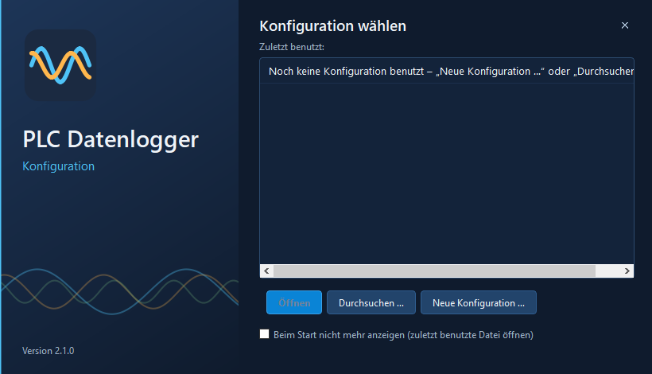

   Start screen of the configuration program: choose or create a configuration.

* **Recently used**: the configurations opened last, with folder and modification date.
  Double-click or **Open** (Enter key) starts with the selected file.
* **Browse …**: choose any configuration file.
* **New configuration …**: in the logger you are asked for a file name, an empty
  configuration is created and the configuration program is opened as well; in the
  configuration program a new, not yet saved configuration begins.
* **Demo** (logger only): start with simulated values.
* **Do not show at startup**: in future start immediately with the last used file.
  To switch it on again: in the logger **File → Show start screen at program start**.

After the choice, the start screen shows the loading progress until the main window is
ready. If a configuration file is passed on the command line (e.g.
``PLCLogger.exe plant.json``), there is no choice. The window can be moved with the
mouse; **Esc** or ✕ quits.

Quick start
======================================================================

#. Start ``plc_config.py``.
#. In the tab *Project & controllers* enter a project name and the controller(s):
   **Name**, choose the **Driver**, set up the connection with **…** (IP address and
   the parameters of the driver), interval.
#. Take variables from the controller with the selection button of the driver (e.g.
   **Select from variable list…**, **Select from tag list…**, **Select from DB
   source…**), or enter the address by hand with **Add variable**.
#. Check with **Test connection** that the values are read correctly.
#. **Save** (or **Save as…** with a file name of your own) and close the
   configuration program.
#. Start ``plc_logger.py`` and press **▶ Start**.

.. tip::

   An existing configuration of the S7, TIA or CLX data logger is simply opened with
   **File › Open…** (see `Importing configurations of the single programs <uebernahme_>`__).
   Without a PLC you can try the program in **Demo** mode (see `Demo mode <demo-modus_>`__).

Configuration program (``plc_config.py``)
======================================================================

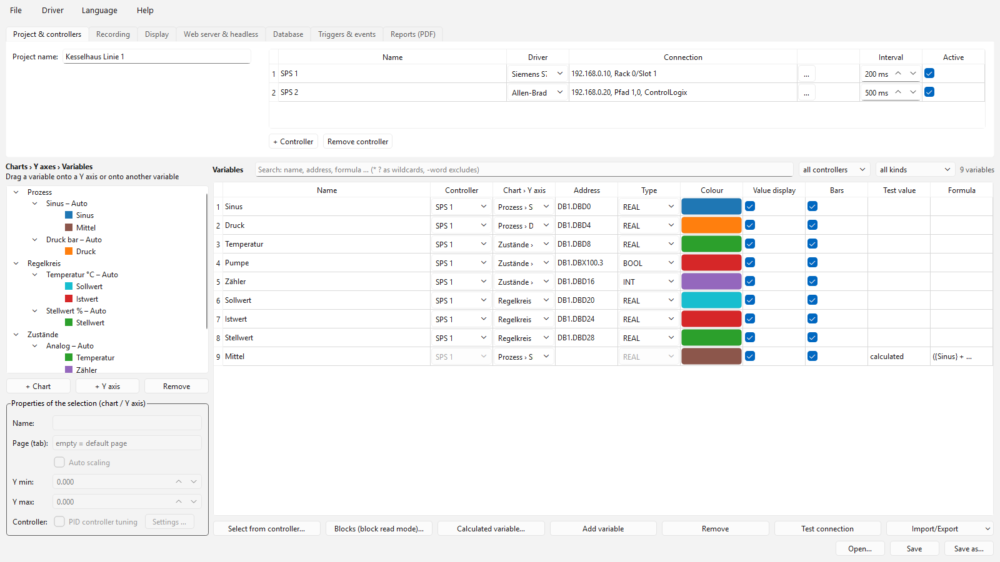

   The configuration program: tabs at the top, assignment tree on the left, variable
   table on the right.

Project, controllers and settings
----------------------------------------------------------------------

The upper part of the window is divided into several tabs.

**Tab “Project & controllers”**

.. figure:: images/en/config_projekt_steuerungen.png
   :alt: Tab Project and controllers
   :width: 80%
   :align: center

   Tab “Project & controllers”.

.. list-table::
   :header-rows: 1
   :widths: 30 70

   * - Field
     - Meaning
   * - Project name
     - Freely chosen name of the project. It appears in the window titles, in the web
       server and in the log.
   * - Controllers (table)
     - One row per controller with the columns:

       * **Name** – unique, also used for the status LED.
       * **Driver** – choice of all loaded drivers (``s7``, ``tia``, ``logo``,
         ``clx``, ``pccc``, ``modbus``, ``opcua``, ``ads``, ``fins`` … and own ones).
         When the driver is changed, the connection parameters are set to its
         defaults; the IP address is kept. The type lists of this controller's
         variables adapt.
       * **Connection** – short description of the connection, e.g.
         ``192.168.0.1, Rack 0/Slot 1`` or ``192.168.0.10:502, Unit 1``.
       * **…** – opens the connection's **settings dialog** (see below).
         Double-clicking *Connection* has the same effect.
       * **Interval** – time between two measurements of this controller, 10 to
         60000 ms.
       * **Active** – disabled controllers are not read.

       Change the list with **+ Controller** and **Remove controller**; when a
       controller is removed, its variables and blocks move to the first controller.

       **Scan network …** finds reachable controllers: in the *range* (suggestion:
       the own network, e.g. ``192.168.0.0/24``; also ``192.168.0.10-50`` or single
       addresses, separated by commas) the scan asks for EtherNet/IP devices by
       broadcast and tries connections on the ports of S7 (102), Modbus (502),
       EtherNet/IP (44818), OPC UA (4840), ADS (48898), FINS (9600), SLMP (5007) and
       Keyence (8501). With *Read device identity* it shows module, order number,
       station and slot of S7 CPUs, and product name, vendor and serial number of
       EtherNet/IP devices. Each hit gets a driver suggestion (S7-1200/1500: ``tia``,
       other S7: ``s7`` with the slot found, Logix: ``clx``, OPC UA with endpoint, ADS
       with AMS Net ID *IP*.1.1 …); **Add as controller** adds the ticked hits with
       their address. Addresses already configured are marked and not preselected.
       Devices behind routers are only found if their range is given; a firewall can
       block ports.

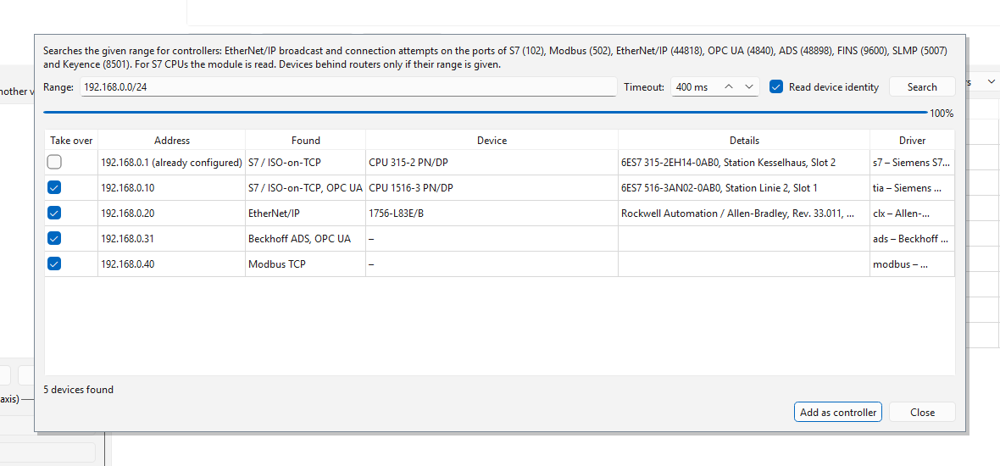

   Scan network: controllers found with identity and driver suggestion; the address
   already configured is not preselected.

**Connection settings dialog.** The dialog is built from the driver's parameters
(text fields, numbers, choice lists, password fields). Rarely needed parameters are in
the *Advanced* section. At the bottom the dialog shows whether the required library is
installed (✓ or ✗ with error message). On **OK** the driver checks the input (e.g. an
empty IP address). The parameters of the built-in drivers are described in the chapter
`Controllers and drivers <treiber_>`__.

In the logger, each controller is read by **its own thread**. The interval applies per
controller; a slow or failed controller does not slow down the others. The
measurements of all controllers – whatever their driver – are merged into one common
CSV file (one column per variable).

**Menu “Driver”**

* **Installed drivers …** – overview of all loaded drivers with ID, name, required
  library and its state; below, drivers that could not be loaded (with error message),
  and the folder for own drivers.
* **Open folder for own drivers …** – creates the folder ``treiber`` in the data folder
  (if necessary), copies the template ``_vorlage.py`` into it and opens it in the file
  manager (see `Developing drivers <treiber-entwickeln_>`__).

**Tab “Recording”**

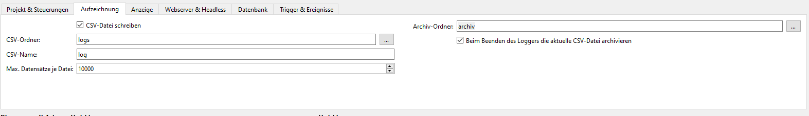

   Tab “Recording”.

.. list-table::
   :header-rows: 1
   :widths: 30 70

   * - Field
     - Meaning
   * - Write CSV file
     - Switches the CSV file on or off (e.g. off if recording only to a database; see
       `Database recording <datenbank_>`__).
   * - CSV folder
     - Target folder for the log files. A relative path refers to the program folder.
   * - CSV name
     - Name of the recording. It is the prefix of the file names and the name of the
       archive subfolder (default: ``log``). The characters ``\ / : * ? " < > |`` are
       not allowed.
   * - Max. records per file
     - Upper limit for the number of records (rows) per CSV file. ``0`` = unlimited.
       When the number is reached, the file is zipped and archived (see
       `Limiting the file size and archiving <csv-archiv_>`__).
   * - Archive folder
     - Base folder of the archive (default: ``archiv``). A relative path refers to the
       program folder.
   * - Archive when closing
     - If ticked (default), the current, not yet full CSV file is also zipped and
       archived when the logger is closed.
   * - Delete after, Use at most
     - Clean-up of old recordings of this logger (CSV files and archive ZIPs): files
       whose last change is more than *n days* ago are deleted; if all together take up
       more than *n MB*, the oldest are deleted until the limit is met. *never*/
       *unlimited* (0) = off. See `Cleaning up old recordings <aufraeumen_>`__.
   * - Recording
     - *Continuous* (default) or *By trigger with pre- and post-trigger time*: then data
       is only saved while the start condition is met (see
       `Recording by trigger (pre- and post-trigger) <trigger-aufzeichnung_>`__).
   * - Start condition
     - Condition as for triggers, e.g. ``{Druck} > 5 or {Störung} == 1``; **…** opens
       the formula editor.
   * - Pre-trigger, post-trigger, max.
     - Seconds before the trigger (ring buffer), after the end of the condition, and the
       maximum duration of a capture (*unlimited* = 0).

**Tab “Display”**

.. figure:: images/en/config_anzeige.png
   :alt: Tab Display
   :width: 80%
   :align: center

   Tab “Display”.

.. list-table::
   :header-rows: 1
   :widths: 30 70

   * - Field
     - Meaning
   * - Display window (online)
     - Width of the visible time window in online mode, in seconds.
   * - Default page layout
     - Layout at start: *Stacked*, *Side by side* or *Tabs*.
   * - Charts on one page
     - *Automatic* (like the default layout), *Stacked*, *Side by side* or *Grid*.
   * - Grid columns
     - Number of columns for *Grid*; *automatic* derives it from the number of charts.
   * - Show bars for current values
     - Switches the narrow bars next to the charts on by default.
   * - Bar width
     - Width of a bar in pixels (4 … 40, default 14).
   * - Logo
     - Image file, e.g. the company logo. It appears in the logger at the top right of
       the menu bar (28 pixels high), on the web pages (charts, process view, login) and
       in the header of PDF reports and IO check protocols. PNG and JPG work everywhere,
       SVG only in the logger and on the web pages. A relative path refers to the
       program folder. **Empty = no logo.**
   * - Customer logo
     - Second logo (e.g. of the customer or plant), shown in the same places to the left
       of the logo, in the PDF at the top left. Empty = no customer logo.
   * - Program icon
     - Icon for windows and taskbar (PNG, ICO or SVG). Without an entry the supplied
       ``app.ico`` is used, otherwise the logo or the default symbol.

**Tab “Database”**

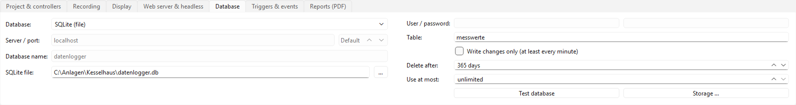

   Tab “Database”.

Choice and access data of a database that is recorded to in addition to or instead of
the CSV file (SQLite, MariaDB/MySQL, TimescaleDB/PostgreSQL, QuestDB, InfluxDB 3,
VictoriaMetrics, Prometheus), with the button **Test database**. Details in the chapter
`Database recording <datenbank_>`__.

**Tab “Triggers & events”**

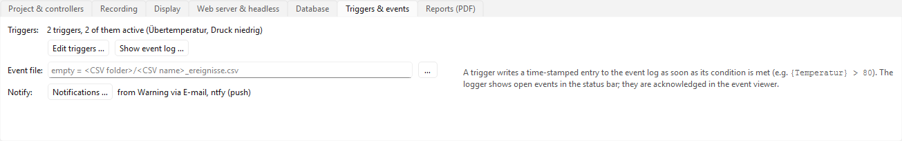

   Tab “Triggers & events”.

Shows the number of triggers defined. **Edit triggers …** opens the trigger editor,
**Show event log …** the event viewer, and *Event file* sets where the event log is
stored (empty = next to the CSV file). Details in the chapter
`Triggers and event log <ereignisse_>`__.

**Tab “Reports (PDF)”**

.. list-table::
   :header-rows: 1
   :widths: 30 70

   * - Field
     - Meaning
   * - Create PDF report automatically
     - At the end of each period the logger writes a report (also in headless
       operation); a partial report is created when stopping.
   * - Period
     - *Shift*, *Day*, *Week* (from Monday) or *Month*.
   * - Shift starts
     - Times separated by commas, e.g. ``06:00,14:00,22:00``.
   * - Day start
     - Time at which day, week and month begin (e.g. ``06:00`` for a production day).
   * - Folder
     - Target folder (default ``berichte`` in the data folder).

Details in the chapter `PDF reports <pdf-berichte_>`__.

**Tab “Web server & headless”**

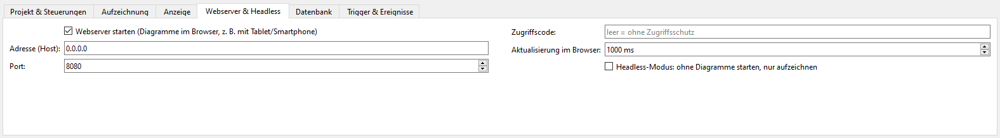

   Tab “Web server & headless”.

.. list-table::
   :header-rows: 1
   :widths: 30 70

   * - Field
     - Meaning
   * - Start web server
     - Starts a web server together with the logger (see
       `Web server (charts in the browser) <webserver_>`__).
   * - Address (host) / port
     - ``0.0.0.0`` makes the server reachable in the whole network, ``127.0.0.1`` only
       on the computer itself. Default port: 8080.
   * - Access code
     - Optional. If a code is set, it must be given when opening the page with
       ``?token=CODE``.
   * - Browser refresh
     - How often the browser page fetches new data (200 to 60000 ms).
   * - Headless mode
     - The logger starts without user interface and only records (see
       `Headless operation (recording only) <headless_>`__).
   * - HTTPS (encrypted)
     - Encrypted connection. Without a certificate of your own, the program creates a
       self-signed one once (folder ``web_tls``).
   * - Certificate / key (PEM)
     - Optionally your own certificate and key (e.g. from the company CA).
   * - Login
     - **Users …** creates users with password (only a hash is stored). Without users
       no login is needed. See `HTTPS and login <https-anmeldung_>`__.

Structure: charts, Y axes and variables
----------------------------------------------------------------------

The display is structured hierarchically:

.. code-block:: text

   Chart
   ├── Y axis 1 (left)
   │   ├── Variable A
   │   └── Variable B
   └── Y axis 2 (right)
       └── Variable C

* Each **chart** appears in the logger as its own movable window.
* Each chart has at least one **Y axis**. The first axis is on the left, all others on
  the right. Each axis scales independently.
* Each **variable** belongs to exactly one Y axis of one chart.

The tree on the left shows this structure. Below it are the buttons:

.. list-table::
   :header-rows: 1
   :widths: 25 75

   * - Button
     - Effect
   * - **+ Chart**
     - Creates a new chart with one Y axis.
   * - **+ Y axis**
     - Adds another Y axis to the selected chart (or the chart of the selection).
   * - **Remove**
     - Removes the selected chart, Y axis or variable. Affected variables move to the
       first axis or the first chart. The last chart and the last axis of a chart
       cannot be removed.

Properties of chart and Y axis
----------------------------------------------------------------------

.. figure:: images/en/config_eigenschaften.png
   :alt: Properties of chart and Y axis
   :width: 90%
   :align: center

   Properties of the selected chart or Y axis.

Select a chart or a Y axis in the tree. In the *Properties* area below you can change:

.. list-table::
   :header-rows: 1
   :widths: 25 75

   * - Field
     - Meaning
   * - Name
     - Name of the chart or Y axis (shown as title or axis label).
   * - Page (tab)
     - *Charts only.* Charts with the same page name are shown together on one page
       (tab or dock), e.g. ``Process`` or ``Alarms``. Empty = default page (see
       `Pages, charts and layout <seiten_>`__).
   * - Controller
     - *Charts only.* Tick **PID controller tuning** and **Settings …**: define
       setpoint, process value and controller output for calculating the controller
       parameters in the logger (see `PID controller tuning <pid-optimierung_>`__).
   * - Auto scaling
     - *Y axes only.* Active: the axis adapts automatically to the visible data.
       Inactive: the fixed limits *Y min* and *Y max* apply.
   * - Y min / Y max
     - Fixed axis limits. *Y max* must be greater than *Y min*.

Creating variables
----------------------------------------------------------------------

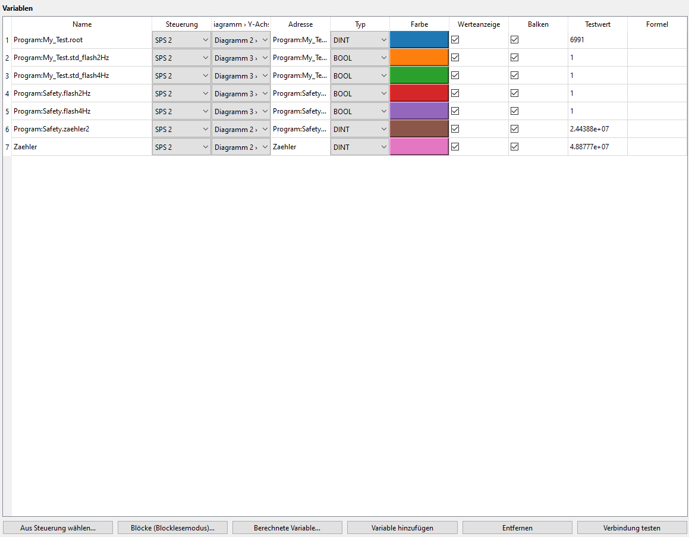

   The variable table with controller, address, type, colour and formula.

Each row of the variable table describes one value of a controller:

.. list-table::
   :header-rows: 1
   :widths: 25 75

   * - Column
     - Meaning
   * - Name
     - Unique name (also used as CSV column header). The character ``;`` is not
       allowed.
   * - Controller
     - Controller the variable is read from (choice from the controller table). It
       determines the driver and thus the address notation and the possible types.
   * - Chart › Y axis
     - Assignment of the variable (choice list or drag & drop, see below).
   * - Address
     - Address in the driver's notation, e.g. ``DB10.DBD4`` (``s7``),
       ``Anlage_DB.Motor[2].Drehzahl`` (``tia``), ``Program:Main.Druck`` (``clx``) or
       ``40001`` (``modbus``). The cell's tooltip shows examples for the driver of the
       selected controller. Details in the chapter `Controllers and drivers <treiber_>`__.
   * - Type
     - Data type, choice of the types the driver can read (e.g. ``BOOL``, ``INT``,
       ``DINT``, ``REAL``, ``LREAL`` …). If the controller of a variable is changed and
       the new driver does not know the type, it stays visible and is reported as an
       error when saving.
   * - Colour
     - Line colour; a click opens the colour picker.
   * - Value display
     - Active: the variable appears in the logger's value/ruler table.
   * - Bars
     - Active: a narrow bar is shown for the variable next to the chart.
   * - Test value
     - Result of **Test connection**.
   * - Formula
     - Calculated variables only: the formula (double-click opens the editor).

.. _variablen-suchen:

Searching and filtering variables
----------------------------------------------------------------------

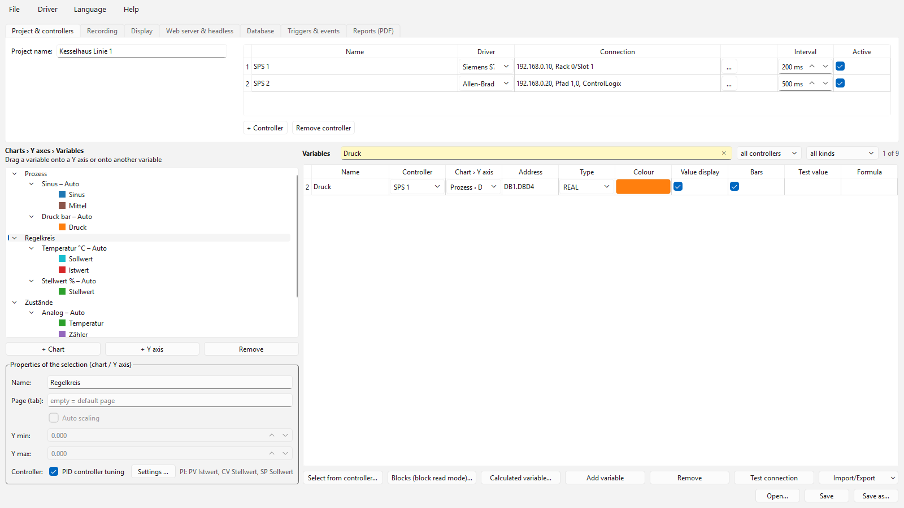

   Search field and filters above the variable table.

Above the variable table there are a **search field** and two choice lists
(``Ctrl+F`` jumps to the search field):

* **Search text** – searches name, address, formula, assignment (chart › Y axis), type
  and controller; case does not matter. Several words must all match
  (``temp db10``), ``*`` and ``?`` are wildcards (``DB?.DBD*``), a word with a leading
  ``-`` excludes (``temp -setpoint``).
* **Controller** – only variables of one controller (calculated variables stay visible).
* **Kind** – *read only*, *computed only* or *without address* (incomplete rows).

On the right you see how many variables are currently shown (*12 of 340*); the search
field has a yellow background while a filter is active. Hidden variables stay in the
configuration and are saved as well. **Remove** deletes only selected, visible rows. A
newly created variable that does not match the filter resets the filter.

Assignment by drag & drop
----------------------------------------------------------------------

Variables can be moved in the tree with the mouse:

* **Drop onto a Y axis:** the variable then belongs to this axis.
* **Drop onto another variable:** the variable takes over the Y axis (and thus the
  chart) of the target variable.
* **Drop onto a chart:** the variable is assigned to the first Y axis of this chart.

The choice list *Chart › Y axis* in the table and the tree are always in sync.

.. _berechnete-variablen:

Calculated variables (formulas)
----------------------------------------------------------------------

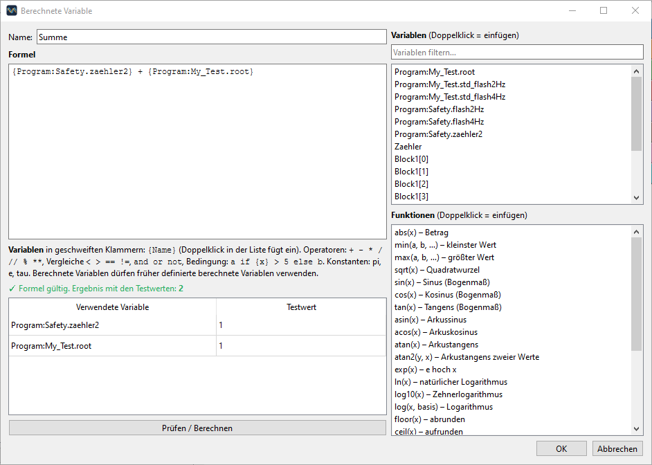

   The editor for calculated variables.

Besides the variables read from the PLC you can create **calculated variables** whose
values the logger computes from other variables at every measurement. They appear like
normal variables in charts, bars, legend, value table and in the CSV file.

**Calculated variable…** opens the editor:

* **Name** of the new variable.
* **Formula** in the text field. Variables are written in curly braces, e.g.
  ``({Temp_Vorlauf} + {Temp_Ruecklauf}) / 2``. A double-click in the variable list
  inserts the name, a double-click in the function list the function.
* **Check / calculate:** the editor checks the formula (syntax, known variables) and
  calculates it with freely entered **test values**. The result appears directly
  below.

The new variable is assigned to the selected chart or Y axis (changeable like any
variable). Double-clicking the *Formula* column opens the editor again.

Allowed are:

.. list-table::
   :header-rows: 1
   :widths: 30 70

   * - Element
     - Example / meaning
   * - Arithmetic operators
     - ``+  -  *  /  //  %  **``
   * - Comparisons, logic
     - ``<  >  <=  >=  ==  !=``, ``and``, ``or``, ``not``
   * - Condition
     - ``100 if {Druck} > 5 else 0``
   * - Constants
     - ``pi``, ``e``, ``tau``
   * - Mathematics
     - ``abs, min, max, sqrt, sin, cos, tan, asin, acos, atan, atan2, exp, ln,
       log10, log, floor, ceil, round, hypot, radians, degrees, sign, clamp``
   * - Time functions
     - ``ddt(x)`` derivative per second, ``integ(x)`` integral (x · s),
       ``avg(x, n)`` moving average over *n* measurements

Examples:

.. code-block:: text

   {Prozess.Temperatur} * 1.8 + 32               conversion °C to °F
   {Druck_Ein} - {Druck_Aus}                     differential pressure
   avg({Durchfluss}, 20)                         smoothed flow
   integ({Durchfluss}) / 3600                    total quantity (flow in 1/h)
   clamp({Fuellstand}, 0, 100)                   limited to 0 … 100

Notes:

* If a value cannot be computed (division by 0, missing measurement, invalid range such
  as ``sqrt`` of a negative number), the result is *no value* (empty CSV field, gap in
  the curve).
* A calculated variable may only use variables that are **further up** in the table
  (real variables always, calculated ones only if defined earlier). This is checked
  when saving.
* If a variable is renamed, formulas using it must be adapted. The name in the formula
  must match exactly.
* For security reasons no arbitrary program code is executed, only the elements listed
  above.
* ``ddt``, ``integ`` and ``avg`` keep their state during the recording and start anew
  with every **▶ Start**.
* Calculated variables are not read from the PLC and are missing in **Test connection**.

.. _blocklesemodus:

Block read mode
----------------------------------------------------------------------

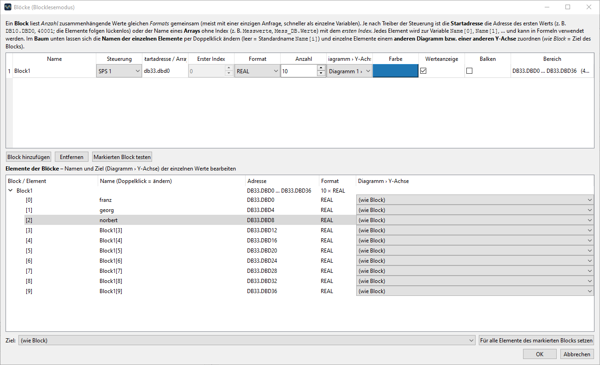

   The block editor with block table and element tree (name and target per element).

Many values of the same kind that lie one after another in the controller are read by
the **block read mode** with as few as **one request**; the values are then assigned
individually. What a block is depends on the driver:

.. list-table::
   :header-rows: 1
   :widths: 15 85

   * - Driver
     - Block
   * - ``s7``
     - **Start address** (e.g. ``DB10.DBD0``, ``MW100``) + count; the elements follow
       without gaps (``DB10.DBD0``, ``DB10.DBD4``, ``DB10.DBD8`` …; bitwise for
       ``BOOL``). Read with one request.
   * - ``tia``
     - **Array without index** (e.g. ``Mess_DB.Werte``) + **first index** (as in TIA,
       e.g. 1 for ``Array[1..100]``) + count.
   * - ``clx``
     - **Array tag without index** (e.g. ``Messwerte``, ``Program:Main.Temp``) +
       **first index** + count. BOOL arrays are bit-packed and cannot be read as a
       block.
   * - ``modbus``
     - **Start address** (e.g. ``40001`` or ``HR0``) + count; the elements follow
       without gaps (2 registers each for ``REAL``: ``40001``, ``40003`` …). The driver
       merges neighbouring addresses anyway; here a block is mainly a convenient way
       of creating many variables.
   * - ``modbus_rtu``
     - like ``modbus``.
   * - ``opcua``, ``ads``
     - **Array node / array name** (without index) + **first index** + count; read in
       one request.
   * - ``slmp``, ``kvhostlink``, ``toyopuc``, ``fins``, ``logo``
     - **Start device / address** (e.g. ``D100``, ``DM100``, ``D0100``, ``VW100``) +
       count; elements without gaps (2 words each for ``REAL``), consecutive bits for
       ``BOOL``.
   * - ``pccc``
     - **First element** of an N, F, L or B file (e.g. ``N7:0``) + count.
   * - ``s5as511``
     - **Start address** (e.g. ``DB10.DW0``, ``MB0``, ``E0.0``) + count; elements
       without gaps.

**Blocks (block read mode)…** opens the editor. Each row is a block with the
following data:

.. list-table::
   :header-rows: 1
   :widths: 25 75

   * - Field
     - Meaning
   * - Name
     - Name of the block. Each element becomes the variable ``Name[0]``, ``Name[1]``,
       …, ``Name[n-1]``. Not allowed: ``; { } [ ]``.
   * - Controller
     - Controller the block is read from (determines the driver).
   * - Start address / array
     - See the table above; the tooltip shows the driver's notation.
   * - First index
     - Only for drivers with arrays (``tia``, ``clx``, ``opcua``, ``ads``); otherwise
       disabled.
   * - Format
     - Data type of the elements (choice of the driver).
   * - Count
     - Number of values (1 to 1000).
   * - Ring buffer
     - Number of records of a ring buffer (see `Ring buffer <ringpuffer_>`__); *off* = normal block.
       Drivers ``s7``, ``tia`` and ``clx`` only.
   * - Chart › Y axis
     - Assignment of all elements of the block (single elements can be assigned
       differently in the tree, see below).
   * - Colour
     - The first element gets this colour, the others differ in hue.
   * - Value display / bars
     - Apply to all elements of the block (bars are off by default).
   * - Range
     - Computed display, e.g. ``DB10.DBD0 … DB10.DBD76 (80 Bytes)`` or
       ``Messwerte[0] … Messwerte[19]``.

Example (``clx``): array tag ``Messwerte`` (``REAL[100]``), first index 10, count 20
reads ``Messwerte[10]`` to ``Messwerte[29]`` with one request and creates the
variables ``Block[0]`` to ``Block[19]``. Example (``s7``): start address ``DB5.DBD0``,
format ``REAL``, count 20 reads bytes 0 to 79 of DB 5.

With ``tia``, ``clx``, ``opcua``, ``ads`` and ``s7`` (from the DB source), arrays can also be
taken over as a block directly in the selection dialog (select the array, **Selected array
as block…** or **Array as block …**, or double-click).

**Test selected block** reads the block once from the controller and shows the first
values and the read time.

Notes:

* The block elements are normal variables: they appear in charts, legend, value table,
  bars and CSV file and can be used in **formulas**, e.g.
  ``{Messwerte[3]} - {Messwerte[4]}``.
* **Renaming elements:** In the lower part of the block editor a **tree** shows all
  blocks with their elements. Double-click the *Name* column to give an element a name
  of its own, e.g. ``Supply pressure`` instead of ``Messwerte[1]``. An empty name
  restores the default name. The names must be unique and must not contain ``; { }``.
  In the configuration file they are stored under ``elementnamen`` of the block.
* **Elements in different charts:** In the tree of the block editor every element has a
  choice list *Chart › Y axis* in the last column. *(like block)* uses the target of the
  block, every other entry shows this element in another chart or on another Y axis.
  **Set for all elements of the selected block** applies the chosen target to all
  elements. In the configuration file different targets are stored under
  ``elementziele`` (index: [chart, axis]).
* In the variable tree of the configuration each block appears as one row
  (``▦ Block …``) under its Y axis. **Remove** deletes the selected block.
* The range must exist completely in the controller (array large enough, DB long
  enough, registers present), otherwise reading the block fails; the other variables
  are still read.
* Many elements mean many curves: split large blocks over several charts or Y axes or
  switch off *value display*.

.. _ringpuffer:

Ring buffer (cycle-synchronous recording)
----------------------------------------------------------------------

Normally the logger polls the controller at the configured read interval. How long a
request takes varies with the network and the load of the controller; cycles in between
are missing, and the time stamp is the time on the PC. For **cycle-synchronous,
gap-free** recording – e.g. every 10 or 50 ms – the controller collects the values
itself: a small block writes one **record** (number, time, values) per cycle or cyclic
interrupt into a **ring buffer**. The logger fetches the new records at the read interval
(e.g. every 250 ms) and turns each record into a row of its own with the **time stamp of
the controller**. The sampling rate thus depends only on the controller, not on the
network.

Possible with the drivers ``s7`` (S7-300/400, S7-1200/1500 with PUT/GET), ``tia``
(S7-1200/1500 without PUT/GET) and ``clx`` (ControlLogix, CompactLogix).

**1. Load the block into the controller.** The button **PLC templates …** in the block
editor opens the folder ``vorlagen`` with ready-made blocks:

.. list-table::
   :header-rows: 1
   :widths: 35 40 25

   * - File
     - Controller
     - Driver
   * - ``Ringpuffer_S7-300_400.scl``
     - S7-300/400 (SCL source for STEP 7 V5.x)
     - ``s7``
   * - ``Ringpuffer_S7-300_400_FB.scl``
     - S7-300/400 as function block with 20 inputs: the buffer is in the instance DB
       (several instances = several ring buffers). Start address ``DBX80.0``, because the
       inputs occupy bytes 0 to 79.
     - ``s7``
   * - ``Ringpuffer_S7-1200_1500.scl``
     - S7-1200/1500 (SCL source for TIA Portal: *External source files*)
     - ``tia`` or ``s7``
   * - ``Ringpuffer_S7-1200_1500_FB.scl``
     - S7-1200/1500 as function block with 20 inputs, **not optimized**: the buffer is in
       the instance DB ``Cycl_Rec_DB`` (several instances = several ring buffers). Start
       address ``DBX80.0``.
     - ``tia`` or ``s7``
   * - ``Ringpuffer_ControlLogix.st``
     - ControlLogix/CompactLogix (Structured Text, data types described)
     - ``clx``

The templates write 10 values of type REAL into a buffer with 100 records; both numbers
can be adjusted (notes at the top of each file). Call the block where the values arise
regularly: in a cyclic interrupt (S7-300/400: OB35, S7-1200/1500: *Cyclic interrupt*
OB30, Logix: periodic task) with e.g. 10 ms or 50 ms.

**2. Create the ring buffer in the block editor.** A block becomes a ring buffer as soon
as the column **Ring buffer** contains the number of records (*off* = normal block):

.. list-table::
   :header-rows: 1
   :widths: 25 75

   * - Field
     - Ring buffer
   * - Start address
     - ``s7``, ``tia``: address of the counter at the start of the buffer in a
       **non-optimized** data block, e.g. ``DB100.DBX0.0``. ``clx``: tag of the buffer,
       e.g. ``Puffer`` or ``Program:Main.Puffer``.
   * - Format
     - Data type of the values: ``INT``, ``DINT``, ``REAL`` (``s7``/``tia`` additionally
       ``WORD``, ``UINT``, ``DWORD``, ``UDINT``, ``LREAL``; ``clx`` additionally ``UINT``,
       ``UDINT``, ``LREAL``). Store binary signals as ``INT`` 0/1.
   * - Count
     - Values per record (as in the controller).
   * - Ring buffer
     - Records in the buffer (as in the controller).

As with blocks, the elements are called ``Name[0]``, ``Name[1]`` … and can be renamed and
assigned to other charts in the tree. **Test selected block** fetches the buffer once and
shows the counter, the number of records, their mean interval and the latest values.

**3. Read interval and buffer size.** The **Interval** of the controller (table of
controllers) is the read interval here: it only determines how often the buffer is
fetched. The buffer must hold the
records of at least three read intervals: *records ≥ 3 × read interval ÷ cycle time*.
Example: 10 ms cyclic interrupt and 250 ms read interval → at least 75 records (the
templates have 100); 50 ms and 500 ms → at least 30.

**Buffer layout** (S7: non-optimized DB, even start address; Logix: UDT with exactly
these names):

.. code-block:: text

   Zaehler          DINT     number of records written so far (1, 2, 3 …)
   Daten[0..N-1]             N records; record number n is stored in Daten[n MOD N]
     Seq            DINT     number of the record (= Zaehler when written)
     Zeit           DINT     time in ms (see below)
     Werte[0..M-1]           M values in the chosen format

The controller writes in this order: values, time, Seq, finally the counter. The logger
reads the counter, then the new records and the counter once more; a record only counts
if *Seq* has the expected number and it could not have been overwritten during reading.

**Time:** S7-300/400 ``TIME_TCK`` (ms since the CPU restart), S7-1200/1500 and Logix ms
since midnight from the controller's clock. The logger removes overflows (midnight, 2³¹)
and attaches the time to the PC clock: the latest record of the first fetch gets the
current time, all others their distance to it according to the controller. The intervals
between rows are thus exactly those of the controller; the absolute time is as accurate
as the PC clock (a deviating controller clock is followed slowly).

Notes:

* Lost records (buffer too small, connection interrupted for a long time) are reported in
  the status line: “Ring buffer …: n records lost”. After a short interruption the
  records are fetched from the buffer as long as it still contains them.
* A restart of the controller resets the counter; the logger detects this and starts
  again.
* Because the records only arrive when they are fetched, charts and value table show all
  values delayed by about two read intervals when ring buffers are used (the rows are
  sorted by their time). CSV file and database contain every record with its time.
* Normal variables of the same or other controllers are read as usual; in the rows of a
  ring buffer they keep their last value.
* Formulas, triggers, reports and triggered recording see every record – a trigger thus
  also fires on a pulse of just one cycle.
* In demo mode, ring buffer elements deliver simulated values like normal variables.

Selecting variables from the controller
----------------------------------------------------------------------

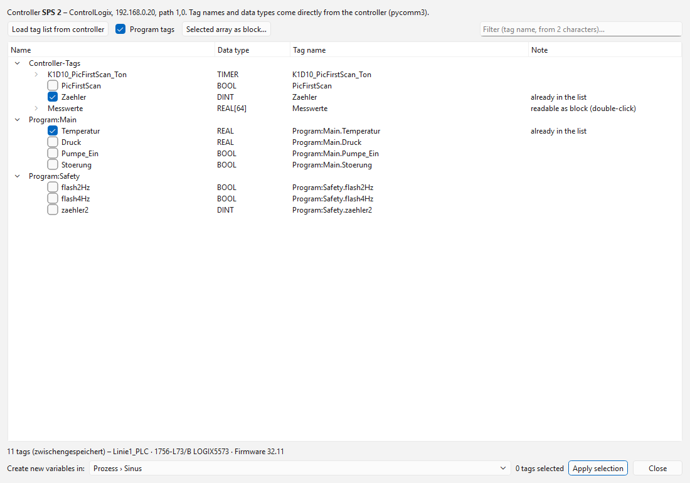

   Example: tag list of a ControlLogix (driver ``clx``); tags already created are ticked.

The button above the variable table has a different name depending on the driver of
the selected controller and opens its selection dialog (with several controllers you
are asked first which one):

.. list-table::
   :header-rows: 1
   :widths: 15 25 60

   * - Driver
     - Button
     - Source of the variables
   * - ``tia``
     - Select from variable list…
     - Variable list directly from the CPU (all data blocks, memory, inputs and
       outputs with structure and type, including optimized blocks).
   * - ``clx``
     - Select from tag list…
     - Tag list directly from the controller (pycomm3): controller and program tags,
       UDTs, arrays.
   * - ``s7``
     - Select from DB source…
     - Exported DB sources from TIA Portal/STEP 7 (the PLC delivers no names via
       PUT/GET); comparison of the DB sizes with the PLC, arrays as block.
   * - ``opcua``
     - Select from OPC UA server…
     - Address space of the server (folders, variables with data type, arrays as block).
   * - ``ads``
     - Choose from TwinCAT…
     - Symbol table of the TwinCAT controller (tree by name parts, type, comment, arrays
       as block).
   * - other drivers
     - –
     - Modbus, MELSEC, Omron, KEYENCE, TOYOPUC, LOGO!, MicroLogix and S5 deliver no
       names; enter the addresses by hand as per program or device manual.

General procedure:

#. **Load.** When opened for the first time, the list is loaded from the controller
   (``tia``, ``clx``) or the DB sources are imported (``s7``, **Import DB source…**).
   Loaded lists are cached per controller in the folder ``taglisten`` of the data
   folder and are shown immediately the next time, even without a connection. The
   paths of the S7 DB sources are stored in the configuration.
#. **Search.** Structures and arrays can be expanded; the **filter** field searches
   by name.
#. **Select.** Tick readable values. Variables already created are ticked and greyed
   out. Types that cannot be recorded (e.g. ``STRING``) are shown in grey.
#. **Arrays as block** (``tia``, ``clx``, ``opcua``, ``ads``, ``s7``): select the array,
   **Selected array as block…** (``s7``: **Array as block …**) or double-click, set first
   index and count. With ``s7`` this applies to one-dimensional arrays of numbers or BOOL;
   the start address is calculated from the DB source.
#. **Take over.** Under *Create new variables in* choose the chart or Y axis and press
   **Take over selection**. Address and type come from the controller or source.
#. **Check.** Check the values read with **Test connection**.

Details about the dialogs are given for each driver in the chapter
`Controllers and drivers <treiber_>`__.

Testing the connection
----------------------------------------------------------------------

**Test connection** connects to each controller in turn (via its driver), reads its
variables once and enters the result in the *Test value* column. Errors of single
variables are shown there in plain text (e.g. address does not exist, wrong type,
access denied, Modbus exception “illegal address”); if a controller cannot be reached,
a message box reports it with name and connection.

When saving, the driver of each controller checks the addresses formally (notation,
suitable type, e.g. ``BOOL`` for coils). Whether an address actually exists in the
controller is only shown by the connection test.

Saving and loading
----------------------------------------------------------------------

The **File** menu of the configuration program contains:

* **New** – empty configuration with one controller; the file name is asked for when
  saving for the first time.
* **Open…** (``Ctrl+O``) – loads a configuration file (JSON) with **any name**,
  including configurations of the S7, TIA and CLX data loggers (see
  `Importing configurations of the single programs <uebernahme_>`__).
* **Save** (``Ctrl+S``) and **Save as…** (``Ctrl+Shift+S``) – write to the current or a
  new file (the extension is always ``.json``). Before saving it is checked that
  controller and variable names are unique and not empty, the connection parameters
  and addresses are valid for the respective driver, the formulas are correct and, for
  fixed Y axes, *Y max* is greater than *Y min*.
* **Convert INI file …** – convert older INI configurations once to JSON (see
  `Converting older INI files <ini-umwandeln_>`__).
* **Start logger with this configuration** (``Ctrl+R``) – saves and starts the logger
  with this file.
* **Start IO check with this configuration** – saves and starts the `IO check
  <io-check_>`__ with the controllers of this file (separate program).

The window title shows project name and file name. The last used file is remembered
(file ``plc_last.txt``); the logger and the configuration program open it again at the
next start without parameters.

.. note::

   The logger reads the configuration at every **start**. Changes therefore only take
   effect after pressing **▶ Start** again.

Importing and exporting variables
----------------------------------------------------------------------

The **Import/Export** button below the variable table exchanges the variable list with
an **Excel** (``.xlsx``) or **CSV file** – useful for editing long lists in Excel or for
taking over an address list of the controller. **ODS files** (LibreOffice/OpenOffice
Calc, ``.ods``) can be read as well.

* **Export variables (CSV/Excel) …** writes all variables of the table (without block
  elements, see `Block read mode <blocklesemodus_>`__) with the columns ``Name``,
  ``Steuerung``, ``Diagramm``, ``Y-Achse``, ``Adresse``, ``Typ``, ``Farbe``,
  ``Werteanzeige``, ``Balken`` and ``Formel``. The column names are always German, so
  files can be exchanged between languages.
* **Import variables (CSV/Excel/ODS) …** reads such a file. The first row contains the
  column names; only ``Name`` is mandatory, order and case do not matter. CSV files may
  use semicolon, comma or tab as separator.

When importing:

* If variables already exist, the program asks whether they should be **replaced** or
  the new ones **appended**. When appending, variables with an existing name are
  skipped.
* ``Steuerung`` is the name of a controller from the controller table; empty or unknown
  = first controller (unknown names are reported).
* ``Diagramm`` and ``Y-Achse`` are names; missing charts and axes are created, empty =
  first chart or first axis.
* ``Typ`` empty = default type of the driver; ``Farbe`` as ``#rrggbb``, empty = colour
  from the palette.
* ``Werteanzeige`` and ``Balken``: ``ja``/``nein`` (also ``yes``/``no``, ``1``/``0``,
  ``x``); empty = yes.
* If ``Formel`` is filled, a calculated variable is created (``Adresse`` and ``Typ`` are
  then ignored).

As with manual input, addresses and formulas are only checked when **saving**.

Structure of the configuration file (JSON)
----------------------------------------------------------------------

The configuration is saved as a **JSON file** (UTF-8, indented) and can also be edited
by hand if required – with any text editor, preferably one that checks JSON (e.g.
Notepad++, Visual Studio Code). The keys are German. Example:

.. code-block:: json

   {
     "format": "PLC Datenlogger Konfiguration",
     "version": 1,
     "einstellungen": {
       "projekt": "Prüfstand 3",
       "csv_ordner": "logs",
       "csv_name": "log",
       "max_records": 100000,
       "archiv_ordner": "archiv",
       "fenster_s": 60,
       "anordnung": "untereinander",
       "balken": true,
       "archiv_beenden": true,
       "seite_anordnung": "raster",
       "raster_spalten": 2,
       "web_aktiv": true,
       "web_host": "0.0.0.0",
       "web_port": 8080,
       "web_intervall_ms": 1000,
       "headless": false,
       "treiberdaten": {
         "s7": {
           "symbolquellen": "C:/Projekt/Mess_DB.db"
         }
       }
     },
     "steuerungen": [
       {
         "name": "Presse",
         "treiber": "tia",
         "intervall_ms": 100,
         "aktiv": true,
         "ip": "192.168.0.1",
         "port": 102,
         "tls": "auto",
         "passwort": "",
         "rolle": "hmi",
         "tags_je_anfrage": 50
       },
       {
         "name": "Altanlage",
         "treiber": "s7",
         "intervall_ms": 500,
         "aktiv": true,
         "ip": "192.168.0.20",
         "rack": 0,
         "slot": 2
       },
       {
         "name": "Kessel",
         "treiber": "clx",
         "intervall_ms": 200,
         "aktiv": true,
         "ip": "192.168.1.10",
         "pfad": "1,0",
         "cpu": "controllogix",
         "timeout_ms": 2000
       },
       {
         "name": "Zaehler",
         "treiber": "modbus",
         "intervall_ms": 1000,
         "aktiv": true,
         "ip": "192.168.0.50",
         "port": 502,
         "unit": 1,
         "wortfolge": "CDAB",
         "max_register": 120,
         "luecke": 8,
         "timeout_ms": 2000
       }
     ],
     "diagramme": [
       {
         "name": "Prozess",
         "seite": "Prozess",
         "achsen": [
           {
             "name": "Temperatur",
             "auto": true,
             "y_min": 0.0,
             "y_max": 100.0
           },
           {
             "name": "Leistung",
             "auto": false,
             "y_min": 0.0,
             "y_max": 50.0
           }
         ]
       }
     ],
     "variablen": [
       {
         "name": "Kraft",
         "adresse": "Presse_DB.Kraft",
         "typ": "REAL",
         "farbe": "#d62728",
         "wert_anzeigen": true,
         "diagramm": 1,
         "achse": 1,
         "balken": true,
         "formel": "",
         "steuerung": 1
       },
       {
         "name": "Temp_Alt",
         "adresse": "DB10.DBD4",
         "typ": "REAL",
         "steuerung": 2
       },
       {
         "name": "Temperatur_Kessel",
         "adresse": "Program:Kessel.Temperatur",
         "typ": "REAL",
         "steuerung": 3
       },
       {
         "name": "Wirkleistung",
         "adresse": "30013",
         "typ": "REAL",
         "steuerung": 4
       }
     ],
     "bloecke": [
       {
         "name": "Messwerte",
         "adresse": "Messwerte",
         "start": 0,
         "typ": "REAL",
         "anzahl": 20,
         "diagramm": 1,
         "achse": 1,
         "farbe": "#1f77b4",
         "wert_anzeigen": true,
         "balken": false,
         "steuerung": 3,
         "elementziele": {
           "3": [
             1,
             2
           ]
         }
       }
     ]
   }

Structure:

.. list-table::
   :header-rows: 1
   :widths: 22 78

   * - Key
     - Content
   * - ``format``, ``version``
     - File identifier and version of the structure (currently 1).
   * - ``einstellungen``
     - Settings: project, recording (CSV, archive, database, trigger recording, reports),
       display, web server, headless.
   * - ``steuerungen``
     - List of controllers (order = number referred to by ``steuerung``).
   * - ``diagramme``
     - List of charts, per chart the list ``achsen`` (Y axes) and possibly the PID
       settings (``pid_…``).
   * - ``variablen``
     - Normal and calculated variables (``formel`` not empty).
   * - ``bloecke``
     - Blocks of the block read mode; ``elementnamen`` = own names of single elements
       (``{"1": "Supply pressure"}``), ``elementziele`` = different chart and axis of
       single elements (``{"3": [2, 1]}``).
   * - ``trigger``
     - Triggers of the event log.

Numbers and booleans are stored with their type (``200``, ``1.5``, ``true``/``false``).
Missing keys get their default value when loading, unknown ones are ignored. If the
file is not valid JSON (e.g. a forgotten comma), the program reports the line of the
error.

Explanations:

* ``treiber`` is the ID of the driver; the other keys of an entry in ``steuerungen``
  (except ``name``, ``intervall_ms``, ``aktiv``) are its connection parameters (see
  `Controllers and drivers <treiber_>`__). Unknown keys are ignored, missing ones get
  the driver's default value.
* ``adresse`` is the address in the notation of the controller's driver. For blocks,
  ``adresse`` is the start address or the array name and ``start`` the first index
  (drivers with arrays only).
* ``treiberdaten`` contains driver-specific data as an object (e.g. the paths of the S7
  DB sources).
* ``diagramm``, ``achse`` and ``steuerung`` are numbers starting at 1.
* ``seite_anordnung`` is empty (automatic), ``untereinander`` (stacked),
  ``nebeneinander`` (side by side) or ``raster`` (grid); ``raster_spalten: 0`` chooses the
  number of columns automatically.
* The variables of a block (``Messwerte[0]`` …) are created when loading and are not
  listed under ``variablen`` in the file.
* The TIA password is stored in **plain text** in the file.

.. _ini-umwandeln:

Converting older INI files
----------------------------------------------------------------------

Earlier versions stored the configuration as an INI file. These files are **no longer
opened directly** but converted once into a JSON file; the INI file itself remains
unchanged:

* **Configuration program › File › Convert INI file …** – choose one or more INI
  files; a ``.json`` file with the same name is created next to each. For a single file
  the result is opened immediately.
* If an INI file is chosen in the configuration program (Open, start screen), it offers
  the conversion directly.
* For many files at once (Python sources):

  .. code-block:: console

     python tools/ini2json.py plant1.ini plant2.ini        # -> plant1.json, plant2.json
     python tools/ini2json.py old.ini -o new.json -f       # other name, overwrite

When started with an INI file, the logger reports that it has to be converted. If an
INI file was opened last and the converted ``.json`` file already exists next to it,
that file is used automatically. All contents – including triggers, PID settings and
blocks – are taken over.

.. _treiber:

Controllers and drivers
======================================================================

Each controller of the configuration has exactly one driver. It defines which
connection parameters exist, how variables are addressed, which data types can be read,
what blocks look like and whether there is a selection dialog. Any drivers can be mixed
in one configuration.

**How well is each driver tested?** Automatic tests run on every upload; where a
third-party, widely used counterpart exists, they test the driver against its simulator.
So far only ``s7`` and ``clx`` have been tried with real controllers:

.. list-table::
   :header-rows: 1
   :widths: 20 80

   * - Driver
     - Tested
   * - ``s7``
     - **With a controller** (S7-300/400, also ring buffer); automatically against the S7
       server of python-snap7 (single values, bits, blocks, ring buffer).
   * - ``clx``
     - **With a controller** (normal reading and blocks); the ring buffer only against a
       simulated libplctag.
   * - ``tia``
     - Automatically: ring buffer against the S7CommPlus emulator of s7commplus. Symbolic
       reading has not yet been tried with a controller.
   * - ``modbus``
     - Automatically against the Modbus TCP server of pymodbus (all four tables, bits,
       REAL/DINT, word order).
   * - ``opcua``
     - Automatically against an OPC UA server of asyncua (numbers, BOOL, array as block).
   * - ``logo``, ``pccc``, ``modbus_rtu``, ``ads``, ``slmp``, ``fins``, ``kvhostlink``,
       ``toyopuc``, ``s5as511``
     - Not yet tried with a controller or a simulator. Experience reports and error
       reports (e.g. via GitHub) are welcome.

Driver ``s7`` – Siemens S7 (PUT/GET, snap7)
----------------------------------------------------------------------

For S7-300/400 and S7-1200/1500 via classic S7 communication with **absolute
addresses**. Library: ``python-snap7``.

.. list-table:: Connection parameters
   :header-rows: 1
   :widths: 20 80

   * - Parameter
     - Meaning
   * - IP address
     - Address of the CPU or CP.
   * - Rack
     - Rack, almost always ``0``.
   * - Slot
     - Slot of the CPU: S7-300 ``2``, S7-1200/1500 ``1`` (or ``0``), S7-400 as per
       hardware configuration.

**Preparation:** On S7-1200/1500 enable *“Permit access with PUT/GET communication from
remote partner”* in the CPU properties in TIA Portal. Only data blocks **without**
“Optimized block access” are read (use the ``tia`` driver for optimized blocks). TCP
port 102.

**Addresses** (German or English mnemonics; the type comes from the *Type* column, the
size letter X/B/W/D in the address is only a writing aid):

.. list-table::
   :header-rows: 1
   :widths: 40 60

   * - Address
     - Meaning
   * - ``DB10.DBX4.2``, ``DB10.DBB4``, ``DB10.DBW4``, ``DB10.DBD4``
     - Data block 10, byte 4 (bit 2)
   * - ``DB10.4``, ``DB10.4.2``
     - Short form: DB number, byte[, bit]
   * - ``M5.0``, ``MB5``, ``MW10``, ``MD20``
     - Memory (flags)
   * - ``E0.1``, ``EB0``, ``EW64`` or ``I0.1``, ``IB0``, ``IW64``
     - Inputs (process image)
   * - ``A1.0``, ``AB1``, ``AW2`` or ``Q1.0``, ``QB1``, ``QW2``
     - Outputs (process image)

When saving, the address is written uniformly to match the type (e.g. ``DB10.4`` with
type ``REAL`` → ``DB10.DBD4``).

**Types:** ``BOOL``, ``BYTE``, ``USINT``, ``SINT``, ``CHAR``, ``WORD``, ``UINT``,
``INT``, ``DWORD``, ``UDINT``, ``DINT``, ``REAL``, ``TIME`` (ms), ``LWORD``, ``ULINT``,
``LINT``, ``LREAL``.

**Blocks:** start address + count, elements without gaps; a block is read with **one**
request. Single variables are read individually – with many variables in one DB a block
is considerably faster.

**Selection dialog “Select from DB source…”:** Via S7 communication the PLC delivers
**no names and structures**. The tree of data blocks (DB › structure › variable) is
therefore built from **DB sources**:

#. In TIA Portal select the DB (and the UDTs needed), right-click *Generate source from
   blocks*; in STEP 7 save the DB as source (``.db``/``.awl``).
#. In the dialog choose **Import DB source…** (several files possible). If the DB number
   is missing in the source (TIA), it is asked for.
#. Optionally **Compare with PLC**: compares the computed size of each DB with the size
   in the PLC (✓ or ⚠ – a difference indicates an optimized block or an outdated
   source).
#. Tick variables (a tick on a structure/array/DB selects everything in it) and take
   them over. The name of the variable is the symbol path.

The paths of the sources are stored in the configuration (``treiberdaten``) and read
again the next time.

Driver ``tia`` – Siemens S7-1200/1500 symbolic (S7CommPlus)
----------------------------------------------------------------------

Symbolic access like TIA Portal and Siemens HMIs – also to **optimized** data blocks,
**without** PUT/GET. Library: ``s7commplus``.

.. list-table:: Connection parameters
   :header-rows: 1
   :widths: 25 75

   * - Parameter
     - Meaning
   * - IP address
     - Address of the CPU.
   * - Port
     - ISO-on-TCP port, default ``102``.
   * - TLS
     - *Automatic* (TLS if the CPU offers it), *Off*, *On (force TLS)*. Newer firmware
       (S7-1500 from V3.1, S7-1200 from V4.7, projects from TIA V19) communicates only
       encrypted.
   * - Password
     - Password of the access level if the CPU protects read access (stored in plain
       text in the configuration file).
   * - Role (Advanced)
     - *HMI* (default), *Engineering*, *PG*.
   * - Variables per request (Advanced)
     - Maximum number of variables per read request (default 50); larger quantities are
       split.

**Preparation:** usually none. Variables must be “Accessible from HMI/OPC UA/Web API”
(default). Each CPU allows only a limited number of HMI connections; the logger uses one
per controller. TCP port 102.

**Addresses:** symbolic names as in TIA Portal:

.. code-block:: text

   Mess_DB.Temp                     variable in a data block
   Anlage_DB.Motor[2].Drehzahl      structure member in an array
   MArea.Start_Merker               memory (PLC tag)
   IArea.Taster_1                   input
   QArea.Lampe                      output

**Types:** ``BOOL``, ``BYTE``, ``WORD``, ``DWORD``, ``LWORD``, ``SINT``, ``INT``,
``DINT``, ``LINT``, ``USINT``, ``UINT``, ``UDINT``, ``ULINT``, ``REAL``, ``LREAL``,
``TIME``, ``LTIME``, ``S5TIME``, ``CHAR``, ``WCHAR``.

**Blocks:** array without index + first index (as in TIA, e.g. ``1`` for
``Array[1..100]``) + count.

**Selection dialog “Select from variable list…”:** loads the variable list directly
from the CPU (data blocks, memory, inputs/outputs with structure and type) and caches it
in the folder ``taglisten``.

.. warning::

   ``s7commplus`` is an **unofficial** implementation, not from Siemens. Test new
   configurations on a plant that is not safety-relevant first.

Driver ``logo`` – Siemens LOGO! (0BA7/0BA8)
----------------------------------------------------------------------

For LOGO! 7 (0BA7) and LOGO! 8 (0BA8, 8.FS4, 8.3, 8.4) via S7 communication; library
``python-snap7`` (as for the ``s7`` driver).

**Set up in the LOGO!:** In LOGO!Soft Comfort under *Tools › Ethernet Connections*
(LOGO! 8: *Online Settings › Access control*) enable HMI access or create a **server
connection (S7)**. The TSAP values of this connection must match the parameters here:
*Local TSAP* of the LOGO! = **TSAP of the LOGO!**, *Remote TSAP* = **TSAP of the
logger**. LOGO! 8 with HMI access enabled: ``02.00`` and ``01.00`` (default).

.. list-table:: Connection parameters
   :header-rows: 1
   :widths: 30 70

   * - Parameter
     - Meaning
   * - IP address
     - Address of the LOGO!.
   * - Device
     - *LOGO! 8* or *LOGO! 7* – determines where I, Q, M, AI, AQ, AM are located in the
       variable memory (VM).
   * - TSAP of the LOGO! / TSAP of the logger
     - As ``hh.hh`` (e.g. ``02.00``, ``20.00``) or number (``0x0200``).

**Addresses:** variable memory directly (``V10`` or ``VB10`` = byte, ``VW12`` = word,
``VD20`` = double word, ``V10.3`` = bit) or the LOGO! operands ``I1`` … ``I24``,
``Q1`` … ``Q20``, ``M1`` … ``M64``, ``NI``, ``NQ`` (BOOL) and ``AI1`` … ``AI8``,
``AQ``, ``AM1`` … ``AM64``, ``NAI``, ``NAQ`` (INT). Values in the VM are “big endian” as
with S7. Neighbouring addresses are merged into one request; blocks: start address in
the VM (e.g. ``VW100``), the elements follow without gaps.

Driver ``clx`` – Allen-Bradley Logix (EtherNet/IP)
----------------------------------------------------------------------

For ControlLogix, CompactLogix and Micro800. Reading is done with **libplctag**
(``plctag.dll`` / ``libplctag.so``); all tags of a controller are triggered at the same
time in each cycle and combined into common CIP requests. The tag list is provided by
**pycomm3**.

.. list-table:: Connection parameters
   :header-rows: 1
   :widths: 25 75

   * - Parameter
     - Meaning
   * - IP address
     - Address of the Ethernet module (e.g. 1756-EN2T) or of the CPU with built-in
       Ethernet.
   * - CIP path
     - Route to the CPU, ``port,address``; backplane = port 1. ControlLogix with CPU in
       slot 0: ``1,0`` (slot 3: ``1,3``), CompactLogix: ``1,0``, Micro800: empty.
   * - Controller type
     - ControlLogix, CompactLogix or Micro800.
   * - Timeout (Advanced)
     - Waiting time per read cycle (default 2000 ms).

**Preparation:** *External Access* of the tags *Read/Write* or *Read Only*. TCP port
44818.

**Addresses:** tag names as in Studio 5000 or Connected Components Workbench:
``Temp_Kessel`` (controller tag), ``Program:Main.Druck`` (program tag),
``Anlage.Motor[2].Drehzahl``, ``Status.3`` (bit 3 of an integer, type ``BOOL``).

**Types:** ``BOOL``, ``SINT``, ``INT``, ``DINT``, ``LINT``, ``USINT``, ``UINT``,
``UDINT``, ``ULINT``, ``REAL``, ``LREAL`` (read bit strings ``DWORD``/``WORD`` as
``UDINT``/``UINT``).

**Blocks:** array tag without index + first index + count; libplctag splits large
ranges itself. BOOL arrays not as block.

**Selection dialog “Select from tag list…”:** controller tags and (tick *Program tags*)
the tags of all programs, with UDTs, arrays (at most 500 elements individually) and
filter; cached in the folder ``taglisten``.

Driver ``pccc`` – Allen-Bradley MicroLogix / SLC 500 (PCCC)
----------------------------------------------------------------------

For the older Allen-Bradley controllers with file addresses (RSLogix 500): MicroLogix
1100/1400, SLC 5/05 and SLC 5/03/04 via an Ethernet bridge module. Library
``pycomm3`` (SLCDriver, EtherNet/IP with PCCC commands). ControlLogix, CompactLogix and
Micro800 use the ``clx`` driver.

.. list-table:: Connection parameters
   :header-rows: 1
   :widths: 30 70

   * - Parameter
     - Meaning
   * - IP address
     - Address of the controller or Ethernet module.
   * - CIP path (Advanced)
     - Only behind a bridge module, e.g. ``bp/1``; otherwise empty.

**Addresses** in RSLogix 500 notation: ``N7:0`` (INT), ``F8:2`` (REAL), ``L9:0`` (DINT,
MicroLogix 1100/1400), ``B3:2`` (word) or ``B3:0/5`` and ``N7:10/3`` (bits, type
BOOL), ``T4:0.ACC``/``T4:0.PRE``/``C5:1.ACC`` (accumulated/preset values), ``T4:0.DN``
(status bit), ``I:0/1``, ``O:0/2``, ``S:1/5``. Elements of the same N, F, L or B file
that are close together are read with **one** request; blocks: first element, e.g.
``N7:0``.

Driver ``modbus`` – Modbus TCP
----------------------------------------------------------------------

For all devices with Modbus TCP (also Modbus RTU devices behind a TCP gateway). No
additional library. Neighbouring addresses are automatically combined into as few
requests as possible (functions 1 to 4).

.. list-table:: Connection parameters
   :header-rows: 1
   :widths: 30 70

   * - Parameter
     - Meaning
   * - IP address, port
     - Address of the device or gateway, default port ``502``.
   * - Device address (unit ID)
     - Slave/unit ID (default 1); for gateways the address on the serial bus.
   * - Byte/word order
     - Order for values spanning several registers (``DINT``, ``REAL`` …) as per device
       manual: ``ABCD`` big endian (default), ``CDAB`` words swapped (common, e.g. with
       many energy meters), ``BADC`` bytes swapped, ``DCBA`` little endian.
   * - Registers per request (Advanced)
     - Maximum number of registers in one request (1 to 125, default 120).
   * - Merge gaps up to (Advanced)
     - Addresses with a smaller distance are read in the same request (default 8
       registers; 0 = only without gaps).
   * - Timeout (Advanced)
     - Time to wait for a response (default 2000 ms).

**Addresses** – Modicon notation (counted from 1) or table + offset (from 0):

.. list-table::
   :header-rows: 1
   :widths: 35 30 35

   * - Modicon
     - from 0
     - Area, function
   * - ``40001`` … (6 digits ``400001``)
     - ``HR0`` …
     - Holding registers, FC 3
   * - ``30001`` … (``300001``)
     - ``IR0`` …
     - Input registers, FC 4
   * - ``00001`` … or ``1`` …
     - ``C0`` …
     - Coils, FC 1 (type ``BOOL``)
   * - ``10001`` … (``100001``)
     - ``DI0`` …
     - Discrete inputs, FC 2 (type ``BOOL``)
   * - ``40001.3``
     - ``HR0.3``
     - Bit 3 of a register (type ``BOOL``, bit 0–15)

``40001`` and ``HR0`` denote the same register. If the device manual says “register
100” without anything else, it usually means ``HR100`` (= ``40101``) – if in doubt,
check both with **Test connection**. ``%MW0`` (Schneider) is understood as ``HR0``.

**Types:** ``BOOL``, ``INT``, ``UINT``, ``WORD`` (1 register), ``DINT``, ``UDINT``,
``DWORD``, ``REAL`` (2 registers), ``LINT``, ``ULINT``, ``LWORD``, ``LREAL`` (4
registers).

**Blocks:** start address + count, elements without gaps (for ``REAL`` at a distance
of 2 registers).

**Errors:** If the device responds with a Modbus exception (e.g. *illegal address*),
only the affected request remains without value; the message appears in the status
line or as test value.

Driver ``modbus_rtu`` – Modbus RTU (serial)
----------------------------------------------------------------------

For devices with Modbus RTU on RS-485 or RS-232 (frequency converters, energy meters,
temperature controllers, compact controllers …), connected via a built-in interface or
a USB adapter. Libraries: ``pymodbus`` (3.x or 4.x) and ``pyserial``.

Addresses, data types, byte/word order, blocks and merging of neighbouring addresses
are **the same as for the** ``modbus`` **driver** (``40001``/``HR0``,
``30001``/``IR0``, ``00001``/``C0``, ``10001``/``DI0``, ``40001.3``).

.. list-table:: Connection parameters
   :header-rows: 1
   :widths: 30 70

   * - Parameter
     - Meaning
   * - Port
     - Windows ``COM3`` …, Linux ``/dev/ttyUSB0``, ``/dev/ttyAMA0`` …
   * - Device address
     - Modbus slave address 1–247.
   * - Baud rate, parity, stop bits
     - As per device; usually 19200 baud, even parity, 1 stop bit (or 9600 8N2).
   * - Byte/word order
     - As for the ``modbus`` driver.
   * - Data bits, registers per request, gap, timeout, retries (Advanced)
     - Registers per request default 60 (smaller values relieve slow devices), timeout
       1000 ms, 1 retry.

**Several devices on one bus:** create one controller per device with the **same
port** and its own device address. The controllers share the port automatically; the
telegrams go onto the bus one after the other. Baud rate, parity, stop bits and data
bits must be the same (otherwise the second controller reports an error). The sampling
intervals of all devices together must match the bus speed – at 9600 baud a request
with 10 registers takes about 30 ms.

If a device does not respond, only its controller is reported as faulty (LED red); the
other devices on the bus are still read.

Driver ``opcua`` – OPC UA
----------------------------------------------------------------------

For all controllers and servers with OPC UA – e.g. Beckhoff TwinCAT, B&R, Codesys
controllers (Wago, Festo, Schneider, Eaton …), Siemens S7-1500 and WinCC, Omron NX/NJ,
Rockwell via FactoryTalk Linx Gateway, Mitsubishi iQ-R with OPC UA module,
Kepware/KEPServerEX. Library: ``asyncua``.

.. list-table:: Connection parameters
   :header-rows: 1
   :widths: 30 70

   * - Parameter
     - Meaning
   * - Endpoint
     - e.g. ``opc.tcp://192.168.0.10:4840`` (Codesys, TwinCAT, S7-1500: port 4840;
       Kepware: 49320). A path after the port belongs to it if the server requires one.
   * - Operating mode
     - *Read cyclically (Read)* (default) or *Subscription* – the server reports only
       changes (see below).
   * - Publishing interval, sampling interval (Advanced, subscription only)
     - How often the server sends collected changes or checks the values; ``0`` =
       interval of the controller.
   * - Security
     - *None*, or *Basic256Sha256*, *Aes128Sha256RsaOaep*, *Aes256Sha256RsaPss* each
       with *Sign* or *Sign and encrypt* – whatever the server offers.
   * - User, password
     - Empty = anonymous. The password is stored in plain text in the configuration file.
   * - Client certificate, private key (Advanced)
     - Only with security. Empty = the driver creates a self-signed certificate when
       connecting for the first time (folder ``opcua`` in the data folder, valid for one
       year).
   * - Timeout, nodes per request (Advanced)
     - Default 4 s and 500 nodes per read request (some servers allow fewer; then set
       e.g. 100).

**Trusting the certificate:** With security, the server usually has to accept the
client certificate as trusted first (TwinCAT, Codesys, S7-1500: choose “Trust” in the
server's certificate store). The first connection attempt is rejected; after trusting
it works.

**Addresses:** the NodeId of the node as shown by the server and the engineering tool:

.. code-block:: text

   ns=4;s=|var|CODESYS Control.Application.GVL.Temperatur     Codesys
   ns=4;s=MAIN.fTemperatur                                     TwinCAT
   ns=3;s="DB_Prozess"."Temperatur"                            S7-1500
   ns=2;s=Kanal1.Geraet1.Temperatur                            Kepware
   ns=2;i=1001                                                 numeric identifier

The server delivers each value with its own OPC UA data type; the *Type* column is for
display only. Timestamps (DateTime) are recorded as Unix time, texts cannot be recorded.

**Blocks:** array node (NodeId without index) + first index + count. The section is
read with an index range in **one** request. An array as single variable reports
“Array – please read as block”.

**Selection dialog “Select from OPC UA server…”:** connects to the server and shows the
address space starting at *Objects*; folders are loaded when expanded. Tick readable
variables (numbers, BOOL), take over arrays by double-click or **Selected array as
block …**. The filter field searches the nodes already loaded. The name of the new
variable is the path of display names.

All nodes of a controller are read in each cycle with as few read requests as possible.
An invalid node (e.g. *BadNodeIdUnknown*) affects only its own variable.

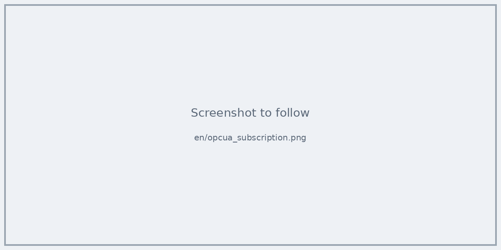

   Connection settings of the opcua driver with mode Subscription.

**Subscription:** Instead of reading all nodes in every cycle, the driver sets up a
subscription when connecting; the server then reports only changed values. The logger
still records at the interval of the controller (with the last reported value). With
many rarely changing values this saves network load and server performance. The initial
values are read once; the driver checks the connection every few seconds with a small
read request and reconnects if necessary. Arrays (blocks) are subscribed with an index
range.

Driver ``ads`` – Beckhoff TwinCAT (ADS)
----------------------------------------------------------------------

For TwinCAT 2 and 3 via the Beckhoff protocol ADS (AMS/TCP, port 48898) – without an
additional library and without TwinCAT on the logger computer. (Alternatively TwinCAT
also works via the ``opcua`` driver if the TF6100 server is licensed.)

**Adding a route:** The controller answers ADS requests only from computers for which a
**route** is configured: in the TwinCAT System Manager or XAE under *SYSTEM › Routes*
(or via the TwinCAT icon on the controller) add a static route with the **AMS Net ID of
this computer** (parameter *Own AMS Net ID*, default: IP address + ``.1.1``) and its IP
address. Without a route the driver reports “ADS error 0x7: target machine not found”.

.. list-table:: Connection parameters
   :header-rows: 1
   :widths: 30 70

   * - Parameter
     - Meaning
   * - IP address
     - Address of the controller.
   * - AMS Net ID of the controller
     - e.g. ``5.12.34.56.1.1`` (TwinCAT shows it in the router); empty = IP + ``.1.1``.
   * - AMS port
     - ``851`` = first PLC runtime of TwinCAT 3 (``852`` … further), ``801`` = TwinCAT 2.
   * - Own AMS Net ID, own AMS port (Advanced)
     - Must match the route; empty = own IP address + ``.1.1``.
   * - Variables per request (Advanced)
     - Maximum number of parts of a sum request (TwinCAT: 500).

**Addresses:** symbolic as in the PLC project – ``MAIN.fTemperatur``,
``GVL.aWerte[3]``, ``MAIN.stMotor.nDrehzahl``, TwinCAT 2 global ``.gWert`` – or
memory/I/O ``%MW10``, ``%MD4``, ``%MX2.3``, ``%IW0``, ``%QX0.1`` or index group:offset
(``0x4020:16``). Symbol names are resolved once when connecting; afterwards all
variables are read with sum requests (up to 500 per request). After a download to the
controller the driver reconnects and resolves the names again.

**Blocks:** array name without index (``MAIN.aWerte``) + first index + count – the
section is read in one piece.

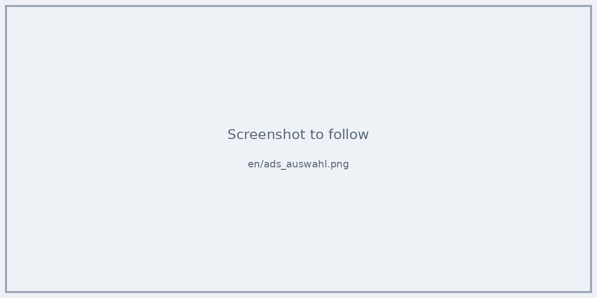

   Connection settings of the ads driver (AMS Net ID, ports, advanced).

**Selection dialog “Choose from TwinCAT…”:** reads the symbol table of the controller
and shows it as a tree (``MAIN`` › ``Pumpe`` › ``fDruck``) with type and comment;
filter field, tick variables, take over arrays of numbers as block by double-click.

Driver ``slmp`` – Mitsubishi MELSEC (SLMP / MC protocol)
----------------------------------------------------------------------

For MELSEC iQ-R, iQ-F (FX5), Q (QnU, QnUDE …) and L with built-in Ethernet or Ethernet
module. Protocol SLMP (MC protocol) with 3E frame, binary, via TCP or UDP. No
additional library.

**Preparation (GX Works):** In the Ethernet settings create a connection “SLMP”
(iQ-R/iQ-F) or “MC protocol” (Q/L), **binary**, TCP or UDP, with a port and download
it to the controller. The logger only reads.

.. list-table:: Connection parameters
   :header-rows: 1
   :widths: 30 70

   * - Parameter
     - Meaning
   * - IP address, port, protocol
     - As set in GX Works (e.g. port 5007, TCP).
   * - Series
     - *Q/L/iQ-F* (standard format) or *iQ-R* (extended format with 4-byte device
       numbers). An iQ-R understands both.
   * - Network no., station, target module (Advanced)
     - For the own station ``0``, ``255``, ``03FF``. In multi-CPU systems target module
       ``03E0`` … ``03E3`` for CPU 1 … 4.
   * - Words per request, gap, timeout (Advanced)
     - Default 960 words (protocol maximum), 16 words, 2000 ms.

**Addresses** in MELSEC notation. ``X``, ``Y``, ``B``, ``W``, ``SB``, ``SW``, ``DX``,
``DY`` are **hexadecimal**, all others decimal:

.. list-table::
   :header-rows: 1
   :widths: 40 60

   * - Address
     - Meaning
   * - ``D100``, ``W1A``, ``R200``, ``ZR1000``, ``SD10``, ``Z0``
     - Word devices (data registers, link registers, file registers …)
   * - ``TN5``, ``CN3``, ``SN0``
     - Current values of timers, counters, retentive timers
   * - ``M10``, ``X1F``, ``Y20``, ``B3``, ``L5``, ``F0``, ``SM400``, ``TS5``, ``CS3``
     - Bit devices (type ``BOOL``)
   * - ``D100.3``
     - Bit 3 of a word (bit ``0`` … ``F``)
   * - ``M16`` with type ``UINT``
     - 16 bits of a bit device as a word (only from a multiple of 16)

**Types:** ``BOOL``, ``INT``, ``UINT``, ``WORD``, ``DINT``, ``UDINT``, ``DWORD``,
``REAL``, ``LINT``, ``ULINT``, ``LWORD``, ``LREAL``. Values spanning several words
occupy consecutive registers, low word first (as in GX Works).

**Blocks:** start device + count (e.g. ``D100``, ``REAL``, 10 → ``D100``, ``D102`` …
``D118``). Independently of this the driver combines neighbouring addresses into as
few requests as possible; bit devices are read word by word (16 bits per word).

Error responses of the controller appear with their code, e.g. *SLMP error 0xC056:
address out of range*; only the respective request is affected.

Driver ``fins`` – Omron (FINS)
----------------------------------------------------------------------

For Omron CJ1/CJ2, CS1, CP1L/CP1H (Ethernet), CP2E and NJ/NX (with FINS enabled) via
FINS/TCP or FINS/UDP, port 9600 – without an additional library.

.. list-table:: Connection parameters
   :header-rows: 1
   :widths: 30 70

   * - Parameter
     - Meaning
   * - IP address, port
     - Address of the controller or Ethernet unit; port 9600.
   * - Protocol
     - *FINS/TCP* (recommended; the controller assigns the node numbers) or *FINS/UDP*.
   * - Destination/source node, destination/source network (Advanced)
     - FINS addresses. ``0`` = automatic: with TCP from the controller, with UDP the last
       byte of the IP address (controller or own computer). With UDP the node table of
       the controller must match the address of this computer.
   * - Words per request (Advanced)
     - At most 999 (older CPUs via UDP possibly fewer).

**Addresses** in Omron notation (decimal): ``D100``/``DM100``, ``W10``, ``H20``,
``A300``, ``CIO100`` (or just ``100``), extended data memory ``E0_100`` (bank 0 … 24),
timer/counter present values ``T5``, ``C3``; bits with a dot and bit number 00 … 15:
``D100.05``, ``CIO0.01``, ``W3.15`` (type BOOL). DINT/REAL/LREAL occupy 2 or 4 words,
low word first (as in CX-Programmer). Neighbouring addresses result in one request;
blocks: start address, elements without gaps.

Driver ``kvhostlink`` – KEYENCE KV (Host Link)
----------------------------------------------------------------------

For KEYENCE KV-8000, KV-7000, KV-5000/5500, KV-3000, KV Nano and KV-X with Ethernet
(built-in or KV-EP21V/KV-LE21V). Protocol: Host Link (ASCII) via TCP, port **8501**.
Nothing needs to be set up in KV STUDIO. No additional library.

.. list-table:: Connection parameters
   :header-rows: 1
   :widths: 30 70

   * - Parameter
     - Meaning
   * - IP address, port
     - Address of the KV; default port 8501.
   * - Words per request, gap, timeout (Advanced)
     - Default 500 words, 16 words, 2000 ms.

**Addresses** in KEYENCE notation:

.. list-table::
   :header-rows: 1
   :widths: 40 60

   * - Address
     - Meaning
   * - ``DM100``, ``EM0``, ``FM0``, ``ZF10``, ``W1A`` (hex), ``TM0``, ``CM10``, ``VM0``, ``Z1``
     - Word devices
   * - ``R1000``, ``MR500``, ``LR0``, ``CR3``
     - Relays (type ``BOOL``); the last two digits are the bit number 00–15
       (``R1000`` = channel 10, bit 0; ``R1015`` is followed by ``R1100``)
   * - ``B1F``, ``VB0``
     - Link relays (hexadecimal, type ``BOOL``)
   * - ``T10``, ``C5``
     - Current value of timer or counter (32 bit, type ``DINT``/``UDINT``)
   * - ``DM100.3``
     - Bit 3 of a word

**Types** as for the ``slmp`` driver; values spanning several words: low word first (as
in KV STUDIO). Neighbouring word addresses are read with one ``RDS`` command, and so are
neighbouring relays.

Error responses (``E0`` invalid device number, ``E1`` invalid command …) affect only the
respective request.

Driver ``toyopuc`` – JTEKT TOYOPUC (Computer Link)
----------------------------------------------------------------------

For JTEKT TOYOPUC PC10G/PC10, PC3J/PC3JG, Nano 10GX and TOYOPUC-Plus with Ethernet.
Protocol: Computer Link (binary) via TCP or UDP. No additional library.

**Preparation (PCwin):** set up a port for *Computer Link* (TCP passive or UDP) on the
Ethernet module or the built-in interface.

.. list-table:: Connection parameters
   :header-rows: 1
   :widths: 30 70

   * - Parameter
     - Meaning
   * - IP address, port, protocol
     - As set in PCwin.
   * - Words per request, gap, timeout (Advanced)
     - Default 512 words, 16 words, 2000 ms.

**Addresses** as in PCwin, numbers **hexadecimal**:

.. list-table::
   :header-rows: 1
   :widths: 40 60

   * - Address
     - Meaning
   * - ``D0100``, ``R0010``, ``S0020``, ``N0005``, ``B0000``
     - Registers (data, link, special, current value, file registers)
   * - ``M0010``, ``X0007``, ``Y0020``, ``K0001``, ``L0100``, ``V0000``, ``T0005``, ``C0003``, ``P0000``
     - Relays and contacts (type ``BOOL``)
   * - ``M010W``
     - 16 relays as a word (``M0100`` … ``M010F``)
   * - ``D0100.F``
     - Bit F of a register
   * - ``U00100``, ``EN0010``, ``H0000``, ``ES0000``, ``EB00000``
     - Extended registers
   * - ``EM0010``, ``EX0007``, ``EY0007``, ``EK0000``, ``EV0000``, ``EL0000``, ``GX0000``, ``GM0000`` …
     - Extended relays
   * - ``P1-D0100``, ``P2-M1000``, ``P3-R0000``
     - Program areas 1–3 (PC3J in 3-program mode, PC10); the upper number ranges (e.g.
       ``D3000`` … or ``M1000`` …) are also addressed this way.

**Types** as for the ``slmp`` driver; values spanning several words: low word first.
The word addresses of the areas correspond to JTEKT's Computer Link manual (basic area
with command 1C, extended area and program areas with command 94).

Driver ``s5as511`` – Siemens S5 (PG interface AS511)
----------------------------------------------------------------------

For SIMATIC S5-90U, 95U, 100U, 115U, 135U, 155U via the **PG interface** (20 mA current
loop). A level converter 20 mA ⇄ RS-232 or USB is required (PG adapter cable, e.g. 6ES5
734-1BD20, or a USB PG adapter). Protocol: AS511 with 9600 baud, 8 data bits, even
parity, 1 stop bit. Library: ``pyserial``.

.. list-table:: Connection parameters
   :header-rows: 1
   :widths: 30 70

   * - Parameter
     - Meaning
   * - Port
     - Port of the adapter, e.g. ``COM1`` or ``/dev/ttyUSB0``.
   * - Baud rate
     - 9600 (standard of the PG interface).
   * - Parity, bytes per request, gap, timeout (Advanced)
     - Even parity; 64 bytes; 8 bytes; 500 ms.

**Addresses** in S5 notation (German or English):

.. list-table::
   :header-rows: 1
   :widths: 40 60

   * - Address
     - Meaning
   * - ``DB10.DW4``
     - Data word 4 of DB 10 (type ``WORD``, ``INT`` or ``S5TIME``)
   * - ``DB10.DL4``, ``DB10.DR4``
     - left or right byte of data word 4 (type ``BYTE``)
   * - ``DB10.DD4``
     - Double word from DW4 and DW5 (type ``DWORD``, ``DINT`` or ``REAL``)
   * - ``DB10.D4.3``
     - Bit 3 of data word 4 (bit 0 … 15; type ``BOOL``)
   * - ``EB0``, ``EW0``, ``ED0``, ``E0.1`` (``I…``)
     - Inputs (process image)
   * - ``AB1``, ``AW2``, ``AD4``, ``A1.0`` (``Q…``)
     - Outputs (process image)
   * - ``MB10``, ``MW10``, ``MD10``, ``M5.0`` (``F…``)
     - Flags
   * - ``T5``, ``Z3`` (``C3``)
     - Timer or counter word

**Types:** ``BOOL``, ``BYTE``, ``WORD``, ``INT``, ``DWORD``, ``DINT``, ``REAL`` (S5
floating point “KG”: exponent and mantissa in two's complement) and ``S5TIME`` (timer
word with time base → milliseconds). The data in the S5 is in Motorola format (high
byte first).

**Sequence:** When connecting, the driver reads the system data of the CPU (location of
process image, flags, timers and counters in memory), on the first access to a data
block its address and length, and then reads the memory areas with as few jobs as
possible. If a data block changes (reloaded, length changed), reconnect with **■ Stop**
/ **▶ Start**.

**Notes:**

* The PG interface is slow (9600 baud, handshaking): one job takes about 50–100 ms. For
  many values choose an interval of 1 s or more and create values as contiguously as
  possible.
* While the logger is reading, the PG interface is occupied – stop the logger to program
  with STEP 5.
* If a data block is missing, the variable reports “DB… does not exist”; addresses beyond
  the end of the DB “address outside DB…”.

.. _uebernahme:

Importing configurations of the single programs
======================================================================

Configuration files of the **S7 Datenlogger**, **TIA Datenlogger** and **CLX
Datenlogger** are taken over – as JSON file directly with **File › Open…**, as older INI
file after the one-time conversion (**File › Convert INI file …**, see
`Converting older INI files <ini-umwandeln_>`__). The following applies:

* The driver of each controller is recognized from its entries: ``rack``/``slot`` →
  ``s7``, ``pfad``/``cpu`` → ``clx``, ``tls``/``rolle``/``port`` → ``tia``.
* S7 variables (``bereich``, ``db``, ``byte``, ``bit``) are converted into addresses,
  e.g. ``DB10.DBD4`` or ``M5.0``; S7 blocks get their start address. Tag names of TIA
  and CLX are taken over unchanged.
* The paths of the S7 DB sources (``symbolquellen``) move to ``treiberdaten``.
* Charts, axes, formulas, blocks, triggers, PID settings, database, web server and
  display are taken over unchanged.

Saving uses the format of the PLC Datenlogger (keys ``treiber`` and ``adresse``). The
single programs can **no longer** read this file afterwards – so save with **Save as…**
under a new name if the file is still to be used in the single program.

Configurations of several single programs can be merged by creating the controllers and
variables again in the configuration program or by copying the entries of the lists
``steuerungen`` and ``variablen`` in the JSON file by hand (adapt ``steuerung`` of the
variables).

Logger (``plc_logger.py``)
======================================================================

Controls
----------------------------------------------------------------------

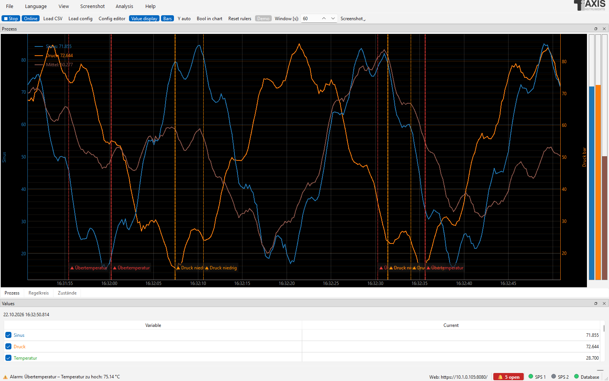

   The main window of the logger with toolbar, charts, value table and status bar.

Toolbar (top):

.. list-table::
   :header-rows: 1
   :widths: 25 75

   * - Element
     - Function
   * - **▶ Start / ■ Stop**
     - Starts or ends recording and CSV logging.
   * - **Online / Offline**
     - Switches between continuous display and review.
   * - **Load CSV**
     - Opens saved CSV files for viewing (offline mode).
   * - **Config editor**
     - Starts the configuration program.
   * - **Value display**
     - Shows or hides the value table (right).
   * - **Bars**
     - Shows or hides the narrow bars next to the charts.
   * - **Y auto**
     - Active: all Y axes are scaled automatically and override fixed ranges.
       Inactive: the settings of the configuration apply.
   * - **Bool in chart**
     - Additionally draws BOOL variables as a filled step line in the chart (depending
       on the Y axis). Default: off, BOOLs appear only as strips in the legend.
   * - **Reset rulers**
     - Sets the two rulers (offline) to one third and two thirds of the visible time
       range.
   * - **Demo**
     - Simulated values instead of a PLC (see `Demo mode <demo-modus_>`__).
   * - **Screenshot**
     - Opens a list of the charts; the chosen chart is saved as PNG or SVG (see
       `Screenshots of charts <screenshots_>`__).
   * - **Window [s]**
     - Width of the visible time window in seconds (1 to 604800).

At the bottom of the window is the **time scroll bar** (active only in offline mode).
The status line shows connection messages and the path of the saved CSV file.

The **View** menu contains the layout of the charts, a list for showing and hiding
single charts and the switches for value display, values at the mouse pointer, trigger
marks and bars. The **Analysis** menu contains XY chart, frequency analysis, PDF report
and PID tuning.

Starting and stopping the recording
----------------------------------------------------------------------

#. Press **▶ Start**. The logger reloads the configuration, builds the charts and
   connects to the controllers.
#. Each controller is read at its own interval. The measurements are merged into rows
   and written to the CSV file.
#. **■ Stop** ends the recording and closes the file. When the program is closed, it
   stops automatically and – if the option is set – archives the current CSV file (see
   `Limiting the file size and archiving <csv-archiv_>`__).

If the connection is lost, the logger tries to restore it by itself and reports this in
the status line. During the interruption there are gaps in the data – only for the
variables of the affected controller; the others continue.

Reading, calculating the formulas and writing the CSV file run in separate threads,
independent of the user interface. The display fetches a section of the data only about
ten times per second and does not redraw invisible curves; this keeps operation smooth
even with many variables.

**File** menu of the logger: **Load config …** (``Ctrl+O``, file dialog for a
configuration file with any name), **Reload configuration** (``F5``), **Config
editor**, **Load CSV**, **Join CSV files and save …**, **Load from database …**,
**Export values (CSV/Excel) …**, **Web server address …**, **Event log …**, **Note to
the event log …** and **Exit**. The window title shows the project name and the
configuration file.

.. _status-led:

Status LEDs of the connections
----------------------------------------------------------------------

.. figure:: images/en/status_leds.png
   :alt: Status LEDs
   :width: 70%
   :align: center

   Status LEDs in the status bar: green, yellow, red, grey.

In the status bar an **LED** with the controller's name shows the connection state of
each controller:

.. list-table::
   :header-rows: 1
   :widths: 20 80

   * - Colour
     - Meaning
   * - grey
     - Controller not active (disabled or recording stopped).
   * - yellow
     - Connection is being established.
   * - green
     - Connected, reading.
   * - red
     - Connection or read error; the logger tries again.

The LED's tooltip shows the status message (for errors the error text) and the cycle
time of the last read request. The web server shows the same LEDs.

Online mode
----------------------------------------------------------------------

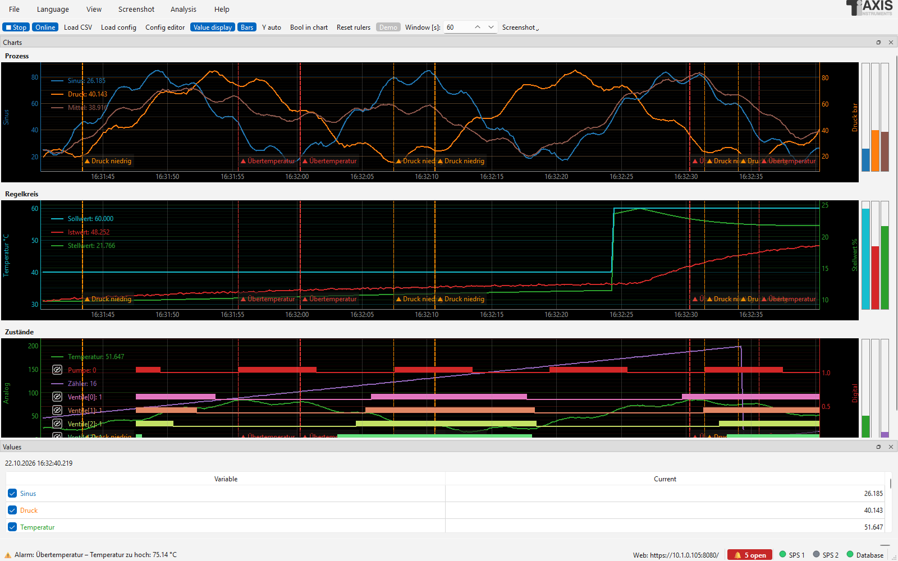

   Online mode: continuous display of the last seconds.

In online mode the time axis follows the newest data. The last *N* seconds are always
shown (setting **Window [s]**). The value table shows the latest measurement in the
column *Current*. The recording continues independently of the display.

**Values at the mouse pointer:** When the mouse is over a chart, a dashed vertical line
appears at the nearest measurement. A box next to it shows its time and the values of
all visible variables of this chart (including BOOL variables); dots mark the values on
the curves. If the mouse stays still, line and values move along with the new
measurements. When the mouse leaves the chart, the display disappears. To switch off:
**View › Values at mouse pointer (online)** (the setting is remembered). In offline mode
the rulers take over this task.

**Zooming with the mouse (time axis only):** In online mode, too, the time axis can be
zoomed with the **mouse wheel** (or by dragging with the right mouse button); the Y axes
stay unchanged. The new width is taken over as **Window [s]**, the right end keeps
following the newest values.

Offline mode
----------------------------------------------------------------------

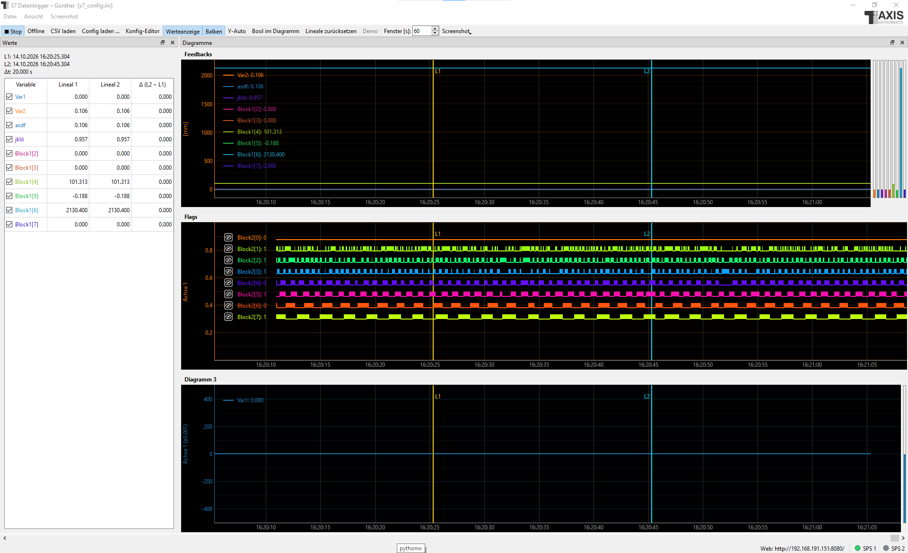

   Offline mode: review with scroll bar.

In offline mode the display is frozen and you can go back in time:

* **Time scroll bar** at the bottom: scroll through the recorded data.
* **Mouse:** drag in the chart with the mouse button pressed to move the time axis, and
  zoom with the mouse wheel. Scroll bar and *Window [s]* follow automatically.
* **Window [s]:** width of the visible time range.

.. note::

   When switching to offline mode, a snapshot of all data measured so far is taken. If
   the recording continues, newer data only appears when you switch from *Online* to
   *Offline* again.

The memory in the program is limited to about 300,000 data points; older points are
then removed from the display. The CSV file always contains all data.

Rulers (offline)
----------------------------------------------------------------------

.. figure:: images/en/logger_lineale.png
   :alt: Rulers in offline mode
   :width: 90%
   :align: center

   Two rulers with time and difference display.

In offline mode two vertical rulers appear in all charts: **L1** (yellow) and **L2**
(cyan). Both can be moved with the mouse and are synchronized across all charts.

The value table then shows:

.. list-table::
   :header-rows: 1
   :widths: 25 75

   * - Column
     - Content
   * - Ruler 1
     - Value of each variable at the time of L1.
   * - Ruler 2
     - Value of each variable at the time of L2.
   * - Δ (L2 − L1)
     - Difference of the two values.
   * - Minimum, Maximum, Mean, Std. dev.
     - Statistics of all measurements between the two rulers.

Above the table the times of L1 and L2 and the time difference **Δt** in seconds are
shown. The nearest measurement in time is used (no interpolation).

.. _trigger-marken:

Trigger marks on the time axis
----------------------------------------------------------------------

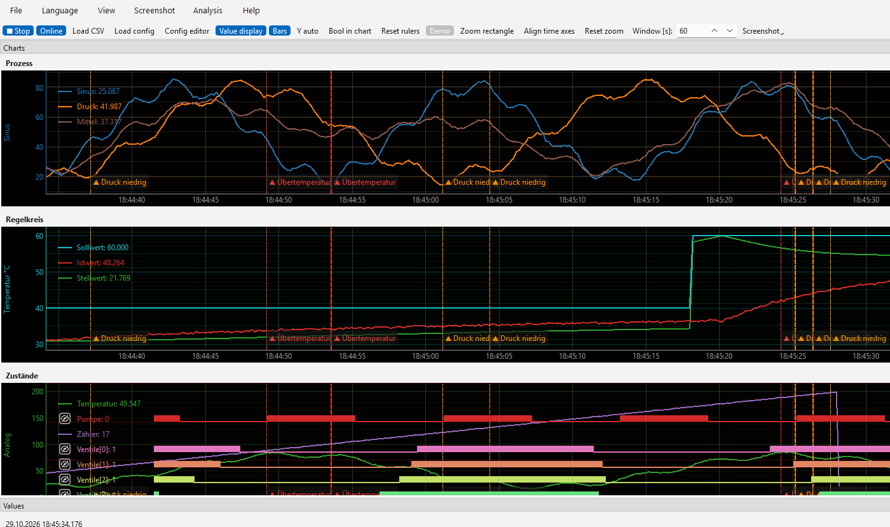

   Trigger marks: alarm (red), warning (orange), recording by trigger (green), note (grey).

Events from the event log appear in all charts as a **vertical dashed line** with a
short text at the bottom of the time axis (▲ name of the trigger): red = *Alarm*,
orange = *Warning*, blue = *Info*, green = start of a
`recording by trigger <trigger-aufzeichnung_>`__, grey = note. The tooltip shows time,
text and the times of going and acknowledgement. The marks are shown online and offline,
also when displaying a loaded CSV file or a database time range (from the event log of
the configuration). With very many events in the visible range at most 150 are shown. To
switch off: **View › Trigger marks on the time axis**.

.. _seiten:

Pages, charts and layout
----------------------------------------------------------------------

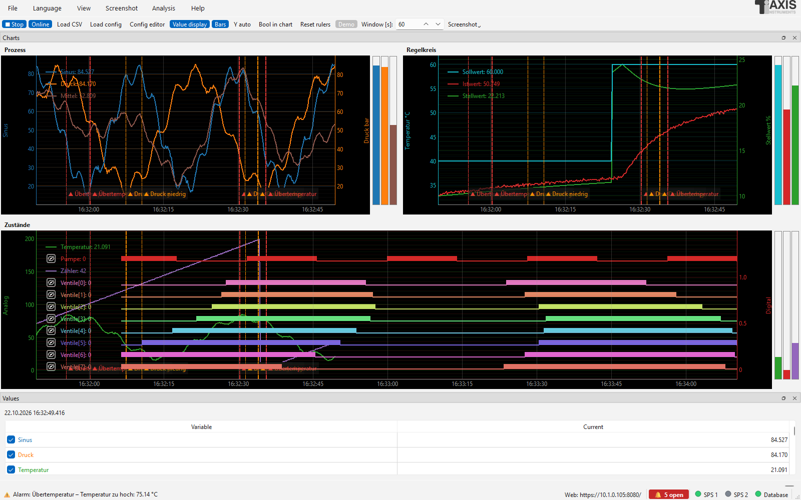

   Charts of one page arranged as a grid.

The charts are placed on **pages**. A page is a dock window or a tab and can contain
**several charts**:

* Without page entries in the configuration, all charts are on one common page
  *Charts*. In *Tabs* mode each chart then gets its own tab.
* With the field **Page (tab)** in the configuration you decide yourself which charts
  share a page (same page name = same page). This way you can create e.g. the tabs
  *Process* and *Alarms* with several charts each.

**Minimum height and scroll bar:** Each chart has a minimum height. If not all charts of
a page fit into the window, a scroll bar appears on the page. In *Side by side* mode a
minimum width with a horizontal scroll bar applies accordingly.

**Layout of the pages** (menu **View › Layout**):

.. list-table::
   :header-rows: 1
   :widths: 25 75

   * - Mode
     - Effect
   * - Stacked
     - Pages lie one above the other; the charts of a page are stacked.
   * - Side by side
     - Pages lie side by side; the charts of a page are also side by side.
   * - Tabs
     - Each page is a tab; the charts of a page are stacked.

**Layout of the charts on a page** (menu **View › Charts on the page**): *Automatic*
follows the layout of the pages; *Stacked* and *Side by side* force one column or one
row; **Grid** arranges the charts in rows and columns. The number of columns is set with
**View › Grid columns** (*Automatic* chooses about the square root of the number of
charts, i.e. three columns for six charts). A last single chart fills the remaining
row. The default is set in the configuration (tab *Display*).

The layout can be adjusted further by **drag & drop**:

* **Pages:** grab the title bar of a page and drag it to the edge of another page (next
  to or above it) or onto its centre (as tab). Double-clicking the title bar detaches
  the page as a floating window.
* **Charts within a page:** grab the title line of a chart (bold, above the chart) and
  drag it onto the title line of another chart on the same page. The chart is inserted
  at that position.

Pages can be hidden and shown again via **View › Pages / charts**. The page layout
adjusted by drag & drop is kept when starting again within the same program session,
as long as the page names and the mode stay the same. After restarting the program the
default layout applies again.

All charts share the same time axis.

Legend with live values
----------------------------------------------------------------------

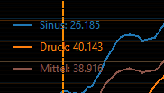

   Legend with live values; one curve is highlighted, one hidden.

The legend in each chart shows the **current value** after the name of each variable,
in the variable's colour, e.g. ``Temperature: 51.234``. Online this is the latest
measurement, offline the value at ruler 1.

**Highlighting a curve:** a **left click** on the name (or sample) of a curve in the
legend highlights it: the curve is drawn thicker and in the foreground, the name appears
in **bold**, all other curves of the chart are dimmed. Clicking the same name again
removes the highlighting; clicking another name moves it.

**Hiding and showing a curve:** right-clicking the name of a curve in the legend opens a
menu with *Hide curve* or *Show curve* and *Show all curves of this chart*. Hidden curves
appear grey in the legend with the addition *(off)*. The tick in the value table stays
in sync. The choice is kept when the layout changes.

.. _screenshots:

Screenshots of charts
----------------------------------------------------------------------

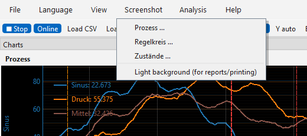

   Menu “Screenshot” with choice of chart and light background.

Single charts can be saved as an image:

#. Click **Screenshot** in the toolbar (or in the **Screenshot** menu) and choose the
   chart.
#. In the save dialog choose file name and format: **PNG** (bitmap) or **SVG** (vector
   graphic). The format results from the file extension or the chosen file type.

The screenshot contains the chart exactly as displayed: curves, all Y axes, legend,
bars and, in offline mode, the rulers. PNG files are created with double resolution.
The **SVG file** is drawn from the measurement data itself (axes with ticks, grid, time
axis, curves, BOOL traces, rulers with labels and legend with values) and can be scaled
without loss and edited further, e.g. in Inkscape or office programs. If the chart is in
a hidden tab, it is brought to the front automatically.

For reports and printouts, the option **Light background (for reports/printing)** can be
switched on in the **Screenshot** menu. The screenshot is then saved with a white
background and dark text; rulers are drawn in darker colours. The screen display itself
stays unchanged. The setting applies to the current program session.

Value table (value display)
----------------------------------------------------------------------

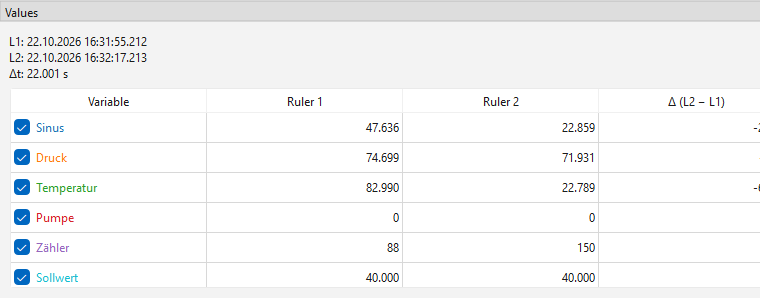

   Value table with current values (online) or ruler values (offline).

The table on the right lists all variables for which *value display* is enabled in the
configuration.

* The name is shown in the variable's colour. Hovering over the name shows the address
  (for calculated variables the formula).
* With the **tick** in front of the name you hide or show the variable's curve in the
  chart (alternatively by right-clicking in the legend).
* The columns change with the mode (*Current* online, *Ruler 1 / Ruler 2 / Δ* offline).
* Offline the table also shows the **statistics between the rulers**: *Minimum*,
  *Maximum*, *Mean* and *Std. dev.* (sample standard deviation, like ``STDEV`` in
  Excel). All data points from the one at ruler 1 to the one at ruler 2 (inclusive) are
  taken into account; missing values are skipped. For BOOL variables the mean is the
  share of time the signal was on (0.25 = 25 %). The values follow every movement of
  the rulers.

Y axes and scaling
----------------------------------------------------------------------

* Each Y axis is labelled in the colour of its first variable.
* Axes with **auto scaling** adapt to the data visible in the time window. Axes with
  fixed limits keep their range.
* The **Y auto** switch in the toolbar temporarily overrides all fixed ranges. When it is
  switched off again, the settings of the configuration apply.

Bars for current values
----------------------------------------------------------------------

Next to each chart a narrow bar per variable shows the current value (width adjustable:
configuration › Display › *Bar width*). The scaling corresponds to the variable's Y
axis. In offline mode the bars show the values at
ruler 1. Move the mouse over the bars to see names and values as tooltip.

BOOL variables
----------------------------------------------------------------------

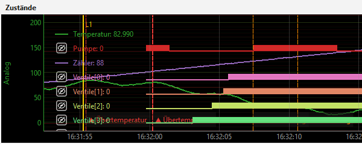

   BOOL signals: line at 0, upward strip at 1, next to the legend rows.

Boolean variables are displayed independently of the Y axes:

* **In the legend** name and value are listed one below the other like the analogue
  curves. Next to each BOOL entry, at the height of its legend row, a **line** on the
  base line (value 0) or an **upward strip** (value 1) in the variable's colour runs
  across the **width of the chart**, like a digital signal. Like a curve it covers the
  displayed time range (online the last *N* seconds, offline the visible section). This
  way several BOOL variables can be compared at a glance without covering the chart.
* **As a curve** BOOLs are not drawn by default (they would otherwise depend on a Y
  axis). With **Bool in chart** in the toolbar they additionally appear as a
  transparently filled step line.
* **In the value table** the cell is **filled** in the variable's colour for value 1 and
  empty for value 0.

Hidden BOOLs (right click in the legend) and highlighted BOOLs (left click) are dimmed or
drawn with a thicker strip. The SVG export and the web server (where the name is shown in
the row of the strip) show the BOOL signals in the same way.

.. _demo-modus:

Demo mode
======================================================================

Demo mode creates simulated values without a PLC being connected:

#. Activate **Demo** in the toolbar.
#. Press **▶ Start**.

The variables of your configuration are supplied with test signals (REAL: sine with
noise, BOOL: square wave, integers: sawtooth). If nothing is configured yet, demo mode
creates example charts with several Y axes, a BOOL signal and a control loop for the PID
tuning. The switch is locked during recording and is not saved. The demo data is stored
as ``demo_YYYYMMDD_HHMMSS.csv``.

.. _webserver:

Web server (charts in the browser)
======================================================================

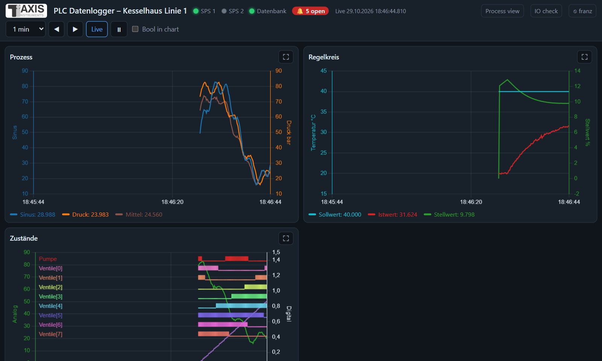

   The charts in the browser of a tablet.

With the option **Start web server** (tab *Web server & headless*) the logger provides
the charts as a web page. It can be opened with any browser in the network, e.g. on a
tablet or smartphone – also in headless operation.

* **Address:** ``http://<IP address of the computer>:<port>/`` (default port 8080). The
  logger shows the address under **File › Web server address …** – together with a
  **QR code**: scan it with the smartphone camera instead of typing (with the access code
  if no login is set up). It is also written to the log at startup. The firewall may have
  to allow the port.
* **Access code:** If a code is entered in the tab, the page is opened with
  ``http://…:8080/?token=CODE``. Without code and without login anybody in the network
  can watch; the page is read-only, there is no control function.
* **HTTPS and login:** see below.
* **Process view:** tiles with values, gauges and lamps under ``/prozess``, see
  `Process view`_.
* **Logos:** customer logo and logo of the configuration (tab *Display*) appear in the
  header of the pages (charts, process view, login); empty fields = no logo.
* **Language:** the pages (charts, login, process view, IO check) appear in the language
  set in the program (menu *Language*), e.g. English.
* **Display:** The page shows the charts per page (tab) with Chart.js, with several Y
  axes, BOOL signals as step lines and status LEDs of the controllers. The display adapts
  to the screen size.
* **Operation:** *Live* shows the latest time window; **◀ ▶** pages back in time
  (history), **Pause** stops the display. Tapping a legend entry highlights a curve, a
  long press or double-click hides it.
* **Full screen:** The button at the top right of a chart (or a double-click into the
  chart) enlarges it to the whole window; the header with time window, **◀ ▶**, *Live*
  and *Pause* stays visible and usable. Where the browser allows it, it also switches to
  real full screen (without address bar). Back to the normal display: the same button,
  double-click, ``Esc`` or the browser's back button or gesture. In full screen more
  points are loaded (to match the width).
* **Chart.js:** The library is served from ``web_static/chart.umd.js`` (the installer
  contains it). If the file is missing, the browser loads it from the internet instead
  (jsdelivr); in a closed network put the file ``chart.umd.js`` (Chart.js 4) into the
  folder ``web_static`` manually.

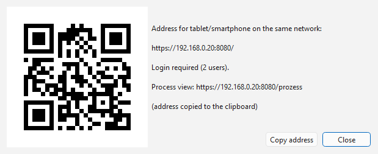

   File › Web server address …: address with QR code for scanning.

The server transfers only the visible data, reduced to the screen width (minimum and
maximum per section are kept), and compresses it.

.. _https-anmeldung:

HTTPS and login
----------------------------------------------------------------------

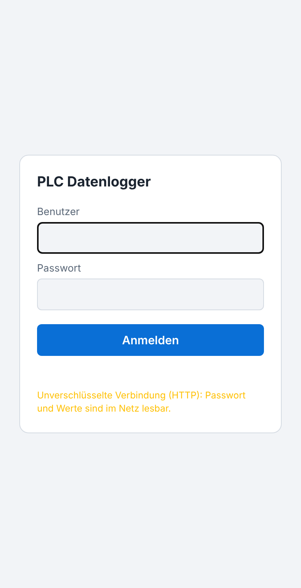

   Login page of the web server (smartphone).

**HTTPS** (tab *Web server & headless*, *HTTPS (encrypted)*): the page is then
reachable at ``https://<IP>:<port>/``. Without a certificate of your own, the logger
creates a **self-signed** one at the first start (RSA 2048, valid for ten years, for
computer name, IP address and ``localhost``; folder ``web_tls`` in the data folder). The
browser warns on the first visit because it does not know the issuer: compare the
fingerprint and confirm the exception. The **SHA-256 fingerprint** is shown under **File ›
Web server address …** (in headless operation it is in the log file). With a certificate
of the company CA (enter PEM files for certificate and key) there is no warning. Requires
the package ``cryptography`` (included in the installation).

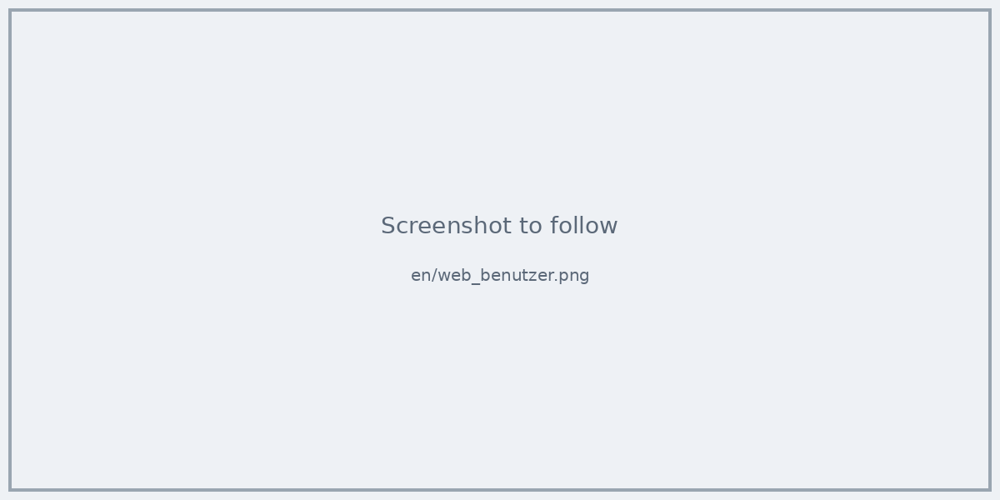

   Creating web server users (configuration program, tab Web server & headless).

**Login:** Create users with **Users …** (name and password, at least 8 characters);
only a hash of the password (PBKDF2-SHA256) is stored, not the password itself. If at
least one user is configured, the browser first shows a login page; the login is valid
for 12 hours or until **⎋ Log out** (top right of the page). After five failed attempts
the address is blocked for one minute. An additionally configured access code still
allows access without login (``?token=CODE``, e.g. for a permanently installed display).

.. note::

   Without HTTPS, passwords and measurements are transmitted unencrypted. Therefore use
   login together with HTTPS. For access from the internet, the server should also be
   behind a VPN or a reverse proxy.

.. _prozessbild:

Process view
----------------------------------------------------------------------

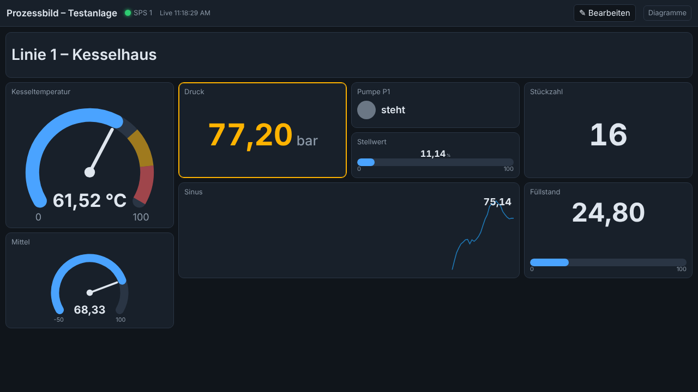

   Process view: text, gauges, numeric values (pressure above the warning limit), status
   lamp, bars and short trend.

Besides the charts the web server offers a **process view** – an overview with large,
easily readable tiles, e.g. for a monitor in the control room or a tablet at the machine.
Open it with ``http://<IP>:<port>/prozess``, the link **Prozessbild** at the top of the
chart page or in the logger with **File › Process view in the browser** (opens the
default browser of this computer). The web pages are in German.

Tile types:

* **Zahlenwert** (numeric value) – large value with unit.
* **Zeigerinstrument** (gauge) – arc from minimum to maximum, warning and alarm ranges in
  colour.
* **Balken** (bar) – horizontal or (for a tall, narrow tile) vertical, e.g. a level.
* **Zustand (Lampe)** (status lamp) – for BOOL signals: lamp with texts and colours for ON
  and OFF (optionally inverted).
* **Kurzverlauf** (short trend) – line of the last seconds to hours (*Zeitraum*) with the
  current value.
* **Text / Überschrift** (text / heading) – e.g. a plant section or a note.

For value, gauge, bar and trend, **upper and lower warning and alarm limits** can be
entered: if one is exceeded, the tile turns yellow or red. Without a measurement
(connection lost) **—** is shown. Several **pages** appear as tabs at the top. On a
smartphone the tiles are stacked (two per row or a full row).

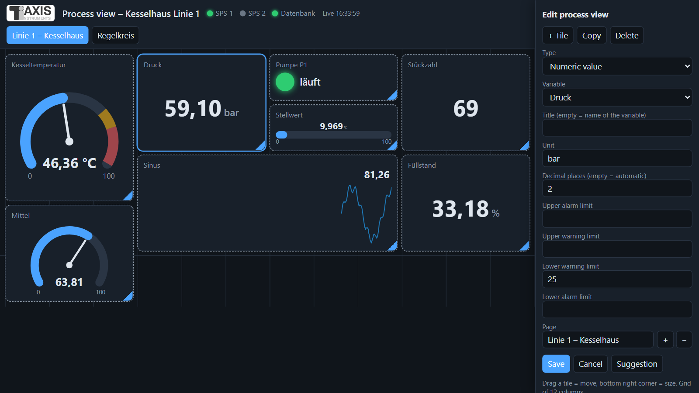

   Editing: tile selected (blue), its properties on the right.

**Editing:** button **✎ Bearbeiten** (on a PC or tablet). Dragging a tile with the mouse
moves it on the grid (12 columns), the bottom right corner changes its size; the arrow
keys move the selected tile, with ``Shift`` they change its size, ``Del`` deletes it. The
properties of the selected tile are on the right (type, variable, title, unit, decimals,
minimum/maximum, limits, colours, texts). **+ Kachel** (add tile), **Kopie** (copy),
**Löschen** (delete), pages are added, deleted and renamed with **+**/**−**; **Vorschlag**
(suggestion) fills the page with one tile per variable. **Speichern** (save) stores the
layout, **Abbrechen** (cancel) discards the changes.

* The layout is stored in the file ``<configuration>.prozessbild.json`` next to the
  configuration file (e.g. ``plant.prozessbild.json``); the configuration program does
  not change it. Tiles refer to the **name** of a variable – if a variable is renamed,
  the tile shows "Variable fehlt" (variable missing) and has to be assigned again.
* Without a saved layout the page shows a suggestion (BOOL as lamp, otherwise value).
* **Who may edit:** if users are set up (`HTTPS and login`_), only logged-in users –
  whoever opens the page with the access code only can view it but not change it (good
  for a permanently installed display). Without login anybody with access to the page may
  edit.

.. _opcua-server:

OPC UA server
======================================================================

The logger can provide its values itself as an **OPC UA server** – for a control system,
MES, SCADA, Node-RED or another logger. This way, e.g. values from an S5 or a Modbus
controller that cannot do OPC UA itself, and the calculated variables, can be used in
an OPC UA network. The server is **read-only**.

**Enable:** configuration program, tab *Web server & headless*, **OPC UA …**:

* **Start OPC UA server** – the server runs as long as recording runs (also in headless
  operation); at start the endpoint is shown in the status bar or the log.
* **Address (host)** and **port** (default 4840). Endpoint:
  ``opc.tcp://<computer>:4840/plc-datenlogger/``. The firewall must allow the port.
* **Update** – how often changed values are taken over into the server (default 500 ms;
  faster than the sampling time of the controllers is pointless).
* **Security** – one or more levels: *None*, *Basic256Sha256* (sign or sign and encrypt),
  *Aes128Sha256RsaOaep*, *Aes256Sha256RsaPss*. For the encrypted endpoints the logger
  creates a self-signed certificate at the first start (folder ``opcua`` in the data
  folder, ``server_cert.der``); the client may have to accept it as trusted. Own
  certificate: enter the files.
* **Access** – *Anonymous* and/or *Login with the web server users* (the same names and
  passwords as in `HTTPS and login`_). For a login an encrypted endpoint should be
  enabled, otherwise the password travels across the network in plain text.

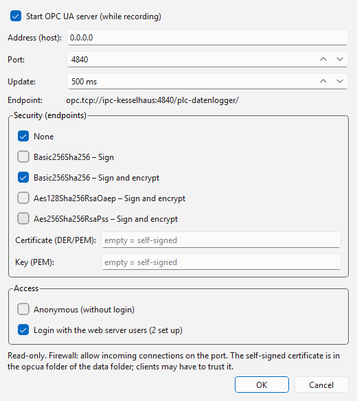

   OPC UA server dialog: endpoint, security levels and access.

**Address space** (namespace ``urn:plc-datenlogger``):

.. code-block:: text

   Objects
   └─ PLC Datenlogger
      ├─ PLC 1                 one folder per controller with its variables
      │  ├─ Temperature        ns=2;s=Temperature   (Double; BOOL variables: Boolean)
      │  └─ …
      ├─ Calculated            calculated variables (formulas)
      ├─ Events                per trigger: Boolean, True while the event is active
      └─ Status
         ├─ PLC 1              Boolean: connection OK
         ├─ PLC 1_Text         status text of the connection
         ├─ Timestamp          time of the last measurement row
         └─ Recording          True while recording runs

The NodeId of a variable is its name (``ns=<index>;s=<name>``; the client gets the index
via the namespace ``urn:plc-datenlogger``, usually 2). The folders *Calculated*, *Events*,
*Timestamp* and *Recording* are named in the language of the interface; their NodeIds do
not change. The **source timestamp** is the time of the measurement. If a variable has no
value (controller not reachable), it has the status **BadNoCommunication**. Clients can
read or subscribe to the values; only changes are reported.

.. _headless:

Headless operation (recording only)
======================================================================

Without user interface the logger only records: reading from the controllers, formulas,
CSV file, archiving, trigger recording, reports and – if enabled – web server. This
saves resources and is suitable for continuous operation, e.g. as autostart program on
an industrial PC.

* **Switching on:** option *Headless mode* in the tab *Web server & headless* of the
  configuration, or command-line parameter ``--headless``. With ``--gui`` the user
  interface can be opened despite the headless mode being set.
* **Messages** (connection, errors, archiving) are written to the log file
  ``plc_logger.log`` in the program or data folder (rotating, several files).
* **Exiting:** ``Ctrl+C`` in the console window or the signal SIGTERM (stop service,
  Windows: close the window) exits cleanly: the CSV file is closed and – if the option
  is set – archived.
* The installed version contains the shortcut *PLC Datenlogger (Headless, nur
  Aufzeichnung)* in the start menu.

.. _datenbank:

Database recording
======================================================================

The measurements can be written to a database **in addition to or instead of** the CSV
file – e.g. for evaluation with SQL or display in Grafana. The settings are in the
configuration program in the tab **Database**; the CSV file is switched on or off with
the tick **Write CSV file** in the tab *Recording*.

.. list-table::
   :header-rows: 1
   :widths: 25 75

   * - Field
     - Meaning
   * - Database
     - *None*, *SQLite (file)*, *MariaDB / MySQL*, *TimescaleDB / PostgreSQL*,
       *QuestDB*, *InfluxDB 3 Core*, *VictoriaMetrics* or *Prometheus (remote write)*.
   * - Server / port
     - Host name or IP address of the database server; port *default* = 3306
       (MariaDB), 5432 (PostgreSQL/TimescaleDB), 9000 (QuestDB), 8181 (InfluxDB 3) or
       8428 (VictoriaMetrics) or 9090 (Prometheus). For QuestDB, InfluxDB, VictoriaMetrics
       and Prometheus a complete URL may also be entered here, e.g. ``https://server:8181`` (encrypted; the port field
       then does not apply).
   * - Database name
     - Name of the database on the server. MariaDB/PostgreSQL: it must already exist,
       the program creates the table itself. InfluxDB 3: created if needed. Not relevant
       for QuestDB, VictoriaMetrics and Prometheus (one database per server).
   * - User / password
     - Access data. The user needs the rights CREATE (at the first start) and INSERT.
       The password is stored in plain text in the configuration file. QuestDB, InfluxDB,
       VictoriaMetrics and Prometheus: user and password are sent with HTTP basic
       authentication; **without user the password is used as token** (InfluxDB 3: token
       ``apiv3_…``, QuestDB Enterprise, VictoriaMetrics behind *vmauth*, Prometheus behind
       a proxy); both empty = no authentication.
   * - SQLite file
     - File name of the SQLite database; a relative path refers to the data folder of
       the program.
   * - Table
     - Name of the table (default ``messwerte``; letters, digits, ``_``).
       VictoriaMetrics and Prometheus: the metric is called *table* + ``_wert``, i.e.
       ``messwerte_wert``.
   * - Write changes only
     - A value is only written if it has changed, but at least every minute. Saves a lot
       of space for slowly changing values.
   * - Delete after, Use at most
     - Delete old values automatically (see `Cleaning up old recordings
       <aufraeumen_>`__): after *n days* (SQLite, MariaDB, PostgreSQL/TimescaleDB,
       QuestDB) or when the values take up more than *n MB* (SQLite only).
   * - Test database
     - Connects, creates the table and reports the result.

**Table structure** (one row per value, “narrow” format):

.. list-table::
   :header-rows: 1
   :widths: 20 30 50

   * - Column
     - Type
     - Content
   * - ``zeit``
     - SQLite: text, MariaDB: ``DATETIME(3)``, PostgreSQL: ``TIMESTAMPTZ``, QuestDB:
       ``TIMESTAMP`` (designated timestamp)
     - Time of the measurement in **UTC** with milliseconds
   * - ``projekt``
     - Text (QuestDB: ``SYMBOL``)
     - Project name from the configuration (several loggers can share a table)
   * - ``variable``
     - Text (QuestDB: ``SYMBOL``)
     - Name of the variable
   * - ``wert``
     - Floating point number
     - Measured value (BOOL as 0/1)

Invalid values (e.g. during a connection failure) are not written. An index on
``variable, zeit`` speeds up queries of single variables. With **TimescaleDB** the table
automatically becomes a *hypertable* (partitioned by time); if the extension is not
installed, a normal PostgreSQL table is created and the status line reports this.

**QuestDB** is addressed via its HTTP interface (default port 9000, the same port as the
web console): the values are sent in *InfluxDB Line Protocol* to ``/write``, read-mode
queries to ``/exp``. The table is created partitioned by day; from QuestDB 7.3 with
deduplication on ``zeit, projekt, variable`` – a batch sent again after a failure thus
does not create duplicate rows (older versions: without deduplication, the status line
reports this). An empty project name is stored as ``NULL``.

**InfluxDB 3** (Core or Enterprise) is also addressed via HTTP (default port 8181):
values in line protocol to ``/api/v3/write_lp``, queries with SQL to
``/api/v3/query_sql``. The program creates database and table (tags ``projekt`` and
``variable``, field ``wert``); in InfluxDB the time column is called ``time`` instead of
``zeit``. The same variable at the same time overwrites itself, so no duplicate rows
arise. If authentication is enabled (default in InfluxDB 3), enter the token
(``influxdb3 create token --admin``) in the field *Password* and leave *User* empty.

**VictoriaMetrics** stores time series instead of tables: each variable becomes a series
of the metric ``messwerte_wert`` with the labels ``projekt`` and ``variable``. Writing
uses line protocol to ``/write``, reading the Prometheus interface (read mode: raw data
via ``/api/v1/export``, averages via ``/api/v1/query_range``). VictoriaMetrics stores
timestamps with milliseconds and by default keeps data for one month only (command-line
parameter ``-retentionPeriod``).

**Prometheus** stores time series like VictoriaMetrics (metric ``messwerte_wert``, labels
``projekt`` and ``variable``). Writing uses **remote write** (``/api/v1/write``, protobuf
with snappy compression, no additional library); Prometheus must be started with
``--web.enable-remote-write-receiver`` for this, otherwise the status line reports
“Remote write is not enabled”. Reading uses the HTTP interface (read mode: raw data hour
by hour via ``/api/v1/query``, averages via ``/api/v1/query_range``; first and last time
in the overview are accurate to about 1/2000 of the retention period). Prometheus only
accepts values per series in chronological order and at most about one hour old. It
rejects older values (e.g. written after a long outage); the logger discards such
batches, reports them (“… values rejected”) and counts them in the tooltip of the
database LED. Remedy: ``storage: tsdb: out_of_order_time_window: 1d`` in the Prometheus
configuration. The retention period is set with the command-line parameter
``--storage.tsdb.retention.time`` (default 15 days).

Example queries:

.. code-block:: sql

   -- Trend of a variable in the last hour (PostgreSQL/TimescaleDB)
   SELECT zeit, wert FROM messwerte
    WHERE variable = 'Temperatur' AND zeit > now() - interval '1 hour' ORDER BY zeit;

   -- Minute averages (TimescaleDB)
   SELECT time_bucket('1 minute', zeit) AS minute, avg(wert)
     FROM messwerte WHERE variable = 'Temperatur' GROUP BY minute ORDER BY minute;

   -- Latest values of all variables (MariaDB / SQLite)
   SELECT variable, MAX(zeit) FROM messwerte GROUP BY variable;

   -- Minute averages (QuestDB)
   SELECT zeit, avg(wert) FROM messwerte WHERE variable = 'Temperatur' SAMPLE BY 1m;

   -- Latest value per variable (QuestDB)
   SELECT * FROM messwerte LATEST ON zeit PARTITION BY variable;

   -- Minute averages (InfluxDB 3)
   SELECT date_bin(INTERVAL '1 minute', time) AS minute, avg(wert) FROM messwerte
    WHERE variable = 'Temperatur' AND time > now() - INTERVAL '1 hour' GROUP BY 1 ORDER BY 1;

For VictoriaMetrics and Prometheus (PromQL, e.g. in Grafana):

.. code-block:: text

   messwerte_wert{variable="Temperatur"}                          # trend
   avg_over_time(messwerte_wert{variable="Temperatur"}[1m])       # minute average
   last_over_time(messwerte_wert{projekt="Anlage 1"}[1h])         # latest value per variable

**Operation:**

* Writing is done in a separate thread about once per second in batches; display and
  reading from the controller are not slowed down by this.
* In the status bar (and in the web server) a separate **LED “Database”** shows the
  state; the tooltip gives the number of values written.
* If the database cannot be reached, the values stay in memory (up to about 2 million
  values) and are written after reconnecting. Values not yet written when exiting are
  reported in the status line.
* **Drivers:** SQLite is included in Python. MariaDB needs ``PyMySQL``,
  TimescaleDB/PostgreSQL ``psycopg`` (``pip install PyMySQL "psycopg[binary]"``); both
  are included in the installer. QuestDB, InfluxDB 3, VictoriaMetrics and Prometheus
  need no library.
* For Grafana: create a data source *MySQL* or *PostgreSQL* (QuestDB: plugin *QuestDB*
  or *PostgreSQL* on port 8812; InfluxDB 3: *InfluxDB* with query language *SQL*;
  VictoriaMetrics and Prometheus: *Prometheus*); the time column is ``zeit`` (InfluxDB:
  ``time``, UTC).
* **Test environment:** in the folder ``docker``, ``docker compose up -d`` starts
  TimescaleDB, QuestDB, InfluxDB 3 Core, VictoriaMetrics, Prometheus and Grafana with ready-made
  data sources (access data in ``docker/.env``). SQLite files can be read with Grafana's
  SQLite plugin.

.. _db-lesen:

Read mode: displaying recordings from the database
----------------------------------------------------------------------

In the logger, **File › Load from database …** (``Ctrl+D``) loads a freely chosen time
range from the database and displays it in **offline mode** – with rulers, value table,
screenshots and PID tuning as with a loaded CSV file. It reads from the database of the
loaded configuration; the database is only read, a running recording (also of another
logger) can continue writing meanwhile.

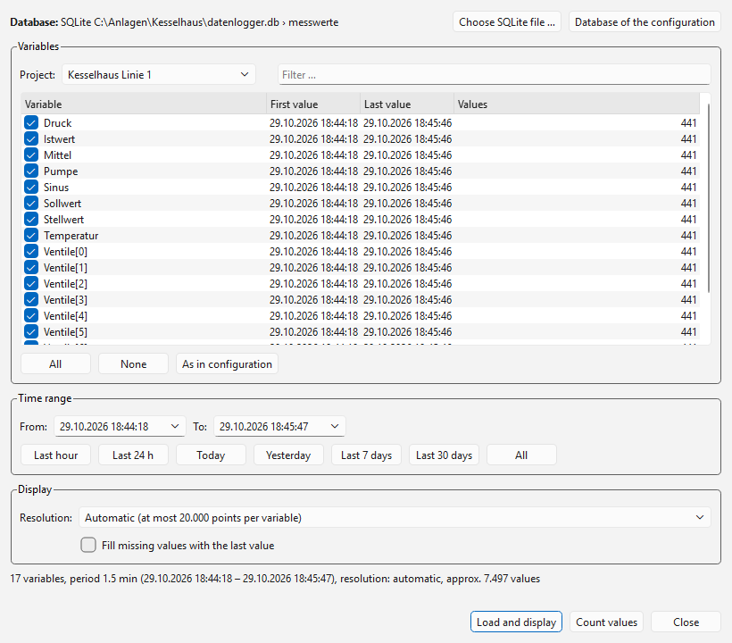

   Dialog “Load from database”: choose variables, time range and resolution.

.. list-table::
   :header-rows: 1
   :widths: 25 75

   * - Area
     - Meaning
   * - Database
     - Shows the source. **Choose SQLite file …** reads any SQLite file instead (e.g. a
       copy from another computer); **Database of the configuration** returns.
   * - Project
     - Project name under which the values were stored (default: project of the
       configuration). *(all projects)* combines variables of the same name of all
       projects.
   * - Variables
     - All variables in the database with first and last time and number of values.
       Initially the variables of the current configuration are ticked. **All**,
       **None**, **As in configuration** and the filter field help with many variables.
   * - Time range
     - **From** / **To** (local time) with calendar, or by button: *Last hour*, *Last
       24 h*, *Last 7 days*, *Last 30 days* (each up to the last stored value of the
       chosen variables), *Today*, *Yesterday*, *All*.
   * - Resolution
     - *Automatic*: raw data as long as there are at most 20,000 points per variable,
       otherwise averages on a suitable grid (1 s, 2 s, 5 s … 1 day). *Raw data*: every
       stored value. *Average per 1 s … per day*: fixed grids. The averages are computed
       by the database itself – so even months of data can be surveyed quickly.
   * - Fill missing values with the last value
     - For recordings with **Write changes only** (preset there): a missing value means
       “unchanged”, the curve runs continuously. Without tick gaps appear.
   * - Count values
     - Determines the exact number of values in the time range (above it there is an
       estimate from the variable list).

**Load and display** reads the values in the background; the progress is shown at the
bottom of the window, **Cancel** stops reading. Then the logger switches to offline
mode. Colours, charts and axes come from the configuration; variables missing there
appear in the first chart. The status line gives source, time range and resolution. A
running recording is stopped when loading (as when loading a CSV file); **▶ Start**
begins a new one.

Notes:

* Timestamps are stored in UTC in the database; they are displayed in local time.
* With averages the timestamp is in the middle of the grid interval (e.g. 10:00:30 for
  10:00:00 to 10:00:59). Minimum and maximum within an interval are not visible – choose
  raw data or a finer grid for short peaks.
* To protect memory, the logger reads at most 20 million values at once; above that a
  note asks you to choose a shorter time range or averages.
* With MariaDB and PostgreSQL the user only needs the SELECT right.

.. _ereignisse:

Triggers and event log
======================================================================

A **trigger** monitors a condition on the variables, e.g. ``{Temperatur} > 80``. As
soon as it is met, the logger writes an entry with timestamp to the **event log** (a
text file). The number of events not yet acknowledged is shown in the logger's status
bar; acknowledgement is done in the **event viewer**.

Creating triggers
----------------------------------------------------------------------

Configuration program, tab **Triggers & events** → **Edit triggers …**.

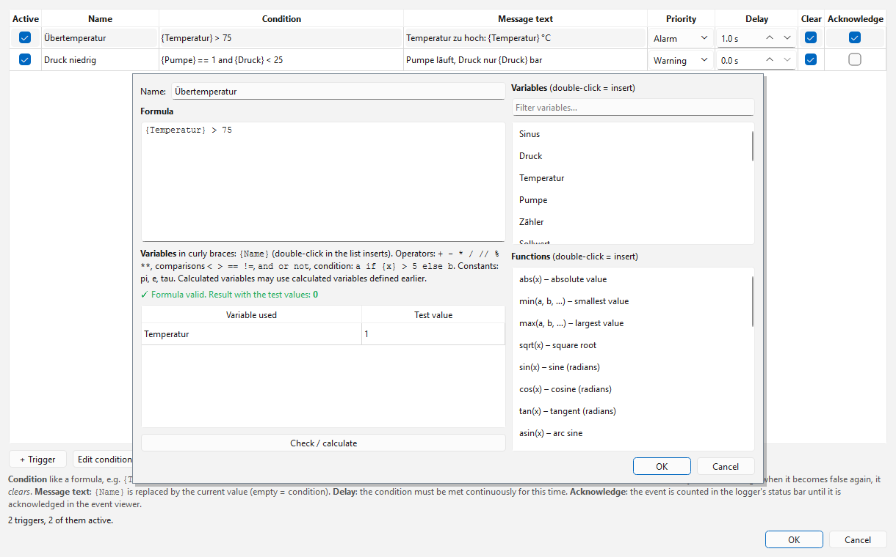

   The trigger editor: one row per trigger, faulty rows are marked red.

.. list-table::
   :header-rows: 1
   :widths: 22 78

   * - Column
     - Meaning
   * - Active
     - Only active triggers are evaluated. Disabled triggers may also be faulty (e.g.
       after renaming a variable).
   * - Name
     - Name of the trigger (unique, without ``;``); written to the event log.
   * - Condition
     - Expression as for `calculated variables <berechnete-variablen_>`__. Result not
       equal to 0 = met. Examples: ``{Temperatur} > 80``, ``{Druck} < 2 and {Pumpe} ==
       1``, ``abs(ddt({Füllstand})) > 5``, ``{Störung} == 1``. Variables without value
       (no connection) count as *not met*. **Edit condition …** (or double-click) opens
       the formula editor with variable list and test values.
   * - Message text
     - Text of the entry. ``{Name}`` is replaced by the value of the variable at the time
       of the event, e.g. ``Temperature too high: {Temperatur} °C``. Empty = the
       condition itself.
   * - Priority
     - *Info*, *Warning* or *Alarm* (colour in the viewer, filter).
   * - Delay
     - The condition must be met **continuously** for this many seconds before the event
       is raised (suppresses short peaks). 0 = immediately.
   * - Clear
     - Also log the end of the event (condition false again).
   * - Acknowledge
     - The event must be acknowledged and is counted in the status bar until then.
       Without tick it is only logged.

A trigger fires **once per edge**: only when the condition becomes false and then true
again is a new event created. The triggers are checked with every measurement cycle –
also in headless operation – and apply from the next start of the recording. In demo
mode without own triggers there are two example triggers (*Übertemperatur*, *Druck
niedrig*).

Event file
----------------------------------------------------------------------

Field **Event file** in the same tab; empty = ``<CSV folder>/<CSV name>_ereignisse.csv``.
The file is only appended to (never changed or archived) and can be opened with Excel
(semicolon, UTF-8):

.. code-block:: text

   ID;Zeit;Art;Trigger;Priorität;Text;Benutzer
   17;2026-10-15 16:20:01.250;KOMMT;Übertemperatur;Alarm;Temperatur zu hoch: 81.37 °C;
   17;2026-10-15 16:22:40.100;GEHT;Übertemperatur;Alarm;;
   17;2026-10-15 16:25:12.000;QUITTIERT;Übertemperatur;Alarm;;mmuster

*Art* (kind) is ``KOMMT`` (raised), ``GEHT`` (cleared) or ``QUITTIERT`` (acknowledged);
rows with the same *ID* belong to the same event. For ``QUITTIERT`` the column
*Benutzer* (user) contains the Windows user name. ``-`` in the column *Benutzer* of a
``KOMMT`` row means “no acknowledgement required”. The file format is the same in all
languages.

Display in the status bar
----------------------------------------------------------------------

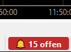

   Red background: three events are not yet acknowledged.

On the right of the status bar the button **🔔** shows the number of open (not
acknowledged) events; with open events it is red. A click on it – or **File → Event log
…** (Ctrl+E) – opens the viewer. Each new event also appears as a message in the status
bar (``⚠ Alarm: …``). The counter also works without a running recording, e.g. if a
headless logger on the same computer writes to the file. In the web server “🔔 n open”
is shown at the top (tooltip: the open events); acknowledgement is only possible in the
viewer.

Event viewer and acknowledgement
----------------------------------------------------------------------

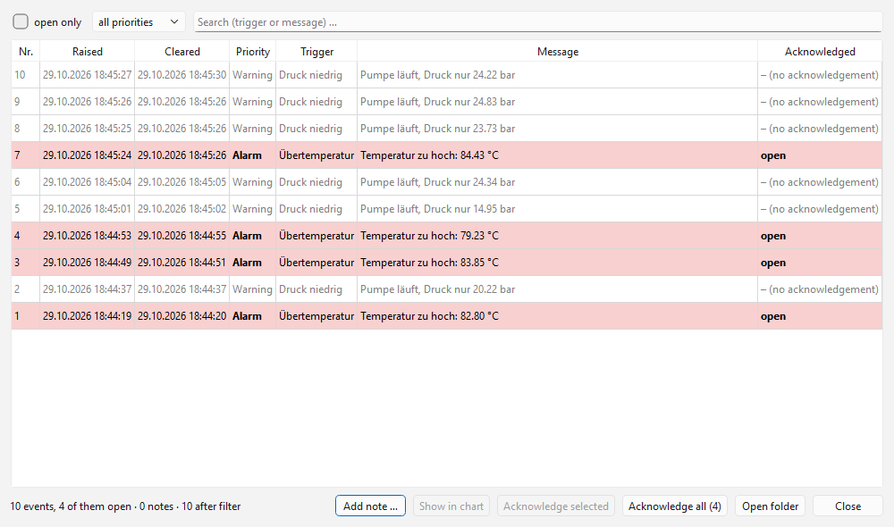

   The event viewer: open events coloured by priority, completed ones grey.

* The table shows the newest events at the top: number, raised, cleared, priority,
  trigger, message and acknowledgement (time and user or **open**).
* Filters: **open only**, priority, search field (trigger or message).
* **Acknowledge selected** (or double-click a row) acknowledges the selected events,
  **Acknowledge all** all open ones.
* The display updates itself as soon as new events arrive (F5 = immediately).
* **Show in chart** (button or right-click on a row, only in the logger): the logger
  switches to offline mode and shows the time range around the event, **ruler 1** on the
  start (coming), **ruler 2** on the end (going). If the values are no longer in memory,
  it loads them from the database of the configuration (if one is set; 10 minutes before
  and after the event), otherwise the matching CSV file from the CSV folder or the
  archive.
* **Open folder** shows the event file in the file manager.

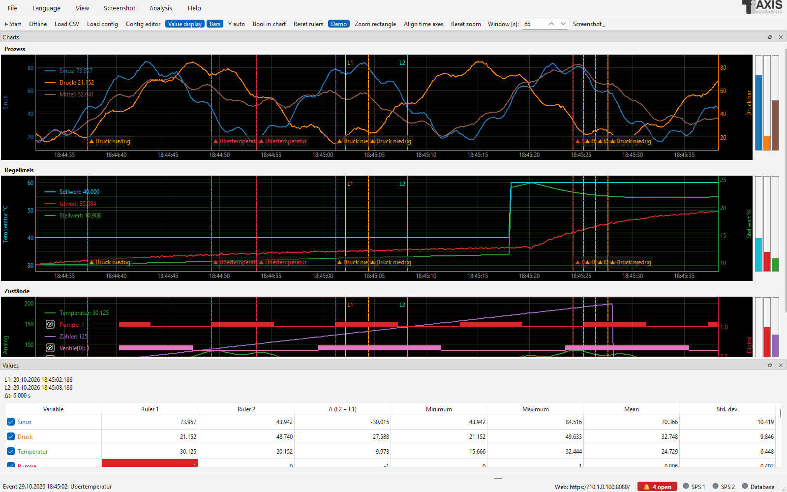

   After “Show in chart”: time range around the event, ruler 1 on coming, ruler 2 on going.

The viewer can also be started **on its own** – e.g. next to a headless logger or on
another computer with access to the file (network drive):

.. code-block:: text

   PLCLogger.exe --ereignisse                        (event log of the last used configuration)
   PLCLogger.exe --ereignisse plant.json             (event log of this configuration)
   PLCLogger.exe --ereignisse D:\logs\log_ereignisse.csv

The installed version has the shortcut *PLC Ereignisprotokoll* in the start menu for
this. In the configuration program **Show event log …** opens the same viewer.

.. _benachrichtigungen:

Notifications
----------------------------------------------------------------------

When an event comes, the logger can pass it on immediately – by **e-mail**, into a
**Microsoft Teams** or **Slack** channel, to any **webhook** (JSON), as a **push message to
the phone** with the app *ntfy* or via **Telegram**. Set it up in the configuration
program, tab *Triggers & events*, **Notifications …**; next to it you see whether and
where notifications go.

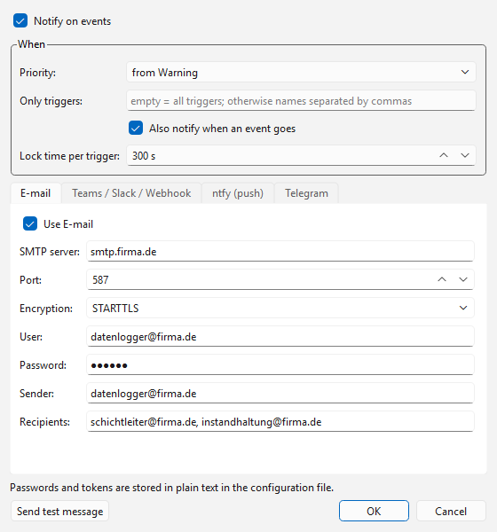

   Notifications: at the top when to notify, below one tab per channel.

**When to notify:**

* **Notify on events** – main switch.
* **Priority** – from *Info*, *Warning* (default) or only *Alarm*.
* **Only triggers** – empty = all; otherwise the names separated by commas.
* **Also notify when an event goes** – an additional message when the condition is no
  longer met (only if the coming was notified).
* **Lock time per trigger** (default 300 s) – if the same trigger comes again within this
  time, no further message is sent; the next message states how many were suppressed.
  Prevents message floods from a fluttering signal.

The message contains priority, trigger, message text, time, project and computer name.

**Channels** (one tab each, can be enabled individually):

* **E-mail:** SMTP server, port (587 with STARTTLS, 465 with SSL/TLS, 25 unencrypted),
  user and password (empty = without login), sender and recipients (several separated by
  commas).
* **Teams / Slack / Webhook:** *Microsoft Teams (Workflows)* – in the Teams channel under
  *Workflows* create the template "Post to a channel when a webhook request is received"
  and enter its address; the message appears as a card, alarms in red. *Slack* – address
  of an *incoming webhook*. *Generic (JSON)* – sends title, text, trigger, priority, type
  (KOMMT/GEHT), time, project and computer as JSON by POST, e.g. to Node-RED, Home
  Assistant or your own system.
* **ntfy (push):** install the app *ntfy* on the phone and subscribe to a topic; enter the
  address with topic here, e.g. ``https://ntfy.sh/plant-4711-xyz``. Alarms arrive with the
  highest urgency. On ``ntfy.sh`` anybody who knows the name of the topic can read along –
  choose a name that is hard to guess or run your own ntfy server (then enter an access
  token if needed).
* **Telegram:** create a bot with *@BotFather* (gives the bot token), send the bot a
  message and enter the chat ID (e.g. via *@userinfobot*).

**Send test message** sends a test via all enabled channels and shows ✓ or the error for
each channel. Sending happens in the background, recording does not wait for it; errors
(server not reachable, wrong login) are shown in the status bar or the log file.
Notifications also work in headless operation – the computer needs access to the mail
server or the internet for this.

.. note::

   Passwords and tokens are stored in plain text in the configuration file. Make the file
   accessible to authorised persons only and use a separate account for e-mail.

.. _notizen:

Notes (own entries)
----------------------------------------------------------------------

Besides the triggers, **notes can be written by hand** to the event log, e.g. “Valve V12
replaced” or “Setpoint changed to 65 °C” – so the same file later tells why a trend
changed.

* In the logger: **File → Note to the event log …** (Ctrl+M). In offline mode the time
  of **ruler 1** is preset – so a point in the trend can be commented afterwards.
* In the event viewer: **Add note …**.

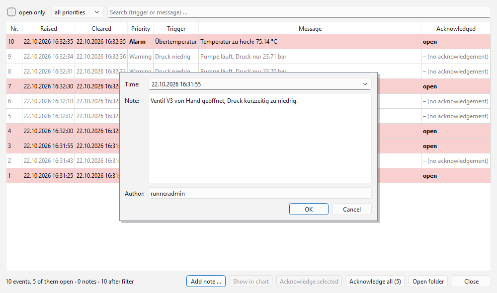

   Time, text and author of a note.

Time (default: now), text (also multi-line) and author (default: Windows or Linux user
name) can be chosen freely. Notes are stored as kind ``NOTIZ`` in the file, appear in
the viewer with a green background and 📝 and need no acknowledgement. The filter
**notes only** shows only them.

.. code-block:: text

   18;2026-10-16 09:12:00.000;NOTIZ;Notiz;Notiz;Valve V12 replaced;mmuster

.. _trigger-aufzeichnung:

Recording by trigger (pre- and post-trigger)
======================================================================

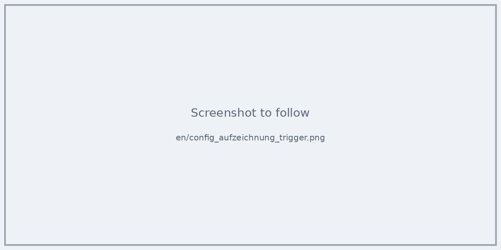

   Tab Recording: recording by trigger with start condition, pre- and post-trigger time.

Instead of recording continuously, the logger can write to the CSV file and database
only when something happens – with the values **before** the event (pre-trigger) and
**after** it (post-trigger). Typical applications: fault analysis, test cycles, batches.

**Settings** (configuration program, tab *Recording*):

* **Recording:** *By trigger with pre- and post-trigger time*.
* **Start condition:** a condition as for triggers, e.g. ``{Druck} > 5``,
  ``{Störung} == 1`` or ``abs(ddt({Kraft})) > 100``; **…** opens the formula editor with
  variable list and check. All variables including the calculated ones can be used.
* **Pre-trigger:** this many seconds before the trigger are saved as well. For this the
  logger keeps the latest measurements in a **ring buffer**.
* **Post-trigger:** saving continues this long after the condition has ended. If the
  condition becomes true again during this time, the capture is extended.
* **max.:** maximum duration of a capture (*unlimited* = 0). After that the capture ends
  even if the condition is still met; the next one only starts after the condition has
  been false once.

**Sequence:** After the start the status bar shows *⏸ waiting for trigger*. When the
condition becomes true, a capture begins (*⏺ Capturing*): a **new CSV file**
(``<CSV name>_<date>_<time>.csv``) with the pre-trigger values and all following values
up to the end of the post-trigger time. Each capture gets its own file; it stays in the
CSV folder. With a database, the same rows are written to the database. Start and end
are logged as event *Aufnahme* (capture; priority *Info*, no acknowledgement required)
in the event log and appear as a green `trigger mark <trigger-marken_>`__ in the chart.

The **display** in the logger (and in the web server) always continues, also between
the captures. If the start condition is faulty (e.g. unknown variable), the logger
reports it and records continuously to be on the safe side.

.. tip::

   Several captures can be joined into one file again with **File › Join CSV files and
   save …** (see `Joining several CSV files <csv-verbinden_>`__).

.. _pid-optimierung:

PID controller tuning
======================================================================

If a chart shows a control loop – **setpoint**, **process value** and **controller
output** – the logger calculates suitable controller parameters (Kp, Ti, Td) from the
recorded data. To do this, it first identifies a model of the process and then applies
proven tuning rules.

Switching on (configuration program)
----------------------------------------------------------------------

Select the chart in the assignment tree and tick **PID controller tuning** under
*Properties of the selection*. In the window **Settings …** you define:

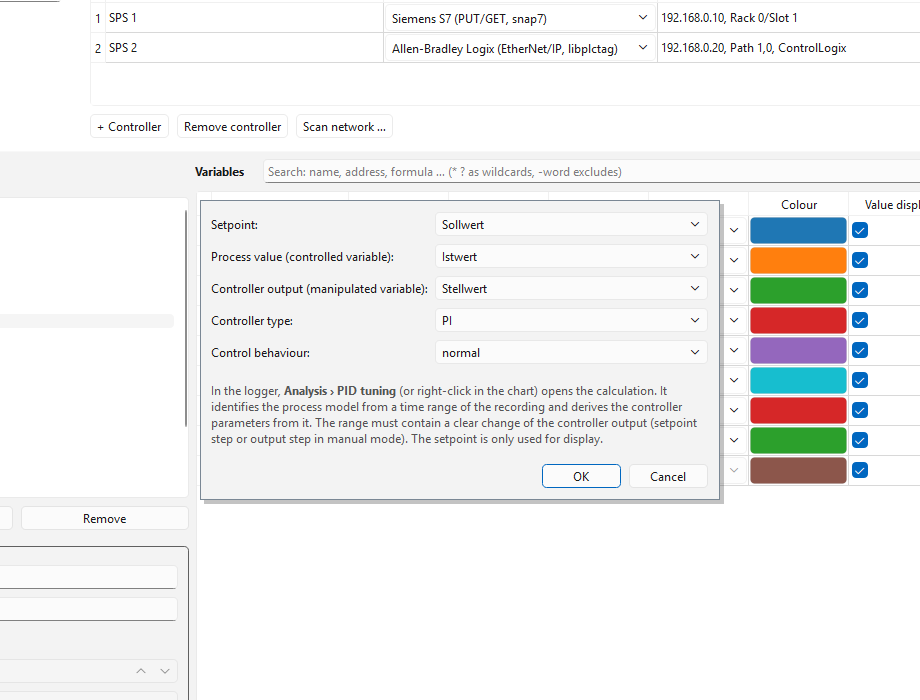

   Assign setpoint, process value and controller output of the chart.

.. list-table::
   :header-rows: 1
   :widths: 25 75

   * - Field
     - Meaning
   * - Setpoint
     - Variable with the setpoint (optional, for display only).
   * - Process value
     - Controlled variable (measured value), e.g. temperature.
   * - Controller output
     - Controller output, e.g. valve position or heating power in %.
   * - Controller type
     - *PI* (usually sufficient, insensitive to measurement noise) or *PID*.
   * - Control behaviour
     - *fast* (aggressive, small margin), *normal* or *robust* (slow, safe even with a
       varying process).

The assignment is suggested from common names (Soll/SP, Ist/PV, Stell/CV/Out …).

Recording data
----------------------------------------------------------------------

The calculation needs a time range in which the **controller output changes
noticeably** and the process value reacts to it:

* **Step of the controller output in manual mode** (best): set the controller to manual,
  let the process settle, step the output by 5 … 20 % and wait until the process value
  is steady again.
* **Setpoint step in automatic mode**: works as well, as long as the controller is not
  too sluggish and the output is not permanently at its limit (0 / 100 %).

The range should begin with a steady process and contain no large disturbances.

Calculating (logger)
----------------------------------------------------------------------

Menu **Analysis → PID tuning: <chart> …** or right-click into the chart → **Tune PID
controller …**.

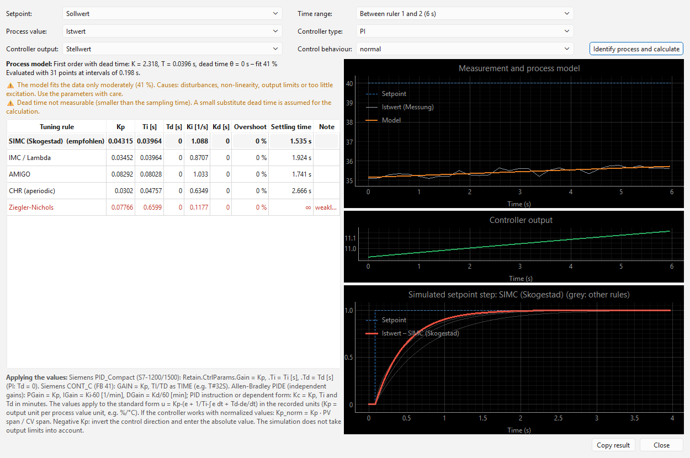

   Left model and parameters, right measurement/model, controller output and simulated
   setpoint step.

1. Choose the **time range**: *Between ruler 1 and 2* (offline mode, place the rulers
   around the step beforehand), *Visible range* or *All data*.
2. Click **Identify process and calculate**. The process model is shown at the top:

   * *first order with dead time* – gain K, time constant T, dead time θ (temperature,
     pressure, flow, speed …);
   * *integrating process with dead time* – integral gain Ki (e.g. level).

   The **fit** states how well the model matches the measurement (100 % = perfect).
   Below about 50 % the parameters are uncertain; notes below name possible causes. In
   the chart on the right the model curve (orange) lies over the measured process value
   (grey).
3. The **table** shows the parameters according to several tuning rules; the first
   (bold) is the recommended one:

   .. list-table::
      :header-rows: 1
      :widths: 28 72

      * - Rule
        - Properties
      * - SIMC (Skogestad)
        - Recommendation: good setpoint tracking and disturbance rejection, little
          overshoot.
      * - IMC / Lambda
        - Smooth, practically without overshoot; spares actuators.
      * - AMIGO
        - Robust (Åström/Hägglund), good disturbance rejection.
      * - CHR (aperiodic)
        - Chien-Hrones-Reswick, setpoint response without overshoot.
      * - Ziegler-Nichols
        - Classic, fast, but poorly damped – for comparison only.

   Columns: **Kp** (gain), **Ti** and **Td** in seconds (standard form
   ``u = Kp·(e + 1/Ti·∫e dt + Td·de/dt)``), plus the parallel form **Ki** = Kp/Ti and
   **Kd** = Kp·Td as well as **overshoot** and **settling time** (2 % band) from the
   simulation.
4. At the bottom right the **simulated setpoint step** with the selected rule is shown
   (red; the others grey). Controller type and control behaviour can be switched in the
   window – the table is recalculated immediately.
5. **Copy result** puts the model and all parameters as text on the clipboard.

Notes
----------------------------------------------------------------------

* Kp applies in the recorded units (output unit per process value unit, e.g. %/°C). If
  the controller in the PLC works with normalized values, convert:
  ``Kp_norm = Kp · process value span / output span``.
* A **negative Kp** means: the process value falls when the output rises (e.g. cooling).
  Reverse the action in the controller and enter the absolute value.
* The simulation does not take output limits into account. Introduce new parameters
  carefully and observe the control loop.
* In **demo mode** the example configuration contains the chart *Regelkreis* with a
  simulated, deliberately sluggish controller (setpoint changes every minute) – after a
  few minutes of recording the tuning can be tried out.
* **Transfer to the controller:** *PIDE* with independent gains: ``PGain`` = Kp,
  ``IGain`` = Ki·60 [1/min], ``DGain`` = Kd/60 [min]. *PIDE* dependent form or *PID*
  instruction: ``Kc`` = Kp, Ti and Td in **minutes** (divide the values from the table by
  60). *PIDE* computes in % of the ranges ``PVEUMax/Min`` and ``CVEUMax/Min`` – convert Kp
  accordingly.

.. _analyse:

Analysis: XY chart and frequency analysis
======================================================================

Both evaluations are available in the logger in the **Analysis** menu and work with the
displayed data – during recording, offline or with a loaded CSV file or database time
range. The **time range** can be chosen: *Between ruler 1 and 2* (offline), *Visible
range* or *All data*. The windows stay open next to the main window; **Refresh** fetches
the data again. **Save image …** saves the chart as PNG, **Save values (CSV) …** the
displayed values.

XY chart
----------------------------------------------------------------------

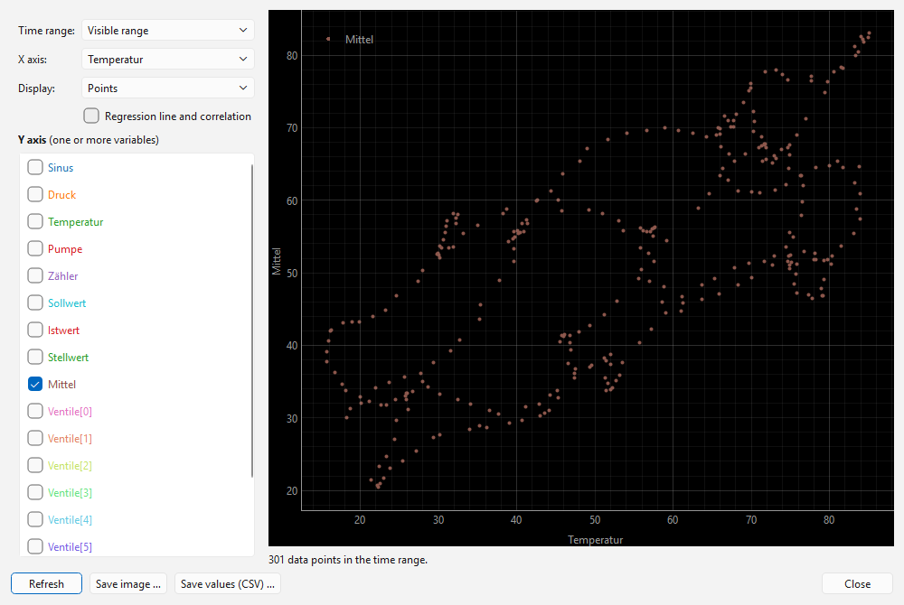

   XY chart with regression line.

One or more variables (Y) against another variable (X) – e.g. pressure over stroke,
force over distance or a characteristic curve. Choose the **X axis**, tick the **Y axis**
variables in the list (colours as in the configuration). Display as *Points*, *Line (in
time order)* or both. **Regression line and correlation** draws the regression line per
Y variable and gives the correlation coefficient *r* and the line equation.

Frequency analysis (FFT)
----------------------------------------------------------------------

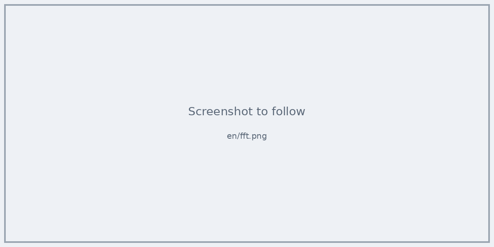

   Amplitude spectrum with the strongest frequencies.

The **amplitude spectrum** of a variable, e.g. to find oscillations, hunting of a
control loop or periodic disturbances. The measurements are first resampled to equal
intervals (usual sampling interval); missing values are bridged.

* **Window:** *Hann* (default), *Hamming*, *Blackman*, *Flat-top* (accurate amplitudes)
  or *Rectangle* (no window).
* **Preprocessing:** subtract the mean or a linear trend (otherwise the DC component
  hides the low frequencies).
* **X axis:** frequency in Hz or period in s (logarithmic); amplitude optionally
  logarithmic.

Below the chart the sampling rate, resolution (= 1 / duration of the time range), highest
frequency that can be shown (half the sampling rate) and the **strongest frequencies**
with period and amplitude (yellow triangles in the chart) are given. A sine of amplitude
*A* appears with about the height *A*.

.. tip::

   For a fine frequency resolution choose a long time range; for high frequencies a short
   interval of the controller (at 100 ms at most 5 Hz are visible).

.. _pdf-berichte:

PDF reports
======================================================================

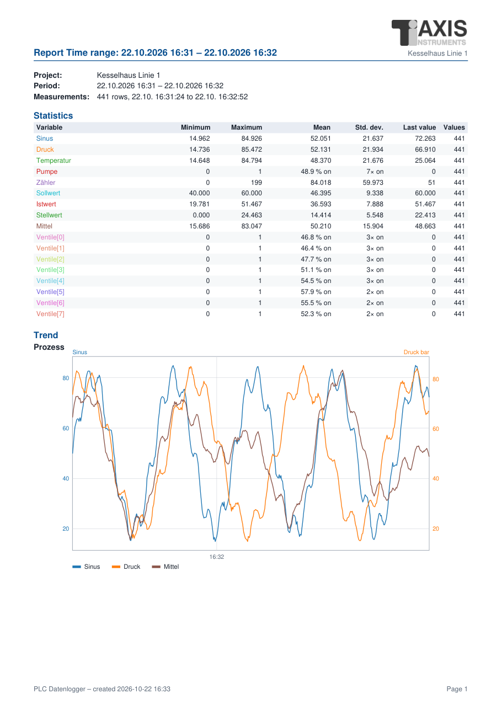

   First page of a PDF report.

A report summarizes a period on a few pages:

* **Header:** project, period, data basis (number of measurement rows, first and last
  measurement); above it the customer logo and logo from the configuration (tab
  *Display*), if entered.
* **Statistics** per variable: minimum, maximum, mean, standard deviation, latest value
  and number of valid values; for BOOL variables the share of time with value 1 (on
  time) and the number of switch-on events.
* **Trend** of every chart of the configuration with its Y axes; BOOL variables as
  traces below the chart (height = share of time with value 1). Peaks are preserved
  (minimum and maximum per time section).
* **Events and notes** of the period from the event log.

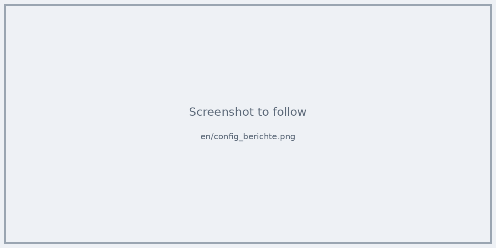

   Tab Reports (PDF) in the configuration program.

**Automatic** (configuration program, tab *Reports (PDF)*): at the end of every **shift**,
**day**, **week** or **month** the logger writes the report to the folder ``berichte``
(name ``<CSV name>_bericht_<period>_<start>.pdf``) – also in headless operation. For this
it collects the statistics and a condensed version of the trend during the recording,
regardless of how many measurements it keeps in memory. When stopping or exiting, a
**partial report** (suffix ``_teil``, title “incomplete”) is created for the period
begun. Shifts start at the configured times; day, week (Monday) and month at the *day
start*.

**Manually:** **Analysis › Create PDF report …** – choose the time range (between the
rulers, visible, all), confirm the file name; the report then opens in the PDF viewer.

The PDF files are created without additional programs (standard font Helvetica, vector
graphics). The texts in the report follow the language of the program.

.. _io-check:

IO check (commissioning)
======================================================================

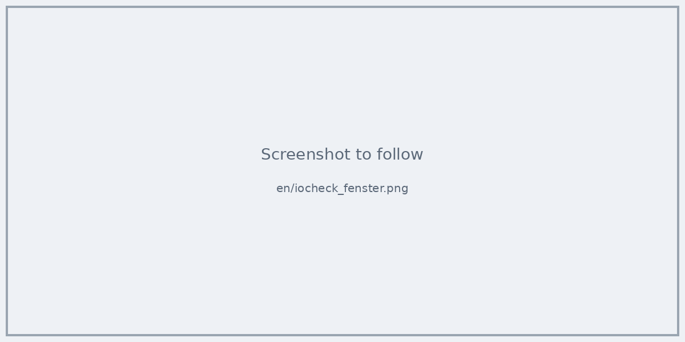

   The IO check window: signal list with live values and status, on the right “What has moved?”.

The IO check helps to test all inputs and outputs of a plant during commissioning:
every signal of the IO list is shown live and checked off; what has just moved is shown
at the top, and swapped signals are noticed immediately. The IO check reads from the
controllers of the configuration itself – no recording needs to be running.

Opening:

* as a program of its own, ``PLCIOCheck.exe`` (start menu *PLC IO-Check*, optionally
  also on the desktop). The start screen lists the recently used test files
  (``*.iocheck.json``) and configurations; a configuration starts a new test file with
  its controllers, **Demo** starts with simulated values;
* in the configuration program **File › Start IO check with this configuration**;
* in the logger **Analysis › IO check …**;
* Linux/AppImage or from the source code: ``--iocheck`` (``plc_logger.py --iocheck``),
  optionally with a configuration or a test file.

**▶ Start reading** (F5) connects to the controllers; with **Demo** the signals are
simulated (to try it out without a controller).

.. note::

   The IO check only reads. Outputs are switched as before with the engineering tool
   (watch/force table) or the program and checked off in the IO check.

Importing the IO list
----------------------------------------------------------------------

**Import IO list …** reads a CSV, Excel or ODS table (LibreOffice), e.g. from EPLAN, the TIA Portal tag
table (export to Excel) or an own list. The columns are recognized by their heading
(case does not matter):

.. list-table::
   :header-rows: 1
   :widths: 25 75

   * - Field
     - Recognized headings (selection)
   * - Address (required)
     - Address, Adresse, Logical Address / Logische Adresse, Operand, Tag name, NodeId
   * - Symbol
     - Symbol, Name, Variable, Signal
   * - Comment
     - Comment, Kommentar, Description, Function
   * - Device tag
     - BMK, Device tag, Betriebsmittelkennzeichen
   * - Group
     - Group, Cabinet, Station, Module, Gruppe, Schrank
   * - Type
     - Type, Kind, Signal type (DI/DO/AI/AO, Input/Output …)
   * - Data type
     - Data Type, Datentyp (Bool, Int, Word, Real …)
   * - Controller
     - Controller, PLC, Steuerung – name of the controller in the configuration;
       empty = first
   * - Measuring range
     - Range / Messbereich (e.g. ``0 … 10 bar``, ``4-20 mA``) or separate *Eng min/max*,
       *Unit*; raw values with *Raw min/max* (default 0 … 27648)

If type and data type are missing, they are derived from the address: ``E0.0``/``%I0.0``
= digital input, ``A4.0``/``%Q4.0`` = digital output, ``EW256``/``%IW256``/``PEW256`` =
analog input, ``AW``/``%QW`` = analog output. For the driver ``s7`` ``%`` and ``P`` are
removed, for ``ads`` the TwinCAT notation (``%IX0.1``) and for ``tia`` the symbol name
(``IArea.<Name>``) is used. Rows without address (intermediate headings) and duplicate
addresses are skipped. On a second import the list can be replaced or extended. The
message after the import names the recognized columns.

**Own column headings:** **Columns …** lists per field the headings it is looked for in
the list (several separated by commas; case, spaces and special characters do not
matter). If a column is called e.g. “I/O” or “Plain text” in your own lists, enter it
here once. **An empty field switches the column off:** it is neither imported nor shown
in the signal list (e.g. device tag or controller if they do not exist). The address is
required. **Default** restores the built-in names. The setting applies to all test
files of this user.

Signal list and test status
----------------------------------------------------------------------

The table shows per signal the status, live value (digital: LED and 0/1; analog: value
in engineering units and raw value), address, symbol, comment, device tag, group, type,
check time, checker and remark. A change flashes yellow briefly. Above the table:
search field, filters for group, type and status and the progress (“312 of 480 checked –
305 OK, 4 faults, 3 skipped”).

* **✓ OK** (Ctrl+1), **✗ Fault …** (Ctrl+2, asks for a remark), **– Skipped**
  (Ctrl+3), **Reset** (Ctrl+0) – for the selected rows. Time and checker (Windows or
  Linux user) are entered.
* The **remark** can be edited directly in the table by double-click.
* **Check off signals automatically** (optional, off): a signal with status *open*
  becomes OK as soon as a digital signal has changed 0→1→0 (sensor actuated and
  released) or an analog input has passed the wire break test (see below). Only signals in the IO list or a scan range are checked off; the list
  therefore determines which signals are to be tested.

What has moved? (swapped signals)
----------------------------------------------------------------------

On the right the latest changes are listed, the newest in large print at the top (time,
signal, e.g. ``0 → 1`` or ``4.98 → 7.51 bar``). This way a signal can be found without
knowing its address: trigger it in the field and read which one arrived. Double-click on
an entry selects the signal.

The **selected signal** in the list or matrix is regarded as *expected*. If another
digital input changes instead (and the expected one does not), a red warning “Swapped?
Expected B12, got B13” appears with a beep; the entry is marked red.

The button **What has moved?** in the toolbar hides and shows the side panel (more room
for the signal list; the choice is remembered). The swap warning then appears in the
status bar.

Checking analog values
----------------------------------------------------------------------

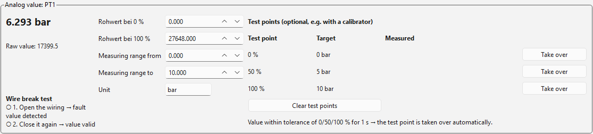

   Analog value with wire break test and optional test points.

If an analog signal is selected, the **Analog value** box shows the scaled value, the
raw value and fault values. The measuring range (raw value at 0 and 100 %, engineering
range, unit) can be adjusted there.

* **Wire break test** (analog inputs, the usual way): open the wiring of the signal
  (loosen the terminal) – the module reports a fault value, step 1 is checked – and close
  it again – the value is valid again, step 2 is checked. Then confirm the signal with
  **✓ OK** or automatically with *Check off signals automatically*. If a different
  analog input than the selected one is interrupted, the swap warning appears. An
  interruption is a fault value (Siemens: above 32511, e.g. 32767; below −4864 with
  4 … 20 mA, e.g. at 0 mA; −32768) or, with other raw ranges, a value more than 17.6 %
  outside. With 0 … 10 V and 0 … 20 mA an interruption cannot be distinguished from the
  value 0 – then check off by hand or use the test points.
* **Test points 0/50/100 %** (optional, e.g. with a calibrator): if the value stays within the **tolerance** (toolbar,
  default 1 % of the measuring range) of a test point for 1 s, it is taken over – e.g.
  feed 4, 12 and 20 mA with a calibrator. **Take over** takes the current value by hand.
  When all three points are within tolerance, the signal becomes OK.
* **Fault values** (Siemens raw values): 32767 = overflow or wire break, −32768 =
  underflow, 27649 … 32511 = overrange, below −4864 = underflow (wire break with
  4 … 20 mA). With other raw ranges: value outside the measuring range.

.. _io-matrix:

Matrix and scanning ranges
----------------------------------------------------------------------

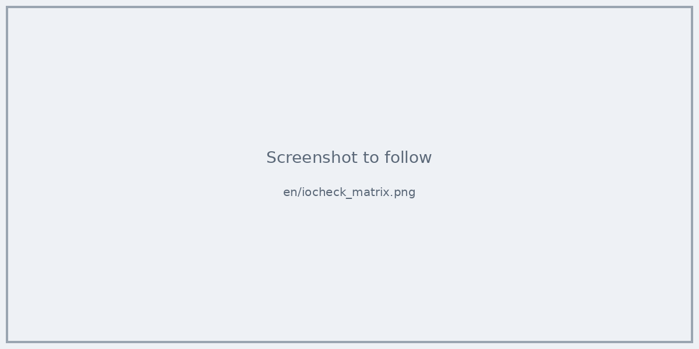

   Matrix: inputs/outputs as LEDs, checked ones green with tick.

The **Matrix** tab shows all binary signals as **LEDs**: Siemens bit addresses by byte
(row) and bit (column 0 … 7), separated into inputs, outputs and memory; other addresses
in sequence.

* LED green = input 1, orange = output 1, grey = 0, red = not readable.
* Background green with ✓ = checked, red with ✗ = fault, grey with – = skipped. A blue
  dot means: 0→1 seen, but not yet 1→0 again. A yellow frame marks a change that has
  just happened, a blue frame the selected signal.
* Click selects the signal (also in the list), double-click switches OK on/off,
  right-click opens the status selection; the tooltip shows symbol, comment, device tag
  and status.

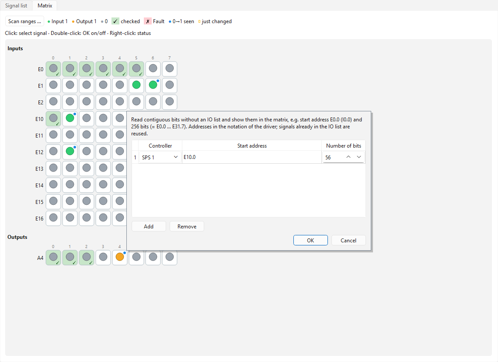

   Scanning ranges without an IO list.

**Scan ranges …** reads contiguous bits also without an IO list, e.g. start address
``E0.0`` (I0.0) and 256 bits (= E0.0 … E31.7) or ``A0.0`` (Q0.0) and 64 bits – useful
if there is no list yet. Addresses in the notation of the driver of the selected
controller; signals that are in the IO list keep their symbol and status. For ``s7``
neighbouring addresses are read with one request per range.

Saving and result
----------------------------------------------------------------------

**Save** stores the test progress as ``*.iocheck.json`` (signals, status, remarks, test
points, scan ranges, options). After the first save, every change is saved immediately –
you can stop at any time and continue the next day with **Open …**. **Export result …**
writes the list with status, check time, checker, remark and test points as Excel or CSV
file.

.. _io-mobil:

Checking on a smartphone or tablet
----------------------------------------------------------------------

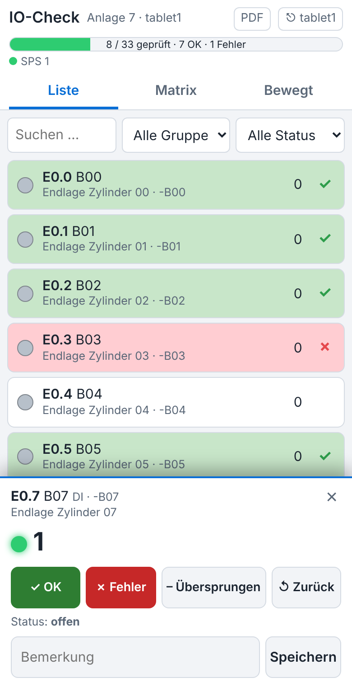

   IO check on a smartphone: signal selected, status buttons at the bottom.

The technician at the machine sees live what arrives and checks off right there; several
devices can test at the same time. **📱 Mobile …** in the toolbar shows the address (e.g.
``https://192.168.0.20:8080/io``) with a **QR code** for scanning and copies it to the
clipboard. If the web server is
already running in the logger, it is used (link *IO-Check* at the top of the chart page);
otherwise the IO check starts its own one with the settings of the configuration (tab
*Web server & headless*: port, HTTPS, users, access code; if the port is in use, the next
free one).

* Tabs **List** (search, filter by group and status), **Matrix** (LEDs as on the PC) and
  **Moved** (latest changes). Tapping selects a signal; at the bottom the value,
  **✓ OK**, **✗ Fault** (with remark), **Skipped**, **Back**, the remark field and for
  analog inputs the wire break test and the test points appear (automatic take-over as on the PC while the
  signal is selected on the device).

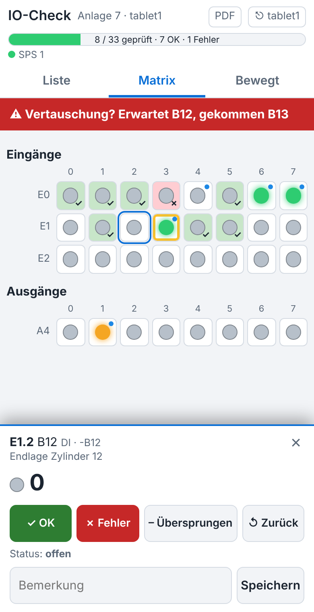

   Matrix and swap warning on the smartphone.

* The selected signal is *expected* on this device: if another digital input changes,
  the warning “Swapped?” appears and the device vibrates.
* The **checker** is the **login name** in the web server (create users in the
  configuration program, see `HTTPS and login <https-anmeldung_>`__); it appears in the
  list, the result and the protocol. Without login “Web (Zugriffscode)” or “Web (IP
  address)” is entered – then anybody in the network can change the status, so create
  users.
* **PDF** at the top right opens the acceptance protocol on the device.
* The IO check window on the PC takes over and saves the changes; it must stay open for
  this.

.. _io-protokoll:

Acceptance protocol (PDF)
----------------------------------------------------------------------

   First page of an acceptance protocol.

**Protocol (PDF) …** creates the acceptance protocol and opens it:

* Header: project, test progress file, controllers, test period and result (checked in
  %, OK, faults, skipped, open); above it the customer logo and logo of the configuration.
* **Summary** per signal type and per group, **checkers** with the number of checked
  signals (PC user or login name in the web server).
* **Faults and open signals** – the remaining items.
* **All signals** per group with address, symbol, comment, device tag, type, status,
  check time, checker and remark or test points of the analog values.
* **Confirmation:** signature fields for the checker and the acceptance (customer).

From scan ranges only edited signals appear. The protocol is created without additional
programs (like the PDF reports); characters outside the Western European character set
appear as “?”. The texts in the protocol follow the language of the program.

.. _sprache:

Switching and translating the language
======================================================================

The user interface is written in German and can be translated into other languages via
**language files**. **German** and **English** are supplied.

Switching
----------------------------------------------------------------------

   Menu Language.

Menu **Language** (in the logger and in the configuration program): choose the language
and confirm the restart question. The choice applies to both programs and the event
viewer and is stored in the file ``plc_einstellungen.json`` in the data folder. The
standard texts of Qt (Yes/No/Cancel, file dialogs) also follow the chosen language, and
**Help › User manual** (F1) opens the manual in the chosen language (English manual for
all languages except German).

Data is not translated: names of variables, charts and triggers, the columns of the CSV
files and of the event log (``KOMMT``, ``GEHT`` …), the keys of the configuration file,
the web page of the web server and (partly) the log file of headless operation.

Creating your own translation
----------------------------------------------------------------------

1. Menu **Language → Open folder with language files …**. The folder ``sprachen`` in the
   data folder opens; the template ``de.txt`` is copied into it.
2. Copy ``de.txt`` and name it after the **language code**, e.g. ``fr.txt`` (French),
   ``it.txt``, ``es.txt``, ``nl.txt``, ``pl.txt``, ``cs.txt``.
3. Open the file with a text editor (UTF-8), enter the name after ``# Sprache:`` at the
   top (e.g. ``Français``) and write the translation after each ``>``:

   .. code-block:: text

      # Sprache: Français

      @ Konfiguration laden
      > Charger la configuration

      @ {0} offene Ereignisse quittieren?
      > Acquitter {0} événements ouverts ?

4. Save – the language appears immediately in the **Language** menu (active after a
   restart).

Rules:

* ``@`` = German original text (do not change), ``>`` = translation. Translations left
  empty show the German text – so you can translate step by step.
* ``\n`` stands for a line break.
* **Placeholders** such as ``{0}``, ``{1}`` or ``{2:.1f}`` must be kept (the order in the
  sentence is free). If one is missing, the original is used for this text.
* ``&`` in front of a letter marks the menu shortcut (Alt + letter); ``&&`` gives a single
  ``&``.
* Leave HTML markup such as ``<b>…</b>`` or ``<code>…</code>`` unchanged.
* The English file ``en.txt`` can serve as an example.

The program first looks in the folder ``sprachen`` of the data folder (own files, kept
during updates), then in the program folder (supplied files). An own ``en.txt`` in the
data folder therefore replaces the supplied one.

For developers: texts in the program are written as ``tr("…")`` or
``tr("… {0} …").format(value)`` (module ``plc_i18n.py``). After program changes
``python tools/extract_tr.py plc .`` brings all language files up to date (new texts
with empty translation, existing translations are kept).

CSV files
======================================================================

File name and location
----------------------------------------------------------------------

For each recording a new file is created in the CSV folder:
``<CSV name>_YYYYMMDD_HHMMSS.csv``, e.g. ``log_20261012_080000.csv`` (in demo mode
``demo_...``).

.. _csv-archiv:

Limiting the file size and archiving
----------------------------------------------------------------------

In the configuration the number of records per CSV file can be limited (*Max. records
per file*, ``0`` = unlimited). When the number is reached, the following happens
automatically:

#. The file is closed and zipped.
#. The ZIP is stored in the following folder structure:

   .. code-block:: text

      <archive folder>/<CSV name>/<year>/<month>/<day>/<file name>.zip

   Example: ``archiv/log/2026/10/12/log_20261012_080000.zip``
#. The original CSV file is only deleted after the archive has been checked
   successfully.
#. The recording continues without interruption in a new CSV file.

Notes:

* **Year, month and day** are taken from the date of the *first record* of the file. The
  folder name ``<CSV name>`` is the name set in the configuration (in demo mode
  ``demo``).
* Zipping runs in the background and does not slow down the recording. The result
  appears in the status line. If archiving fails, the CSV file stays in the CSV folder.
* If the recording is ended with **■ Stop**, the current file stays unzipped in the CSV
  folder. Only full files are archived.
* Archived files can be opened directly as ZIP with **Load CSV**.
* The display in the logger works independently of the files; when a file is loaded,
  only its content is shown.

Rule of thumb for the file size: records per file = duration ÷ sampling interval. At an
interval of 200 ms there are 5 records per second, i.e. 432,000 per day; a limit of
100,000 records then corresponds to about 5.5 hours per file.

.. _aufraeumen:

Cleaning up old recordings
----------------------------------------------------------------------

So that the disk or the database does not fill up, the logger can delete old recordings
itself – by **period** (*Delete after … days*) and/or by **storage space** (*Use at
most … MB*). Both limits are switched off by default (*never* or *unlimited*).

* **CSV and archive** (tab *Recording*): only the files of this logger are affected –
  ``<CSV name>_*.csv`` in the CSV folder and the ZIP files under
  ``<archive folder>/<CSV name>/``. The decisive time is the last change of a file
  (= end of the recording in it). The CSV file currently being written is never
  deleted; archive folders that became empty are removed.
* **Database** (tab *Database*): values older than *n days* are deleted – row by row (in
  portions) for SQLite and MariaDB, whole chunks for TimescaleDB (``drop_chunks``),
  whole daily partitions for QuestDB. The storage limit exists for SQLite only: if the
  values take up more than *n MB*, the oldest day is deleted at a time. The file does not
  get smaller, the freed space is reused for new values (to shrink it: ``VACUUM`` with a
  SQLite tool). InfluxDB 3, VictoriaMetrics and Prometheus manage the retention period
  themselves (setting on the server).

The check runs when recording starts and then every hour, also in headless operation.
What was deleted is shown in the status bar or the log (“[Clean-up] …”).

.. warning::

   Deleted recordings cannot be restored. Choose the limits so that the data is kept as
   long as it is needed (e.g. retention obligations).

Format
----------------------------------------------------------------------

* Separator: semicolon (``;``), decimal separator: point
* Character set: UTF-8
* First row: column headers

.. list-table::
   :header-rows: 1
   :widths: 20 80

   * - Column
     - Content
   * - ``Zeit``
     - Timestamp with milliseconds, e.g. ``2026-10-11 10:59:30.927``
   * - ``Epoch``
     - Unix time in seconds with three decimals (milliseconds), e.g.
       ``1791716370.927``
   * - Variables
     - One column per variable, named after the variable. An empty field means: no
       valid value.

Example:

.. code-block:: text

   Zeit;Epoch;Temperatur;Pumpe
   2026-10-11 10:59:30.927;1791716370.927;51.234;1
   2026-10-11 10:59:31.127;1791716371.127;51.301;1

.. note::

   When the file is opened in Excel, Excel shows milliseconds only if the column is
   formatted accordingly (custom number format ``yyyy-mm-dd hh:mm:ss.000``). The values
   in the file itself always contain the milliseconds.

Loading a CSV file
----------------------------------------------------------------------

**Load CSV** opens one or more CSV or ZIP files (for ZIP archives the first CSV in the
archive) and shows them in offline mode; several files are joined by time (see below). A
running recording is stopped. The column ``Epoch`` is used for the display. Variables
whose name exists in the current configuration take over colour and assignment to chart
and Y axis; unknown variables appear on the first Y axis of the first chart.

.. _csv-verbinden:

Joining several CSV files
----------------------------------------------------------------------

**File › Join CSV files and save …** chooses several recordings (CSV or archived ZIP
files, also from different archive folders) and joins them into one; the result is saved
as a **new CSV file** (suggestion: ``<CSV name>_<start>-<end>.csv``) and shown offline.
The chosen files stay unchanged.

* The order of the selection does not matter: all rows are sorted by time.
* Columns are matched by variable name. If a variable is missing in a file (e.g. added
  later), it stays empty there.
* Duplicate times (overlapping files) are taken over only once.
* At gaps between the files (e.g. between two captures by trigger) an empty row is
  inserted so that the curves are interrupted there.

If you only want to view the files, simply choose them together in **Load CSV** – then
without saving.

Exporting values (CSV/Excel)
----------------------------------------------------------------------

   Dialog “Export values”.

**File › Export values (CSV/Excel) …** (``Ctrl+Shift+E``) saves measurements as CSV or
Excel file (``.xlsx``). The basis is the whole recording in memory or the loaded CSV
file or database time range.

* **Time range:** *Between ruler 1 and ruler 2* (offline only; the same data points as
  the statistics of the value table), *Visible section* or *All data*.
* **Only visible variables:** hidden curves are left out.
* **Downsampling:** reduces the values to a fixed time grid (e.g. 1 s or 60 s), e.g. to
  make long recordings smaller for Excel or a report. Method per interval: *Mean*,
  *Minimum*, *Maximum*, *First value* or *Last value*. The timestamp of a row is the
  start of its interval; intervals without data points are omitted. BOOL variables stay
  0/1 (with the mean, 1 applies if the signal was on in the interval). The dialog shows
  how many rows will be created at most.

The format follows the file extension or the chosen file type:

* **CSV:** same structure as the recording (``Zeit;Epoch;variables …``, semicolon,
  decimal point) – the file can be opened again with **Load CSV**.
* **Excel:** column A date and time (with milliseconds), column B ``Epoch``, then one
  column per variable; missing values stay empty. A worksheet holds at most 1,048,575
  rows – use downsampling or save as CSV for more data points.

.. _treiber-entwickeln:

Developing drivers
======================================================================

A driver is **one Python file**. It is loaded automatically at program start; the
program itself needs neither to be changed nor rebuilt – the installed ``.exe`` or the
AppImage also loads own drivers.

Where drivers are searched
----------------------------------------------------------------------

.. list-table::
   :header-rows: 1
   :widths: 40 60

   * - Location
     - Note
   * - Folder ``treiber`` in the **data folder**
     - Recommended. Windows installed: ``%APPDATA%\PLCDatenlogger\treiber``, Linux:
       ``~/PLCDatenlogger/treiber``, portable or Python sources: folder ``treiber`` next
       to the program files. Kept during updates. Open it with **Driver › Open folder
       for own drivers …**.
   * - Folders in the environment variable ``PLC_TREIBER``
     - Separate several folders with ``;`` (Windows) or ``:`` (Linux) – e.g. for a
       shared network folder.
   * - Package ``plc_treiber`` (Python sources only)
     - File directly next to ``s7.py`` etc.; file name **without** underscore (names
       with ``_`` are treated as helper modules there, e.g. ``s7_browser.py``).

Files whose name starts with ``_`` (e.g. ``_vorlage.py``) are **not** loaded. Helper
modules of a driver can be placed next to it in the same folder (the folder is added to
the search path). If a driver cannot be loaded (syntax error, missing library on import,
duplicate ID), all others continue to work; the error message is shown under **Driver ›
Installed drivers …**.

Your own driver in five steps
----------------------------------------------------------------------

#. **Driver › Open folder for own drivers …** – the folder then contains the template
   ``_vorlage.py``.
#. Copy the template, e.g. to ``my_plc.py`` (without ``_`` at the beginning). Unchanged,
   it is already a working driver “Simulation” that supplies sine, ramp, square and
   random values (addresses ``sinus:20``, ``rampe:10``, ``rechteck:4``, ``zufall:50``).
#. Adapt the ID ``id`` (unique, stored in the configuration file), ``name``, ``params``
   and ``types``.
#. Fill ``connect()``, ``read()`` and ``close()`` in the reader class with the protocol
   of the controller.
#. Restart the configuration program – the driver appears in the *Driver* selection of
   the controller table.

Minimal driver
----------------------------------------------------------------------

.. code-block:: python

   from plc_treiber.base import NAN, Driver, Param, Reader

   class MyReader(Reader):
       def connect(self):
           # Establish the connection; report errors as exception (e.g. ConnectionError)
           self.sock = connect_to(self.plc.params["ip"], self.plc.params["port"])
           return len(self.vars)                 # number of readable variables

       def read(self):
           # ONE measurement cycle: values in the order of self.vars, float, NaN = no value
           out = []
           for v in self.vars:
               try:
                   out.append(float(read_value(self.sock, v.address, v.dtype)))
                   self.errors.pop(v.address, None)
               except KeyError as e:             # only this variable is missing
                   self.errors[v.address] = str(e)
                   out.append(NAN)
           return out

       def close(self):
           self.sock.close()

   class MyDriver(Driver):
       id = "mine"
       name = "My controller"
       description = "Short description for the settings dialog"
       params = [
           Param("ip", "IP address", "text", "192.168.0.10"),
           Param("port", "Port", "int", 5000, minimum=1, maximum=65535),
       ]
       types = ["BOOL", "INT", "DINT", "REAL"]
       address_hint = "e.g. R100"

       def create_reader(self, plc, variables):
           return MyReader(self, plc, variables)

   DRIVER = MyDriver()

Interface
----------------------------------------------------------------------

All details are in ``src/plc_treiber/base.py``. The most important parts:

.. list-table:: Class ``Driver`` – attributes
   :header-rows: 1
   :widths: 30 70

   * - Attribute
     - Meaning
   * - ``id``
     - Unique ID (lower case), stored as ``"treiber": "…"`` in the configuration file.
       Do not change it once in use.
   * - ``name``, ``description``
     - Display name (selection list) and description (settings dialog).
   * - ``params``
     - List of ``Param`` – the settings dialog is built from it; the values are stored
       in the configuration file and are available in the reader as
       ``self.plc.params``.
   * - ``types``, ``block_types``, ``default_type``
     - Readable data types (choice from ``BOOL, BYTE, WORD, DWORD, LWORD, SINT, INT,
       DINT, LINT, USINT, UINT, UDINT, ULINT, REAL, LREAL, TIME, LTIME, S5TIME, CHAR,
       WCHAR``), formats for blocks (``None`` = as ``types``), default.
   * - ``address_label``, ``address_hint``, ``block_hint``
     - Label and tooltip texts for addresses and blocks.
   * - ``block_uses_index``
     - ``True``: block = array name + first index (elements ``Name[i]``); ``False``:
       block = start address (element address via ``block_element_address``).
   * - ``browse_label``
     - Text of the browse button; empty = no browse dialog.
   * - ``library``
     - Name of the required library (for display).

.. list-table:: Class ``Driver`` – methods (all optional except ``create_reader``)
   :header-rows: 1
   :widths: 35 65

   * - Method
     - Task
   * - ``create_reader(plc, variables)``
     - Returns the ``Reader`` for a controller.
   * - ``summary(plc)``
     - Short text of the connection for table, LEDs and messages.
   * - ``check_params(params)``
     - Error text for invalid parameters or ``""``.
   * - ``check_address(address, dtype)``
     - Formal check of an address when saving; error text or ``""``.
   * - ``normalize_address(address, dtype)``
     - Uniform notation (e.g. upper case).
   * - ``block_element_address(block, i)``
     - Address of the i-th block element (``block.address``, ``block.start``,
       ``block.dtype``).
   * - ``check_block(block)``, ``type_size(dtype)``
     - Check of a block; size of a type in bytes (for display).
   * - ``check_library()``
     - Checks the library (``import …``); exception with a hint if it is missing.
       Import libraries only here or in ``connect()`` if possible, so that the driver is
       also loaded without them.
   * - ``read_once(plc, variables)``
     - Connection test; default: ``connect`` + ``read`` + ``close``.
   * - ``browse(parent, ctx)``
     - Browse dialog (Qt). ``ctx``: ``BrowseContext`` with ``plc``, ``existing``
       (existing addresses), ``target_labels``, ``default_target`` and ``store``
       (driver-specific values stored in the configuration). Return value:
       ``BrowseResult`` with ``variables`` = ``[(name, address, type)]``, ``blocks`` =
       ``[(name, address, first index, count, type)]``, ``target_index`` and changed
       ``store`` – or ``None`` on cancel.

.. list-table:: Class ``Reader``
   :header-rows: 1
   :widths: 30 70

   * - Part
     - Meaning
   * - ``self.plc``, ``self.vars``, ``self.driver``
     - Controller (``plc.params``, ``plc.name``), variables to read (each with
       ``address``, ``dtype``, ``name``, ``block``, ``block_idx``), driver.
   * - ``connect()``
     - Establish and check the connection; return value: number of readable variables.
   * - ``read()``
     - One measurement cycle; list of ``float`` in the order of ``self.vars``, ``NAN``
       for values that cannot be read. Use as few requests as possible (read variables
       with the same ``block`` together).
   * - ``close()``
     - Close the connection (may be called several times).
   * - ``self.errors``
     - ``{address: error text}`` of single variables that cannot be read; shown in the
       status line and test value. The other variables continue to be read.

Rules:

* Report **connection errors** (controller not reachable, socket closed) as exception
  from ``connect()``/``read()``. The reading thread shows the LED red, closes the reader
  and reconnects after a short wait.
* **Errors of single variables**, on the other hand, are entered in ``self.errors`` and
  return ``NAN`` – no exception.
* Each reader runs in **its own thread**; it does not need to be thread-safe, but must
  not share global objects with other readers without synchronization.
* ``read()`` should take clearly less time than the interval of the controller.
* Texts for the user interface can be made translatable with ``from plc_i18n import tr``
  (``tools/extract_tr.py`` includes drivers in the package).

For complete examples have a look at ``src/plc_treiber/modbus.py`` (own protocol via
sockets, combining requests, own address notation), ``src/plc_treiber/fins.py`` (own
protocol via UDP/TCP) and ``src/plc_treiber/s7.py`` (library, blocks, browse dialog).

Testing without user interface
----------------------------------------------------------------------

.. code-block:: python

   import sys; sys.path.insert(0, r"C:\path\to\plc_datenlogger")
   from plc_common import Plc, Variable
   from plc_treiber import get_driver, load_errors

   print(load_errors())                                  # load errors?
   d = get_driver("mine")
   plc = Plc(name="Test", driver="mine", params=d.default_params())
   values, errors = d.read_once(plc, [Variable("A", address="R100", dtype="INT")])
   print(values, errors)

Including a driver in the ``.exe``
----------------------------------------------------------------------

Own drivers in the folder ``treiber`` need no rebuild. If a driver is to be built in
permanently, put the file into ``plc_treiber/``, enter its ID in ``BUILTIN`` in
``src/plc_treiber/__init__.py`` (optional, only sets the order) and add required
libraries to ``requirements.txt`` and – if PyInstaller does not find them – as
``--collect-all`` in ``build.bat`` or ``build_appimage.sh``. ``build.bat`` includes all
modules of ``plc_treiber`` automatically (``--collect-submodules plc_treiber``).

.. _installer:

Creating the setup file (Windows)
======================================================================

Three standalone programs (``PLCLogger.exe``, ``PLCKonfiguration.exe`` and
``PLCIOCheck.exe``) and a setup file can be created from the Python files. The following files are used:

.. list-table::
   :header-rows: 1
   :widths: 30 70

   * - File
     - Task
   * - ``build.bat``
     - Builds both programs with **PyInstaller** into *one* common folder
       (``dist\PLCDatenlogger``) and then the installer with **Inno Setup**.
   * - ``installer.iss``
     - Inno Setup script (program folder, start menu, optional desktop icons,
       uninstallation, manual).
   * - ``tools/make_icon.py``
     - Creates missing icon files (``app.ico`` from the standard icon, ``app.png`` for
       the AppImage from ``app.ico``); existing ones stay unchanged.
   * - ``requirements.txt``
     - Required Python packages (incl. PyInstaller and docutils for the build).

**Requirements:** Python 3.9 or newer (64 bit), internet access on the first run (pip)
and, for the installer, **Inno Setup 7 or 6** (``https://jrsoftware.org/isinfo.php``).

**Procedure:**

#. The folder structure of the project is kept (program files in ``src``, manual in
   ``doc``, build files in the project folder; see overview).
#. Start ``build.bat`` in the project folder (double-click or command prompt).

   .. code-block:: console

      build.bat              everything: environment, programs, installer
      build.bat exe          only the programs (dist\PLCDatenlogger)
      build.bat installer    only the installer (requires an existing dist\)

#. Result: ``dist\PLCDatenlogger`` (runs without installation) and
   ``installer\PLCDatenlogger_Setup_<version>.exe``.

The script creates a virtual environment ``.venv``, installs the packages, creates the
icon if needed and builds both programs. The German manual (``bedienungsanleitung.html``)
and the English one (``user_manual.html``) are generated as well. The version number is
set at the top of ``build.bat`` under ``VERSION``. Icon and logo are the files
``app.ico`` and ``logo.png`` in the project folder; simply replace them to change them
(icon preferably with 256×256 pixels for a sharp symbol in Explorer and taskbar).

**Data location:** The installed programs do **not** write the configuration
(``plc_config.json``), CSV files and archive to the program folder (which is usually
write-protected), but to ``%APPDATA%\\PLCDatenlogger``. The data is kept when
uninstalling and during updates. If everything is to be stored next to the programs
(portable operation on a USB stick), put an empty file ``portable.txt`` next to the
``.exe`` files.

**Notes:**

* The ``.exe`` files contain Python and all libraries (``plctag.dll`` and the libraries
  of all built-in drivers – python-snap7, s7commplus, pycomm3, cryptography – are
  included; if ``plctag.dll`` is missing next to ``build.bat``, the script downloads it
  once from the GitHub release of libplctag); nothing has to be installed on the target
  computer.
* The logger starts the configuration via **Config editor** in the toolbar
  (``PLCKonfiguration.exe`` in the same folder); ``PLCIOCheck.exe`` is the IO check as a
  program of its own (start menu *PLC IO-Check*).
* If the build fails, the cause is in the messages of the window (frequently: no internet
  for pip, Python not in PATH, virus scanner locks ``dist``). With ``build.bat exe`` the
  steps can be repeated separately.

Portable version (without installation)
----------------------------------------------------------------------

Instead of the installer, a ZIP package can be created that is only unpacked – e.g. onto
a USB stick or into any folder:

.. code-block:: console

   build.bat portable

Result: ``dist\PLCDatenlogger_portable_<version>.zip`` (``build.bat`` without parameter
creates the ZIP in addition to the installer). Usage:

#. Unpack the ZIP (right-click › *Extract all*).
#. Start ``PLCKonfiguration.exe`` or ``PLCLogger.exe`` in the unpacked folder. Neither an
   installation nor administrator rights are required.

The package contains the file ``portable.txt``. It switches on portable operation:
configuration, CSV files, archive and log file are then stored **in the unpacked
folder** instead of under ``%APPDATA%``. The folder must therefore be writable (so do
not unpack it under ``C:\Program Files``). To remove the program, simply delete the
folder. For an update, unpack the new program files over the old folder; configuration
and recordings are kept.

.. note::

   On the first start of a downloaded ``.exe`` Windows SmartScreen may warn (*More info ›
   Run anyway*), because the programs are not signed. Via *Properties › Unblock* of the
   ZIP file this can be lifted for all files before unpacking.

Building on GitHub (without a Windows PC of your own)
----------------------------------------------------------------------

If the project is in a GitHub repository, the workflow ``.github/workflows/windows.yml``
builds the **portable ZIP** and the **installer** on a Windows machine of GitHub:

* **Manually:** *Actions › Windows › Run workflow*. The files are then in the summary of
  the run under *Artifacts* (``windows-portable`` and ``windows-setup``).
* **With a tag** ``v*`` (e.g. ``v3.0.0``): additionally as files of a GitHub release,
  together with the AppImages. The text of the release comes from ``CHANGELOG.md``.

The build uses ``build.bat`` as on your own PC. Images of the manual (folder
``doc/images``) are included if they are in the repository.

**Version number:** It is defined in exactly one place, ``APP_VERSION`` in
``src/plc_common.py``; ``build.bat``, ``build_appimage.sh``, the installer, the PDF manual
and the *About* dialog read it from there. The number follows the scheme
``MAJOR.MINOR.PATCH`` (incompatible change / new features / bug fixes); the changes are
listed in ``CHANGELOG.md`` (German). New version and release:

.. code-block:: console

   python tools/bump_version.py minor --tag    # e.g. 3.0.0 -> 3.1.0: number, CHANGELOG, commit, tag
   git push && git push origin v3.1.0          # push the tag: GitHub builds installer, ZIP and AppImages

If the tag does not match ``APP_VERSION``, the workflow stops.

**Automatic tests:** the workflow ``.github/workflows/tests.yml`` runs on every push on
Linux and Windows: program logic, web server, notifications, OPC UA server, language
files and manual as well as the user interface with real PySide6 (without a screen).
Failures appear as annotations on the run. Locally:

.. code-block:: console

   pip install pytest
   python -m pytest tests

**Manual as PDF:** This manual can be created as PDF with Sphinx – without LaTeX, via
rinohtype:

.. code-block:: console

   pip install -r doc/requirements.txt
   python tools/build_doc.py              # -> dist\PLC_Datenlogger_Bedienungsanleitung_<version>.pdf
   python tools/build_doc.py --lang en    # -> dist\PLC_Datenlogger_User_Manual_<version>.pdf
   python tools/build_doc.py --html       # additionally HTML preview in build\doc\html

The settings are in ``doc/conf.py``, the layout in ``doc/pdf.rtt`` (template) and
``doc/pdf.rts`` (fonts, page breaks). The German manual is
``doc/bedienungsanleitung.rst``, the English one ``doc/user_manual.rst``. The version
number comes from ``APP_VERSION`` in ``src/plc_common.py``. ``build.bat`` creates the
PDFs automatically and puts them, in addition to the HTML manuals, into the installer
(start menu entries for the manual) and into the portable ZIP (folder ``Doku``). If a PDF
fails, ``build.bat`` shows a note and continues without it.

**Wiki:** The workflow ``.github/workflows/wiki.yml`` regenerates the GitHub wiki with
every change of the manual (or of the images): one page per chapter, with sidebar and
images (tool ``tools/make_wiki.py``, requires pandoc). Enable the wiki in the repository
once beforehand and create the first page. Do not edit the wiki pages by hand – they are
overwritten on the next run.

.. _appimage:

Linux: AppImage and Debian package (x86_64 and arm64)
======================================================================

For Linux the program is available as **AppImage**: a single file that runs without
installation. It contains the logger, the configuration program, the IO check and the event
viewer. Alternatively the same program is available as **Debian package** (``.deb``) for
Debian, Ubuntu, Linux Mint and Raspberry Pi OS, see `Debian package <debpaket_>`_.

Usage
----------------------------------------------------------------------

.. code-block:: console

   chmod +x PLCDatenlogger-3.0.0-x86_64.AppImage        # once: make executable
   ./PLCDatenlogger-3.0.0-x86_64.AppImage               # logger (with start screen)
   ./PLCDatenlogger-3.0.0-x86_64.AppImage --konfig      # configuration program
   ./PLCDatenlogger-3.0.0-x86_64.AppImage --ereignisse  # event viewer
   ./PLCDatenlogger-3.0.0-x86_64.AppImage --headless plant.json   # recording only (e.g. as service)

On Raspberry Pi (64-bit system) and other arm64 computers use the file
``…-aarch64.AppImage`` accordingly. The data (configuration, CSV, archive, events,
language files) is stored in ``~/PLCDatenlogger``; if a file ``portable.txt`` is next to
the AppImage, it stays in the folder of the AppImage. Some systems need the package
``libfuse2`` for AppImages (Ubuntu 22.04: ``sudo apt install libfuse2``, Ubuntu 24.04:
``libfuse2t64``); without FUSE it also starts with ``--appimage-extract-and-run``.

**Wayland:** On desktops with Wayland (e.g. Ubuntu, Fedora, KDE Plasma) all programs start
via **XWayland**. Under pure Wayland, Qt crashed when dragging a chart or value window
(dock); via XWayland the windows can also be moved and detached freely. An own
``QT_QPA_PLATFORM`` still applies; with ``PLC_WAYLAND=1`` the program runs under Wayland,
then the docks cannot be dragged (arrangement via the menu *View*). If XWayland is missing,
the same applies automatically.

The library **libplctag** (``libplctag.so``) is compiled from source during the build and
is contained in the AppImage.

.. _debpaket:

Debian package (.deb)
----------------------------------------------------------------------

The package installs the program permanently into the system, with start menu entries
(*PLC Datenlogger*, *PLC Configuration*, *PLC IO check*) and terminal commands. ``apt``
installs the required system libraries (Qt graphics) along with it:

.. code-block:: console

   sudo apt install ./plc-datenlogger_3.2.1_amd64.deb   # PC (x86_64)
   sudo apt install ./plc-datenlogger_3.2.1_arm64.deb   # Raspberry Pi 4/5 (64-bit system), arm64
   plc-datenlogger                     # logger (with start screen)
   plc-konfiguration                   # configuration program
   plc-iocheck                         # IO check
   plc-ereignisse                      # event viewer
   plc-datenlogger --headless plant.json    # recording only (e.g. as service)
   sudo apt remove plc-datenlogger     # remove (the data in ~/PLCDatenlogger is kept)

The program is installed in ``/usr/lib/PLCDatenlogger``, the manual in
``/usr/share/doc/PLCDatenlogger``. As with the AppImage, the data is stored in
``~/PLCDatenlogger`` (per user). An update is installed the same way with the newer ``.deb``
file.

Which systems are suitable? As with the AppImage, the program needs at least the glibc of
the build system; ``apt`` checks this and refuses the package on systems that are too old:

* **amd64** (from the GitHub release): Ubuntu 22.04 and newer, Debian 12 and newer, Linux
  Mint 21 and newer.
* **arm64** (from the GitHub release): Raspberry Pi OS from Trixie (Debian 13), Ubuntu 24.04
  and newer. For Raspberry Pi OS Bookworm build the package yourself: ``./build_appimage.sh
  --docker arm64`` (see below) builds in a Debian 12 container. A 32-bit Raspberry Pi OS is
  not supported.

Building
----------------------------------------------------------------------

``build_appimage.sh`` in the program folder builds the AppImage for the architecture of
the computer it runs on:

.. code-block:: console

   sudo apt install python3-venv cmake build-essential file libxkbcommon-x11-0 libxcb-cursor0 \
        libxcb-icccm4 libxcb-keysyms1 libxcb-shape0 libegl1 libfontconfig1 libdbus-1-3
   ./build_appimage.sh
   # result: dist/PLCDatenlogger-3.0.0-x86_64.AppImage (or -aarch64)
   #     and dist/plc-datenlogger_3.0.0_amd64.deb (or _arm64)

* Build **x86_64** on an x86_64 computer, **arm64** on an arm64 computer (Raspberry Pi
  4/5 with 64-bit system, Ubuntu arm64 …). PyInstaller cannot compile for another
  architecture.
* Without an arm64 computer: ``./build_appimage.sh --docker arm64`` builds in a Docker
  container via QEMU emulation (slow, but possible on any x86_64 PC with Docker).
* The AppImage runs on systems with the **same or a newer** glibc than the build system.
  For as many target systems as possible, build on an older system (e.g. Ubuntu 22.04).
* If there is no suitable PySide6 package for an older arm64 system, use the Qt packages
  of the system: ``sudo apt install python3-pyside6.qtwidgets python3-pyside6.qtsvg`` and
  ``VENV_SYSTEM=1 ./build_appimage.sh``.
* The ``.deb`` package is created in the same run from the same program files (needs
  ``dpkg-deb``, always present on Debian/Ubuntu); ``SKIP_DEB=1`` switches it off.
* **GitHub Actions**: The workflow ``.github/workflows/appimage.yml`` builds the
  AppImages and ``.deb`` packages for x86_64 and arm64 automatically if the project is in a GitHub repository
  (Actions › AppImages › Run workflow, or with a tag ``v*``).

.. _macos:

macOS (Apple Silicon and Intel)
======================================================================

For macOS the program is available as an **app** in a ``.dmg`` file:
``PLCDatenlogger-<version>-macos-arm64.dmg`` for Macs with Apple Silicon (M1, M2 …) and
``…-macos-x86_64.dmg`` for Intel Macs; both from macOS 12. The app contains the logger,
configuration program, IO check and event viewer, plus the manual and the PLC templates.

.. note::

   The macOS version is a **preview**: it is built and tested automatically, but has not yet
   been operated on a Mac. Feedback (e.g. via GitHub) is welcome.

**Installing:** open the DMG and drag **PLC Datenlogger** onto **Programme**
(Applications). The app is not signed and notarized by Apple; macOS therefore blocks it at
the first start. Start it once in the Finder with **right-click › Open** and confirm (newer
macOS versions: *System Settings › Privacy & Security › Open Anyway*) or in the terminal:

.. code-block:: console

   xattr -dr com.apple.quarantine "/Applications/PLC Datenlogger.app"

**Usage:** the app starts the logger with the start screen. The configuration program
opens from the logger (config editor); parameters as under Linux:

.. code-block:: console

   "/Applications/PLC Datenlogger.app/Contents/MacOS/PLC Datenlogger" --konfig
   "/Applications/PLC Datenlogger.app/Contents/MacOS/PLC Datenlogger" --headless plant.json

The data is stored in ``~/PLCDatenlogger``. As with Mac programs, the menu bar is at the top
of the screen; shortcuts with ``Ctrl`` use ``⌘`` on the Mac. libplctag (driver ``clx``) is
included.

**Building:** ``build_macos.sh`` builds the app on a Mac for its architecture (needs Python
3.10+, the Xcode Command Line Tools and ``cmake`` for libplctag, e.g. ``brew install
cmake``); result ``dist/PLC Datenlogger.app`` and the ``.dmg``. The workflow
``.github/workflows/macos.yml`` builds both variants on GitHub (Actions › macOS › Run
workflow, or with a tag ``v*``) and attaches the ``.dmg`` files to the release. With an Apple
developer account the script signs with ``MACOS_SIGN_ID="Developer ID Application: …"``;
notarization then follows with ``xcrun notarytool``.

Help and context help (F1)
======================================================================

Logger and configuration program have a **Help** menu:

* **User manual** opens this manual (PDF or HTML) with the default program of the
  system. If the user interface is set to German, the German manual is opened, otherwise
  the English one.
* **About PLC Datenlogger …** shows version, copyright, links to taxis-instruments.de and
  the source code on GitHub, the licence, the licences of the third-party components and
  the versions of the libraries used.

**F1** opens the manual in the browser directly at the section that matches the current
window – also in dialogs. The field with the input focus decides:

* Configuration program: the matching section for each tab; in the controller table the
  section of the driver of the selected row; in the assignment tree, in the variable
  table and for the properties of chart and Y axis their section.
* Dialogs: connection settings (section of the driver), select variables from the
  controller, blocks, calculated variables, triggers, PID controller, database read mode,
  event log, notes, web server users, XY chart, frequency analysis, IO check.
* Logger: controls, charts, value table; start screen: section “Start screen”.

The context help needs the HTML version ``user_manual.html`` (German:
``bedienungsanleitung.html``; installer and portable version: subfolder ``Doku``). If it
is missing, F1 opens the manual at the beginning.

Troubleshooting
======================================================================

.. list-table::
   :header-rows: 1
   :widths: 35 65

   * - Problem
     - Possible cause and remedy
   * - “Connection failed” / LED red
     - Check the connection parameters (**…** in the controller table) and the network
       of the controller concerned, firewall (``s7``/``tia``/``logo`` TCP 102,
       ``clx``/``pccc`` TCP 44818, ``modbus`` TCP 502, ``fins`` UDP/TCP 9600, ``ads``
       TCP 48898). The other controllers continue independently.
   * - “Library missing” in the settings dialog or under *Installed drivers*
     - Install the library of the driver: ``pip install python-snap7`` (``s7``,
       ``logo``), ``pip install s7commplus`` (``tia``), ``pip install pycomm3``
       (``pccc``; ``clx`` additionally ``plctag.dll``). ``fins`` and ``ads`` need no
       library.
   * - Driver missing in the selection / “(driver missing)”
     - Own driver not loaded: **Driver › Installed drivers …** shows the error message.
       The file name must not start with ``_``; is the file in the right folder?
       Controllers with a missing driver stay in the configuration but are not read.
   * - ``s7``: “Address out of range” / wrong values
     - DB too short or **optimized** block (offsets do not match) – create the block
       without “Optimized block access” or use the driver ``tia``. Allow PUT/GET on
       S7-1200/1500.
   * - ``tia``: connection refused
     - TLS setting (try *On* or *Off*), password of the access level, number of free HMI
       connections of the CPU.
   * - ``logo``: no connection
     - In LOGO!Soft Comfort set up a connection as **server** with the matching TSAP
       (default remote TSAP ``02.00``, local ``01.00``) and load the program into the
       LOGO!. Only a limited number of connections is possible at the same time.
   * - ``clx``: “libplctag was not found”
     - Put ``plctag.dll`` (64 bit) next to the program files or give the path in
       ``CLX_PLCTAG_LIB``. 32-bit Python cannot load the 64-bit DLL.
   * - ``clx``: “PLCTAG_ERR_NOT_FOUND” or “…BAD_PARAM”
     - The tag does not exist (spelling, prefix ``Program:Name.``) or *External Access*
       is *None*. Only this tag stays without value.
   * - ``pccc``: file not found / no value
     - Data file does not exist in the controller or is too short (e.g. ``N7:120`` with
       only 100 elements). Check the data table of the project.
   * - ``modbus``: “invalid address” (exception 2)
     - Register not present in the device. Check the counting (``40001`` = ``HR0``;
       “register 100” in the manual is often ``HR100``). Single gaps in a combined
       range: set *Merge gaps up to* to ``0``.
   * - ``modbus_rtu``: “Device … does not respond”
     - Check device address, baud rate, parity, stop bits; A/B line swapped? Bus
       termination present? Increase the timeout.
   * - ``opcua``: “BadSecurityChecksFailed”, “BadCertificate…” or rejection
     - Trust the client certificate in the server; choose the security as offered by
       the server.
   * - ``opcua``: “BadNodeIdUnknown”
     - NodeId misspelled (namespace ``ns=``, quotation marks for S7-1500) – preferably
       take it over from the browse dialog.
   * - ``ads``: no connection / timeout
     - A **route** for the logger computer (AMS Net ID and IP address) must be entered
       in the TwinCAT controller; check the AMS Net ID and port (TwinCAT 3: 851,
       TwinCAT 2: 801) of the target.
   * - ``fins``: “FINS error …” or no response
     - Check node numbers (network/node/unit) and UDP/TCP; with UDP the local node number
       must not be used by another device.
   * - ``slmp``: “SLMP error 0xC059” or no connection
     - Set up the connection in GX Works as **binary**; check series (Q/L or iQ-R), port
       and TCP/UDP.
   * - ``kvhostlink``: “KV error E0”
     - Device number outside the range of the CPU.
   * - ``toyopuc``: “TOYOPUC error 0x40/0x42”
     - Address out of range; address upper number ranges with ``P1-…``.
   * - ``s5as511``: “No response from the S5”
     - Check adapter, interface, parity (even) and cabling; STEP 5 must not be connected
       at the same time.
   * - ``modbus``: values absurdly large/small
     - Wrong byte/word order (usually ``CDAB`` instead of ``ABCD``) or wrong type
       (``REAL`` instead of ``DINT``). Try the settings with **Test connection**.
   * - Browse dialog cannot be loaded
     - Library of the driver missing (see above), check the connection. ``clx``: switch
       off *Program tags* for very large projects. ``s7``: DB sources must be at the
       stored path.
   * - LED “Database” red
     - Check server, port, database name and access data with **Test database**. The
       database must exist (``CREATE DATABASE datenlogger;``), the user needs CREATE and
       INSERT rights. “Driver missing”: ``pip install PyMySQL`` or
       ``pip install "psycopg[binary]"``. The values are buffered until the connection
       is established.
   * - Web page not reachable
     - Web server switched on in the configuration? Port open in the firewall? Host
       ``0.0.0.0`` (not ``127.0.0.1``) for access from other devices. With access code:
       append ``/?token=CODE``. With HTTPS enabled use ``https://``.
   * - Browser warns about the certificate
     - Normal for the self-signed certificate: compare the fingerprint (**File › Web
       server address …**) and confirm the exception, or use a certificate of the
       company CA.
   * - Logger starts without window
     - *Headless mode* is active in the configuration. Start with ``--gui`` or switch off
       the option.
   * - Values are obviously wrong
     - The set type does not match the variable (e.g. ``INT`` instead of ``REAL``).
       Cross-check with **Test connection** or take over the variable from the browse
       dialog (the type then comes from the controller).
   * - “No variables” at start
     - First create and save variables in the configuration program, or use demo mode.
   * - No CSV file is written
     - With *Recording: By trigger with pre- and post-trigger time* files are only
       created while the start condition is met (status bar *⏸ waiting for trigger*).
   * - Changes to the configuration have no effect
     - The logger loads the configuration at start. Press **■ Stop** and **▶ Start**
       again.
   * - Chart is empty
     - Recording not running, or the variable is hidden via the tick in the value table.
       Check in the menu *View › Pages / charts* whether the chart is shown.
   * - Curve of a Y axis is not visible
     - Fixed axis limits are outside the values. Activate **Y auto** or adjust the limits
       in the configuration.
   * - “⚠ Archiving … failed”
     - Archive folder not writable or disk full. The CSV file stays in the CSV folder.
   * - Block cannot be read
     - The range (start + count) does not completely exist in the controller, or the
       format does not match. Check size, index and format.
   * - Calculated variable shows no values
     - Check the formula (editor: **Check / calculate**). Values that cannot be
       calculated result in gaps. At start the logger reports formula errors.
   * - Logo or icon does not appear
     - Check the path in the configuration (relative paths refer to the program folder).
       Use PNG instead of SVG as an alternative (PDFs only support PNG and JPG). An empty
       logo field means “no logo”.
   * - Installed version does not find the configuration
     - The data is stored under ``%APPDATA%\\PLCDatenlogger`` (not in the program
       folder). With ``portable.txt`` next to the ``.exe`` the program folder is used.
   * - Single program can no longer read the file
     - After saving in PLC Datenlogger the file has the new format (see
       `Importing configurations of the single programs <uebernahme_>`__). Back up the
       old file beforehand with **Save as…**.
   * - No milliseconds in Excel
     - Adjust the cell format (see note in the section *CSV files*).

Known limitations
======================================================================

* A block belongs to exactly one controller; formulas can, however, combine variables of
  different controllers (also of different drivers) – the latest value of each counts.
  The measurement times of the controllers are not synchronous.
* Read-only access; the logger writes nothing to the controllers.
* ``opcua``: structures and strings cannot be recorded.
* ``s5as511``: slow (9600 baud); read-only; data block addresses are determined when
  connecting.
* ``slmp``, ``kvhostlink``, ``toyopuc``, ``s5as511``, ``fins``, ``ads`` and ``logo`` have
  been tested against protocol simulators, ``pccc`` only with a simulated library; check
  with **Test connection** on the real controller before productive use.
* ``ads``: only data types of fixed size (numbers, BOOL), no references/pointers and
  properties; a route in the controller is required.
* ``s7``: only non-optimized blocks; names only via DB sources.
* ``tia``: unofficial library; function depends on firmware and protection settings of
  the CPU.
* Numbers and ``BOOL`` are recorded; strings and whole structures are not (their members
  are, though).
* A block has at most 1000 elements and exactly one format. If part of the range cannot
  be read, the whole block fails.
* Own drivers run with the rights of the program; only put drivers from a trustworthy
  source into the driver folder.
* The web server is read-only; without HTTPS unencrypted.
* PDF reports use the standard font Helvetica: characters outside the Western European
  character set (Windows-1252) appear as “?”.
* Automatic reports and recording by trigger refer to a running recording; after a
  restart the report period begins with the new data (partial report when stopping).
* Calculated variables only know values of the current measurement (except ``ddt``,
  ``integ`` and ``avg``); when loading a CSV file they are taken from the file.
* Charts can only be rearranged by drag & drop within their page.
* The minimum sampling time depends on the communication with the controller; with many
  variables the set interval may not be kept.
* The demo switch and the window layout are not stored in the configuration file.

Licence
======================================================================

PLC Datenlogger · Copyright (C) 2026 Michael Taxis

The program is free software and is licensed under the **GNU Lesser General Public
License, version 3 or (at your option) any later version** (``LGPL-3.0-or-later``). It is
distributed in the hope that it will be useful, but **without any warranty**.

* ``LICENSE`` – text of the GNU LGPL v3, ``COPYING`` – text of the GNU GPL v3, on which
  the LGPL v3 is based.
* ``THIRD_PARTY_LICENSES.md`` – licences of the supplied components: among others
  Qt/PySide6, asyncua and psycopg (LGPL-3.0), libplctag (MPL-2.0 or LGPL-2.0), the others
  under MIT, BSD or Apache-2.0.
* The files are in the program folder (portable version: also in the program folder,
  AppImage: ``usr/share/doc``). In the program **Help › About PLC Datenlogger …** shows
  version, licence and the libraries used.
* The libraries are separate files in the program folder (``_internal``) and can be
  replaced by own, compatible versions.

